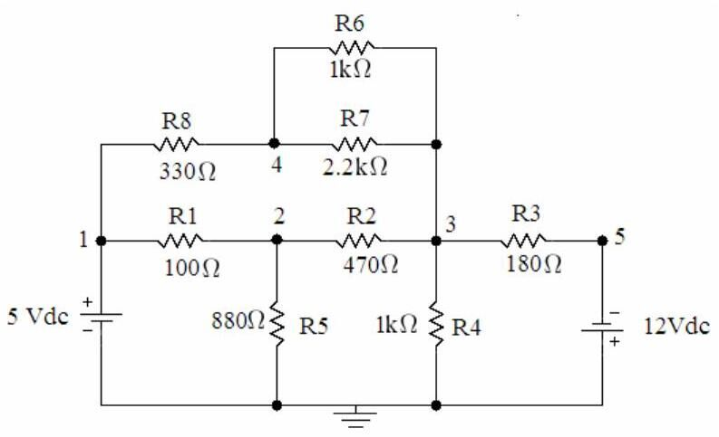
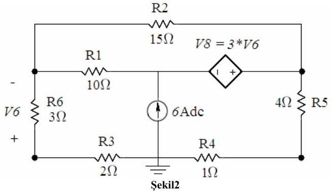
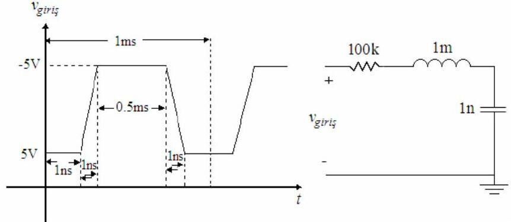

Bu yazı, Başkent Üniversitesi **EEM 214 Electronics I** dersinde PSpice'ı tanıtmak için verilen **Pspice Çalışması** föyünü (Mart 2008), laboratuvarda dağıtılan **How to add an Include File** notunu ve bir öğrencinin 2012'de hazırladığı Türkçe, ekran görüntülü PSpice kullanım notunu bir araya getiriyor. Belgeler yazının sonunda ZIP olarak indirilebilir.

## Pspice Çalışması (2008)

### 1. Bias point ve transient analiz

Şekil 1'deki devrenin şematiğini "OrCAD Capture" programı ile çiziniz. Simülasyonun çalışması için toprak sembolünün adının **"0"** olmasına dikkat ediniz.

- a. PSpice/New Simulation Profile seçeneğinde "analysis type" olarak **Bias Point** seçip simülasyonu çalıştırınız.
- b. OrCAD Capture'da "I" ve "V" düğmeleriyle elemanlardan geçen akımları ve düğüm gerilimlerini bulup not ediniz.
- c. PSpice/Edit Simulation Profile ile analiz türünü **Time Domain (Transient)** yapınız; çalışma süresi 10 s, adım 10 ms seçip eleman gerilimlerinin değişimini gerilim problarıyla gözlemleyiniz.

### 2. DC sweep

Şekil 2'deki devreyi (bağımlı gerilim kaynağı V8 = 3·V6 ve 6 A'lik bağımsız akım kaynağı içeren) çizip yeni bir simülasyon profili oluşturunuz. Analiz türü **DC Sweep**, "sweep variable" olarak bağımsız akım kaynağı, lineer tarama: −6 A'den +6 A'e 0.5 A adımlarla. V_R3 ve V_R4 değişimlerini "PSpice A/D" penceresinde elde ediniz.

### 3. Kare dalga ile transient analiz

Şekil 3'teki devreyi (100 kΩ – 1 mH – 1 nF seri RLC, girişte yükselme ve düşme süreleri 1 ns olan ±5 V, 1 ms periyotlu darbe) çiziniz.

- a. Analiz türü **Time Domain (Transient)**; çalışma süresini ve adım aralığını girişteki kare dalgaya uygun seçiniz. Kondansatör gerilimini R = 100 kΩ, 2 kΩ ve 68 Ω için ayrı ayrı gözlemleyiniz.
- b. Giriş işaretinin periyodunu PER = 0.01 ms, darbe genişliğini PW = 0.005 ms yapıp aynı üç direnç değeri için tekrarlayınız.

### 4. Parametrik AC sweep

Şekil 4'teki devreyi (V_in = 10 V, R_f = 4 Ω, C_f = 2.0 µF seri, çıkışta L_f = 127 µH) çiziniz. Analiz türü **AC Sweep/Noise**, seçenek olarak **Parametric Sweep**; "sweep variable" R_f, lineer 4 Ω'dan 8 Ω'a 2 Ω adımla. Giriş kaynağı VAC (ACMAG = 10 V), AC sweep logaritmik, başlangıç 100 Hz (asla 0 Hz olamaz), bitiş 1 MHz, onkatta 1000 nokta. Frekans tepkisini (DB(v_out/v_in)) R_f = 4, 6 ve 8 Ω için aynı "Probe Window"da elde ediniz.

")

*Not: Bu devre bir seri RLC yüksek geçiren filtredir; rezonans frekansı f₀ = 1/(2π√(L_f·C_f)) = 1/(2π√(127 µH × 2 µF)) ≈ 10 kHz civarındadır ve R_f arttıkça rezonanstaki tepe yayvanlaşır.*

### Raporda istenenler

1. 1.a ve 1.b'de elde edilen sonuçları OrCAD Capture şekli üzerinde gösteriniz.
1. 1.c'deki eleman gerilimlerini tablo hâlinde, V_R1, V_R2, V_R3 değişimlerini grafik olarak veriniz.
1. 2'de elde edilen V_R3, V_R4 grafiklerini veriniz.
1. 3.a ve 3.b'de üç direnç değeri için kondansatör geriliminin değişimini grafik olarak veriniz.
1. 4. soruda üç direnç değeri için frekans tepkilerini veriniz.

## How to add an Include File

Include dosyaları C'deki başlık (header) dosyaları gibidir: simülasyona her türlü geçerli SPICE kodunu (netlist, uyarım, model) eklemek için kullanılır. Sözdizimi `.INC "<filename>"`; bu satırla dosyanın içeriği SPICE girdisine eklenir.

- Ana menüden **PSpice → New Simulation Profile** (ya da var olan profili düzenleyin) seçilip **Libraries** sekmesine geçilir.
- Model dosyası (örneğin `diode.lib`) **Browse** ile bulunur. Önemli: dosya penceresi varsayılan olarak yalnız `.inc` uzantılı dosyaları gösterir; "tüm dosyalar" seçilmezse `.lib` görünmez.
- **Add as Global** ile eklenir.

Kütüphane (.olb) eklemek için: **Place → Part**, **Add New Library**, ilgili `.olb` dosyası (örneğin `diode.olb`) seçilip eklenir. Bu yöntem laboratuvarda BC238B, CD4007 ve föylerle verilen diyot modellerini eklemek için kullanılıyordu.

## Öğrencinin PSpice kullanım notu (2012)

Bir öğrencinin ekran görüntüleriyle hazırladığı kısa not şu adımları anlatıyor: File → New → Project ile projeye isim verip **Create a blank project** seçmek; devreyi kurmak; PSpice → **New Simulation** ile profil oluşturup "Run to time" alanına süreyi girmek; açılan pencerede **Trace → Add Trace** ile istenen grafiği seçmek, başka bir grafik için **Plot → Add Plot to Window** kullanmak; pencere açılmazsa devre ekranındaki çalıştır (play) tuşuna basmak; grafikleri **Window → Copy to Clipboard** ile kopyalamak ve simülasyondan sonra devre üzerindeki V, I, P düğmeleriyle gerilim, akım ve güçleri görmek.

## İndirme

ZIP dosyasında Pspice Çalışması föyünün PDF'i, "How to add an Include File" Word belgesi ve öğrencinin kullanım notunun PDF kopyası bulunuyor.
