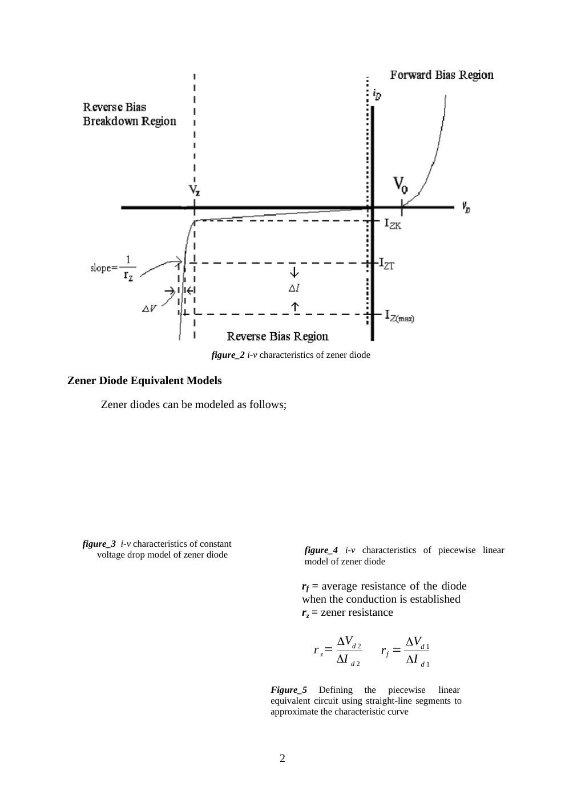
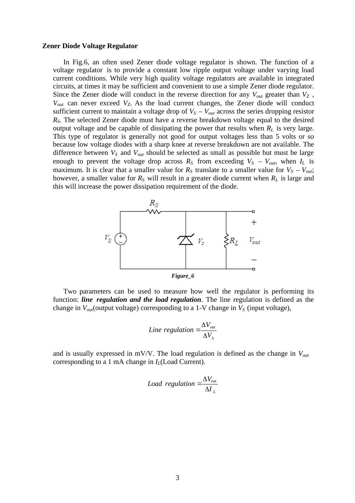

Bu yazı, Başkent Üniversitesi EEM214 Elektronik I laboratuvarının **Zener Diode Characteristics & Zener Diode Voltage Regulator** başlıklı Deney 5 föyüdür. Belgede hazırlayan ve tarih belirtilmemiştir; kaynak kopyası Mart 2015 tarihlidir. İngilizce deney yönergeleri aşağıda metne aktarıldı; Word belgesinden dönüştürülen PDF yazının sonunda indirilebilir. Bu deneyin önceki yıllardaki sonuçları [Zener öğrenci raporları](/arsiv/eem214-lab-zener-raporlar/) yazısındadır.

## Aim and theory

The aim is to investigate the i–v characteristics of Zener diodes and their application to voltage regulation. A Zener diode is optimized for operation in the reverse breakdown region. In the forward direction it behaves as a normal diode.

Above the knee current I_ZK, the reverse characteristic is approximately a straight line. The specified Zener voltage is measured at a test current I_ZT: for example, a 6.8 V device may have this drop at 10 mA. Changes near the operating point obey:

- ΔV = r_z ΔI
- r_z = ΔV_d2 / ΔI_d2
- r_f = ΔV_d1 / ΔI_d1

The incremental or dynamic resistance r_z is the inverse slope of the characteristic at Q. Typical values in the handout range from a few ohms to a few tens of ohms. Smaller r_z gives more nearly constant voltage. Near the knee, r_z increases and regulation becomes poorer. The voltage, dynamic resistance, knee current and maximum power rating must all be considered.

*Not: Word kaynağındaki bazı gömülü model çizimleri PDF dönüşümünde görünmüyor. Eksik çizimler tahminle tamamlanmadı; okunabilen karakteristik ve denklemler aktarıldı.*

## Voltage regulator

The circuit contains a source V_S, series resistance R_S, and a reverse-connected Zener in parallel with R_L. The aim is to keep V_out approximately constant as source voltage and load current change. The diode must support the desired output voltage and dissipate the power occurring at large R_L. A smaller R_S improves the available load current but increases the diode current and dissipation at light load.

- Line regulation = ΔV_out / ΔV_S, usually expressed in mV/V.
- Load regulation = ΔV_out / ΔI_L, usually expressed in mV/mA.

*Not: Föy, ideal modele dayanarak çıkışın V_Z’yi aşamayacağını söylüyor. Gerçek diyotta r_z sıfır olmadığından çıkış gerilimi akımla bir miktar değişir; aynı föyün ΔV = r_z ΔI bağıntısı bunu ifade eder.*

## Preliminary work

1. Review textbook sections 3.6 and 3.12.
1. Construct the circuit of Figure 7 in PSpice with R = 1 kΩ and a 1N750 Zener. Sweep V_in from −20 V to +10 V and plot diode current against diode voltage. Change the graph’s horizontal variable to the diode voltage.
1. Briefly describe the difference between a Zener diode and a standard diode.
1. For the regulator of Figure 6, use V_Z = 6.8 V at I_ZT = 5 mA, r_z = 20 Ω, I_ZK = 0.2 mA, and a nominal supply V_S = 10 V varying by ±1 V. Find the model’s Zener voltage; V_out with no load and R_S = 0.5 kΩ; the output change for the supply variation; the output change after connecting R_L = 2 kΩ; V_out at R_L = 0.5 kΩ; and the minimum R_L for which breakdown operation continues.
1. Read the experimental procedure.

## Part I: Zener diode test

Check the diode with the DMM’s diode function. For a Zener voltage above the meter’s test voltage, forward connection acts like a normal silicon diode and reverse connection appears as high resistance. Record the displayed forward and reverse values and decide whether the device is good or defective.

The handout gives a forward reading of 0.500–0.900 V and describes a blinking “000.0” in reverse connection.

*Not: Ters yöndeki ekran gösterimi multimetre modeline bağlıdır; “000.0” ifadesi bütün ölçü aletlerine genellenemez.*

## Part II: Forward and reverse characteristics

Use R = 330 Ω and a BZX55C 6.2 V Zener. Increase the supply until the measured forward diode voltage reaches each target; record actual voltage and current.

| Target diode voltage (V) | Measured voltage (V) | Measured current (mA) |
|---|---|---|
| 0.35 | | |
| 0.45 | | |
| 0.55 | | |
| 0.60 | | |
| 0.65 | | |
| 0.70 | | |
| 0.75 | | |
| 0.80 | | |

Reverse the diode and record V_Z and I_Z for applied voltages **3.5, 4, 4.5, 5, 5.5, 6, 6.5, 7, 7.5, 8, 9, 10, 11, 12, 13, 14 and 15 V**. Plot the complete i–v curve on graph paper or in Excel and label its operating regions.

## Part III: Zener regulator

1. Construct the regulator with BZX55C and R_S = 390 Ω.
1. Measure stabilized V_out at V_S = 12 V and 8 V, first with R_L = 820 Ω, then with 330 Ω.
1. Repeat for R_S = 620 Ω and 100 Ω.

| R_S | V_S = 12 V, R_L = 820 Ω | V_S = 12 V, R_L = 330 Ω | V_S = 8 V, R_L = 820 Ω | V_S = 8 V, R_L = 330 Ω |
|---|---|---|---|---|
| 620 Ω | | | | |
| 390 Ω | | | | |
| 100 Ω | | | | |

For all twelve combinations:

1. Calculate load current I_L and Zener current I_Z.
1. Calculate line regulation at each fixed R_L, then load regulation at each fixed V_S.
1. Identify cases where I_Z approaches zero and regulation is lost. In this condition V_out depends on V_S, R_S and R_L rather than the breakdown voltage.
1. Calculate P_Z and P_RS; compare with the components’ maximum ratings.
1. Predict the voltage across a Zener accidentally reversed in the regulator.
1. Decide which R_S gives the best overall regulation and explain the other cases.

The handout’s finite-difference expressions are:

- Line regulation = 1000(V_out,max − V_out,min)/(V_S,max − V_S,min), at constant R_L, in mV/V.
- Load regulation = (V_out,max − V_out,min)/(I_L,max − I_L,min), at constant V_S, in mV/mA when consistent units are used.

## Equipment and result sheet

Breadboard, multimeter, DC power supply; one BZX55C 6.2 V Zener and resistors of 100 Ω, 390 Ω, 620 Ω, 330 Ω and 820 Ω. The final page repeats the forward, reverse and regulator tables as a blank result sheet.
