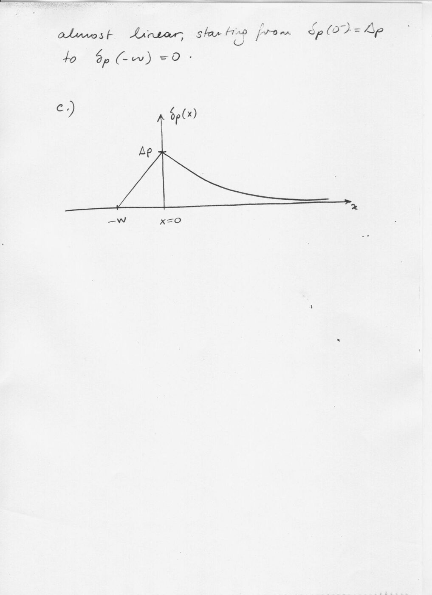
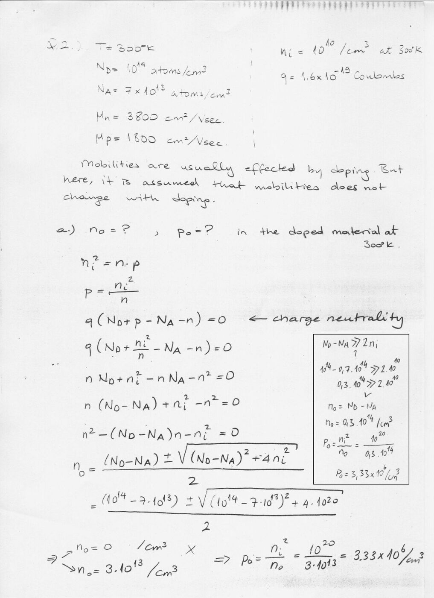
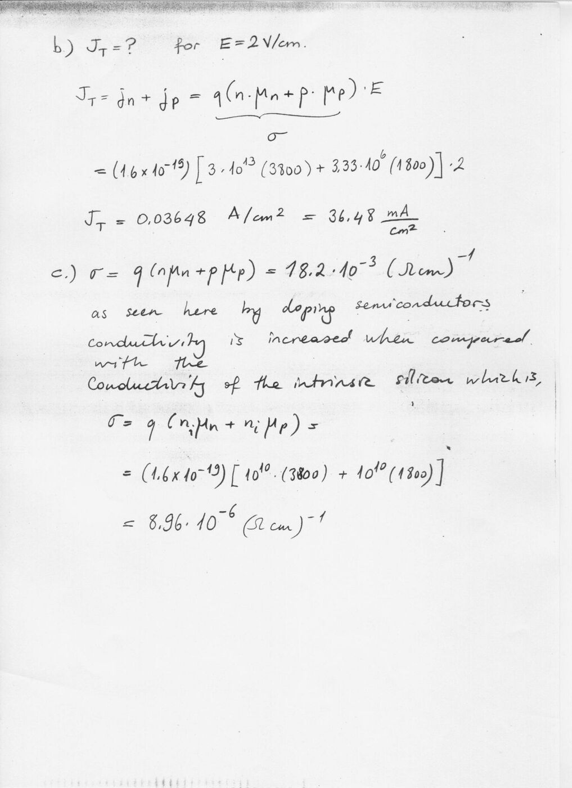
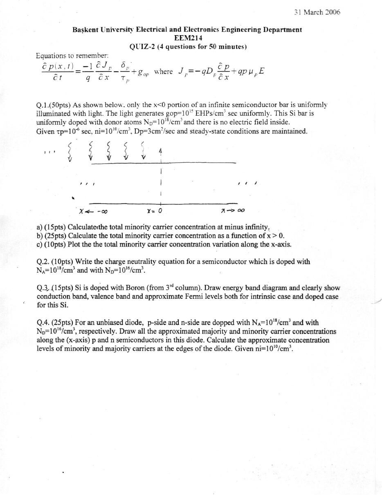
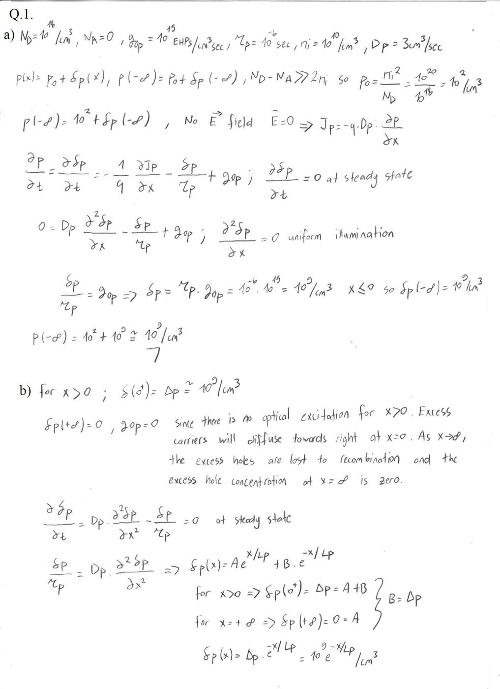
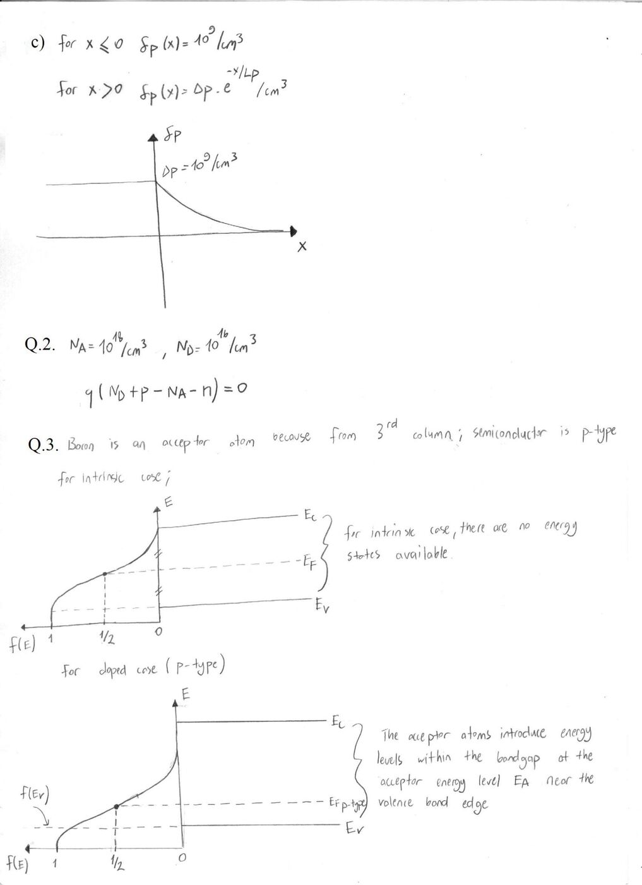
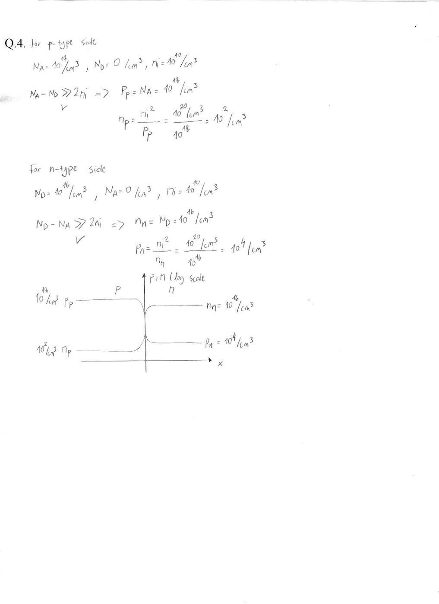
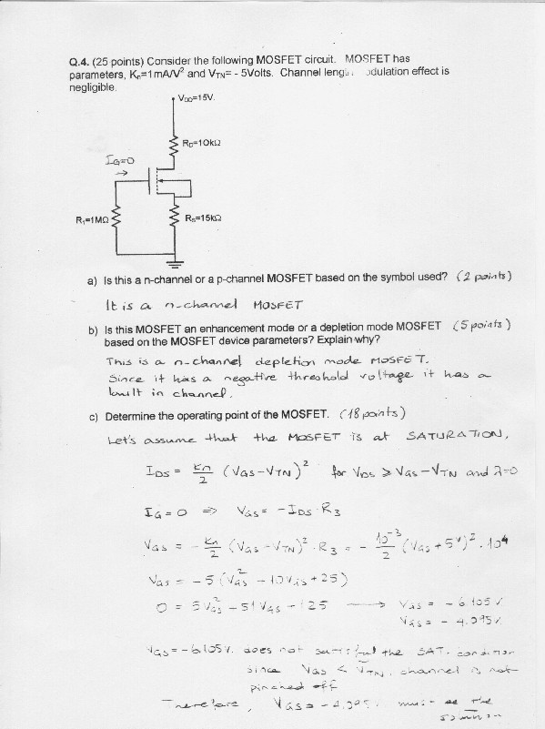
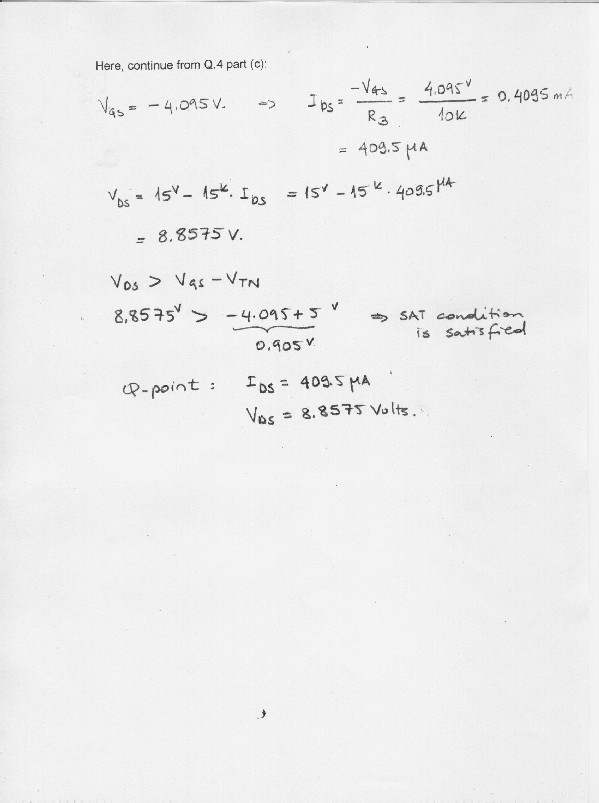
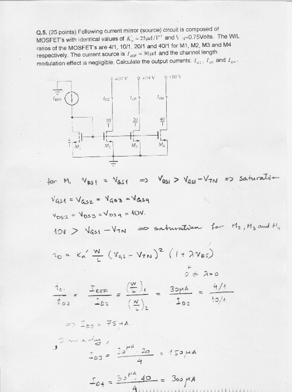

This post brings together the solutions to three quizzes from the spring 2006 semester of **EEM214 Electronics I** in the Department of Electrical and Electronics Engineering at Başkent University. The solutions consist of handwritten, scanned pages; the problem sheet is also included at the beginning of Quiz 2 (March 31, 2006). Alongside the page images, the headings, main equations and results are written out as text. The original PDFs were password-protected; the ZIP file at the end of the post contains copies with the password removed.

## Quiz 1

### Problem 1: Continuous injection of excess holes

The problem sheet is not in the file; as far as can be understood from the solution, holes are continuously injected into a semiconductor bar from x = 0, and the electric field is zero.

**a)** Steady state and continuous injection ⇒ ∂p/∂t = 0. E = 0 ⇒ no drift current; for x > 0, J_p = −q·D_p·dp/dx = −q·D_p·dδp/dx. From the continuity equation:

0 = D_p·d²δp/dx² − δp/τ_p

δp(x) = A·e^(x/L_p) + B·e^(−x/L_p). As x → ∞, δp → 0 ⇒ A = 0; with δp = Δp at x = 0, for x ≥ 0:

δp(x) = Δp·e^(−x/L_p)

**b)** On the x < 0 side, there is an ohmic contact at x = −W, where δp(−W) = 0. In the solution, the conditions δp(0⁻) = C + D = Δp and δp(−W) = 0 give C = 0, D = Δp; since W ≪ L_p, the decrease in the negative direction is taken to be nearly linear: from δp(0⁻) = Δp to δp(−W) = 0.

*Note: The solution takes C = 0, D = Δp; however, in that case δp(−W) = Δp·e^(−W/L_p) ≠ 0 and the boundary condition is not satisfied. The solution that satisfies both conditions together is δp(x) = Δp·sinh((W − |x|)/L_p)/sinh(W/L_p); for W ≪ L_p this approaches the linear profile the solution arrives at, δp ≈ Δp·(1 − |x|/W). The result is correct; the intermediate step is wrong.*

**c)** Profile: a curve rising linearly to Δp between −W and 0, and decaying exponentially for x > 0.

")

### Problem 2: Carriers and conductivity in doped silicon

Data: T = 300 K, N_D = 10¹⁴ atoms/cm³, N_A = 7×10¹³ atoms/cm³, μ_n = 3800 cm²/V·s, μ_p = 1800 cm²/V·s, n_i = 10¹⁰/cm³, q = 1.6×10⁻¹⁹ C. The mobilities are assumed not to change with doping.

**a)** n_i² = n·p and charge neutrality q·(N_D + p − N_A − n) = 0 ⇒ n² − (N_D − N_A)·n − n_i² = 0:

n_o = [(N_D − N_A) ± √((N_D − N_A)² + 4n_i²)] / 2 ⇒ n_o = 3×10¹³/cm³ (the n_o = 0 root is discarded)

p_o = n_i²/n_o = 10²⁰/(3×10¹³) = 3.33×10⁶/cm³

Shortcut: since N_D − N_A = 0.3×10¹⁴ ≫ 2n_i, n_o = N_D − N_A.

**b)** Total current density for E = 2 V/cm:

J_T = J_n + J_p = q·(n·μ_n + p·μ_p)·E = (1.6×10⁻¹⁹)·[3×10¹³·3800 + 3.33×10⁶·1800]·2 = 0.03648 A/cm² = 36.48 mA/cm²

**c)** σ = q·(n·μ_n + p·μ_p) = 18.2×10⁻³ (Ω·cm)⁻¹. Through doping, the conductivity has increased greatly relative to that of intrinsic silicon: σ_i = q·n_i·(μ_n + μ_p) = (1.6×10⁻¹⁹)·10¹⁰·(3800 + 1800) = 8.96×10⁻⁶ (Ω·cm)⁻¹.

## Quiz 2 (March 31, 2006)

Başkent University Electrical and Electronics Engineering Department, EEM214, Quiz-2 (4 questions for 50 minutes). Equations to remember:

∂p(x,t)/∂t = −(1/q)·∂J_p/∂x − δ_p/τ_p + g_op, where J_p = −q·D_p·∂p/∂x + q·p·μ_p·E

**Q.1 (50 pts)** Only the x < 0 portion of an infinite semiconductor bar is uniformly illuminated with light. The light generates g_op = 10¹⁵ EHPs/cm³·sec uniformly. This Si bar is uniformly doped with donor atoms N_D = 10¹⁸/cm³ and there is no electric field inside. Given τ_p = 10⁻⁶ sec, n_i = 10¹⁰/cm³, D_p = 3 cm²/sec and steady-state conditions are maintained. a) (15 pts) Calculate the total minority carrier concentration at minus infinity. b) (25 pts) Calculate the total minority carrier concentration as a function of x > 0. c) (10 pts) Plot the total minority carrier concentration variation along the x-axis.

**Q.2 (10 pts)** Write the charge neutrality equation for a semiconductor which is doped with N_A = 10¹⁸/cm³ and with N_D = 10¹⁶/cm³.

**Q.3 (15 pts)** Si is doped with Boron (from 3rd column). Draw the energy band diagram and clearly show the conduction band, valence band and approximate Fermi levels both for the intrinsic case and the doped case for this Si.

**Q.4 (25 pts)** For an unbiased diode, the p-side and n-side are doped with N_A = 10¹⁸/cm³ and N_D = 10¹⁶/cm³, respectively. Draw all the approximated majority and minority carrier concentrations along the x-axis in p and n semiconductors in this diode. Calculate the approximate concentration levels of minority and majority carriers at the edges of the diode. Given n_i = 10¹⁰/cm³.

### Solutions

**Q.1 a)** p_o = n_i²/N_D = 10²⁰/10¹⁸ = 10²/cm³. Under uniform illumination ∂²δp/∂x² = 0, and in steady state 0 = −δp/τ_p + g_op ⇒ δp = τ_p·g_op = 10⁻⁶·10¹⁵ = 10⁹/cm³. Thus p(−∞) = 10² + 10⁹ ≅ 10⁹/cm³.

**b)** For x > 0 there is no optical generation; the excess carriers diffuse to the right and vanish by recombination, δp(+∞) = 0. D_p·d²δp/dx² = δp/τ_p ⇒ δp(x) = A·e^(x/L_p) + B·e^(−x/L_p); δp(+∞) = 0 ⇒ A = 0, δp(0⁺) = Δp ⇒ B = Δp:

δp(x) = Δp·e^(−x/L_p) = 10⁹·e^(−x/L_p) /cm³

**c)** For x ≤ 0, δp = 10⁹/cm³ is constant; for x > 0, exponential decay.

**Q.2** q·(N_D + p − N_A − n) = 0

**Q.3** Boron, from the 3rd column, is an acceptor atom; the semiconductor becomes p-type. In the intrinsic case E_F is near the middle of the band gap; in the p-type case the acceptors create E_A energy levels near the valence band edge and E_F moves closer to the valence band.

**Q.4** p side: p_p = N_A = 10¹⁸/cm³, n_p = n_i²/p_p = 10²/cm³. n side: n_n = N_D = 10¹⁶/cm³, p_n = n_i²/n_n = 10⁴/cm³.

## Quiz 3 (May 2006)

The first four pages of Quiz 3 are low-resolution, blurry photographs; they can be seen in the PDF in the ZIP but are not legible enough to be transcribed. The legible parts are: in Problem 1, determining the operating region from the given voltages for NPN and PNP BJTs and a circuit; in Problem 2, computing β_R using the transport model equations (result β_R = 0.5); in Problem 3, current and voltage calculation with the transport model and resistor selection in a biasing circuit. The last two problems are legible:

**Q.4 (25 points)** Consider the following MOSFET circuit. The MOSFET has parameters K_n = 1 mA/V² and V_TN = −5 Volts. Channel length modulation effect is negligible. (Circuit: V_DD = 15 V, R_D = 10 kΩ, R_S = 15 kΩ, gate connected to ground through R₁ = 1 MΩ.)

- a) Is this an n-channel or a p-channel MOSFET based on the symbol used? (2 points) — *It is an n-channel MOSFET.*
- b) Is this MOSFET an enhancement mode or a depletion mode MOSFET based on the device parameters? Explain why. (5 points) — *This is an n-channel depletion mode MOSFET. Since it has a negative threshold voltage, it has a built-in channel.*
- c) Determine the operating point of the MOSFET. (18 points)

Solution: assume it is in saturation, I_DS = (K_n/2)·(V_GS − V_TN)². I_G = 0 ⇒ V_GS = −I_DS·R_S. In the solution, R_S is replaced by 10 kΩ, giving 0 = 5V_GS² + 51V_GS + 125; the roots are V_GS = −6.105 V and −4.095 V. V_GS = −6.105 V is discarded since V_GS < V_TN (channel pinched off, no conduction). With V_GS = −4.095 V, I_DS = 4.095/10k = 409.5 µA, V_DS = 15 − 15k·I_DS = 8.8575 V; since V_DS > V_GS − V_TN = 0.905 V, the saturation condition is satisfied. The Q point in the solution: I_DS = 409.5 µA, V_DS = 8.8575 V.

*Note: In the figure R_S = 15 kΩ and R_D = 10 kΩ are given; the solution, however, uses R_S = 10 kΩ in the V_GS equation and only 15 kΩ in the V_DS calculation. With the values in the figure, 0 = 7.5V_GS² + 76V_GS + 187.5 ⇒ V_GS ≈ −4.25 V, I_DS = 4.25/15k ≈ 283 µA and V_DS = 15 − (10k + 15k)·I_DS ≈ 7.92 V are obtained (the saturation condition is again satisfied).*

**Q.5 (25 points)** The following current mirror (source) circuit is composed of MOSFETs with identical values of K_n′ = 25 µA/V² and V_TN = 0.75 Volts. The W/L ratios of the MOSFETs are 4/1, 10/1, 20/1 and 40/1 for M1, M2, M3 and M4 respectively. The current source is I_REF = 30 µA and the channel length modulation effect is negligible. Calculate the output currents I_O2, I_O3 and I_O4.

Solution: In M1, V_DS1 = V_GS1 ⇒ V_DS1 > V_GS1 − V_TN, so it is in saturation. V_GS1 = V_GS2 = V_GS3 = V_GS4 and V_DS2 = V_DS3 = V_DS4 = 10 V > V_GS1 − V_TN ⇒ M2, M3 and M4 are also in saturation. With λ = 0, the currents scale only with the W/L ratios:

- I_REF/I_D2 = (W/L)₁/(W/L)₂ ⇒ 30 µA/I_D2 = (4/1)/(10/1) ⇒ I_D2 = 75 µA
- I_D3 = 30 µA·20/4 = 150 µA
- I_D4 = 30 µA·40/4 = 300 µA

