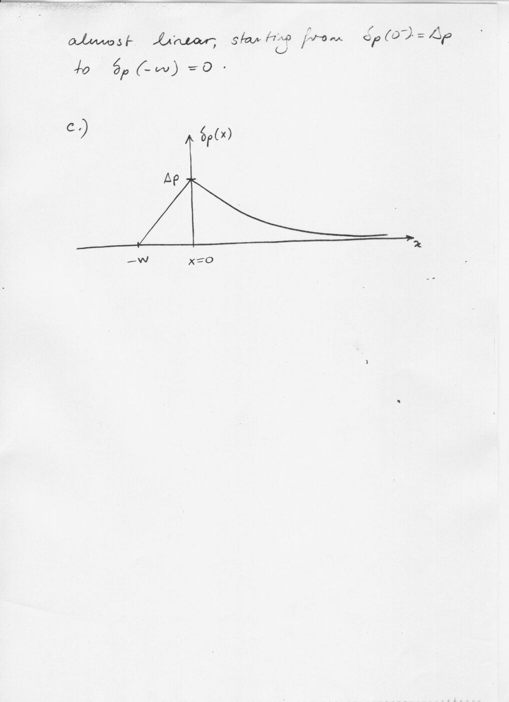
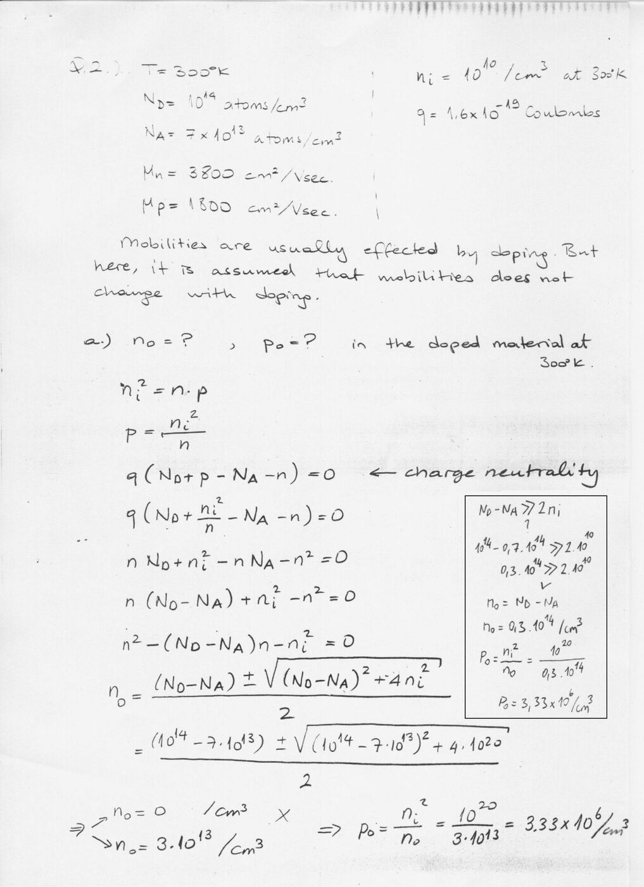
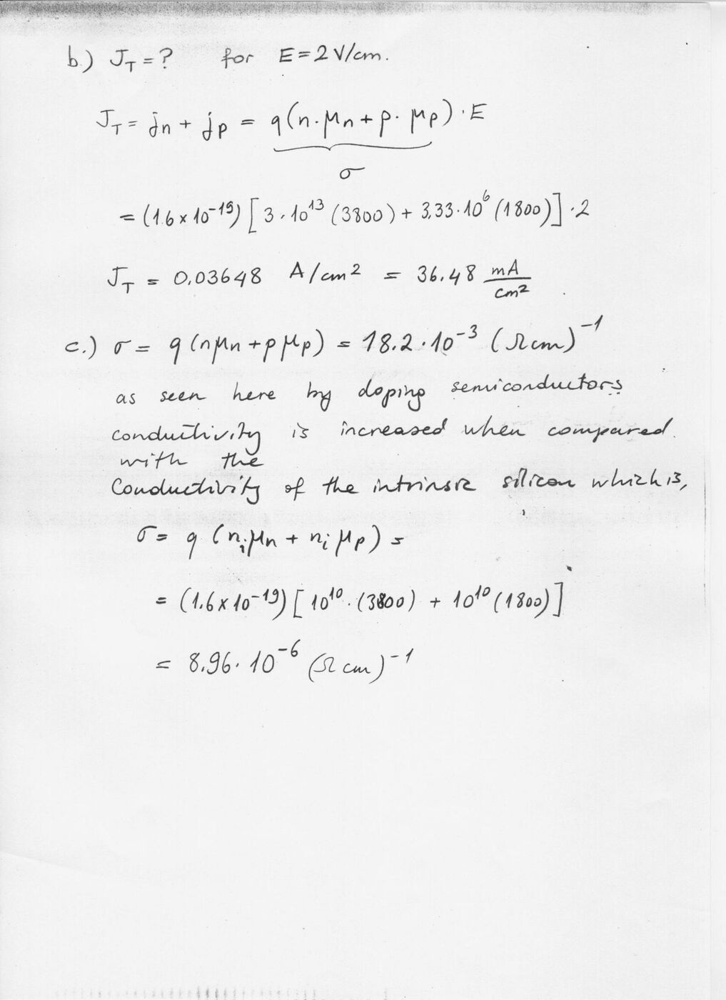
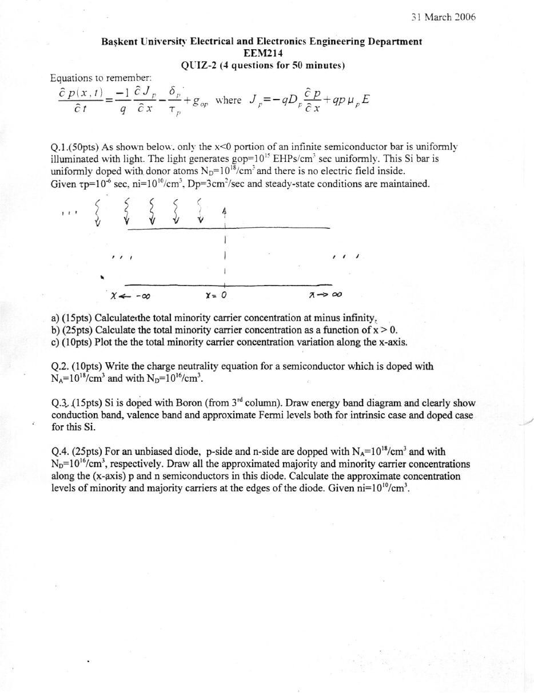
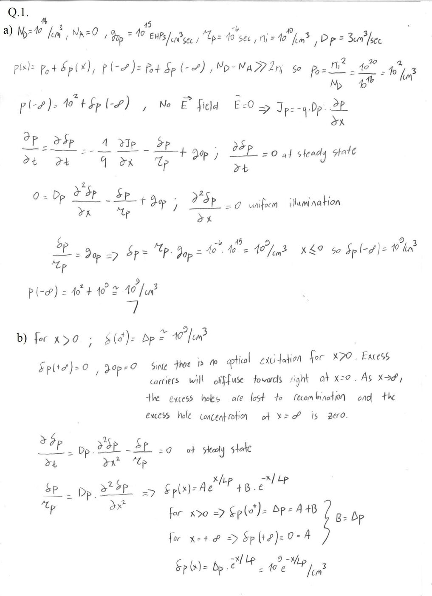
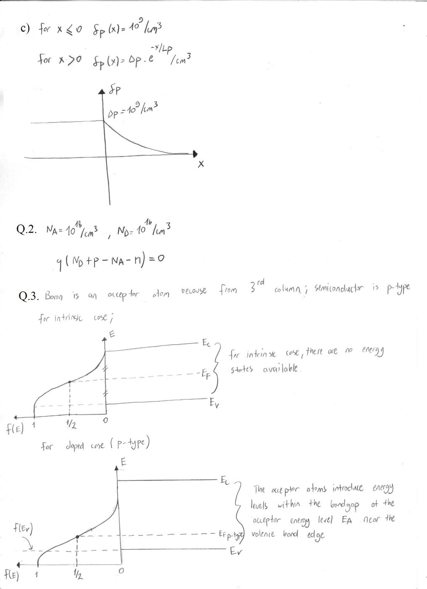
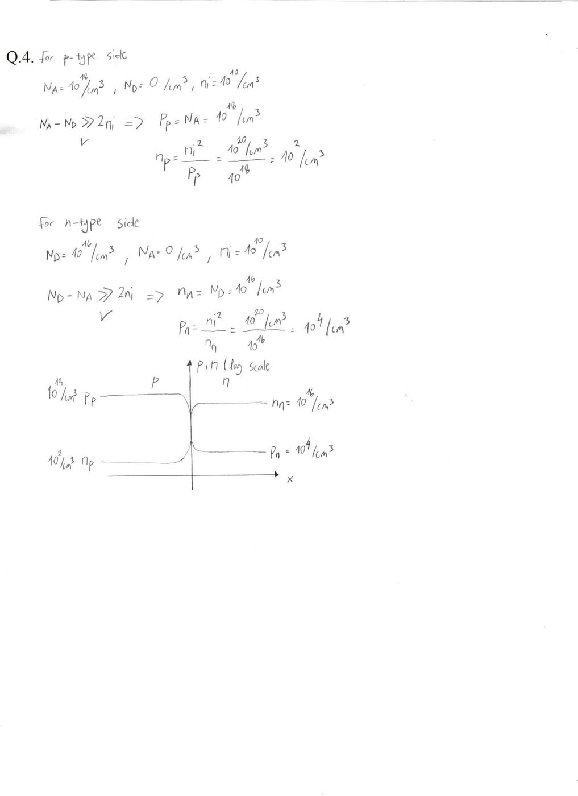
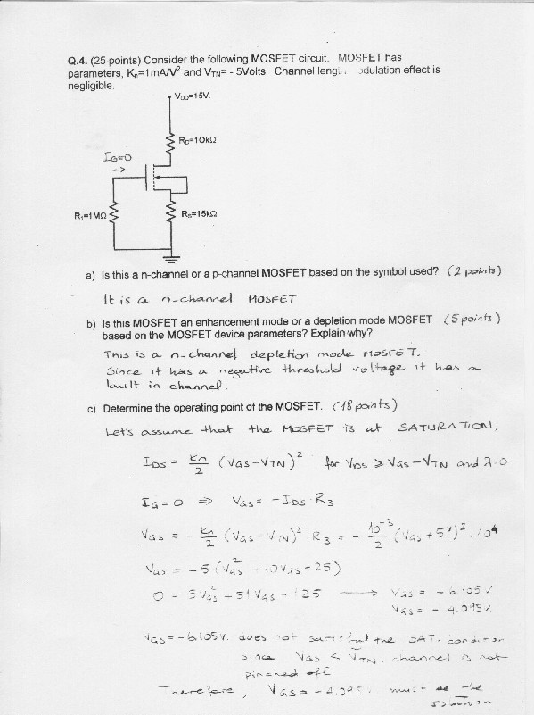
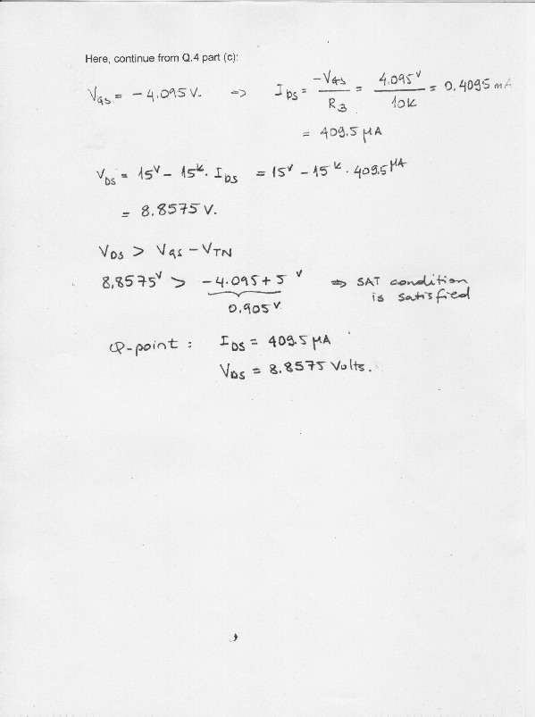
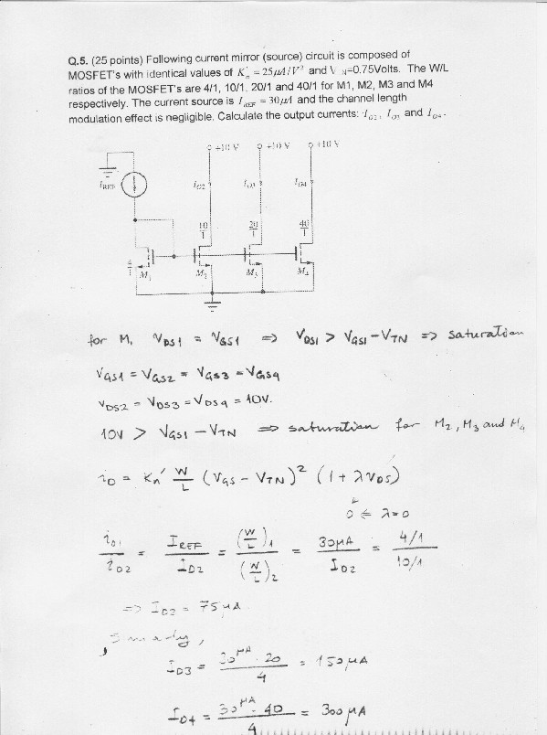

Bu yazı, Başkent Üniversitesi Elektrik-Elektronik Mühendisliği **EEM214 Elektronik I** dersinin 2006 bahar dönemine ait üç quizin çözümlerini bir araya getiriyor. Çözümler el yazısı ve taranmış sayfalardan oluşuyor; Quiz 2'nin başında soru kâğıdı da var (31 Mart 2006). Sayfa görsellerinin yanında başlıklar, ana denklemler ve sonuçlar metin olarak yazıldı. Orijinal PDF'ler parolalıydı; yazının sonundaki ZIP dosyasında parolası kaldırılmış kopyaları bulunuyor.

## Quiz 1

### Soru 1: Fazla deliklerin sürekli enjeksiyonu

Soru kâğıdı dosyada yok; çözümden anlaşıldığı kadarıyla bir yarıiletken çubuğa x = 0'dan sürekli delik enjekte ediliyor, elektrik alan sıfır.

**a)** Kararlı durum ve sürekli enjeksiyon ⇒ ∂p/∂t = 0. E = 0 ⇒ sürüklenme akımı yok; x > 0 için J_p = −q·D_p·dp/dx = −q·D_p·dδp/dx. Süreklilik denkleminden:

0 = D_p·d²δp/dx² − δp/τ_p

δp(x) = A·e^(x/L_p) + B·e^(−x/L_p). x → ∞ için δp → 0 ⇒ A = 0; x = 0'da δp = Δp ⇒ x ≥ 0 için:

δp(x) = Δp·e^(−x/L_p)

**b)** x < 0 tarafında, x = −W'de omik kontak var ve orada δp(−W) = 0. Çözümde δp(0⁻) = C + D = Δp ve δp(−W) = 0 koşullarından C = 0, D = Δp bulunuyor; W ≪ L_p olduğu için azalma negatif yönde neredeyse doğrusal kabul ediliyor: δp(0⁻) = Δp'den δp(−W) = 0'a.

*Not: Çözümde C = 0, D = Δp alınıyor; ancak bu durumda δp(−W) = Δp·e^(−W/L_p) ≠ 0 olur ve sınır koşulu sağlanmaz. İki koşulu birlikte sağlayan çözüm δp(x) = Δp·sinh((W − |x|)/L_p)/sinh(W/L_p) ifadesidir; W ≪ L_p için bu, çözümün vardığı doğrusal profile, δp ≈ Δp·(1 − |x|/W), yaklaşır. Sonuç doğru, ara adım hatalı.*

**c)** Profil: −W ile 0 arasında Δp'ye doğrusal yükselen, x > 0'da üstel azalan bir eğri.

")

### Soru 2: Katkılı silisyumda taşıyıcılar ve iletkenlik

Veriler: T = 300 K, N_D = 10¹⁴ atom/cm³, N_A = 7×10¹³ atom/cm³, μ_n = 3800 cm²/V·s, μ_p = 1800 cm²/V·s, n_i = 10¹⁰/cm³, q = 1.6×10⁻¹⁹ C. Mobilitelerin katkıyla değişmediği varsayılıyor.

**a)** n_i² = n·p ve yük nötrlüğü q·(N_D + p − N_A − n) = 0 ⇒ n² − (N_D − N_A)·n − n_i² = 0:

n_o = [(N_D − N_A) ± √((N_D − N_A)² + 4n_i²)] / 2 ⇒ n_o = 3×10¹³/cm³ (n_o = 0 kökü atılıyor)

p_o = n_i²/n_o = 10²⁰/(3×10¹³) = 3.33×10⁶/cm³

Kısa yol: N_D − N_A = 0.3×10¹⁴ ≫ 2n_i olduğundan n_o = N_D − N_A.

**b)** E = 2 V/cm için toplam akım yoğunluğu:

J_T = J_n + J_p = q·(n·μ_n + p·μ_p)·E = (1.6×10⁻¹⁹)·[3×10¹³·3800 + 3.33×10⁶·1800]·2 = 0.03648 A/cm² = 36.48 mA/cm²

**c)** σ = q·(n·μ_n + p·μ_p) = 18.2×10⁻³ (Ω·cm)⁻¹. Katkılamayla iletkenlik, içsel silisyumun iletkenliğine göre çok artmış: σ_i = q·n_i·(μ_n + μ_p) = (1.6×10⁻¹⁹)·10¹⁰·(3800 + 1800) = 8.96×10⁻⁶ (Ω·cm)⁻¹.

## Quiz 2 (31 Mart 2006)

Başkent University Electrical and Electronics Engineering Department, EEM214, Quiz-2 (4 questions for 50 minutes). Equations to remember:

∂p(x,t)/∂t = −(1/q)·∂J_p/∂x − δ_p/τ_p + g_op, where J_p = −q·D_p·∂p/∂x + q·p·μ_p·E

**Q.1 (50 pts)** Only the x < 0 portion of an infinite semiconductor bar is uniformly illuminated with light. The light generates g_op = 10¹⁵ EHPs/cm³·sec uniformly. This Si bar is uniformly doped with donor atoms N_D = 10¹⁸/cm³ and there is no electric field inside. Given τ_p = 10⁻⁶ sec, n_i = 10¹⁰/cm³, D_p = 3 cm²/sec and steady-state conditions are maintained. a) (15 pts) Calculate the total minority carrier concentration at minus infinity. b) (25 pts) Calculate the total minority carrier concentration as a function of x > 0. c) (10 pts) Plot the total minority carrier concentration variation along the x-axis.

**Q.2 (10 pts)** Write the charge neutrality equation for a semiconductor which is doped with N_A = 10¹⁸/cm³ and with N_D = 10¹⁶/cm³.

**Q.3 (15 pts)** Si is doped with Boron (from 3rd column). Draw the energy band diagram and clearly show the conduction band, valence band and approximate Fermi levels both for the intrinsic case and the doped case for this Si.

**Q.4 (25 pts)** For an unbiased diode, the p-side and n-side are doped with N_A = 10¹⁸/cm³ and N_D = 10¹⁶/cm³, respectively. Draw all the approximated majority and minority carrier concentrations along the x-axis in p and n semiconductors in this diode. Calculate the approximate concentration levels of minority and majority carriers at the edges of the diode. Given n_i = 10¹⁰/cm³.

### Çözümler

**Q.1 a)** p_o = n_i²/N_D = 10²⁰/10¹⁸ = 10²/cm³. Düzgün aydınlatmada ∂²δp/∂x² = 0 ve kararlı durumda 0 = −δp/τ_p + g_op ⇒ δp = τ_p·g_op = 10⁻⁶·10¹⁵ = 10⁹/cm³. Böylece p(−∞) = 10² + 10⁹ ≅ 10⁹/cm³.

**b)** x > 0'da optik üretim yok; fazla taşıyıcılar sağa doğru yayılır ve yeniden birleşerek kaybolur, δp(+∞) = 0. D_p·d²δp/dx² = δp/τ_p ⇒ δp(x) = A·e^(x/L_p) + B·e^(−x/L_p); δp(+∞) = 0 ⇒ A = 0, δp(0⁺) = Δp ⇒ B = Δp:

δp(x) = Δp·e^(−x/L_p) = 10⁹·e^(−x/L_p) /cm³

**c)** x ≤ 0 için δp = 10⁹/cm³ sabit, x > 0 için üstel azalma.

**Q.2** q·(N_D + p − N_A − n) = 0

**Q.3** Bor, 3. sütundan bir akseptör atomudur; yarıiletken p tipi olur. İçsel durumda E_F bant aralığının ortasına yakındır; p tipinde akseptörler valans bandı kenarına yakın E_A enerji seviyeleri oluşturur ve E_F valans bandına yaklaşır.

**Q.4** p tarafı: p_p = N_A = 10¹⁸/cm³, n_p = n_i²/p_p = 10²/cm³. n tarafı: n_n = N_D = 10¹⁶/cm³, p_n = n_i²/n_n = 10⁴/cm³.

## Quiz 3 (Mayıs 2006)

Quiz 3'ün ilk dört sayfası düşük çözünürlüklü, bulanık fotoğraflar; ZIP içindeki PDF'te görülebiliyor ama metne dökülecek kadar okunaklı değil. Okunabilen kısımlar: Soru 1'de NPN ve PNP BJT için verilen gerilimlere göre çalışma bölgesinin belirlenmesi ve bir devre, Soru 2'de taşıma modeli (transport model) denklemleriyle β_R hesabı (sonuç β_R = 0.5), Soru 3'te taşıma modeliyle akım ve gerilim hesabı ve bir kutuplama devresinde direnç seçimi. Son iki soru okunaklı:

**Q.4 (25 points)** Consider the following MOSFET circuit. The MOSFET has parameters K_n = 1 mA/V² and V_TN = −5 Volts. Channel length modulation effect is negligible. (Devre: V_DD = 15 V, R_D = 10 kΩ, R_S = 15 kΩ, kapı R₁ = 1 MΩ ile toprağa bağlı.)

- a) Is this an n-channel or a p-channel MOSFET based on the symbol used? (2 points) — *It is an n-channel MOSFET.*
- b) Is this MOSFET an enhancement mode or a depletion mode MOSFET based on the device parameters? Explain why. (5 points) — *This is an n-channel depletion mode MOSFET. Since it has a negative threshold voltage, it has a built-in channel.*
- c) Determine the operating point of the MOSFET. (18 points)

Çözüm: doyumda olduğu varsayılır, I_DS = (K_n/2)·(V_GS − V_TN)². I_G = 0 ⇒ V_GS = −I_DS·R_S. Çözümde R_S yerine 10 kΩ konarak 0 = 5V_GS² + 51V_GS + 125 elde ediliyor; kökler V_GS = −6.105 V ve −4.095 V. V_GS = −6.105 V, V_GS < V_TN olduğundan (kanal kısılmış, iletim yok) atılıyor. V_GS = −4.095 V ile I_DS = 4.095/10k = 409.5 µA, V_DS = 15 − 15k·I_DS = 8.8575 V; V_DS > V_GS − V_TN = 0.905 V olduğundan doyum koşulu sağlanıyor. Çözümdeki Q noktası: I_DS = 409.5 µA, V_DS = 8.8575 V.

*Not: Şekilde R_S = 15 kΩ ve R_D = 10 kΩ verilmiş; çözüm ise V_GS denkleminde R_S = 10 kΩ, V_DS hesabında da yalnızca 15 kΩ kullanıyor. Şekildeki değerlerle 0 = 7.5V_GS² + 76V_GS + 187.5 ⇒ V_GS ≈ −4.25 V, I_DS = 4.25/15k ≈ 283 µA ve V_DS = 15 − (10k + 15k)·I_DS ≈ 7.92 V bulunur (doyum koşulu yine sağlanıyor).*

**Q.5 (25 points)** The following current mirror (source) circuit is composed of MOSFETs with identical values of K_n′ = 25 µA/V² and V_TN = 0.75 Volts. The W/L ratios of the MOSFETs are 4/1, 10/1, 20/1 and 40/1 for M1, M2, M3 and M4 respectively. The current source is I_REF = 30 µA and the channel length modulation effect is negligible. Calculate the output currents I_O2, I_O3 and I_O4.

Çözüm: M1'de V_DS1 = V_GS1 ⇒ V_DS1 > V_GS1 − V_TN, doyumda. V_GS1 = V_GS2 = V_GS3 = V_GS4 ve V_DS2 = V_DS3 = V_DS4 = 10 V > V_GS1 − V_TN ⇒ M2, M3, M4 de doyumda. λ = 0 iken akımlar yalnızca W/L oranlarıyla ölçeklenir:

- I_REF/I_D2 = (W/L)₁/(W/L)₂ ⇒ 30 µA/I_D2 = (4/1)/(10/1) ⇒ I_D2 = 75 µA
- I_D3 = 30 µA·20/4 = 150 µA
- I_D4 = 30 µA·40/4 = 300 µA

