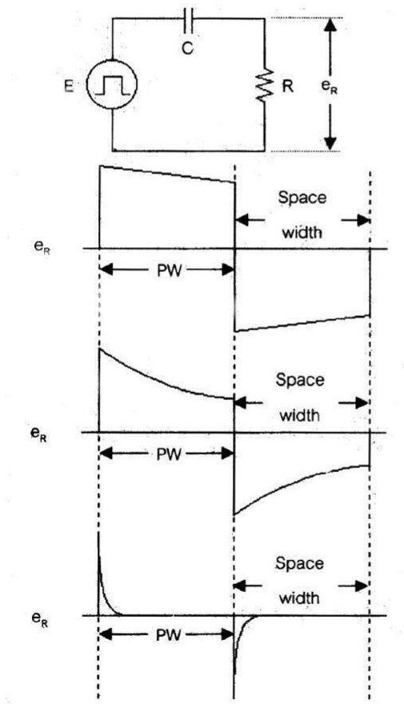
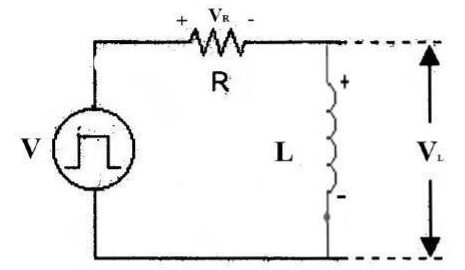
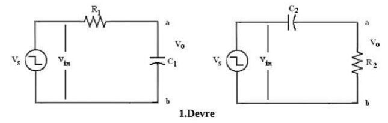
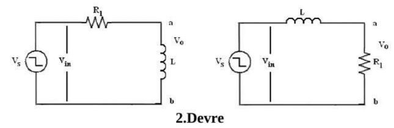
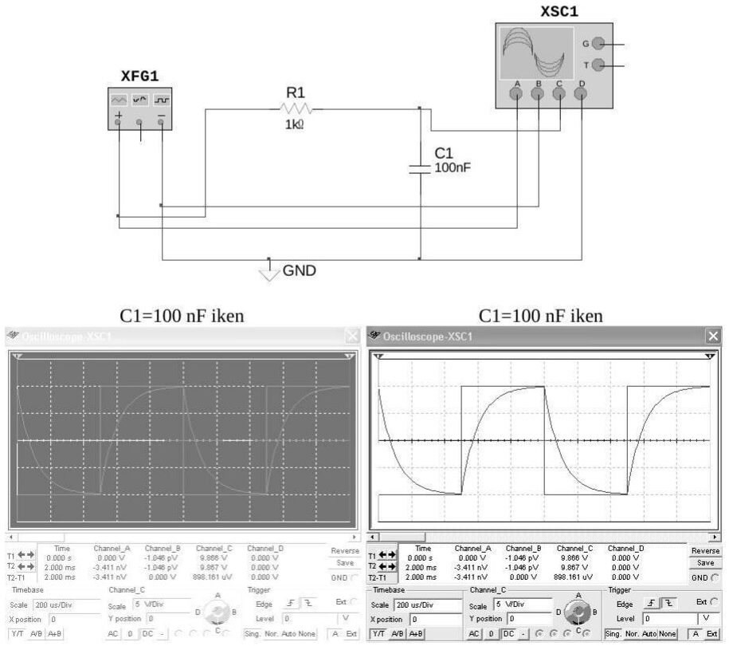

This post is the **7th preliminary report, "Differentiator and Integrator Circuits,"** prepared by a friend for the laboratory of the **EEM215 Measurement and Analysis** course (December 2006). The course code and name were taken from the name of the archive folder where the document was found; the report itself does not state the course code. The name, student number, and group information of the report's author have been removed; the downloadable PDF at the end of this post consists of page images in which this information is covered.

Part of the report's theory section and some of its figures were taken from other sources; the report's bibliography lists the following: the page "Diferansiyel devreleri" (Differential circuits) on the *silisyum.net* site, a course document (3103-0004.doc) at *deejunk.th.gs*, Wilhelm C. Miller, *Circuit Analysis: Theory and Practice* (Thomson Delmar Learning, 2003, pp. 442–450), and Electronics Workbench Multisim 9 for the simulations.

*This content belongs to a third-party source; it is shared for archival and nostalgic purposes with attribution. It will be removed at the request of the rights holder.*

**Experiment title:** Differentiator and integrator circuits

**Purpose of the experiment:** To examine, with the help of an oscilloscope, the output voltage of differentiator and integrator circuits as a function of the frequency of the square wave applied to them.

## Theoretical background

### Integrator circuit

Applying Kirchhoff's voltage law to the circuit on the side gives:

- 1-a. E_C(t) + E_R(t) = E(t)
- 1-b. (1/C)∫₀ᵗ i(t) dt + R·i(t) = E(t)
- 1-c. i(t) = (E/R)·e^(−t/RC)
- 1-d. E_R = E·e^(−t/RC)
- 1-e. E_C = E·(1 − e^(−t/RC))

as results. If T ≪ RC or T ≪ L/R (written in the report as "T >> L/R"), then from equations (1-c, d, e) i → E/R, E_R → E, E_C → 0; from equations (2-c, d, e) i → 0, E_R → 0, E_L → E are obtained. Hence E_R ≫ E_C and E_L ≫ E_R. If these results are used in equations 1-b and 2-b, i = E/R or i = ∫(E/L) dt is obtained. From this:

- V_C = (1/RC)·∫E dt  and  V_R = (R/L)·∫E dt

is found. Under these conditions, these voltages are proportional to the integral of the input voltage. When these voltages are taken as the output, these circuits are called **"INTEGRATOR"** circuits, by analogy with integration in mathematics.

### Differentiator circuit

Applying Kirchhoff's voltage law to the circuit on the side gives:

- 2-a. V_R(t) + V_L(t) = V(t)
- 2-b. R·i(t) + L·di(t)/dt = V(t)
- 2-c. i(t) = (V/R)·(1 − e^(−tR/L))
- 2-d. V_R(t) = V·(1 − e^(−tR/L))
- 2-e. V_L(t) = V·e^(−tR/L)

as results. If t ≫ RC or t ≫ L/R, then from equations (1-c, d, e) i → 0, V_R → 0, V_C → V; from equations (2-c, d, e) i → V/R, V_R → V, V_L → 0 are obtained. Hence V_R ≪ V_C and V_L ≪ V_R. If these results are used in equations 1-a and 2-b:

- V_R = R·i = RC·dV/dt  and  V_L = L·di/dt = (L/R)·dV/dt

is found. Under these conditions, the voltages V_R and V_L are proportional to the derivative of the input voltage. When these voltages are taken as the output, these circuits are called **"DIFFERENTIATOR"** circuits, by analogy with differentiation in mathematics.

A few points that are important in this theoretical proof:

- In an RL circuit, if the output voltage is taken across the inductor (L), the circuit behaves as a differentiator; if it is taken across the resistor (R), it behaves as an integrator.
- In an RC circuit, the situation is the opposite: if the output is taken across the capacitor (C), it behaves as an integrator; if it is taken across the resistor (R), it behaves as a differentiator.
- For the circuits to behave as described, the time constant must be compared with the period T of the square wave.

*Note: In the report, equation 2-e is written as "V_c(t)"; for the RL circuit the correct form is V_L(t). Also, the report writes V_R = ∫E dt; since i = (1/L)∫E dt for the RL circuit, it should be V_R = (R/L)∫E dt (corrected above). In the last item, the report requires "the time constant to be much smaller than T for RL and much larger for RC"; in fact the condition depends not on the circuit type but on the function: for both RC and RL, a differentiator requires τ ≪ T and an integrator requires τ ≫ T (τ = RC or L/R). Also, the figure under the "Integrator circuit" heading shows the waveforms of an RC circuit with the output taken across the resistor; this connection is actually a differentiator.*

## Procedure of the experiment

- **Step 1:** Using a resistance box in place of R, we build circuit 1 shown in the figure.
- **Step 2:** Varying R from 10 kΩ to 100 kΩ, we sketch the waveforms we observe and find the RC corresponding to these waveforms. We compare this value with the wave period and decide whether the circuit is a differentiator or an integrator.

**Explanation:** When 1 ≪ ωRC, that is, RC ≫ T, the circuit is an integrator.

- **Step 3:** Applying V_C to the oscilloscope and varying R from 1 kΩ to 10 kΩ, we repeat the procedures we performed earlier (f = 1 kHz).

- **Step 4:** Using L = 12 mH or 35 mH and a resistance box in place of R, we build the second circuit (f = 10 kHz).
- **Step 5:** Varying R from 10 Ω to 2 kΩ, we repeat the previous procedures.
- **Step 6:** Applying V_R to the oscilloscope and varying R from 3 kΩ to 1 kΩ, we repeat the previous procedures (f = 1 kHz).

*Note: The report gives the inductor value as "35 MH"; it should be 35 mH.*

## Simulations of integrator circuits

In Multisim, in a circuit built with a function generator (XFG1), an RC circuit with R1 = 1 kΩ and C1 = 100 nF, and a four-channel oscilloscope (XSC1), the square-wave input and the capacitor voltage are observed together (time scale 200 µs/div, 5 V/div). In the report, this is repeated for C1 values of 25, 50, 100, 150, 250, 500, and 1000 nF.

, the capacitor voltage is close to a square wave")

For time constants that are small relative to the period, such as RC = 1 kΩ × 25 nF = 25 µs, the capacitor voltage follows the input almost exactly; as C increases (RC = 0.25–1 ms), the charge-discharge curves become more pronounced and the waveform approaches a triangle, that is, the circuit begins to behave like an integrator.

## Simulations of differentiator circuits

In the same setup, C1 = 100 nF is connected in series and R1 serves as the output resistor; the simulation is repeated for R1 values of 250 Ω, 500 Ω, 1 kΩ, 2 kΩ, 3 kΩ, 5 kΩ, and 10 kΩ, and also for C1 = 10 nF and 50 nF at R1 = 1 kΩ (10 V/div).

, the output approaches a square wave")

For small RC values (e.g., 100 nF × 250 Ω = 25 µs), sharp pulses form at the edges of the square wave at the output; as RC increases (100 nF × 10 kΩ = 1 ms), the pulses reach the next edge without dying out, and the output turns into a slightly sloped copy of the input.

*Note: The inferences from the simulations (time-constant calculations) were made from the screenshots; the report itself contains no commentary on the simulations.*

## Conclusions: what did we learn?

- A differentiator circuit is a circuit that takes the derivative of the signal applied to its input and passes it to the output. When a triangular wave is applied to the input of a differentiator, a square wave is obtained at its output; when a square wave is applied, a spiked (sharpened) waveform is obtained at its output. Hence, in electronics, the derivative of a triangular wave is a square wave, and the derivative of a square wave is a spiked waveform.
- An integrator circuit takes the integral of the signal applied to its input and passes it to the output. In the mathematical sense, the integral corresponds to the area under a curve. When a square wave is applied to the input of an integrator, a triangular wave is obtained at the circuit's output, because the integral of a square wave is a triangular wave.

## References (as listed in the report)

1. silisyum.net, "Diferansiyel devreleri" (www.silisyum.net/htm/pals_devreleri/diferansiyel_devreleri.htm)
1. www.deejunk.th.gs/web-d/eejunk/3103-0004.doc
1. Wilhelm C. Miller, *Circuit Analysis: Theory and Practice*, Thomson Delmar Learning, 2003, pp. 442–450
1. Electronics Workbench, Multisim 9
