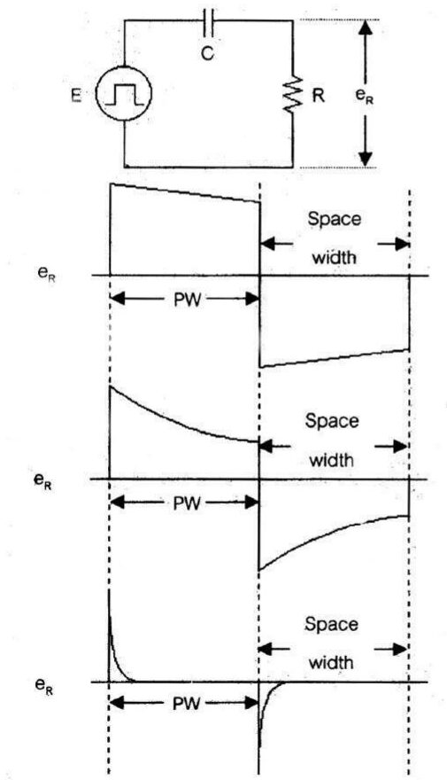
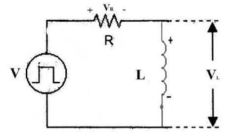
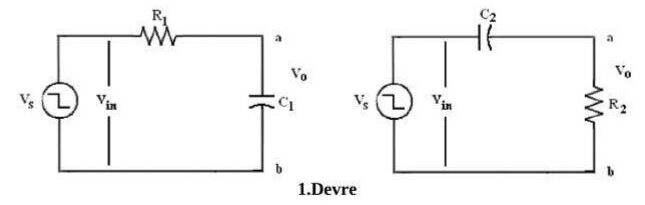
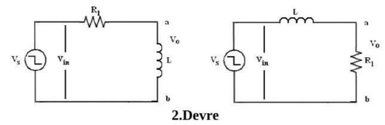
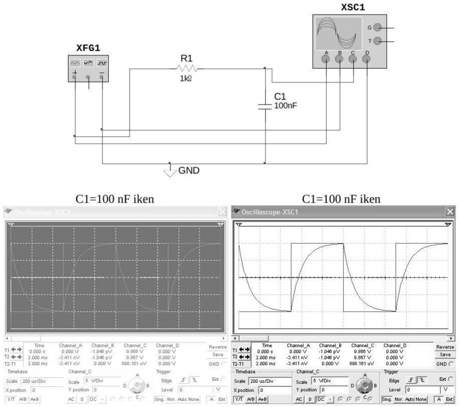

Bu yazı, **EEM215 Ölçme ve Analiz** dersinin laboratuvarı için bir arkadaşın hazırladığı **7. ön çalışma raporudur: "Türev Alıcı ve İntegre Edici Devreler"** (Aralık 2006). Ders kodu ve adı, belgenin bulunduğu arşiv klasörünün adından alındı; raporun kendisinde ders kodu yazmıyor. Raporu hazırlayanın adı, öğrenci numarası ve grup bilgisi çıkarıldı; yazının sonunda indirilebilen PDF, bu bilgilerin kapatıldığı sayfa görüntülerinden oluşuyor.

Raporun teori bölümü ve şekillerinin bir kısmı başka kaynaklardan alınmış; raporun kaynakçasında şunlar listeleniyor: *silisyum.net* sitesinin "Diferansiyel devreleri" sayfası, *deejunk.th.gs* adresindeki bir ders belgesi (3103-0004.doc), Wilhelm C. Miller, *Circuit Analysis: Theory and Practice* (Thomson Delmar Learning, 2003, s. 442–450) ve simülasyonlar için Electronics Workbench Multisim 9.

*Bu içerik üçüncü taraf bir kaynağa aittir; arşiv ve nostalji amacıyla kaynak belirtilerek paylaşılmıştır. Hak sahibinin talebi hâlinde kaldırılır.*

**Deneyin adı:** Türev alıcı ve integre edici devreler

**Deneyin amacı:** Türev alıcı ve integre edici devrelere uygulanan kare dalganın frekansına göre çıkış geriliminin osiloskop yardımıyla incelenmesi.

## Teorik bilgiler

### İntegre edici devre

Yandaki devrede Kirchhoff gerilimler kanunu uygulanırsa:

- 1-a. E_C(t) + E_R(t) = E(t)
- 1-b. (1/C)∫₀ᵗ i(t) dt + R·i(t) = E(t)
- 1-c. i(t) = (E/R)·e^(−t/RC)
- 1-d. E_R = E·e^(−t/RC)
- 1-e. E_C = E·(1 − e^(−t/RC))

sonuçları elde edilir. T ≪ RC veya T ≪ L/R (raporda "T >> L/R") ise (1-c, d, e) denklemlerinden i → E/R, E_R → E, E_C → 0; (2-c, d, e) denklemlerinden i → 0, E_R → 0, E_L → E elde edilir. O hâlde E_R ≫ E_C, E_L ≫ E_R olur. Bu sonuçlar denklem 1-b ve 2-b'de kullanılırsa i = E/R veya i = ∫(E/L) dt elde edilir. Buradan:

- V_C = (1/RC)·∫E dt  ve  V_R = (R/L)·∫E dt

bulunur. Bu şartlar altında bu gerilimler giriş geriliminin integrali ile orantılıdır. Çıkış olarak bu gerilimler alınırsa, matematikteki integral almaya benzetilerek bu devreler **"İNTEGRE EDİCİ"** devre adını alır.

### Türev alıcı devre

Yandaki devrede Kirchhoff gerilimler kanunu uygulanırsa:

- 2-a. V_R(t) + V_L(t) = V(t)
- 2-b. R·i(t) + L·di(t)/dt = V(t)
- 2-c. i(t) = (V/R)·(1 − e^(−tR/L))
- 2-d. V_R(t) = V·(1 − e^(−tR/L))
- 2-e. V_L(t) = V·e^(−tR/L)

sonuçları elde edilir. t ≫ RC veya t ≫ L/R ise (1-c, d, e) denklemlerinden i → 0, V_R → 0, V_C → V; (2-c, d, e) denklemlerinden i → V/R, V_R → V, V_L → 0 elde edilir. O hâlde V_R ≪ V_C, V_L ≪ V_R olur. Bu sonuçlar denklem 1-a ve 2-b'de kullanılırsa:

- V_R = R·i = RC·dV/dt  ve  V_L = L·di/dt = (L/R)·dV/dt

bulunur. Bu şartlar altında V_R ve V_L gerilimleri giriş geriliminin türevi ile orantılıdır. Çıkış olarak alınan bu gerilimler matematikteki türev almaya benzetilerek bu devreler **"TÜREV ALICI"** devre adını alır.

Bu teorik ispatta önemli olan birkaç husus:

- RL devresinde çıkış gerilimi bobin (L) üzerinden alınırsa devre türev alıcı, direnç (R) üzerinden alınırsa integre edici olarak davranır.
- RC devresinde bu durum tam tersidir: çıkış kapasitör (C) üzerinden alınırsa integre edici, direnç (R) üzerinden alınırsa türev alıcı olarak davranır.
- Devrelerin yazıldığı gibi davranması için zaman sabitinin kare dalganın periyodu T ile karşılaştırılması gerekir.

*Not: Raporda 2-e denklemi "V_c(t)" olarak yazılmış; RL devresinde doğrusu V_L(t). Yine raporda V_R = ∫E dt yazıyor; RL devresi için i = (1/L)∫E dt olduğundan V_R = (R/L)∫E dt olmalı (yukarıda düzeltildi). Son maddede raporda "RL için zaman sabitinin T'den çok küçük, RC için çok büyük olması" şart koşuluyor; aslında koşul devre tipine değil işleve bağlı: hem RC hem RL'de türev alıcı için τ ≪ T, integre edici için τ ≫ T gerekir (τ = RC veya L/R). Ayrıca "İntegre edici devre" başlığı altındaki şekil, çıkışı direnç üzerinden alınan RC devresinin dalga şekillerini gösteriyor; bu bağlantı aslında türev alıcıdır.*

## Deneyin yapılışı

- **Adım 1:** R yerine direnç kutusu kullanarak şekildeki 1. devreyi kuruyoruz.
- **Adım 2:** R'yi 10 kΩ'dan 100 kΩ'a kadar değiştirerek gözlediğimiz şekilleri çizip, bu şekillere karşılık gelen RC'yi buluyoruz. Bu değeri dalga periyodu ile karşılaştırıyor ve devrenin türev alıcı mı yoksa integre edici mi olduğuna karar veriyoruz.

**Açıklama:** 1 ≪ ωRC, yani RC ≫ T olduğunda devre integre edicidir.

- **Adım 3:** V_C'yi osiloskoba uygulayıp R'yi 1 kΩ'dan 10 kΩ'a kadar değiştirerek daha önce yaptığımız işlemleri tekrarlıyoruz (f = 1 kHz).

- **Adım 4:** L = 12 mH veya 35 mH, R yerine direnç kutusu kullanarak ikinci devreyi kuruyoruz (f = 10 kHz).
- **Adım 5:** R'yi 10 Ω'dan 2 kΩ'a kadar değiştirerek önceki işlemleri tekrarlıyoruz.
- **Adım 6:** V_R'yi osiloskoba uygulayıp R'yi 3 kΩ'dan 1 kΩ'a kadar değiştirerek önceki işlemleri tekrarlıyoruz (f = 1 kHz).

*Not: Raporda bobin değeri "35 MH" yazılmış, 35 mH olmalı.*

## İntegral alıcı devrelerin simülasyonları

Multisim'de fonksiyon üreteci (XFG1), R1 = 1 kΩ ve C1 = 100 nF'lık RC devresi ve dört kanallı osiloskop (XSC1) ile kurulan devrede, kare dalga girişi ve kapasitör gerilimi birlikte gözleniyor (zaman ölçeği 200 µs/div, 5 V/div). Raporda C1 değeri 25, 50, 100, 150, 250, 500 ve 1000 nF için tekrarlanmış.

 kapasitör gerilimi kare dalgaya yakın")

Zaman sabiti RC = 1 kΩ × 25 nF = 25 µs gibi periyoda göre küçük değerlerde kapasitör gerilimi girişi neredeyse aynen izliyor; C büyüdükçe (RC = 0,25–1 ms) şarj-deşarj eğrileri belirginleşip dalga şekli üçgene yaklaşıyor, yani devre integre edici gibi davranmaya başlıyor.

## Türev alıcı devrelerin simülasyonları

Aynı düzenekte C1 = 100 nF seri, R1 çıkış direnci olarak bağlanıyor; R1 değeri 250 Ω, 500 Ω, 1 kΩ, 2 kΩ, 3 kΩ, 5 kΩ ve 10 kΩ, ayrıca R1 = 1 kΩ'da C1 = 10 nF ve 50 nF için tekrarlanmış (10 V/div).

 çıkış kare dalgaya yaklaşıyor")

Küçük RC değerlerinde (ör. 100 nF × 250 Ω = 25 µs) çıkışta kare dalganın kenarlarında sivri darbeler oluşuyor; RC büyüdükçe (100 nF × 10 kΩ = 1 ms) darbeler sönmeden bir sonraki kenara ulaşıyor ve çıkış girişin hafifçe eğimli bir kopyasına dönüşüyor.

*Not: Simülasyonlardaki çıkarımlar (zaman sabiti hesapları) ekran görüntülerinden yapıldı; raporun kendisinde simülasyon yorumu yok.*

## Sonuçlar: neler öğrendik?

- Türev alan devre, girişine uygulanan sinyalin türevini alarak çıkışa aktaran bir devredir. Türev alan devrenin girişine üçgen dalga uygulandığında çıkışından kare dalga, kare dalga uygulandığında ise çıkışından sivriltilmiş dalga elde edilir. O hâlde elektronikte üçgen dalganın türevi kare dalga, kare dalganın türevi ise sivriltilmiş dalgadır.
- İntegre edici devre, girişine uygulanan sinyalin integralini alarak çıkışa aktarır. Matematiksel anlamda integral, bir eğrinin altında kalan alana karşı gelir. İntegre edici devrenin girişine kare dalga uygulandığında devrenin çıkışından üçgen dalga elde edilir; çünkü kare dalganın integrali üçgen dalgadır.

## Kaynaklar (rapordaki hâliyle)

1. silisyum.net, "Diferansiyel devreleri" (www.silisyum.net/htm/pals_devreleri/diferansiyel_devreleri.htm)
1. www.deejunk.th.gs/web-d/eejunk/3103-0004.doc
1. Wilhelm C. Miller, *Circuit Analysis: Theory and Practice*, Thomson Delmar Learning, 2003, s. 442–450
1. Electronics Workbench, Multisim 9
