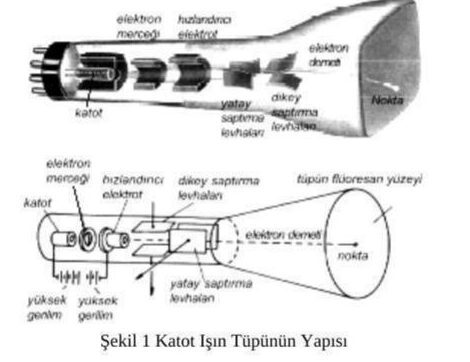
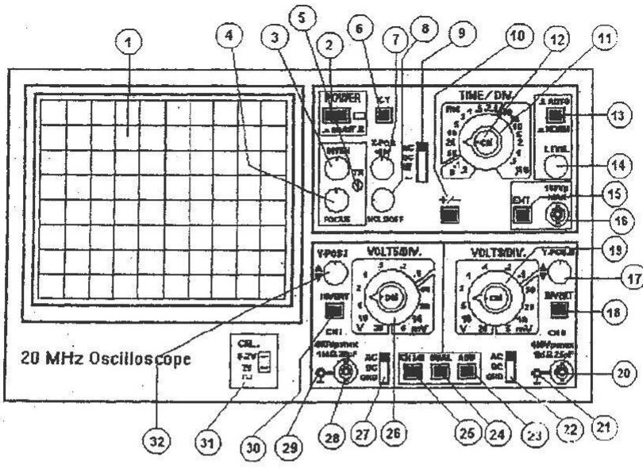
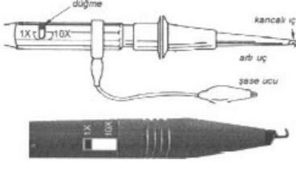
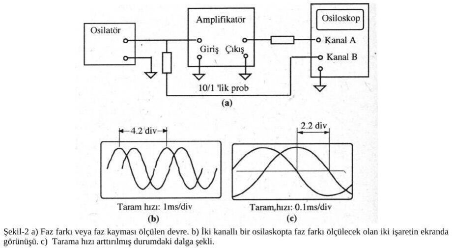
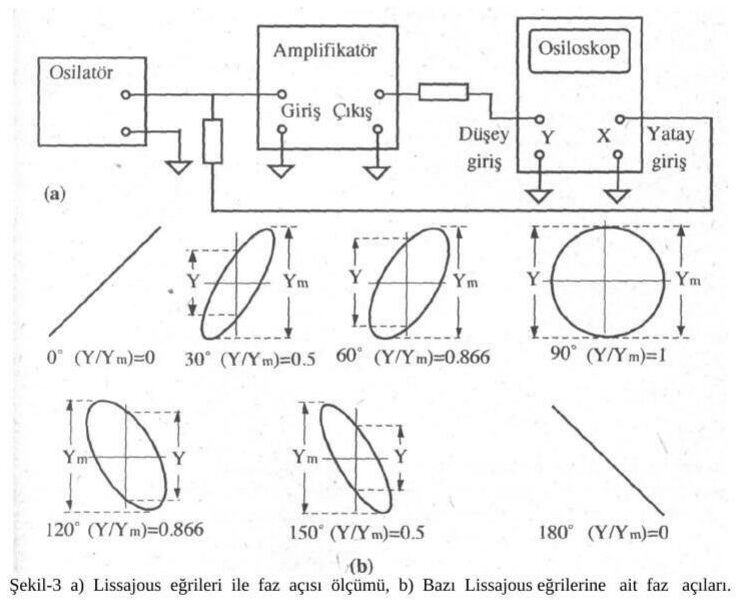
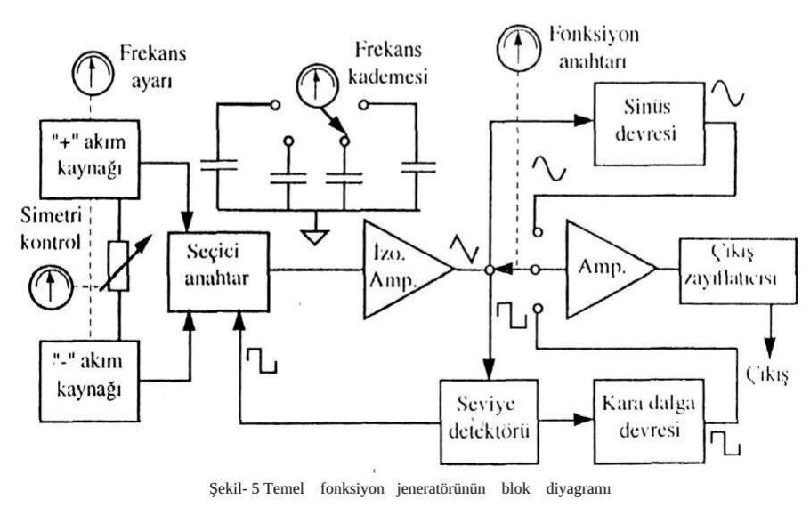
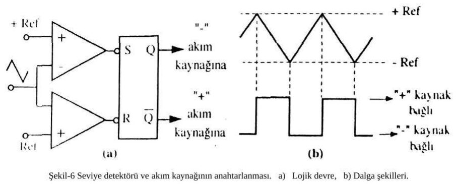
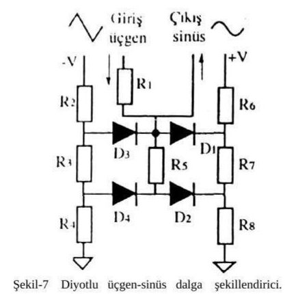

This post is the **8th preliminary report, "Examination of Oscilloscopes and Signal Generators,"** prepared by a friend for the laboratory of the **EEM215 Measurement and Analysis** course (December 2006). The course code and name were taken from the name of the archive folder in which the document was found; the report itself does not state a course code. The name, student number and group information of the person who prepared the report have been removed; the downloadable PDF at the end of the post consists of page images in which this information is masked.

The text and figures of the report are largely compiled from other sources; the report's bibliography lists the following: **Atatürk University** Faculty of Science and Letters, Department of Physics, *Electricity and Magnetism Laboratory Experiments* (2005); Süleyman Arslan, Turhan Özkan, *Basic Electronics Laboratory, Information and Processing Sheets* (1997); Elginkan Foundation, *Development and Adaptation Courses, Basic Electronics* (2004); **Mersin University Mersin Vocational School**, Department of Industrial Electronics, *Electronic Measurement Techniques and Safety Lecture Notes*; Prof. Dr. Halit Pastacı, *Electrical and Electronic Measurement* (YTÜ, 2000) and an article on the **eproje.com** website.

*This content belongs to a third-party source; it is shared for archival and nostalgic purposes with the source credited. It will be removed at the request of the rights holder.*

**Title and purpose of the experiment:** Examination of oscilloscopes and signal generators.

## What is the internal structure of an oscilloscope?

Measuring instruments that display an electrical signal applied to their input graphically on a screen, giving amplitude and time information, are called **oscilloscopes**. The oscilloscope makes use of a high-speed (on the order of 10⁷ m/s) electron beam in a specially built vacuum tube called a **cathode-ray tube** (CRT). The parts of a typical CRT are shown in Figure 1. The cathode, heated by a tungsten filament, emits electrons thermionically. Various electric fields are applied to the electrons emitted by the cathode to accelerate them (between the cathode and the anode); finally they are gathered and focused at a point. This electron beam is then subjected to operations such as thinning and confinement, again by means of applied electric fields.

The electrons move freely inside the evacuated glass tube and strike the phosphor-coated screen at the end of the tube, where they appear as a small, bright spot. The electrons are deflected from their path by different potentials applied to two pairs of electrodes called the vertical and horizontal deflection plates. In oscilloscopes, the part of the electron's trajectory lying between a pair of plates is generally about 2 cm, and its total path is about 30 cm. Therefore, the time for an electron to pass between the deflection plates is about 2 × 10⁻⁹ s, and the time to cover the whole path is about 3 × 10⁻⁸ s, that is, 30 ns. The instrument therefore responds quickly to voltage changes, and measurements can be taken up to frequencies near 100 MHz. This is about 10⁷ times faster than the moving part of an ordinary measuring instrument; for this reason the instrument can be used to measure very rapidly changing voltages.

While a voltage V(t) to be measured is applied to the vertical deflection plates, either directly or through an electronic amplifier, a voltage that increases uniformly with time is applied to the horizontal deflection plates. In this case the vertical deflection of the electron is proportional to V(t) and the horizontal deflection is proportional to t; thus the luminous spot traces a graph of V as a function of t. So that the electron beam gives sufficiently large deflections and the image can be altered as desired, the voltages are amplified by variable-gain amplifiers. There are control knobs that move the image up-down and left-right; part of the image can be magnified for more precise measurements.

## Examination of the oscilloscope: front panel

To make measurements with an oscilloscope, one must know the functions and usage of the knobs, switches, commutators and connection terminals on the front panel.

| No | Control | Function |
|---|---|---|
| 1 | Screen | The medium in which signals are displayed. |
| 2 | POWER (on/off) | Turns the oscilloscope on and off; if the LED next to it is lit, the instrument is on. |
| 3 | INTEN | Adjusts the brightness of the trace on the screen. |
| 4 | FOCUS | Focuses the trace so that it appears sharp. |
| 5 | TR | Compensates for the Earth's magnetic field to align the horizontal indicator line with the sweep line. |
| 6 | X-Y | Selects X-Y operation, stops the sweep. |
| 7 | X-POS | Controls the horizontal position of the trace. |
| 8 | HOLDOFF | Controls the delay time between sweeps. |
| 9 | TRIG. (AC-DC-HF-~) | Trigger selector. AC: 10 Hz–20 MHz; DC: DC–20 MHz; HF: 1.5 kHz–40 MHz; ~: internal line triggering. |
| 10 | +/− | Selects the trigger slope: + rising edge, − falling edge. |
| 11 | TIME/DIV. | Selects time in the range 0.5 ms/cm to 0.2 s/cm. |
| 12 | Cal | Increases the time range by a ratio of 2.5:1. |
| 13 | AUTO/NORM | When not pressed, automatic triggering (a trace is seen even with no input); when pressed, normal triggering (with LEVEL; no trace is seen if there is no input). |
| 14 | LEVEL | Selects the trigger point in normal triggering. |
| 15 | EXT | Selects internal or external triggering (pressed: external). |
| 16 | External trigger input | Input for the external trigger signal when EXT is selected. |
| 17 | Y-POS. II | Shifts the vertical position of the CH II image. |
| 18 | INVERT | Inverts the CH II image; performs algebraic addition with ADD (23). |
| 19 | VOLTS/DIV. | CH II input attenuator, from 5 mV/cm to 20 V/cm. |
| 20 | CH. II | CH II signal input. |
| 21 | Ground jack | |
| 22 | AC-DC-GND | CH II input coupling. AC: capacitive coupling, blocks DC; DC: passes all components; GND: input is grounded. |
| 23 | ADD | Performs algebraic addition together with INVERT (18). |
| 24 | DUAL | When not pressed, single channel; when pressed, both channels operate together. |
| 25 | CH. I / II | When not pressed, only CH I is used; when pressed, only CH II is used. |
| 26 | VOLTS/DIV. | CH I input attenuator, from 5 mV/cm to 20 V/cm. |
| 27 | AC-DC-GND | CH I input coupling (same as 22). |
| 28 | CH. I | CH I signal input. |
| 29 | Ground jack | |
| 30 | INVERT | Inverts the CH I image; performs algebraic addition with ADD (23). |
| 31 | CAL. | Square-wave output for calibrating the probes. |
| 32 | Y-POS. I | Shifts the vertical position of the CH I image. |

### Probe

Two types of probe are generally used with oscilloscopes:

1. **1:1 probe:** Transmits the signal as it is.
1. **10:1 probe:** Transmits the signal with its amplitude attenuated by a factor of 10.

The two most important reasons for using an attenuating probe:

- The largest voltage that can be measured without an attenuator is limited. For example, the highest range of the KENWOOD oscilloscope without an attenuator is 1 cm = 50 V; since the vertical length of the screen is 8 cm, the largest signal that can be measured is 8 × 50 = 400 V. A voltage of 500 V cannot be measured with a non-attenuating probe, as it would go off the screen; if a probe that attenuates by a factor of 10 is used, it is as if 50 V were applied to the oscilloscope input, and the true value is found by multiplying the peak value read on the screen by 10.
- An oscilloscope connected through an attenuating probe loads the circuit less. However, the probe and the oscilloscope input must be matched in terms of impedance; for this reason, almost all oscilloscopes have a special test terminal that provides a square wave of 500 mV peak value at a frequency of 1 kHz.

## DC and AC voltage measurement with an oscilloscope

### Measuring DC voltage

The AC-GND-DC switch is set to the DC position. If the probe has an attenuation switch, it is set to the x1 position. The VOLTS/DIV commutator is adjusted so that the DC signal appears on the screen. The number of divisions the signal occupies above the X axis on the vertical axis is determined and multiplied by the VOLTS/DIV value.

**Example:** The DC signal is 2 divisions above the X axis, and the VOLTS/DIV commutator is at 2 V. Input voltage: U = (volts/div) × number of divisions = 2 × 2 = **4 V**. If the probe's attenuation switch is in the x10 position, the value found is multiplied by 10; the input voltage is then 40 V.

### Measuring AC voltage

The AC-GND-DC switch is set to the AC position, the probe is set to x1, and VOLTS/DIV is adjusted so that the AC signal appears on the screen. The number of divisions the signal occupies on the vertical axis is multiplied by the VOLTS/DIV value and divided by 2 to find the maximum (peak) value of the voltage.

**Example:** The AC signal occupies 4 divisions on the vertical axis, VOLTS/DIV is at 5 V.

- Maximum value: U_max = (5 × 4) / 2 = **10 V**
- RMS value: U_rms = U_max × 0.707 = **7.07 V**
- Average value: U_avg = U_max × 0.636 = **6.36 V**

If the probe is in the x10 position, the values found are multiplied by 10. In practice the RMS value is used most: the 220 V measured at household outlets is the RMS value of the voltage coming into the house; its maximum value is U_max = 220 / 0.707 ≈ 311 V.

*Note: The report gives this value as 310.2 V; 220 / 0.707 = 311.2 V.*

## Period and frequency measurement with an oscilloscope

To measure the period of a periodic signal, after the signal is applied, the VOLT/DIV and TIME/DIV switches are adjusted to give a comfortably viewable image on the screen. AC input coupling is selected and the signal is displayed symmetrically about the horizontal axis. With the horizontal POSITION knob, one of the starting points of the signal is made to coincide with a vertical grid line, and the number of divisions up to the end of the period is measured. The number of divisions is multiplied by the TIME/DIV setting.

**Example:** One period occupies 4 divisions, TIME/DIV is 0.1 ms: T = 4 × 0.1 = **0.4 ms**. Frequency: f = 1/T = 1 / (0.4 × 10⁻³) = **2500 Hz = 2.5 kHz**.

## Phase measurement with an oscilloscope

### With a two-channel oscilloscope

The most practical of the phase measurement methods is measurement with a two-channel oscilloscope. One of the signals whose phase difference is to be measured is applied to one channel of the oscilloscope and the other to the other channel; by measuring the delay t_d between the two signals and the period T, the phase difference in degrees is calculated from the relation

- θ = 360° × t_d / T

From the values measured on the screen:

- T = 4.2 div × 1 ms/div = 4.2 × 10⁻³ s
- t_d = 2.2 div × 0.1 ms/div = 220 × 10⁻⁶ s
- θ = 360 × (220 × 10⁻⁶) / (4.2 × 10⁻³) ≈ **18.86°**

*Note: In the report, the sweep speed on the t_d line is written as "100 ns/div"; as in the figure, it should be 0.1 ms/div (100 µs/div). The result (18.86°) is correct.*

### With Lissajous curves

The second method used in phase measurement is Lissajous curves. One of the signals whose phase difference is to be measured is applied to the horizontal (X) input of the oscilloscope and the other to the vertical (Y) input; a stable figure is obtained on the screen by adjusting the gains. The maximum value of the curve (Y_m) and the distance between the points where the curve crosses the vertical axis (Y) are measured, and the phase angle is calculated from the relation

- θ = sin⁻¹(Y / Y_m)

The phase difference between the input and output signals of the amplifier in Figure 3a arises from the R, C and L elements in the circuit; the measurement can also be made on a simple RC circuit instead of the amplifier. With this method, phase differences as small as 1° can be measured; measuring angles close to 90° is difficult, because the figure approaches a circle. There may also be a phase-shift error arising from the horizontal and vertical connection cables of the oscilloscope. To detect this, the same sine signal is applied to the horizontal and vertical inputs; a straight line inclined at exactly 45° should appear on the screen. If a closed curve in the shape of an ellipse appears, there is a phase shift arising from the connections; this shift is measured and subtracted from the total value.

## Power measurement with an oscilloscope

The power dissipated in a resistor R whose terminal voltage is known is calculated from the relation

- P = [V_pp / 2.828]² / R

where V_pp is the peak-to-peak value of the sinusoidal signal (2.828 = 2√2). For example, if 0.2 V peak-to-peak is measured at an RF source connected to a 50 Ω load, the power dissipated is P = (0.2 / 2.828)² / 50 = **0.1 mW**.

## Function generators

A basic function generator produces sine, square, triangle and sawtooth signals from the Hz range up to 2 MHz. More advanced function generators additionally produce amplitude-, frequency-, phase- and pulse-width-modulated signals and include a voltage-controlled oscillator (VCO). Audio frequency (AF) and radio frequency (RF) generators basically produce sinusoidal signals; in a function generator, however, the basic signal is the **triangle wave**, and all the other waveforms are obtained from the triangle wave.

The voltage of a capacitor charged from a voltage source through a resistor increases exponentially. However, by the relation V = Q/C = I·t/C, the voltage of a capacitor (C) charged by a constant current source (I) increases **linearly** with time. To reverse the slope of the voltage, the direction of the current must be changed; the charging rate is directly proportional to the charging current and inversely proportional to the capacitance value.

 by a constant current source, b) through a resistor")

Figure 5 shows the block diagram of a basic function generator. The triangle wave is obtained by charging and discharging a capacitor with a constant current source: the capacitor first charges up to a certain maximum point, then a constant current source in the opposite direction is connected to the capacitor by a switch circuit; the capacitor first discharges, then charges in the negative direction up to a certain maximum point.

As seen in Figure 6, the lower and upper limits (±Ref) are fixed. As the slope increases, the maximum and minimum values are reached faster and the repetition frequency rises. In practice, the frequency is controlled by the capacitance value and the charging current. The triangle wave across the capacitor is passed through an isolation amplifier to reduce the loading effect; the output of this amplifier is fed to the sine, square-wave and level detector circuits.

The wave shaper in Figure 7 is a special circuit that converts the triangle wave into a low-distortion sine wave. Thanks to a nonlinear voltage divider formed with nonlinear diode elements, the triangle wave is distorted to give an approximate sine signal. Since all the diodes are cut off when there is no input signal, the input and output have no ground connection. When the triangle wave at the input begins to rise, D2 first starts conducting and resistors R1, R5, R8 are connected in series; the increase in output amplitude slows down. Then D1 starts conducting, placing R5 and R7 in parallel, and the output is attenuated a little more. When the input goes below zero, the diodes and resistors on the other side of the circuit come into play, and the negative half of the triangle wave is also turned into a sine shape. A better sine can be obtained with additional diodes and resistors.

The square-wave circuit is a bistable circuit; it changes state at the levels determined for the current sources. The frequency of the resulting square wave is the same as that of the triangle wave. The desired wave is fed through the wave-selector switch to the output amplifier, and from there to the output attenuator. Amplitude adjustment and DC level control can be done in these stages: if +1 V DC is added to a ±3 V sine, the output varies between +4 V and −2 V. The bandwidth of the output amplifier and attenuator must be large and the gain curve flat; for low-frequency signals the gain curve must start from DC. The bandwidth must be about 10 times the highest frequency to be obtained: for example, for a signal of at most 4 MHz, the upper cutoff frequency must be 40 MHz. In this way the components of the signal up to its 10th harmonic are amplified in the same proportion; for the signal not to be distorted, all harmonics must be amplified in the same proportion.

## Conclusions: what did we learn?

We learned:

- What an oscilloscope is, its internal structure and how it works,
- How to use an oscilloscope and how measurements are made with it,
- The internal structure of a signal generator and how it works.

## References (as given in the report)

- Atatürk University Faculty of Science and Letters, Department of Physics, *Electricity and Magnetism Laboratory Experiments*, 2005.
- *Basic Electronics Laboratory, Information and Processing Sheets*, Süleyman Arslan, Turhan Özkan, 1997.
- Elginkan Foundation, *Development and Adaptation Courses, Basic Electronics*, 2004.
- Mersin University Mersin Vocational School, Department of Industrial Electronics, *Electronic Measurement Techniques and Safety Lecture Notes*.
- *Electrical and Electronic Measurement*, Prof. Dr. Halit Pastacı, YTÜ, 2000.
- eproje.com (www.eproje.com/modules.php?name=News&file=article&sid=231)
