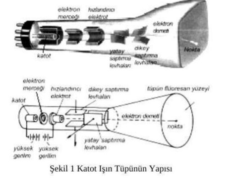
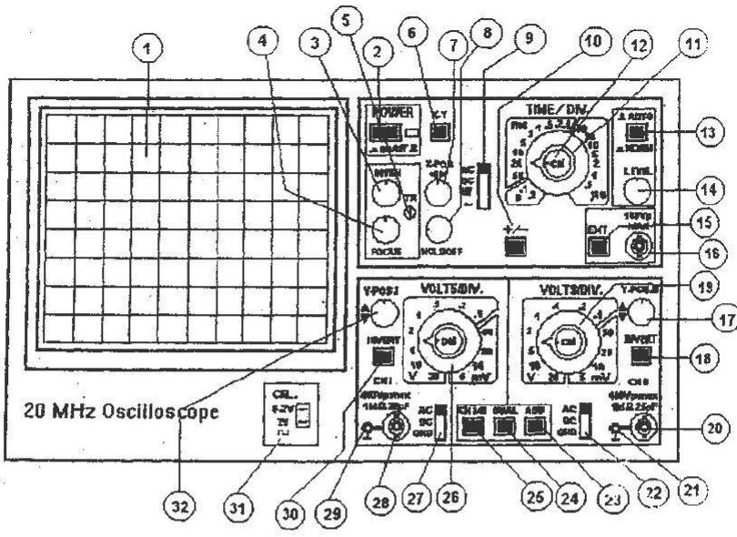
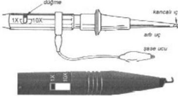
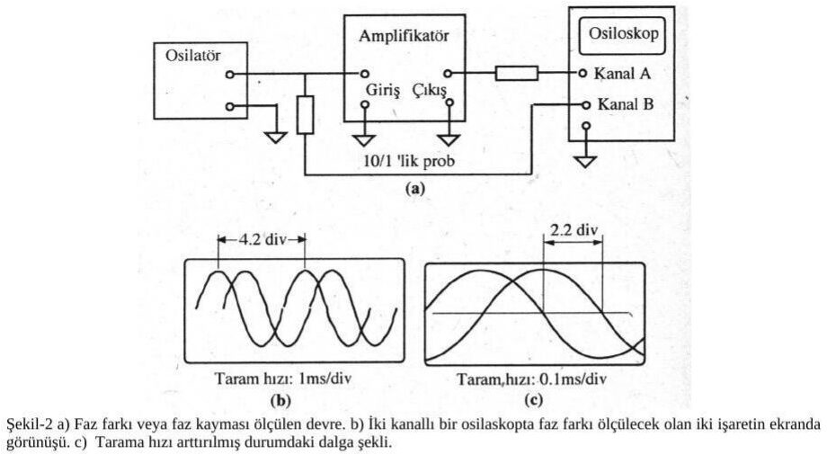
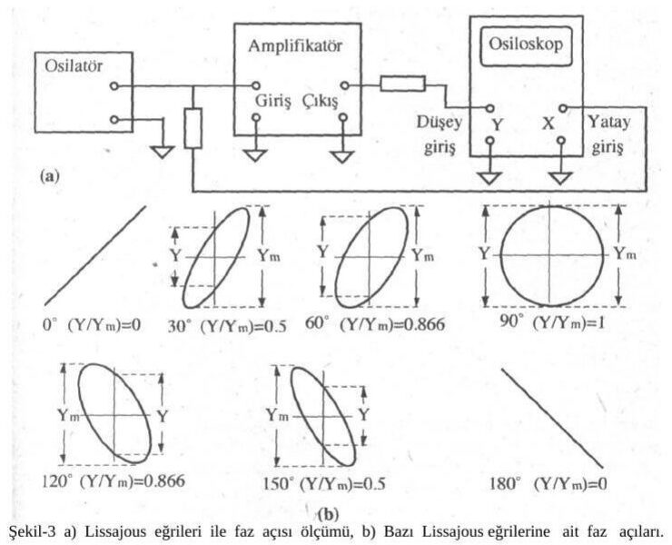
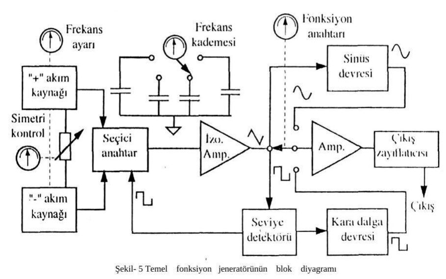
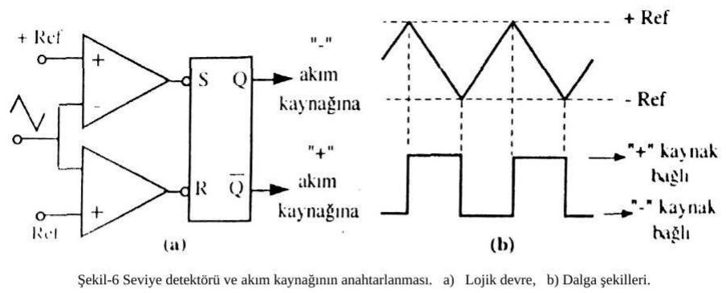
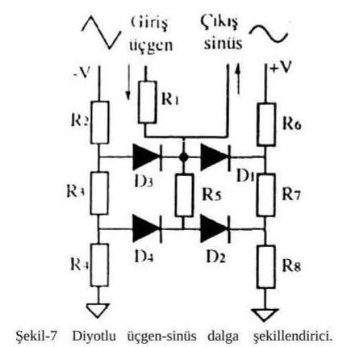

Bu yazı, **EEM215 Ölçme ve Analiz** dersinin laboratuvarı için bir arkadaşın hazırladığı **8. ön çalışma raporudur: "Osiloskop ve Sinyal Jeneratörlerinin İncelenmesi"** (Aralık 2006). Ders kodu ve adı, belgenin bulunduğu arşiv klasörünün adından alındı; raporun kendisinde ders kodu yazmıyor. Raporu hazırlayanın adı, öğrenci numarası ve grup bilgisi çıkarıldı; yazının sonunda indirilebilen PDF, bu bilgilerin kapatıldığı sayfa görüntülerinden oluşuyor.

Raporun metni ve şekilleri büyük ölçüde başka kaynaklardan derlenmiş; raporun kaynakçasında şunlar listeleniyor: **Atatürk Üniversitesi** Fen-Edebiyat Fakültesi Fizik Bölümü, *Elektrik ve Manyetizma Laboratuvar Deneyleri* (2005); Süleyman Arslan, Turhan Özkan, *Temel Elektronik Laboratuvarı, Bilgi ve İşlem Yaprakları* (1997); Elginkan Vakfı, *Geliştirme ve Uyum Kursları, Temel Elektronik* (2004); **Mersin Üniversitesi Mersin MYO** Endüstriyel Elektronik Bölümü, *Elektronik Ölçme Tekniği ve Güvenlik Ders Notları*; Prof. Dr. Halit Pastacı, *Elektrik ve Elektronik Ölçme* (YTÜ, 2000) ve **eproje.com** sitesindeki bir makale.

*Bu içerik üçüncü taraf bir kaynağa aittir; arşiv ve nostalji amacıyla kaynak belirtilerek paylaşılmıştır. Hak sahibinin talebi hâlinde kaldırılır.*

**Deneyin adı ve amacı:** Osiloskop ve sinyal jeneratörlerinin incelenmesi.

## Osiloskobun iç yapısı nasıldır?

Girişine uygulanan elektriksel işareti genlik ve zaman bilgisi verecek şekilde ekranında grafiksel olarak görüntüleyen ölçü aletlerine **osiloskop** denir. Osiloskopta **katot ışınlı tüp** (KIT, CRT: Cathode-Ray Tube) denilen, özel yapılmış bir vakum tüpündeki yüksek hızlı (10⁷ m/s mertebesinde) elektron demetinden faydalanılır. Tipik bir KIT'in parçaları Şekil 1'de verilmiştir. Tungsten bir flaman vasıtasıyla ısıtılan katot termoiyonik ışıma yapar. Katodun yaydığı elektronlara çeşitli elektrik alanlar uygulanarak elektronlar (katot ve anot arasında) hızlandırılır, sonunda bir noktada toplanıp odaklanır. Bu elektron demeti yine uygulanan elektrik alanlar vasıtasıyla inceltme ve sınırlandırma gibi işlemlere tabi tutulur.

Elektronlar havası boşaltılmış cam tüp içerisinde serbestçe hareket eder ve tüpün sonundaki fosforla kaplı ekrana çarparak küçük ve parlak bir leke olarak görülür. Düşey ve yatay saptırıcı levhalar adı verilen iki çift elektroda uygulanan farklı potansiyellerle elektronlar yolundan saptırılır. Genellikle osiloskoplarda elektronun yörüngesinin levha çifti arasında kalan kısmı 2 cm, toplam yolu ise 30 cm kadardır. Bu nedenle bir elektronun saptırıcı levhalar arasından geçme süresi 2 × 10⁻⁹ s, toplam yolu katetme süresi ise 3 × 10⁻⁸ s, yani 30 ns kadardır. O hâlde alet gerilim değişimine çabucak uyum sağlar ve 100 MHz yakınlarındaki frekanslara kadar ölçüm alınabilir. Bu, normal bir ölçü aletinin hareketli kısmından 10⁷ kat kadar daha hızlıdır; bu yüzden alet çok hızlı değişen gerilimlerin ölçülmesinde kullanılabilir.

Ölçülecek bir V(t) gerilimi doğrudan veya elektronik bir amplifikatör vasıtasıyla düşey saptırıcı levhalara uygulanırken, yatay saptırıcı levhalara da zamanla düzgün biçimde artan bir gerilim uygulanır. Bu durumda elektronun düşey sapması V(t) ile, yatay sapması da t ile orantılı olur; böylece ışıklı nokta t'nin fonksiyonu olan bir V grafiği çizer. Elektron demetinin yeterince büyük sapmalar vermesi ve görüntünün istenilen biçimde değiştirilebilmesi için gerilimler değişken kazançlı amplifikatörlerle yükseltilir. Görüntüyü yukarı-aşağı, sağa-sola hareket ettiren kumanda düğmeleri vardır; görüntünün bir kısmı daha hassas ölçümler için büyütülebilir.

## Osiloskobun incelenmesi: ön panel

Bir osiloskop ile ölçme yapabilmek için ön paneldeki düğme, anahtar, komütatör ve bağlantı uçlarının görevlerini ve kullanım biçimlerini bilmek gerekir.

| No | Kumanda | Görevi |
|---|---|---|
| 1 | Ekran | Sinyal ve işaretlerin görüldüğü ortam. |
| 2 | POWER (on/off) | Osiloskobu açar ve kapar; yanındaki LED ışık veriyorsa cihaz açıktır. |
| 3 | INTEN | Ekrandaki izin parlaklığını ayarlar. |
| 4 | FOCUS | İzin net görünmesi için odaklama yapar. |
| 5 | TR | Yatay gösterge çizgisi ile tarama çizgisini hizalamak için yerin manyetik alanını kompanze eder. |
| 6 | X-Y | X-Y çalışmayı seçer, taramayı durdurur. |
| 7 | X-POS | İzin yatay konumunu kontrol eder. |
| 8 | HOLDOFF | Taramalar arasındaki gecikme zamanını kontrol eder. |
| 9 | TRIG. (AC-DC-HF-~) | Tetikleme seçici. AC: 10 Hz–20 MHz; DC: DC–20 MHz; HF: 1,5 kHz–40 MHz; ~: içten hat tetiklemesi. |
| 10 | +/− | Tetikleme eğimini seçer: + yükselen kenar, − düşen kenar. |
| 11 | TIME/DIV. | Zamanı 0,5 ms/cm ile 0,2 s/cm aralığında seçer. |
| 12 | Cal | Zaman aralığını 2,5:1 oranında artırır. |
| 13 | AUTO/NORM | Basılı değilken otomatik tetikleme (giriş yokken de iz görülür); basılıyken normal tetikleme (LEVEL ile; giriş yoksa iz görülmez). |
| 14 | LEVEL | Normal tetiklemede tetikleme noktasını seçer. |
| 15 | EXT | İçten veya dıştan tetiklemeyi seçer (basılı: dıştan). |
| 16 | Dış tetik girişi | EXT seçildiğinde dış tetikleme işareti girişi. |
| 17 | Y-POS. II | CH II görüntüsünün düşey konumunu kaydırır. |
| 18 | INVERT | CH II görüntüsünü ters çevirir; ADD (23) ile cebirsel toplama yapar. |
| 19 | VOLTS/DIV. | CH II giriş zayıflatıcısı, 5 mV/cm ile 20 V/cm arası. |
| 20 | CH. II | CH II işaret girişi. |
| 21 | Toprak jakı | |
| 22 | AC-DC-GND | CH II giriş kuplajı. AC: kapasitif kuplaj, DC'yi bloke eder; DC: tüm bileşenleri geçirir; GND: giriş topraklanır. |
| 23 | ADD | INVERT (18) ile birlikte cebirsel toplama yapar. |
| 24 | DUAL | Basılı değilken tek kanal, basılıyken iki kanal birlikte çalışır. |
| 25 | CH. I / II | Basılı değilken yalnız CH I, basılıyken yalnız CH II kullanılır. |
| 26 | VOLTS/DIV. | CH I giriş zayıflatıcısı, 5 mV/cm ile 20 V/cm arası. |
| 27 | AC-DC-GND | CH I giriş kuplajı (22 ile aynı). |
| 28 | CH. I | CH I işaret girişi. |
| 29 | Toprak jakı | |
| 30 | INVERT | CH I görüntüsünü ters çevirir; ADD (23) ile cebirsel toplama yapar. |
| 31 | CAL. | Probları kalibre etmek için kare dalga çıkışı. |
| 32 | Y-POS. I | CH I görüntüsünün düşey konumunu kaydırır. |

### Prob

Osiloskoplarda genel olarak iki tip prob kullanılır:

1. **1:1'lik prob:** İşareti olduğu gibi iletir.
1. **10:1'lik prob:** İşaretin genliğini 10 kez zayıflatarak iletir.

Zayıflatıcı prob kullanılmasının en önemli iki nedeni:

- Zayıflatıcısız ölçülebilecek en büyük gerilim sınırlıdır. Örneğin KENWOOD osiloskobunun zayıflatıcısız en yüksek kademesi 1 cm = 50 V'tur; ekranın dikey uzunluğu 8 cm olduğuna göre ölçülebilecek en büyük işaret 8 × 50 = 400 V olur. 500 V'luk bir gerilim zayıflatıcısız probla ölçülemez, ekran dışına taşar; 10 kez zayıflatan prob kullanılırsa osiloskop girişine 50 V uygulanmış gibi olur ve ekranda okunan tepe değeri 10 ile çarpılarak gerçek değer bulunur.
- Zayıflatıcı prob üzerinden bağlanan osiloskop devreyi daha az yükler. Ancak prob ile osiloskop girişinin empedans bakımından uyumlu olması gerekir; bunun için hemen hemen tüm osiloskoplarda, 1 kHz frekansında 500 mV tepe değerli kare dalga veren özel bir test ucu bulunur.

## Osiloskop ile DC ve AC gerilim ölçümü

### DC gerilim ölçme

AC-GND-DC anahtarı DC konumuna alınır. Probun zayıflatma anahtarı varsa x1 konumuna getirilir. VOLTS/DIV komütatörü ayarlanarak DC sinyalin ekranda görünmesi sağlanır. Sinyalin dikey eksende X ekseninden yukarıya doğru kapladığı kare sayısı belirlenir ve VOLTS/DIV değeri ile çarpılır.

**Örnek:** DC sinyal X ekseninden 2 kare yukarıda, VOLTS/DIV komütatörü 2 V konumunda. Giriş gerilimi: U = (volts/div) × kare sayısı = 2 × 2 = **4 V**. Probun zayıflatma anahtarı x10 konumunda ise bulunan değer 10 ile çarpılır; giriş gerilimi 40 V olur.

### AC gerilim ölçme

AC-GND-DC anahtarı AC konumuna alınır, prob x1 konumuna getirilir, VOLTS/DIV ayarlanarak AC sinyalin ekranda görünmesi sağlanır. Sinyalin dikey eksende kapladığı kare sayısı VOLTS/DIV değeri ile çarpılıp 2'ye bölünerek gerilimin maksimum (tepe) değeri bulunur.

**Örnek:** AC sinyal dikey eksende 4 kare kaplıyor, VOLTS/DIV 5 V konumunda.

- Maksimum değer: U_maks = (5 × 4) / 2 = **10 V**
- Etkin değer: U_et = U_maks × 0,707 = **7,07 V**
- Ortalama değer: U_ort = U_maks × 0,636 = **6,36 V**

Prob x10 konumundaysa bulunan değerler 10 ile çarpılır. Uygulamada en çok etkin değer kullanılır: konutlardaki prizlerde ölçülen 220 V eve gelen gerilimin etkin değeridir; maksimum değeri U_maks = 220 / 0,707 ≈ 311 V'tur.

*Not: Raporda bu değer 310,2 V yazılmış; 220 / 0,707 = 311,2 V eder.*

## Osiloskop ile periyot ve frekans ölçümü

Periyodik bir işaretin periyodunu ölçmek için, işaret uygulandıktan sonra VOLT/DIV ve TIME/DIV anahtarları ekranda rahat izlenebilir bir görüntü verecek şekilde ayarlanır. Giriş kuplajı AC seçilir ve işaret yatay eksen etrafında simetrik görüntülenir. Yatay POSITION düğmesiyle işaretin başlangıç noktalarından biri bir dikey ızgara çizgisiyle çakıştırılır ve periyodun bitimine kadar kaç kare olduğu ölçülür. Kare sayısı, TIME/DIV konumu ile çarpılır.

**Örnek:** Bir periyot 4 kare kaplıyor, TIME/DIV 0,1 ms: T = 4 × 0,1 = **0,4 ms**. Frekans: f = 1/T = 1 / (0,4 × 10⁻³) = **2500 Hz = 2,5 kHz**.

## Osiloskop ile faz ölçümü

### İki kanallı osiloskopla

Faz ölçme yöntemlerinin en pratiği iki kanallı osiloskopla yapılan ölçümdür. Faz farkı ölçülecek işaretlerden biri osiloskobun bir kanalına, diğeri öbür kanalına uygulanır; iki işaret arasındaki gecikme t_d ve periyot T ölçülerek faz farkı derece cinsinden

- θ = 360° × t_d / T

bağıntısından hesaplanır.

Ekranda ölçülen değerlerden:

- T = 4,2 div × 1 ms/div = 4,2 × 10⁻³ s
- t_d = 2,2 div × 0,1 ms/div = 220 × 10⁻⁶ s
- θ = 360 × (220 × 10⁻⁶) / (4,2 × 10⁻³) ≈ **18,86°**

*Not: Raporda t_d satırında tarama hızı "100 ns/div" yazılmış; şekildeki gibi 0,1 ms/div (100 µs/div) olmalı. Sonuç (18,86°) doğru.*

### Lissajous eğrileriyle

Faz ölçümünde kullanılan ikinci yöntem Lissajous eğrileridir. Faz farkı ölçülecek işaretlerden biri osiloskobun yatay (X) girişine, diğeri düşey (Y) girişine uygulanır; kazançlar ayarlanarak ekranda kararlı bir şekil elde edilir. Eğrinin maksimum değeri (Y_m) ile eğrinin düşey ekseni kestiği noktalar arasındaki mesafe (Y) ölçülür ve faz açısı

- θ = sin⁻¹(Y / Y_m)

bağıntısından hesaplanır.

Şekil 3a'daki amplifikatörün giriş ve çıkış işaretleri arasındaki faz farkı devredeki R, C ve L elemanlarından kaynaklanır; amplifikatör yerine basit bir RC devresi üzerinde de ölçüm yapılabilir. Bu yöntemle 1°'ye kadar küçük faz farkları ölçülebilir; 90°'ye yakın açıların ölçümü zordur, çünkü şekil daireye yaklaşır. Osiloskobun yatay ve düşey bağlantı kablolarından kaynaklanan faz kayması hatası da olabilir. Bunu anlamak için yatay ve düşey girişlere aynı sinüs işareti verilir; ekranda tam 45°'lik eğik bir doğru görünmelidir. Elips şeklinde kapalı bir eğri varsa bağlantılardan kaynaklanan bir faz kayması vardır; bu kayma ölçülerek toplam değerden çıkarılır.

## Osiloskop ile güç ölçümü

Uçlarındaki gerilim belli olan bir R direnci üzerinde harcanan güç

- P = [V_tt / 2,828]² / R

bağıntısıyla hesaplanır; V_tt sinüzoidal işaretin tepeden tepeye değeridir (2,828 = 2√2). Örneğin 50 Ω'luk bir yüke bağlı RF kaynağında tepeden tepeye 0,2 V ölçülmüşse P = (0,2 / 2,828)² / 50 = **0,1 mW** güç harcanır.

## Fonksiyon jeneratörleri

Basit bir fonksiyon jeneratörü Hz mertebesinden 2 MHz'e kadar sinüs, kare, üçgen ve testere dişi işaretler üretir. Daha gelişmiş fonksiyon jeneratörleri bunlara ek olarak genlik, frekans, faz ve darbe genişlik modülasyonlu işaretler de üretir ve gerilim kontrollü osilatör (VCO) içerir. Ses frekans (AF) ve radyo frekans (RF) jeneratörleri temel olarak sinüzoidal işaret üretir; fonksiyon jeneratöründe ise temel işaret **üçgen dalgadır**, diğer bütün dalga şekilleri üçgen dalgadan elde edilir.

Bir direnç üzerinden bir gerilim kaynağı ile şarj olan kapasitenin gerilimi üstel olarak artar. Hâlbuki V = Q/C = I·t/C bağıntısı gereği, sabit bir akım kaynağı (I) ile şarj olan kapasitenin (C) gerilimi zamanla **doğrusal** artar. Gerilimin eğimini tersine çevirmek için akımın yönünü değiştirmek gerekir; şarj hızı şarj akımıyla doğru, kapasite değeriyle ters orantılıdır.

 sabit akım kaynağı, b) direnç üzerinden şarj olması")

Şekil 5'te temel bir fonksiyon jeneratörünün blok diyagramı görülüyor. Üçgen dalga, bir kapasitenin sabit bir akım kaynağıyla şarj ve deşarj olmasıyla elde edilir: kapasite önce belli bir maksimum noktaya kadar şarj olur, sonra bir anahtar devresiyle kapasiteye ters yönde bir sabit akım kaynağı bağlanır; kapasite önce deşarj olur, sonra negatif yönde belli bir maksimum noktaya kadar şarj olur.

Şekil 6'da görüldüğü gibi alt ve üst sınırlar (±Ref) sabittir. Eğim arttıkça maksimum ve minimum değerlere daha hızlı ulaşılır ve tekrarlanma frekansı yükselir. Pratikte frekans, kapasite değeri ve şarj akımıyla kontrol edilir. Kapasite uçlarındaki üçgen dalga, yükleme etkisini azaltmak için bir izolasyon amplifikatöründen geçirilir; bu amplifikatörün çıkışı sinüs, kare dalga ve seviye detektörü devrelerine verilir.

Şekil 7'deki dalga şekillendirici, üçgen dalgayı az distorsiyonlu sinüs dalgaya dönüştüren özel bir devredir. Doğrusal olmayan diyot elemanlarıyla oluşturulan doğrusal olmayan gerilim bölücü sayesinde üçgen dalga bozularak yaklaşık bir sinüs işareti elde edilir. Giriş işareti yokken bütün diyotlar kesimde olduğundan giriş ve çıkışın toprak bağlantısı yoktur. Girişteki üçgen dalga artmaya başlayınca önce D2 iletime girer ve R1, R5, R8 dirençleri seri bağlanır; çıkışın genlik artışı yavaşlar. Sonra D1 iletime girerek R5 ve R7'yi paralel konuma getirir ve çıkış biraz daha zayıflar. Giriş sıfırın altına geçince devrenin diğer tarafındaki diyot ve dirençler devreye girer ve üçgen dalganın negatif yarısı da sinüs şekline dönüşür. İlave diyot ve dirençlerle daha iyi bir sinüs elde edilebilir.

Kare dalga devresi iki kararlı bir devredir; akım kaynakları için belirlenen seviyelerde konum değiştirir. Elde edilen kare dalganın frekansı üçgen dalganınkiyle aynıdır. Dalga seçici anahtarla istenen dalga çıkış amplifikatörüne, oradan da çıkış zayıflatıcısına verilir. Bu katlarda genlik ayarı ve DC seviye kontrolü yapılabilir: ±3 V'luk bir sinüse +1 V DC eklenirse çıkış +4 V ile −2 V arasında değişir. Çıkış amplifikatörü ve zayıflatıcısının bant genişliği büyük, kazanç eğrisi düz olmalıdır; alçak frekanslı işaretler için kazanç eğrisi DC'den başlamalıdır. Bant genişliği elde edilecek en yüksek frekansın yaklaşık 10 katı olmalıdır: örneğin en çok 4 MHz'lik işaret için üst kesim frekansı 40 MHz olmalıdır. Böylece işaretin 10. harmoniğine kadar olan bileşenleri aynı oranda kuvvetlendirilir; işaretin bozulmaması için tüm harmoniklerin aynı oranda kuvvetlendirilmesi gerekir.

## Sonuçlar: neler öğrendik?

- Osiloskobun ne olduğunu, iç yapısını ve nasıl çalıştığını,
- Osiloskop kullanımını ve osiloskopla nasıl ölçüm yapıldığını,
- Sinyal jeneratörünün iç yapısını ve nasıl çalıştığını öğrendik.

## Kaynaklar (rapordaki hâliyle)

- Atatürk Üniversitesi Fen-Edebiyat Fakültesi Fizik Bölümü, *Elektrik ve Manyetizma Laboratuvar Deneyleri*, 2005.
- *Temel Elektronik Laboratuvarı, Bilgi ve İşlem Yaprakları*, Süleyman Arslan, Turhan Özkan, 1997.
- Elginkan Vakfı, *Geliştirme ve Uyum Kursları, Temel Elektronik*, 2004.
- Mersin Üniversitesi Mersin MYO Endüstriyel Elektronik Bölümü, *Elektronik Ölçme Tekniği ve Güvenlik Ders Notları*.
- *Elektrik ve Elektronik Ölçme*, Prof. Dr. Halit Pastacı, YTÜ, 2000.
- eproje.com (www.eproje.com/modules.php?name=News&file=article&sid=231)
