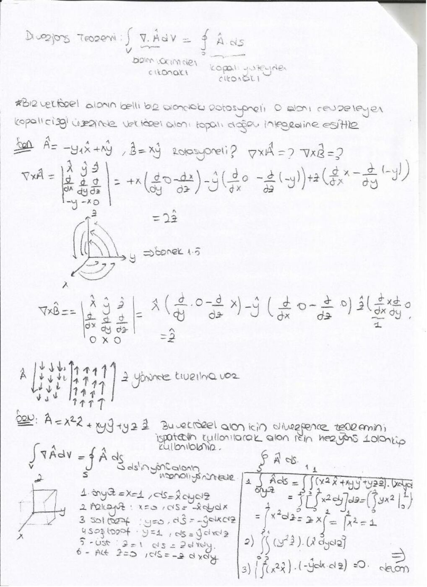
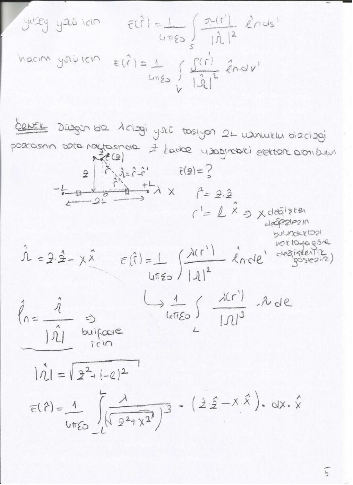

This post was prepared from a friend's course notes; personal information has been removed. The date is not given in the document in a form that includes the year. The headings, key formulas, and example results have been transcribed into the text. A PDF recreated under an anonymous file name can be downloaded at the end of the post.

## Divergence theorem

The total divergence in a volume V equals the total flux leaving through the closed surface S enclosing the volume:

∫_V (∇·A) dv = ∮_S A·dS.

Divergence is a scalar, and flux is also a scalar. The Cartesian volume element is dv = dx dy dz. The surface element's normal points outward.

## Curl and Stokes' theorem

The curl ∇×A measures the local circulation of the field; the result is a vector. The analogy of a small paddle wheel rotating is used. Circulation is computed as C = ∮ A·dl.

∇×A = (∂A_z/∂y−∂A_y/∂z)â_x + (∂A_x/∂z−∂A_z/∂x)â_y + (∂A_y/∂x−∂A_x/∂y)â_z.

Stokes' theorem: ∫_S (∇×A)·dS = ∮_C A·dl. The direction of the contour and the surface normal must be consistent with the right-hand rule.

For A = −yâ_x+xâ_y, ∇×A = 2â_z is obtained; for B = xâ_y, ∇×B = â_z is obtained.

## Example on the unit cube

For the field A = x²â_x + xyâ_y + yzâ_z, ∇·A = 3x+y. Over the unit cube 0≤x,y,z≤1:

∫∫∫(3x+y) dx dy dz = 3/2 + 1/2 = 2.

When the surface fluxes are summed separately, the same result is obtained; thus the divergence theorem is verified on the example.

## Electrostatic postulates

∇·E = ρ/ε₀ and ∇×E = 0.

With the divergence theorem, ∮_S E·dS = Q/ε₀ is obtained. The line integral of the field along a closed contour is zero.

## Spherical surface and volume

The spherical volume element is dv = r² sinθ dr dθ dφ, and for a surface of constant r, dS = r² sinθ dθ dφ.

For a sphere of radius R:

V = ∫₀ᴿ∫₀^π∫₀^(2π) r² sinθ dφ dθ dr = 4πR³/3,

S = ∫₀^π∫₀^(2π) R² sinθ dφ dθ = 4πR².

## Continuous charge distributions

The differential charges of line, surface, and volume distributions are dq = λdl, dq = σdS, and dq = ρdv', respectively. The field is found by summing the Coulomb contribution of each dq:

E(r) = (1/4πε₀)∫ (r−r′)dq/|r−r′|³.

In the last example, a uniform line charge on the x axis between −L and L is chosen, with the observation point on the z axis. The source–observation difference is R = zâ_z−xâ_x, with magnitude √(z²+x²); both this direction and distance are retained together in the integral.

