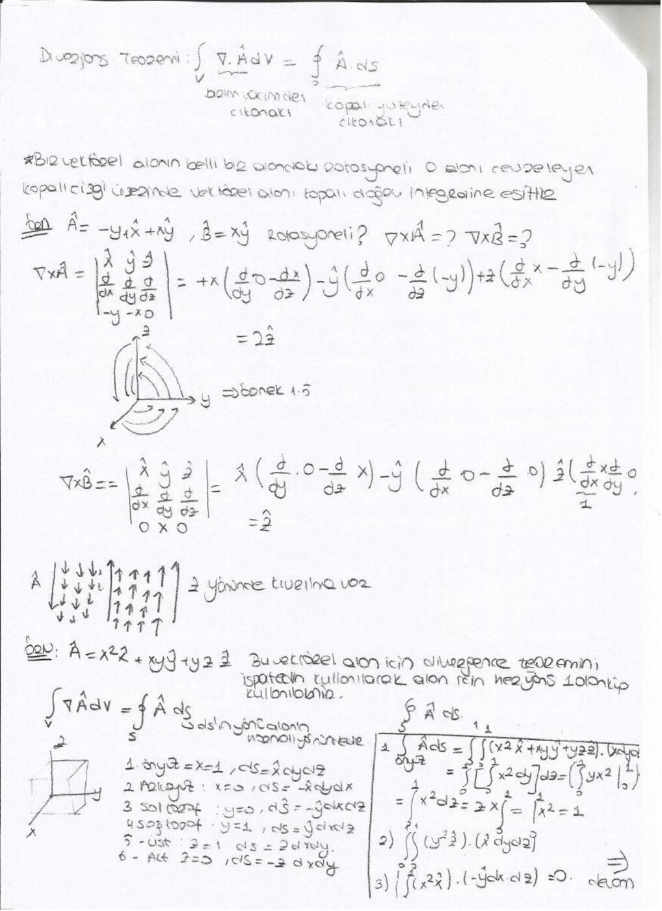
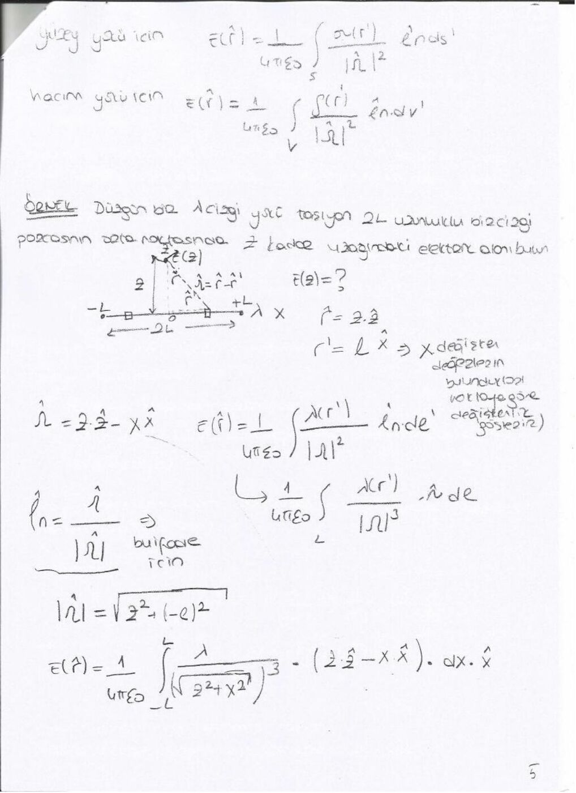

Bu yazı, bir arkadaşın ders notu üzerinden hazırlandı; kişisel bilgiler çıkarıldı. Tarih belgede yıl içerecek biçimde belirtilmemiştir. Başlıklar, temel formüller ve örnek sonuçları metne aktarıldı. İsimsiz dosya adıyla yeniden oluşturulan PDF yazının sonunda indirilebilir.

## Diverjans teoremi

Bir V hacmindeki toplam diverjans, hacmi çevreleyen kapalı S yüzeyinden çıkan toplam akıya eşittir:

∫_V (∇·A) dv = ∮_S A·dS.

Diverjans skaler, akı da skalerdir. Kartezyen hacim elemanı dv = dx dy dz'dir. Yüzey elemanının normali dışarı yöneltilir.

## Rotasyonel ve Stokes teoremi

Rotasyonel ∇×A, alanın yerel dolaşımını ölçer; sonuç vektördür. Küçük bir çarkın dönmesi benzetmesi kullanılır. Dolaşım C = ∮ A·dl ile hesaplanır.

∇×A = (∂A_z/∂y−∂A_y/∂z)â_x + (∂A_x/∂z−∂A_z/∂x)â_y + (∂A_y/∂x−∂A_x/∂y)â_z.

Stokes teoremi: ∫_S (∇×A)·dS = ∮_C A·dl. Kontur yönü ile yüzey normali sağ el kuralıyla uyumlu olmalıdır.

A = −yâ_x+xâ_y için ∇×A = 2â_z; B = xâ_y için ∇×B = â_z hesaplanır.

## Birim küpte örnek

A = x²â_x + xyâ_y + yzâ_z alanında ∇·A = 3x+y. 0≤x,y,z≤1 birim küpünde:

∫∫∫(3x+y) dx dy dz = 3/2 + 1/2 = 2.

Yüzey akıları ayrı ayrı toplandığında aynı sonuç elde edilir; böylece diverjans teoremi örnek üzerinde doğrulanır.

## Elektrostatik postülalar

∇·E = ρ/ε₀ ve ∇×E = 0.

Diverjans teoremiyle ∮_S E·dS = Q/ε₀ elde edilir. Alanın kapalı kontur boyunca çizgi integrali sıfırdır.

## Küresel yüzey ve hacim

Küresel hacim elemanı dv = r² sinθ dr dθ dφ, sabit r yüzeyi için dS = r² sinθ dθ dφ.

Yarıçapı R olan kürede:

V = ∫₀ᴿ∫₀^π∫₀^(2π) r² sinθ dφ dθ dr = 4πR³/3,

S = ∫₀^π∫₀^(2π) R² sinθ dφ dθ = 4πR².

## Sürekli yük dağılımları

Çizgisel, yüzeysel ve hacimsel yüklerin diferansiyel yükleri sırasıyla dq = λdl, dq = σdS ve dq = ρdv'dir. Alan, her bir dq'nun Coulomb katkısı toplanarak bulunur:

E(r) = (1/4πε₀)∫ (r−r′)dq/|r−r′|³.

Son örnekte x ekseninde −L ile L arasında düzgün çizgisel yük ve z ekseninde gözlem noktası seçilir. Kaynak–gözlem farkı R = zâ_z−xâ_x, büyüklüğü √(z²+x²)'dir; integralde bu yön ve uzaklık birlikte korunur.

