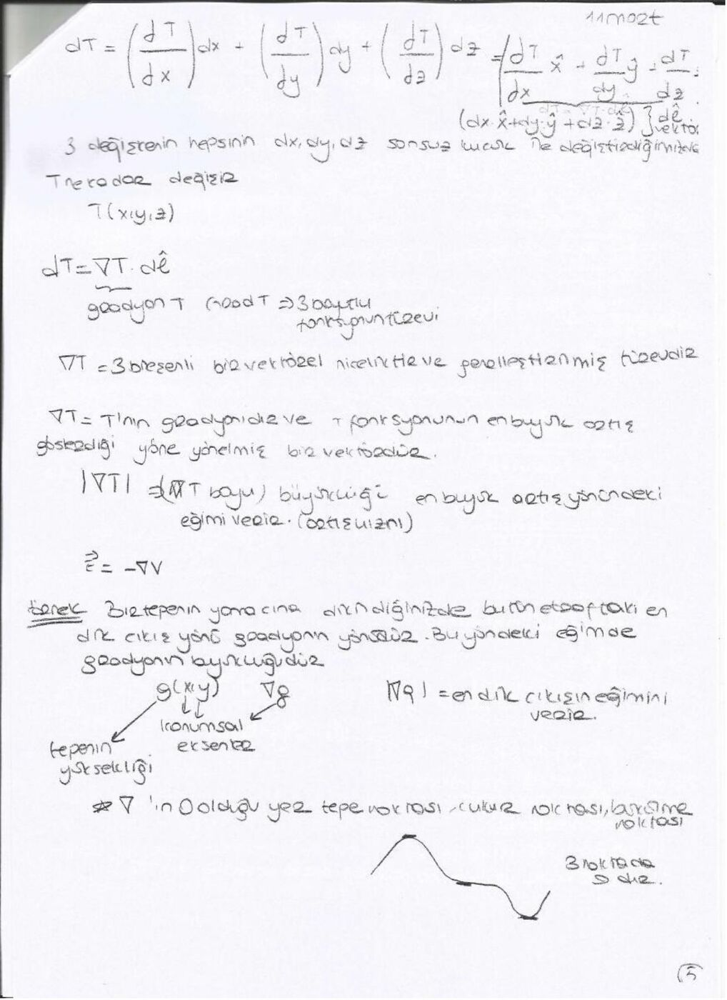

This post was prepared from a friend's course notes; personal information has been removed. The date is not given in the document in a form that includes the year. The headings, basic formulas and example results have been transferred into the text. A PDF recreated under an anonymous file name can be downloaded at the end of the post.

## Field and electric force

A field is the distribution of a scalar or vector quantity with position; if it varies with time, it is written as f(x,y,z,t). The electric field is the force acting on a unit test charge: E = F/Q. Its unit is N/C or V/m.

Let the source charge be q and the test charge at the observation point be Q. For the vector R pointing from the source to the observation point:

F = qQ R/(4πε₀|R|³), E = qR/(4πε₀|R|³).

In the notes, ε₀ ≈ 8.85×10⁻¹² C²/(N·m²) is used. The notes stress that the source and observation points must not be confused.

## Coordinates and example

From cylindrical to Cartesian coordinates: x = s cosφ, y = s sinφ, z = z. For the point (s,φ,z) = (2,5π/6,3), x = −√3, y = 1, z = 3.

For the Cartesian point (0,−2,0), the cylindrical radius is 2 and the azimuth is 3π/2. The arctangent ratio alone does not determine the quadrant of the angle.

## Complex numbers

z = a + jb = |z|(cosθ + j sinθ) = |z|e^(jθ).

|z| = √(a²+b²). Euler's relations are e^(jθ) = cosθ+j sinθ and e^(−jθ) = cosθ−j sinθ.

In the notes, for 5+12j, |z| = 13 and θ ≈ 0.374π are obtained. The operation (3+j)(1−3j)(4+3j) is given as 48−14j, with magnitude 50. Dividing the first two factors by (4−3j) gives −2j.

## Derivative and gradient

For a function of one variable, df = (df/dx)dx. For a function of three variables T(x,y,z):

dT = (∂T/∂x)dx + (∂T/∂y)dy + (∂T/∂z)dz = ∇T · dl.

∇T = â_x ∂T/∂x + â_y ∂T/∂y + â_z ∂T/∂z.

The gradient points in the direction in which the scalar function increases fastest. Its magnitude is the rate of change in that direction. It is perpendicular to the level curves or surfaces. The relation between the electric field and the potential is E = −∇V.

## Divergence and flux

If V = V_x â_x + V_y â_y + V_z â_z, then ∇·V = ∂V_x/∂x + ∂V_y/∂y + ∂V_z/∂z. The result is a scalar.

Examples: for r = xâ_x+yâ_y+zâ_z, ∇·r = 3; for the constant â_z, the result is 0; for zâ_z, the result is 1.

The flux through a surface depends on the component of the field perpendicular to the surface: Φ = ∫_S V·dS. A field parallel to the surface contributes zero flux.

Divergence is the limit of the ratio of the net flux leaving a small closed surface to the enclosed volume:

∇·V = lim_(Δv→0) [∮ V·dS]/Δv.

## Differential length

Cartesian: dl = â_x dx + â_y dy + â_z dz.

Cylindrical: dl = â_s ds + â_φ s dφ + â_z dz.

Spherical: dl = â_r dr + â_θ r dθ + â_φ r sinθ dφ.

On the last page, it is shown that the function √(x²+y²+z²) is directly equal to r in spherical coordinates.
