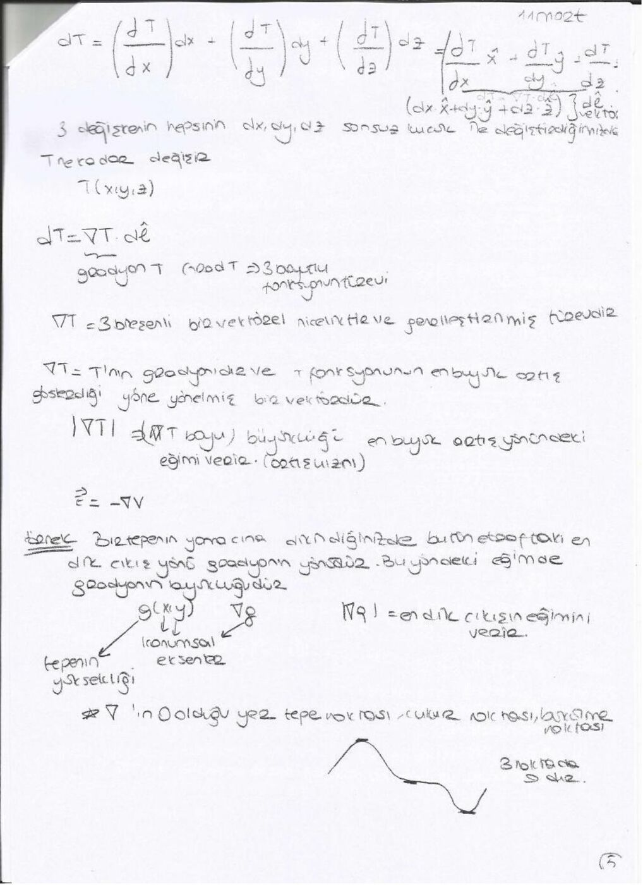

Bu yazı, bir arkadaşın ders notu üzerinden hazırlandı; kişisel bilgiler çıkarıldı. Tarih belgede yıl içerecek biçimde belirtilmemiştir. Başlıklar, temel formüller ve örnek sonuçları metne aktarıldı. İsimsiz dosya adıyla yeniden oluşturulan PDF yazının sonunda indirilebilir.

## Alan ve elektrik kuvveti

Alan, skaler veya vektörel bir büyüklüğün konumla dağılımıdır; zamanla değişiyorsa f(x,y,z,t) biçiminde yazılır. Elektrik alan, birim deneme yüküne etkiyen kuvvettir: E = F/Q. Birimi N/C veya V/m'dir.

Kaynak yük q, gözlem noktasındaki deneme yükü Q olsun. Kaynaktan gözlem noktasına yönelen R vektörü için:

F = qQ R/(4πε₀|R|³), E = qR/(4πε₀|R|³).

Notta ε₀ ≈ 8,85×10⁻¹² C²/(N·m²) kullanılır. Kaynak ile gözlem noktalarının karıştırılmaması vurgulanır.

## Koordinatlar ve örnek

Silindirik koordinatlardan Kartezyen sisteme: x = s cosφ, y = s sinφ, z = z. (s,φ,z) = (2,5π/6,3) noktası için x = −√3, y = 1, z = 3.

Kartezyen (0,−2,0) noktası için silindirik yarıçap 2, azimut 3π/2'dir. Arctan oranı tek başına açının bölgesini belirlemez.

## Kompleks sayılar

z = a + jb = |z|(cosθ + j sinθ) = |z|e^(jθ).

|z| = √(a²+b²). Euler ilişkileri e^(jθ) = cosθ+j sinθ ve e^(−jθ) = cosθ−j sinθ biçimindedir.

Notta 5+12j için |z| = 13 ve θ ≈ 0,374π elde edilir. (3+j)(1−3j)(4+3j) işlemi 48−14j, büyüklüğü 50 olarak verilmiştir. Aynı ilk iki çarpanın (4−3j)'ye bölünmesi −2j sonucunu verir.

## Türev ve gradyant

Bir değişkenli fonksiyonda df = (df/dx)dx. Üç değişkenli T(x,y,z) için:

dT = (∂T/∂x)dx + (∂T/∂y)dy + (∂T/∂z)dz = ∇T · dl.

∇T = â_x ∂T/∂x + â_y ∂T/∂y + â_z ∂T/∂z.

Gradyant, skaler fonksiyonun en hızlı arttığı yönü gösterir. Büyüklüğü bu yöndeki değişim hızıdır. Seviye eğrilerine veya yüzeylerine diktir. Elektrik alanla potansiyel ilişkisi E = −∇V'dir.

## Diverjans ve akı

V = V_x â_x + V_y â_y + V_z â_z ise ∇·V = ∂V_x/∂x + ∂V_y/∂y + ∂V_z/∂z. Sonuç skalerdir.

Örnekler: r = xâ_x+yâ_y+zâ_z için ∇·r = 3; sabit â_z için sonuç 0; zâ_z için sonuç 1.

Bir yüzeyden geçen akı alanın yüzeye dik bileşenine bağlıdır: Φ = ∫_S V·dS. Yüzeye paralel alanın akı katkısı sıfırdır.

Diverjans, küçük kapalı yüzeyden çıkan net akının kapatılan hacme oranının limitidir:

∇·V = lim_(Δv→0) [∮ V·dS]/Δv.

## Diferansiyel uzunluk

Kartezyen: dl = â_x dx + â_y dy + â_z dz.

Silindirik: dl = â_s ds + â_φ s dφ + â_z dz.

Küresel: dl = â_r dr + â_θ r dθ + â_φ r sinθ dφ.

Son sayfada √(x²+y²+z²) fonksiyonunun küresel koordinatlarda doğrudan r'ye eşit olduğu gösterilir.
