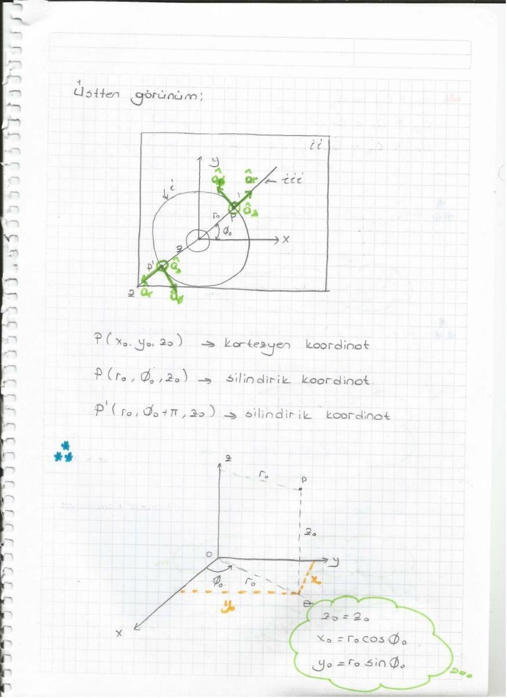
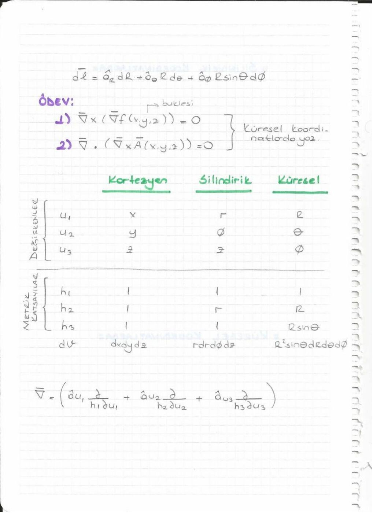
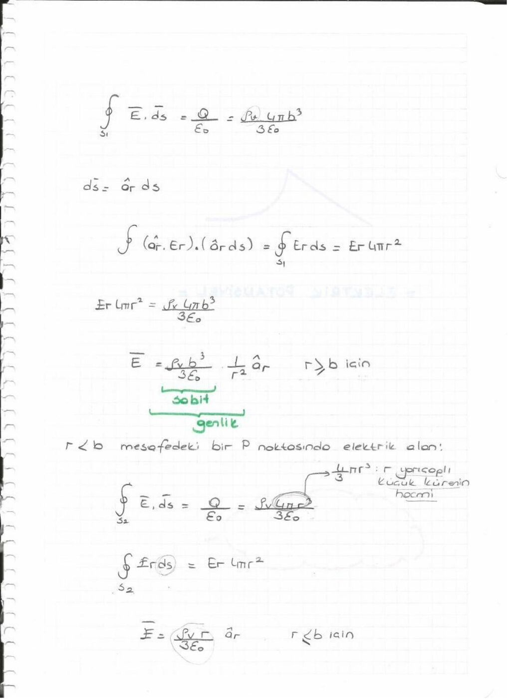
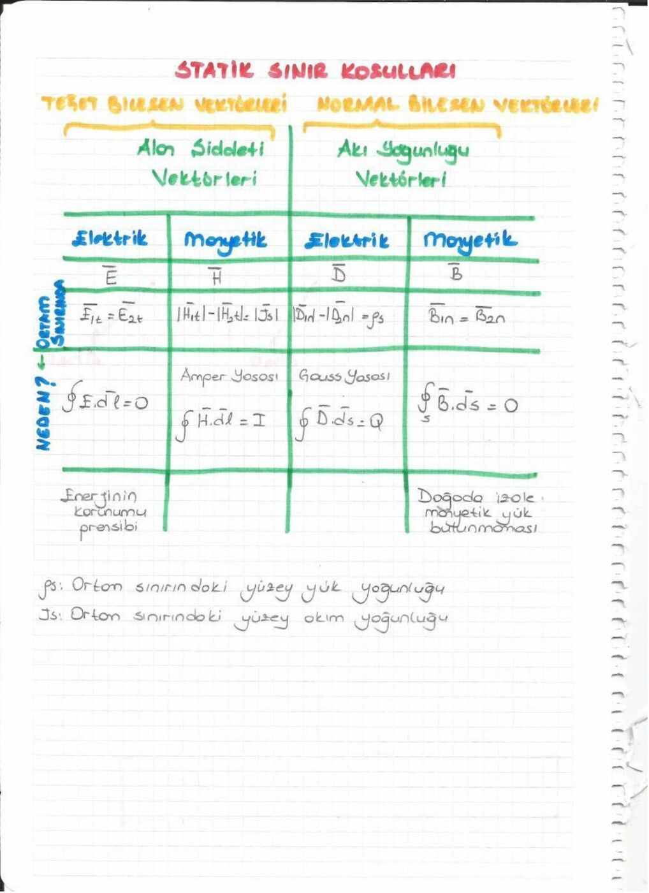

This post is a topic and formula digest of a friend's 88-page Electromagnetics I course notebook. Personal information has been removed. The source PDF was created on March 20, 2014. A size-reduced PDF, regenerated under an anonymous file name, can be downloaded at the end of the post.

## Spectrum and Waves (pages 1–5)

The notebook begins with a spectrum showing the radio, microwave, infrared, visible light, ultraviolet, X-ray, and gamma-ray regions. Acoustic waves are shown separately. In a transverse wave the oscillation is perpendicular to the direction of propagation; in a longitudinal wave it is parallel.

λ = vT = v/f, f = 1/T. For an electromagnetic wave in vacuum, v = c ≈ 3×10⁸ m/s. At constant speed, the wavelength decreases as the frequency increases.

*Note: The notebook lists the decrease in range and the increase in information capacity with rising frequency as if it were a general rule. These depend on the medium, losses, bandwidth, and system conditions.*

## Scalar and Vector Fields (pages 6–9)

A scalar quantity has only a value; a vector has a magnitude and a direction. Temperature and charge density are scalar examples; force and electric field are vector examples. These position-dependent quantities form fields.

A = â_A |A|, â_A = A/|A|.

Addition is done by the triangle or parallelogram method. A−B is A+(−B). Scalar multiplication kA changes the magnitude of the vector and, depending on the sign, its direction.

A·B = |A||B|cosθ; A×B = â_n |A||B|sinθ.

A·B = B·A, A×B = −B×A, A·A = |A|², and A×A = 0. The scalar projection of A onto the direction of B is A·â_B.

## Orthogonal Coordinates (pages 10–18)

The purpose of a coordinate system is to express a point and a vector. In the Cartesian system the x, y, and z axes are mutually perpendicular. Cylindrical coordinates are denoted r,φ,z; spherical coordinates are denoted R,θ,φ.

- Cylindrical: x = r cosφ, y = r sinφ, z = z.
- Spherical: x = R sinθ cosφ, y = R sinθ sinφ, z = R cosθ.
- Cylindrical radius r = √(x²+y²); spherical radius R = √(x²+y²+z²).
- Spherical polar angle 0≤θ≤π; azimuth 0≤φ<2π.

In Cartesian components, |A| = √(A_x²+A_y²+A_z²), A·B = A_xB_x+A_yB_y+A_zB_z.

A×B = (A_yB_z−A_zB_y)â_x+(A_zB_x−A_xB_z)â_y+(A_xB_y−A_yB_x)â_z.

## Line, Surface, and Volume Integrals (pages 19–23)

The work done by a force along a small path is ΔW = F·Δl. The total work along the path is W = ∫F·dl. If the force is perpendicular to the path, the contribution is zero.

The flux through a surface is found as Φ = ∫A·dS. The surface vector points along the normal; the tangential component of the field makes no contribution. For a closed surface, ∮ is used.

The mass of a body with density d(x,y,z) is m = ∫_V d dv'. Here there is a scalar product rather than a vector one.

## Gradient, Divergence, Curl (pages 24–28)

∇ = â_x∂/∂x + â_y∂/∂y + â_z∂/∂z.

Gradient: ∇f = â_x∂f/∂x+â_y∂f/∂y+â_z∂f/∂z. It produces a vector from a scalar and points in the direction of fastest increase. For f = 3x+4y+5z, ∇f = 3â_x+4â_y+5â_z; for f = 3x²+4y+5z², ∇f = 6xâ_x+4â_y+10zâ_z.

Divergence: ∇·A = ∂A_x/∂x+∂A_y/∂y+∂A_z/∂z. It produces a scalar from a vector.

Curl: ∇×A = (∂A_z/∂y−∂A_y/∂z)â_x+(∂A_x/∂z−∂A_z/∂x)â_y+(∂A_y/∂x−∂A_x/∂y)â_z. It produces a vector from a vector.

Two zero identities: ∇×(∇f)=0 and ∇·(∇×A)=0.

## Integral Examples and Metric Coefficients (pages 29–36)

For a path in the z=0 plane that goes first in the x direction and then in the y direction, the line integral of the field A=3xâ_x+5yâ_y+3xy e^z â_z is found to be 3x₀²/2+5y₀²/2. Since the path lies in the plane, the z component makes no contribution.

The flux of a field with A_z=5 through a rectangular surface in the z=0 plane is 5(x₁−x₀)(y₁−y₀).

On a quarter circle, dl = â_φ r dφ is used. In the notebook, for A_φ=r² and radius a, the integral is found to be πa³/2.

| Coordinates | Metric coefficients | Volume element |
|---|---|---|
| Cartesian x,y,z | 1,1,1 | dx dy dz |
| Cylindrical r,φ,z | 1,r,1 | r dr dφ dz |
| Spherical R,θ,φ | 1,R,R sinθ | R² sinθ dR dθ dφ |

Cylindrical dl = â_r dr+â_φ r dφ+â_z dz; spherical dl = â_R dR+â_θ R dθ+â_φ R sinθ dφ.

In the quiz example, it is explained that the equality A·B=A·C does not by itself imply B=C. A·(B×A)=0, because the vector B×A is perpendicular to A.

## Divergence and Stokes Theorems (pages 37–38)

∮_S A·dS = ∫_V (∇·A)dv.

∮_C A·dl = ∫_S (∇×A)·dS.

The notebook also touches on the determination of a field by its divergence and curl.

*Note: Appropriate boundary conditions are also required for a field to be uniquely determined. The surface in Stokes' theorem does not itself have to be closed; the contour is the boundary of the surface.*

## Electrostatic Postulates and Coulomb's Law (pages 38–50)

E = lim_(q→0) F/q. In a static field, ∇×E=0 and ∇·E=ρ_v/ε₀.

Integral forms: ∮_C E·dl=0, ∮_S E·dS=Q/ε₀. Because the closed-path integral is zero, the integral between two points is independent of the path.

For a point charge at the origin, E = qâ_R/(4πε₀R²). The field at point r due to a charge at r′ is:

E(r) = q(r−r′)/(4πε₀|r−r′|³).

If there are multiple charges, vector summation is performed:

E(r) = (1/4πε₀)Σ qᵢ(r−rᵢ′)/|r−rᵢ′|³.

The notebook gives examples of two charges of equal magnitude cancelling each other at the midpoint, and of resolving the fields of charges at different positions into components.

## Continuous Distributions and Gauss's Law (pages 51–57)

For a volume distribution, dq=ρ_v dv; the Coulomb contribution of each small charge is integrated. For symmetric structures, choosing a Gaussian surface simplifies the calculation.

- Infinite uniformly charged wire: E = ρ_l â_r/(2πε₀r).
- Infinite uniformly charged plane: E = ±ρ_s â_z/(2ε₀).
- The point-charge field is inversely proportional to the square of the distance, the wire field to the distance; the infinite-plane field is independent of distance.

For a sphere of radius b containing a constant ρ_v:

E = ρ_v r â_r/(3ε₀), r<b;

E = ρ_v b³ â_r/(3ε₀r²), r>b.

The field increases linearly inside; beyond the surface it decreases as 1/r².

## Potential, Equipotentials, and the Dipole (pages 58–68)

E = −∇V. The potential difference is V₂−V₁ = −∫₁²E·dl. When V(∞)=0 is chosen, V=q/(4πε₀R) for a point charge.

Potentials add as scalars, fields as vectors. Equipotential surfaces are perpendicular to field lines; no electrical work is done when moving a charge along these surfaces.

For charges ±q separated by d, the dipole moment is p=qd; its direction is taken from negative to positive. In the far region (R≫d):

V ≈ qd cosθ/(4πε₀R²) = p·â_R/(4πε₀R²).

## Magnetostatic Fields and Ampère's Law (pages 69–74)

Steady magnetic fields are produced by moving charges or magnets. ∇·B=0, and in vacuum ∇×B=μ₀J.

The integral forms are ∮_S B·dS=0 and ∮_C B·dl=μ₀I. Magnetic field lines are closed. The unit of volume current density is A/m², and that of surface current density is A/m.

For a long straight conductor of radius b in which the current is uniformly distributed over the cross-section:

B = μ₀Ir â_φ/(2πb²), r<b;

B = μ₀I â_φ/(2πr), r>b.

In the interior region of an ideal toroid with N turns, B = μ₀NI â_φ/(2πr); in the ideal model the field is zero in the central opening and in the exterior region. The magnetic dipole moment of a circular current loop is given as m=Iπb²â_z.

## Magnetic Boundary Conditions (pages 75–80)

At the interface of two media, the normal magnetic flux density is continuous: B₁n=B₂n. The difference of the tangential H components is related to the surface current density. If there is no surface current, H₁t=H₂t.

For a linear isotropic medium, B=μH. Thus, with no surface current, B₁t/μ₁=B₂t/μ₂. In the notes, ε, μ, and σ are listed as the parameters that characterize the medium.

## Electrostatic Energy and Polarization (pages 81–88)

The energy of a charge system is the total work done to bring the charges from infinity to their positions. For two charges, W=Q₁Q₂/(4πε₀R₁₂)=½(Q₁V₁+Q₂V₂).

For N discrete charges, W=½ΣQᵢVᵢ; for a continuous volume charge, W=½∫ρ_vV dv.

In a dielectric, the dipole moment per unit volume is the polarization P. Its unit is C/m². The electric flux density is D=ε₀E+P; for a linear medium it is written D=εE. The general form of Gauss's law is ∮D·dS=Q.

*Note: On some pages of the notebook there is notation in the unit of electric flux density that could be confused with volume density; the unit is C/m² for D and P, and C/m³ for ρ_v.*
