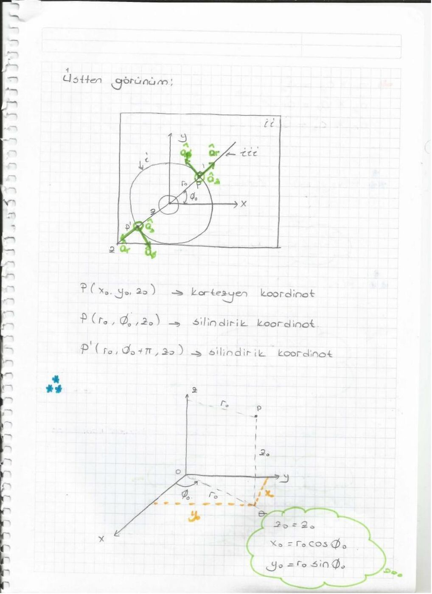
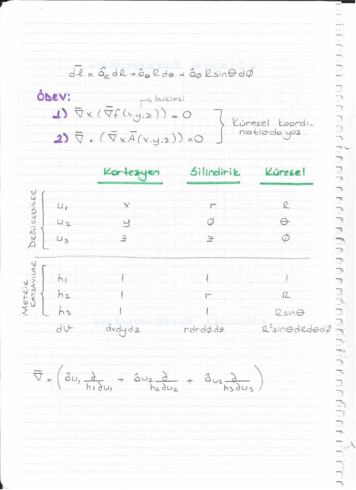
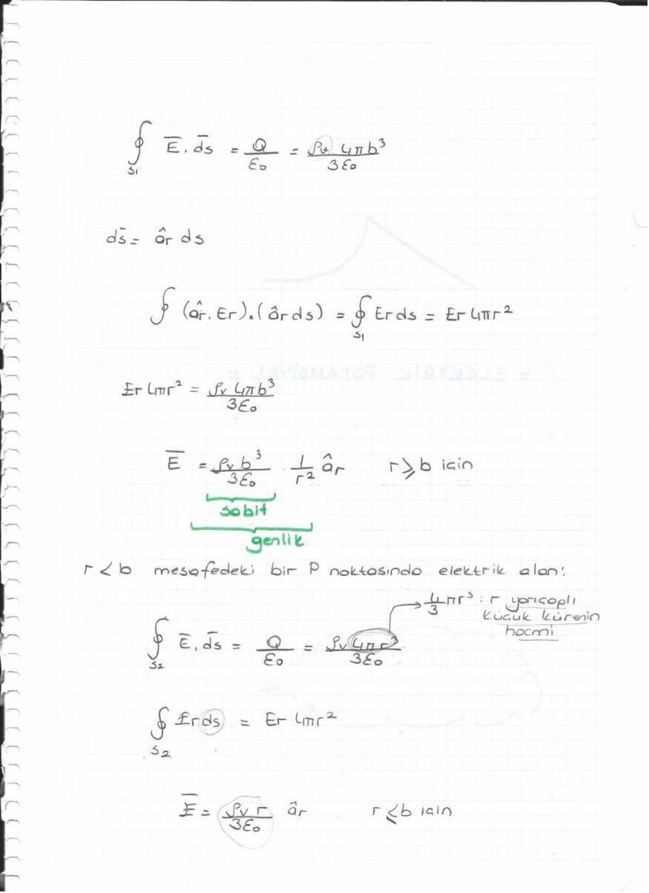
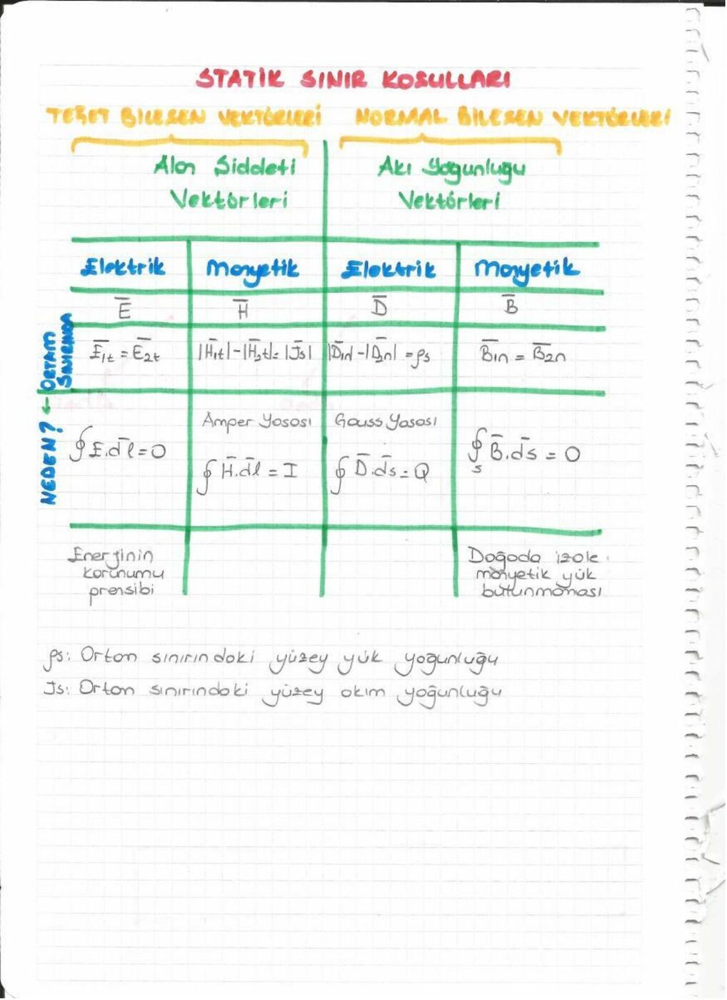

Bu yazı, bir arkadaşın ders notu olan 88 sayfalık Elektromanyetik I defterinin konu ve formül dökümüdür. Kişisel bilgiler çıkarıldı. Kaynak PDF'nin oluşturulma tarihi 20 Mart 2014'tür. İsimsiz dosya adıyla yeniden oluşturulan, boyutu küçültülmüş PDF yazının sonunda indirilebilir.

## Spektrum ve dalgalar (sayfa 1–5)

Defter radyo, mikrodalga, kızılötesi, görünür ışık, morötesi, X ve gama ışını bölgelerini gösteren bir spektrumla başlar. Akustik dalgalar ayrıca gösterilir. Enine dalgada salınım ilerlemeye diktir; boyuna dalgada paraleldir.

λ = vT = v/f, f = 1/T. Boşlukta elektromanyetik dalga için v = c ≈ 3×10⁸ m/s. Sabit hızda frekans yükselince dalga boyu küçülür.

*Not: Defterde frekans yükselmesiyle menzilin azalması ve bilgi kapasitesinin artması genel bir kural gibi sıralanmıştır. Bunlar ortam, kayıp, bant genişliği ve sistem koşullarına bağlıdır.*

## Skaler ve vektörel alan (sayfa 6–9)

Skaler büyüklüğün yalnız değeri; vektörün büyüklüğü ve yönü vardır. Sıcaklık ve yük yoğunluğu skaler, kuvvet ve elektrik alan vektörel örneklerdir. Konuma bağlı bu büyüklükler alanları oluşturur.

A = â_A |A|, â_A = A/|A|.

Toplama üçgen veya paralelkenar yöntemiyle yapılır. A−B, A+(−B)'dir. Skaler çarpma kA, vektörün büyüklüğünü ve işarete göre yönünü değiştirir.

A·B = |A||B|cosθ; A×B = â_n |A||B|sinθ.

A·B = B·A, A×B = −B×A, A·A = |A|² ve A×A = 0. A'nın B yönündeki skaler izdüşümü A·â_B'dir.

## Ortogonal koordinatlar (sayfa 10–18)

Koordinat sisteminin amacı noktayı ve vektörü ifade etmektir. Kartezyen sistemde x, y ve z eksenleri birbirine diktir. Silindirik koordinatlar r,φ,z; küresel koordinatlar R,θ,φ ile gösterilir.

- Silindirik: x = r cosφ, y = r sinφ, z = z.
- Küresel: x = R sinθ cosφ, y = R sinθ sinφ, z = R cosθ.
- Silindirik yarıçap r = √(x²+y²); küresel yarıçap R = √(x²+y²+z²).
- Küresel kutupsal açı 0≤θ≤π; azimut 0≤φ<2π.

Kartezyen bileşenlerle |A| = √(A_x²+A_y²+A_z²), A·B = A_xB_x+A_yB_y+A_zB_z.

A×B = (A_yB_z−A_zB_y)â_x+(A_zB_x−A_xB_z)â_y+(A_xB_y−A_yB_x)â_z.

## Çizgi, yüzey ve hacim integralleri (sayfa 19–23)

Bir kuvvetin küçük yol boyunca yaptığı iş ΔW = F·Δl'dir. Yol boyunca toplam iş W = ∫F·dl olur. Kuvvet yola dikse katkı sıfırdır.

Yüzeyden geçen akı Φ = ∫A·dS ile bulunur. Yüzey vektörü normale yönelir; alanın teğet bileşeni katkı vermez. Kapalı yüzeyde ∮ kullanılır.

Yoğunluğu d(x,y,z) olan cismin kütlesi m = ∫_V d dv'dir. Burada vektörel değil skaler çarpım vardır.

## Gradyant, diverjans, bukle (sayfa 24–28)

∇ = â_x∂/∂x + â_y∂/∂y + â_z∂/∂z.

Gradyant: ∇f = â_x∂f/∂x+â_y∂f/∂y+â_z∂f/∂z. Skalerden vektör üretir ve en hızlı artış yönünü gösterir. f = 3x+4y+5z için ∇f = 3â_x+4â_y+5â_z; f = 3x²+4y+5z² için ∇f = 6xâ_x+4â_y+10zâ_z.

Diverjans: ∇·A = ∂A_x/∂x+∂A_y/∂y+∂A_z/∂z. Vektörden skaler üretir.

Bukle: ∇×A = (∂A_z/∂y−∂A_y/∂z)â_x+(∂A_x/∂z−∂A_z/∂x)â_y+(∂A_y/∂x−∂A_x/∂y)â_z. Vektörden vektör üretir.

İki sıfır özdeşliği: ∇×(∇f)=0 ve ∇·(∇×A)=0.

## İntegral örnekleri ve metrik katsayılar (sayfa 29–36)

z=0 düzleminde önce x sonra y yönünde ilerlenen yol için A=3xâ_x+5yâ_y+3xy e^z â_z alanının çizgi integrali 3x₀²/2+5y₀²/2 bulunur. Yol düzlemde olduğundan z bileşeni katkı yapmaz.

A_z=5 olan alanın z=0 düzlemindeki dikdörtgen yüzeyden akısı 5(x₁−x₀)(y₁−y₀)'dır.

Çeyrek çember üzerinde dl = â_φ r dφ kullanılır. Defterde A_φ=r² için, yarıçap a olduğunda integral πa³/2 olarak bulunur.

| Koordinatlar | Metrik katsayılar | Hacim elemanı |
|---|---|---|
| Kartezyen x,y,z | 1,1,1 | dx dy dz |
| Silindirik r,φ,z | 1,r,1 | r dr dφ dz |
| Küresel R,θ,φ | 1,R,R sinθ | R² sinθ dR dθ dφ |

Silindirik dl = â_r dr+â_φ r dφ+â_z dz; küresel dl = â_R dR+â_θ R dθ+â_φ R sinθ dφ.

Quiz örneğinde A·B=A·C eşitliğinin tek başına B=C anlamına gelmediği açıklanır. A·(B×A)=0, çünkü B×A vektörü A'ya diktir.

## Diverjans ve Stokes teoremleri (sayfa 37–38)

∮_S A·dS = ∫_V (∇·A)dv.

∮_C A·dl = ∫_S (∇×A)·dS.

Defter, bir alanın diverjans ve buklesiyle belirlenmesine de değinir.

*Not: Alanın tekil olarak belirlenmesi için uygun sınır koşulları da gerekir. Stokes teoremindeki yüzeyin kendisi kapalı olmak zorunda değildir; kontur yüzeyin sınırıdır.*

## Elektrostatik postülalar ve Coulomb yasası (sayfa 38–50)

E = lim_(q→0) F/q. Statik alanda ∇×E=0 ve ∇·E=ρ_v/ε₀.

İntegral biçimler: ∮_C E·dl=0, ∮_S E·dS=Q/ε₀. Kapalı yol integrali sıfır olduğu için iki nokta arasındaki integral yoldan bağımsızdır.

Orijindeki noktasal yük için E = qâ_R/(4πε₀R²). r′ konumundaki yükün r noktasındaki alanı:

E(r) = q(r−r′)/(4πε₀|r−r′|³).

Birden fazla yük varsa vektörel toplama yapılır:

E(r) = (1/4πε₀)Σ qᵢ(r−rᵢ′)/|r−rᵢ′|³.

Defterde aynı büyüklükte iki yükün orta noktada birbirini götürmesi ve farklı konumlardaki yüklerin bileşenlerine ayrılması örneklenir.

## Sürekli dağılımlar ve Gauss yasası (sayfa 51–57)

Hacimsel dağılım için dq=ρ_v dv; her küçük yükün Coulomb katkısı entegre edilir. Simetrik yapılarda Gauss yüzeyi seçmek işlemi kolaylaştırır.

- Sonsuz düzgün yüklü tel: E = ρ_l â_r/(2πε₀r).
- Sonsuz düzgün yüklü düzlem: E = ±ρ_s â_z/(2ε₀).
- Noktasal yük alanı uzaklığın karesiyle, tel alanı uzaklıkla ters orantılıdır; sonsuz düzlem alanı uzaklıktan bağımsızdır.

Yarıçapı b olan, içinde sabit ρ_v bulunan kürede:

E = ρ_v r â_r/(3ε₀), r<b;

E = ρ_v b³ â_r/(3ε₀r²), r>b.

Alan içeride doğrusal artar; yüzeyden sonra 1/r² ile azalır.

## Potansiyel, eşpotansiyel ve dipol (sayfa 58–68)

E = −∇V. Potansiyel farkı V₂−V₁ = −∫₁²E·dl'dir. V(∞)=0 seçildiğinde noktasal yük için V=q/(4πε₀R).

Potansiyeller skaler olarak, alanlar vektörel olarak toplanır. Eşpotansiyel yüzeyler alan çizgilerine diktir; bu yüzeylerde yük taşınırken elektriksel iş sıfırdır.

±q yüklerinin d ayrımı için dipol momenti p=qd'dir; yönü negatiften pozitife alınır. Uzak bölgede (R≫d):

V ≈ qd cosθ/(4πε₀R²) = p·â_R/(4πε₀R²).

## Manyetostatik alanlar ve Ampère yasası (sayfa 69–74)

Durgun manyetik alanları hareket eden yükler veya mıknatıslar oluşturur. ∇·B=0, boşlukta ∇×B=μ₀J.

İntegral biçimler ∮_S B·dS=0 ve ∮_C B·dl=μ₀I'dır. Manyetik alan çizgileri kapalıdır. Hacim akım yoğunluğunun birimi A/m², yüzey akım yoğunluğunun birimi A/m'dir.

Yarıçapı b olan uzun düz iletkende akım kesite düzgün dağılmışsa:

B = μ₀Ir â_φ/(2πb²), r<b;

B = μ₀I â_φ/(2πr), r>b.

N sarımlı ideal toroidin iç bölgesinde B = μ₀NI â_φ/(2πr); merkez boşluğunda ve dış bölgede ideal modelde alan sıfırdır. Dairesel akım halkasının manyetik dipol momenti m=Iπb²â_z olarak verilir.

## Manyetik sınır koşulları (sayfa 75–80)

İki ortamın sınırında normal manyetik akı yoğunluğu süreklidir: B₁n=B₂n. Teğet H bileşenlerinin farkı yüzey akım yoğunluğuyla ilişkilidir. Yüzey akımı yoksa H₁t=H₂t.

Doğrusal izotrop ortam için B=μH. Böylece yüzey akımı yokken B₁t/μ₁=B₂t/μ₂. Notta ε, μ ve σ ortamı tanımlayan parametreler olarak sıralanır.

## Elektrostatik enerji ve polarizasyon (sayfa 81–88)

Bir yük sisteminin enerjisi, yükleri sonsuzdan yerlerine getirmek için yapılan toplam iştir. İki yükte W=Q₁Q₂/(4πε₀R₁₂)=½(Q₁V₁+Q₂V₂).

N ayrık yükte W=½ΣQᵢVᵢ; sürekli hacim yükünde W=½∫ρ_vV dv.

Dielektrikte birim hacim başına dipol momenti polarizasyon P'dir. Birimi C/m². Elektrik akı yoğunluğu D=ε₀E+P; doğrusal ortam için D=εE olarak yazılır. Gauss yasasının genel biçimi ∮D·dS=Q'dur.

*Not: Defterin bazı sayfalarında elektrik akı yoğunluğu biriminde hacimsel yoğunlukla karışabilecek notasyonlar vardır; D ve P için birim C/m², ρ_v için C/m³'tür.*
