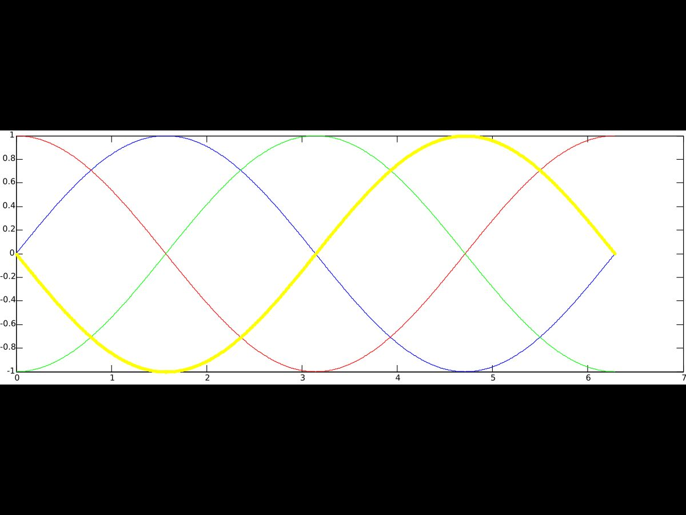
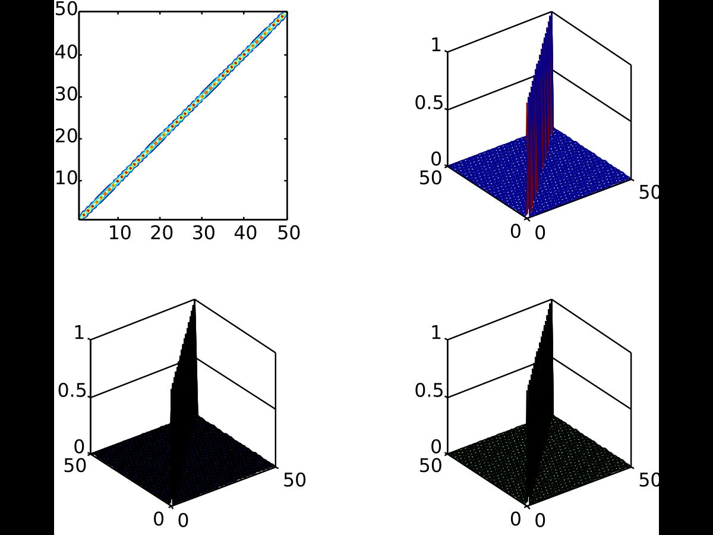

MATLAB Assignment 3 prepared by a friend; personal information has been removed. The document's creation date is 16 March 2014. It covers circle and sphere calculations, trigonometric plots, and matrix surfaces. An anonymized and reformatted PDF can be downloaded at the end of the post.

## Circle and sphere

The circumference and area of a circle, and the surface area and volume of a sphere, are computed using software.

```matlab
r = 5;
cember_cevre = 2*pi*r
cember_alan = pi*r^2
[x,y] = cylinder(r,360);
plot(x,y)
axis equal

r = 5;
[x,y,z] = sphere();
kure_hacim = (4/3)*pi*r^3
kure_alan = 4*pi*r^2
surf(r*x,r*y,r*z)
```

```
cember_cevre = 31.4159
cember_alan = 78.5398
kure_hacim = 523.5988
kure_alan = 314.1593
```

*Note: These four numbers agree with the formulas for the given r = 5. Since no unit was specified, no length unit was added to the results.*

## Line segments and sine

In Figure 1, x goes from 0 to 360; in Figure 2, y goes from 0 to 720. In the source, the plot is drawn using two endpoints.

```matlab
x = [0 360];
y = [0 0];
hold on;
plot(x,y)
y = [0 360*2];
plot(x,y)
```

In Figure 3, the sine is plotted over the range 0–2π with a step of π/360.

```matlab
der = 0:pi/360:2*pi;
z = sin(der);
plot(der,z)
```

## Four trigonometric curves

Figure 4: showing sine, cosine, and their negatives with different line styles and colors.

```matlab
der = 0:pi/360:2*pi;
z = sin(der);
plot(der,z,'b')
hold on;
z = cos(der);
plot(der,z,'r--')
hold on;
z = -cos(der);
plot(der,z,'g-.')
hold on;
z = -sin(der);
plot(der,z,'y:.')
```

In Figures 6 and 7, a title, axis labels, and a legend box are added.

```matlab
xlabel('Angle (radians)');
ylabel('various matlab usages');
title('Figure 6');
axis equal
legend('sin(x)','cos(x)','-sin(x)','-cos(x)')
```

*Note: The legend order in the source does not match the last two curves. The code plots −cos third and −sin fourth, but the legend entries are given in the reverse order. The source's code has been preserved. The figure numbers also jump from 4 to 6, as in the document.*



## Four views of the identity matrix

Figure 8: a 50 × 50 identity matrix is displayed in a 2 × 2 subplot layout using contour, mesh, surf, and surfl.

```matlab
i = eye(50,50);
subplot(2,2,1)
contour(i)
axis square
subplot(2,2,2)
mesh(i)
axis square
subplot(2,2,3)
surf(i)
axis square
subplot(2,2,4)
surfl(i)
axis square
```



*Note: The code was transcribed from the document without being run. Font and layout details may change when the EMF drawings are converted.*

*Note: The Word document could not be converted directly to PDF in this environment. The download is a PDF re-typeset from the text in the document; the original page layout was not preserved. For documents with embedded drawings, the drawings were transferred separately.*
