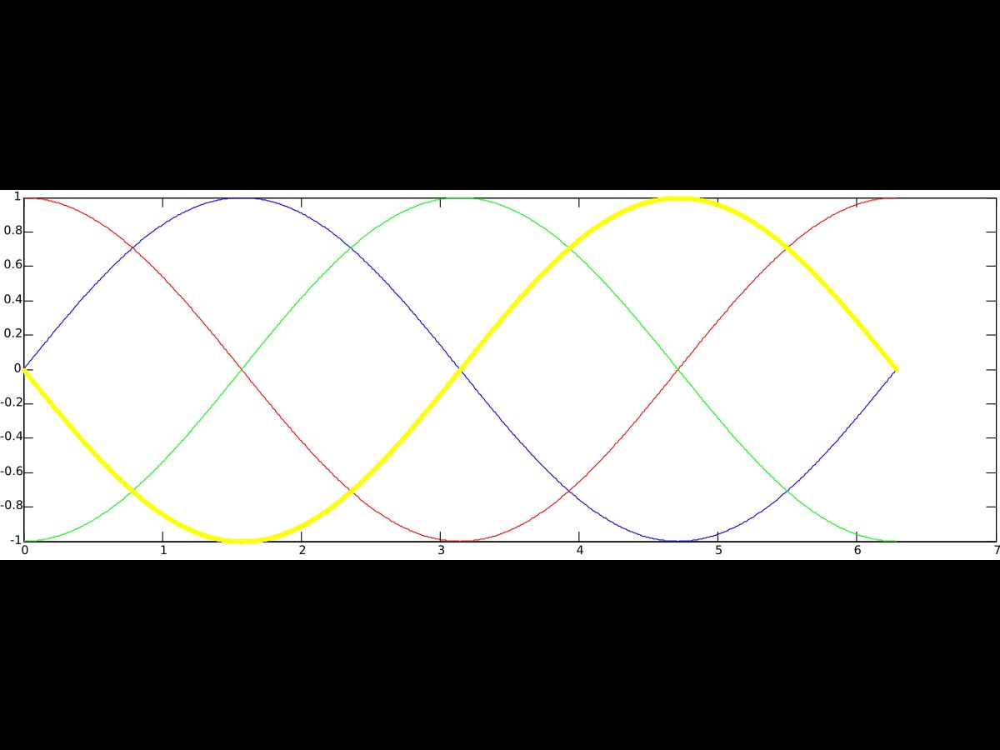
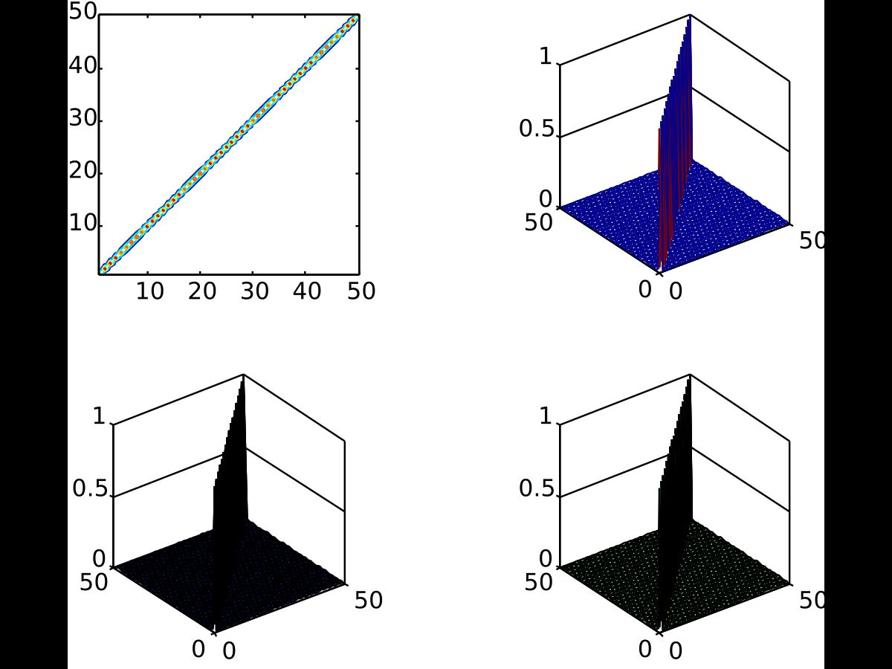

Bir arkadaşın hazırladığı MATLAB Ödev 3; kişisel bilgiler çıkarıldı. Belgenin oluşturma tarihi 16 Mart 2014. Çember ve küre hesapları, trigonometrik grafikler ve matris yüzeyleri işleniyor. Anonimleştirilip yeniden düzenlenmiş PDF yazının sonunda indirilebilir.

## Çember ve küre

Yazılım kullanarak çemberin çevresi ve alanı, kürenin alanı ve hacmi hesaplanıyor.

```matlab
r = 5;
cember_cevre = 2*pi*r
cember_alan = pi*r^2
[x,y] = cylinder(r,360);
plot(x,y)
axis equal

r = 5;
[x,y,z] = sphere();
kure_hacim = (4/3)*pi*r^3
kure_alan = 4*pi*r^2
surf(r*x,r*y,r*z)
```

```
cember_cevre = 31.4159
cember_alan = 78.5398
kure_hacim = 523.5988
kure_alan = 314.1593
```

*Not: Bu dört sayı verilen r = 5 için formüllerle uyumludur. Birim belirtilmediği için sonuçlara uzunluk birimi eklenmedi.*

## Doğru parçaları ve sinüs

Figure 1’de x, 0’dan 360’a; Figure 2’de y, 0’dan 720’ye gidiyor. Kaynakta iki uç nokta ile çizim yapılıyor.

```matlab
x = [0 360];
y = [0 0];
hold on;
plot(x,y)
y = [0 360*2];
plot(x,y)
```

Figure 3’te 0–2π aralığında π/360 adımıyla sinüs çiziliyor.

```matlab
der = 0:pi/360:2*pi;
z = sin(der);
plot(der,z)
```

## Dört trigonometrik eğri

Figure 4: sinüs, kosinüs ve bunların negatiflerini farklı çizgi ve renklerle gösterme.

```matlab
der = 0:pi/360:2*pi;
z = sin(der);
plot(der,z,'b')
hold on;
z = cos(der);
plot(der,z,'r--')
hold on;
z = -cos(der);
plot(der,z,'g-.')
hold on;
z = -sin(der);
plot(der,z,'y:.')
```

Figure 6 ve 7’de başlık, eksenler ve açıklama kutusu ekleniyor.

```matlab
xlabel('Açı(radyan)');
ylabel('çeşitli matlab kullanımları');
title('Figure 6');
axis equal
legend('sin(x)','cos(x)','-sin(x)','-cos(x)')
```

*Not: Kaynaktaki legend sırası son iki eğriyle uyuşmuyor. Kod üçüncü olarak −cos, dördüncü olarak −sin çiziyor; açıklamalar ters sırada verilmiş. Kaynağın kodu korunmuştur. Figure numaraları da belgedeki gibi 4’ten 6’ya geçmektedir.*



## Birim matrisin dört görünümü

Figure 8: 50 × 50 birim matris, 2 × 2 alt grafik düzeninde contour, mesh, surf ve surfl ile gösteriliyor.

```matlab
i = eye(50,50);
subplot(2,2,1)
contour(i)
axis square
subplot(2,2,2)
mesh(i)
axis square
subplot(2,2,3)
surf(i)
axis square
subplot(2,2,4)
surfl(i)
axis square
```



*Not: Kodlar çalıştırılmadan belgeden aktarılmıştır. EMF çizimleri dönüştürülürken yazı tipi ve yerleşim ayrıntıları değişebilir.*

*Not: Word belgesi bu ortamda doğrudan PDF’ye dönüştürülemedi. İndirme, belgedeki metinden yeniden dizilmiş bir PDF’dir; özgün sayfa düzeni korunmadı. Gömülü çizimler bulunan belgelerde çizimler ayrıca aktarıldı.*
