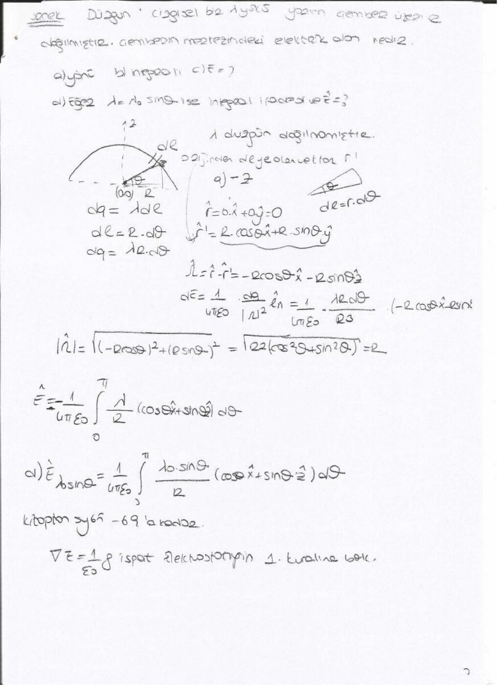

This post was prepared from a friend's course notes; personal information has been removed. The date is not given in the document with a year. The headings, basic formulas, and example results have been transferred into the text. A PDF recreated under an anonymous file name can be downloaded at the end of the post.

## Basic relations

∮_S A·dS = ∫_V ∇·A dv; ∮_C A·dl = ∫_S (∇×A)·dS.

∇·E = ρ/ε₀, ∇×E = 0, E = −∇V, F = QE.

For a point charge, E = q R̂/(4πε₀R²). For a uniform line distribution, dq = λdl is used.

## Finite line segment

The electric field is required on the extension of a line segment of length 1.5 m with line charge density λ = 2 μC/m, at a distance of 2.5 m from its starting point. In the solution, the line is placed along the x axis with 0≤x′≤1.5:

E = â_x [λ/(4πε₀)]∫₀^1.5 dx′/(2.5−x′)².

The integral gives 1/1−1/2.5 = 3/5 m⁻¹. The result is approximately E = 10.8×10³ â_x N/C.

If the charge at the same point is q₀ = 4 μC, then F = q₀E = 43.2×10⁻³ â_x N.

*Note: The results were checked using the approximation k ≈ 9×10⁹ N·m²/C² used in the source.*

## Field at the center of a semicircle

For a uniformly line-charged semicircle, take dq = λa dφ. The observation point is the center; the horizontal components of symmetric elements cancel each other. Summing the vertical components gives a field magnitude of λ/(2πε₀a). The direction is determined by the position of the arc and the sign of the charge.

## Field on the axis of a charged disk

On the last page, the integral is set up for the field on the axis of a circular region with uniform surface charge. Because of circular symmetry, the in-plane components vanish and the axial component remains. The surface element is dS = r dr dφ, and the source–observation distance is √(b²+r²).

The note also recalls the derivation of the relation ∇·E = ρ/ε₀ from the electrostatic postulate, and that as the distance becomes very large the result approaches the field of a point charge.
