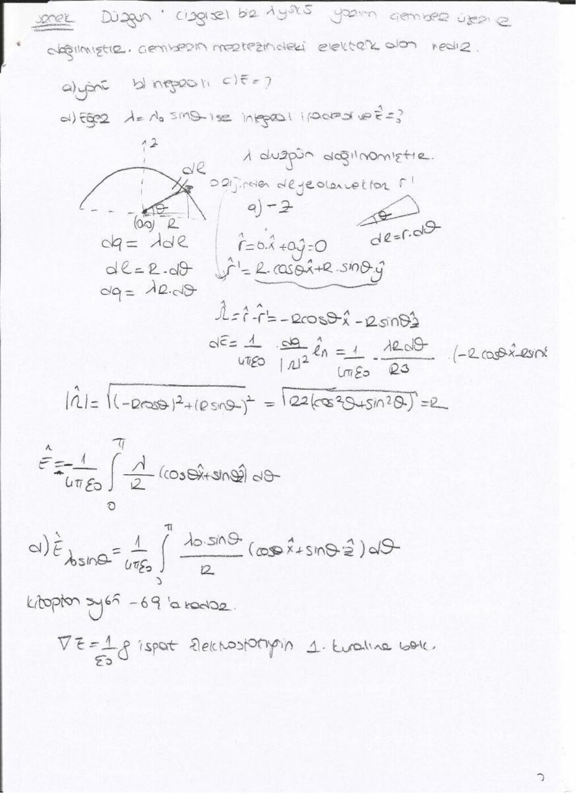

Bu yazı, bir arkadaşın ders notu üzerinden hazırlandı; kişisel bilgiler çıkarıldı. Tarih belgede yıl içerecek biçimde belirtilmemiştir. Başlıklar, temel formüller ve örnek sonuçları metne aktarıldı. İsimsiz dosya adıyla yeniden oluşturulan PDF yazının sonunda indirilebilir.

## Temel bağıntılar

∮_S A·dS = ∫_V ∇·A dv; ∮_C A·dl = ∫_S (∇×A)·dS.

∇·E = ρ/ε₀, ∇×E = 0, E = −∇V, F = QE.

Noktasal yük için E = q R̂/(4πε₀R²). Düzgün çizgisel dağılımda dq = λdl kullanılır.

## Sonlu doğru parçası

1,5 m uzunluğunda, λ = 2 μC/m çizgisel yoğunluklu doğru parçasının uzantısında, başlangıçtan 2,5 m uzakta elektrik alan istenir. Çözümde doğru x ekseninde 0≤x′≤1,5 olarak seçilir:

E = â_x [λ/(4πε₀)]∫₀^1,5 dx′/(2,5−x′)².

İntegral 1/1−1/2,5 = 3/5 m⁻¹ olur. Sonuç yaklaşık E = 10,8×10³ â_x N/C'dir.

Aynı noktadaki yük q₀ = 4 μC ise F = q₀E = 43,2×10⁻³ â_x N.

*Not: Sonuçlar kaynakta kullanılan k ≈ 9×10⁹ N·m²/C² yaklaşımıyla kontrol edildi.*

## Yarım çemberin merkezindeki alan

Düzgün çizgisel yüklü yarım çemberde dq = λa dφ alınır. Gözlem noktası merkezdir; simetrik parçaların yatay bileşenleri birbirini götürür. Düşey bileşenler toplanarak alanın büyüklüğü λ/(2πε₀a) bulunur. Yön, yayın konumu ve yükün işaretiyle belirlenir.

## Yüklü diskin eksenindeki alan

Son sayfada düzgün yüzey yüklü dairesel bölgenin eksen üzerindeki alanı için integral kurulmuştur. Dairesel simetri nedeniyle düzlem içindeki bileşenler yok olur, eksen bileşeni kalır. Yüzey elemanı dS = r dr dφ, kaynak–gözlem uzaklığı √(b²+r²)'dir.

Notta ayrıca ∇·E = ρ/ε₀ ilişkisinin elektrostatik postüladan çıkarılması ve uzaklık çok büyüdüğünde sonucun noktasal yük alanına yaklaşması hatırlatılır.
