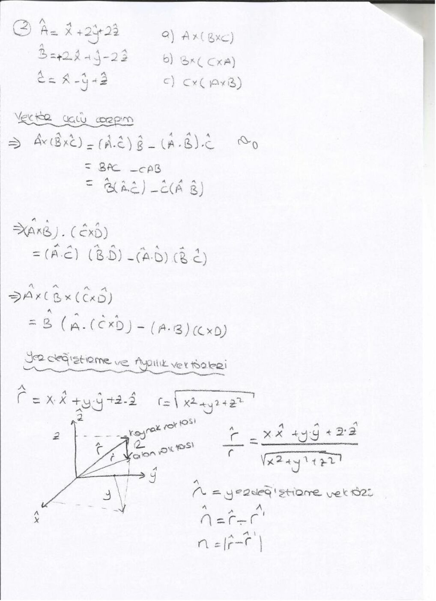
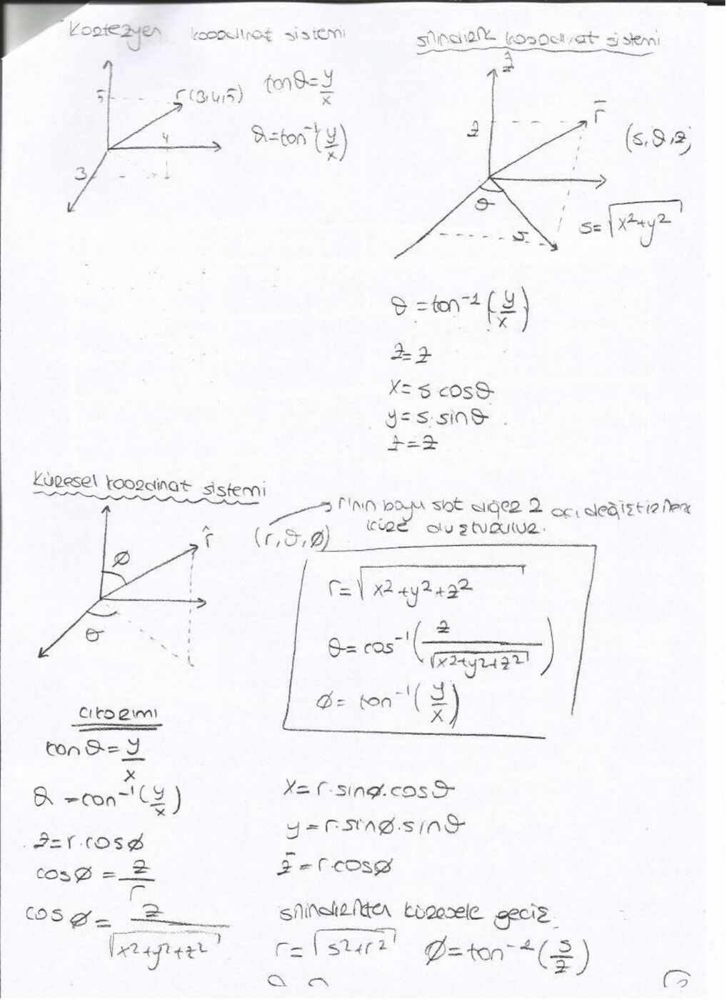

This post was prepared from a friend's course notes; personal information has been removed. The date is not given in the document in a way that includes the year. The headings, key formulas, and example results have been transcribed into the text. A PDF recreated under an anonymous file name can be downloaded at the end of the post.

## Vector operations

Addition uses the triangle or parallelogram method. Multiplying a vector by a scalar changes its magnitude; if the scalar is negative, the direction is also reversed. A − B = A + (−B).

A · B = |A||B| cosθ. The result is a scalar. The dot product of perpendicular vectors is zero. A · A = |A|².

A × B = â_n |A||B| sinθ. The result is a vector perpendicular to the plane formed by the two vectors; its direction is found with the right-hand rule. A × B = −B × A.

For Cartesian unit vectors, â_x × â_y = â_z, â_y × â_z = â_x, â_z × â_x = â_y; the sign changes when the order is reversed. The cross product of a unit vector with itself is zero.

## Computation with components

A = A_x â_x + A_y â_y + A_z â_z.

|A| = √(A_x² + A_y² + A_z²), â_A = A/|A|.

A · B = A_x B_x + A_y B_y + A_z B_z.

A × B = (A_y B_z − A_z B_y)â_x + (A_z B_x − A_x B_z)â_y + (A_x B_y − A_y B_x)â_z.

In the notes, A = â_x + â_y, B = â_x + 2â_y − 2â_z, and C = â_y + 3â_z are chosen. A × B = −2â_x + 2â_y + â_z; |A × B| = 3, and the unit vector parallel to it is (−2â_x + 2â_y + â_z)/3.

## Triple products and the position vector

A × (B × C) = (A · C)B − (A · B)C.

A · (B × C) = (A × B) · C.

The position vector of a point is r = xâ_x + yâ_y + zâ_z, its magnitude is r = √(x²+y²+z²), and the unit vector in its direction is r/r. The displacement between two points is found as R = r₂ − r₁.

In the source, for the points (2,8,7) and (4,6,8), the difference vector is calculated as −2â_x + 2â_y − â_z, with a magnitude of 3. Which point is taken as the starting point and which as the endpoint determines the sign.

## Coordinate transformations

In cylindrical coordinates (s,φ,z): x = s cosφ, y = s sinφ, z = z; s = √(x²+y²).

In spherical coordinates (r,θ,φ): x = r sinθ cosφ, y = r sinθ sinφ, z = r cosθ.

r = √(x²+y²+z²), θ = arccos(z/r). Between the cylindrical and spherical systems, s = r sinθ, z = r cosθ.

*Note: The source uses the angles θ and φ with different meanings on different pages. Here, when writing the transformations, θ is taken as the polar angle and φ as the azimuthal angle. arctan(y/x) alone does not give the quadrant; the signs of x and y must also be taken into account.*

