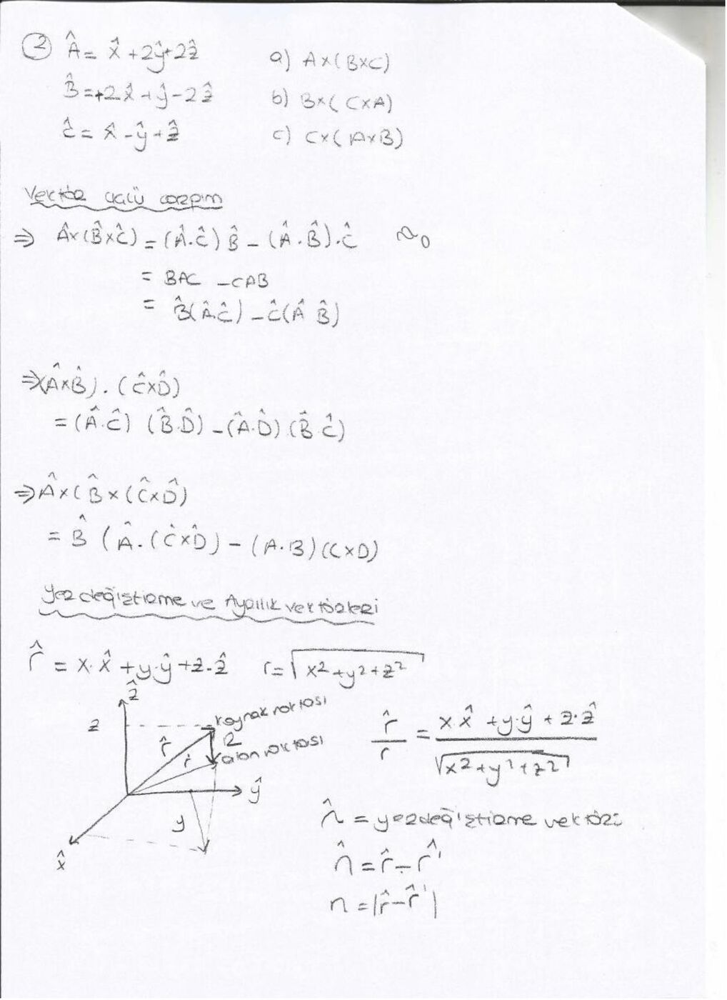
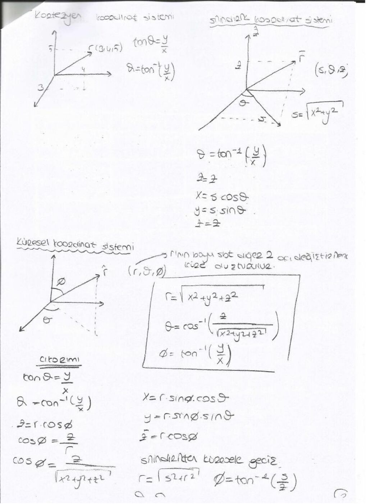

Bu yazı, bir arkadaşın ders notu üzerinden hazırlandı; kişisel bilgiler çıkarıldı. Tarih belgede yıl içerecek biçimde belirtilmemiştir. Başlıklar, temel formüller ve örnek sonuçları metne aktarıldı. İsimsiz dosya adıyla yeniden oluşturulan PDF yazının sonunda indirilebilir.

## Vektör işlemleri

Toplamada üçgen veya paralelkenar yöntemi kullanılır. Vektörü skalerle çarpma büyüklüğünü değiştirir; skaler negatifse yönü de tersine döner. A − B = A + (−B).

A · B = |A||B| cosθ. Sonuç skalerdir. Dik vektörlerin nokta çarpımı sıfırdır. A · A = |A|².

A × B = â_n |A||B| sinθ. Sonuç iki vektörün oluşturduğu düzleme dik bir vektördür; yönü sağ el kuralıyla bulunur. A × B = −B × A.

Kartezyen birim vektörler için â_x × â_y = â_z, â_y × â_z = â_x, â_z × â_x = â_y; ters sıralamada işaret değişir. Aynı birim vektörün kendisiyle çapraz çarpımı sıfırdır.

## Bileşenlerle hesap

A = A_x â_x + A_y â_y + A_z â_z.

|A| = √(A_x² + A_y² + A_z²), â_A = A/|A|.

A · B = A_x B_x + A_y B_y + A_z B_z.

A × B = (A_y B_z − A_z B_y)â_x + (A_z B_x − A_x B_z)â_y + (A_x B_y − A_y B_x)â_z.

Notta A = â_x + â_y, B = â_x + 2â_y − 2â_z ve C = â_y + 3â_z seçilmiştir. A × B = −2â_x + 2â_y + â_z; |A × B| = 3 ve buna paralel birim vektör (−2â_x + 2â_y + â_z)/3 olur.

## Üçlü çarpım ve konum vektörü

A × (B × C) = (A · C)B − (A · B)C.

A · (B × C) = (A × B) · C.

Bir noktaya ait konum vektörü r = xâ_x + yâ_y + zâ_z, büyüklüğü r = √(x²+y²+z²) ve yönündeki birim vektör r/r'dir. İki nokta arasındaki yer değiştirme R = r₂ − r₁ olarak bulunur.

Kaynakta (2,8,7) ile (4,6,8) noktaları için −2â_x + 2â_y − â_z yönünde, büyüklüğü 3 olan fark vektörü hesaplanmıştır. Hangi noktadan hangisine yönelindiği işareti belirler.

## Koordinat dönüşümleri

Silindirik koordinatlarda (s,φ,z): x = s cosφ, y = s sinφ, z = z; s = √(x²+y²).

Küresel koordinatlarda (r,θ,φ): x = r sinθ cosφ, y = r sinθ sinφ, z = r cosθ.

r = √(x²+y²+z²), θ = arccos(z/r). Silindirik ve küresel sistemler arasında s = r sinθ, z = r cosθ.

*Not: Kaynak farklı sayfalarda θ ve φ açılarını farklı anlamlarda kullanıyor. Burada dönüşümler yazılırken θ kutupsal, φ azimut açısı olarak açıklandı. Tek başına arctan(y/x), bölge bilgisini vermez; x ve y işaretleri de dikkate alınmalıdır.*

