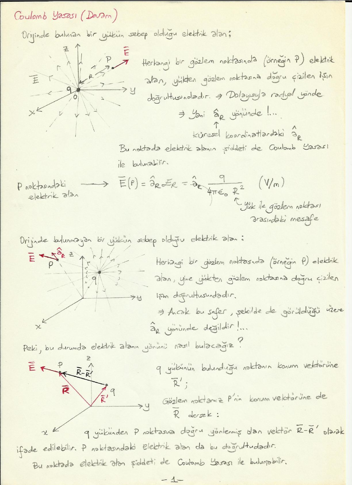
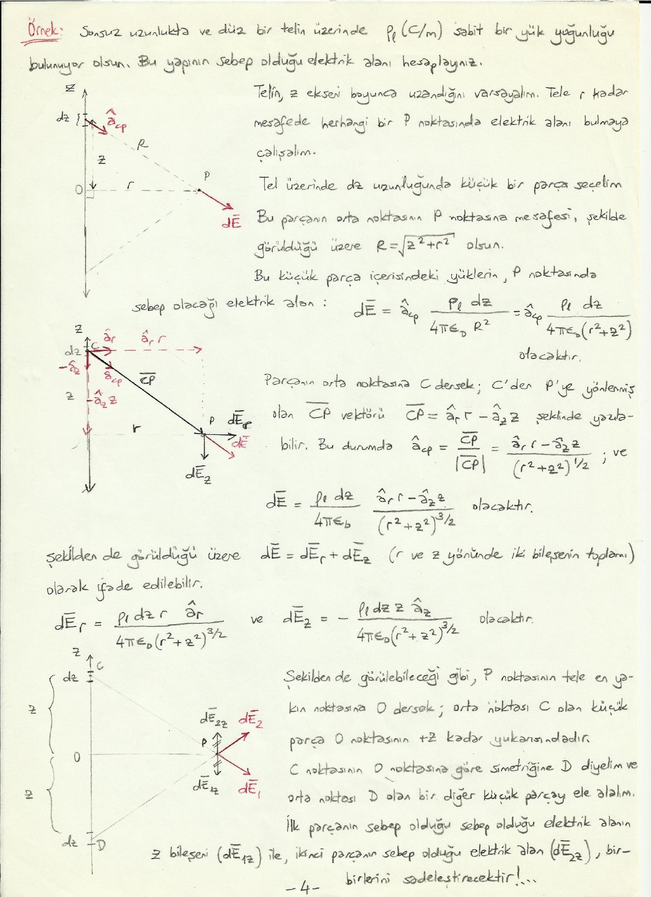
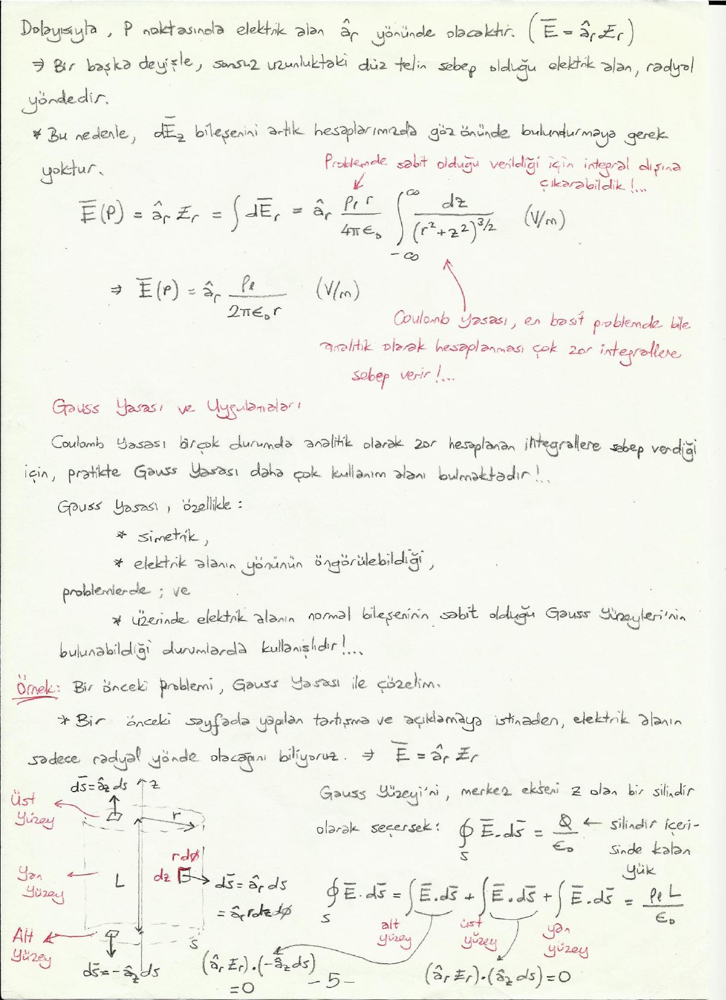
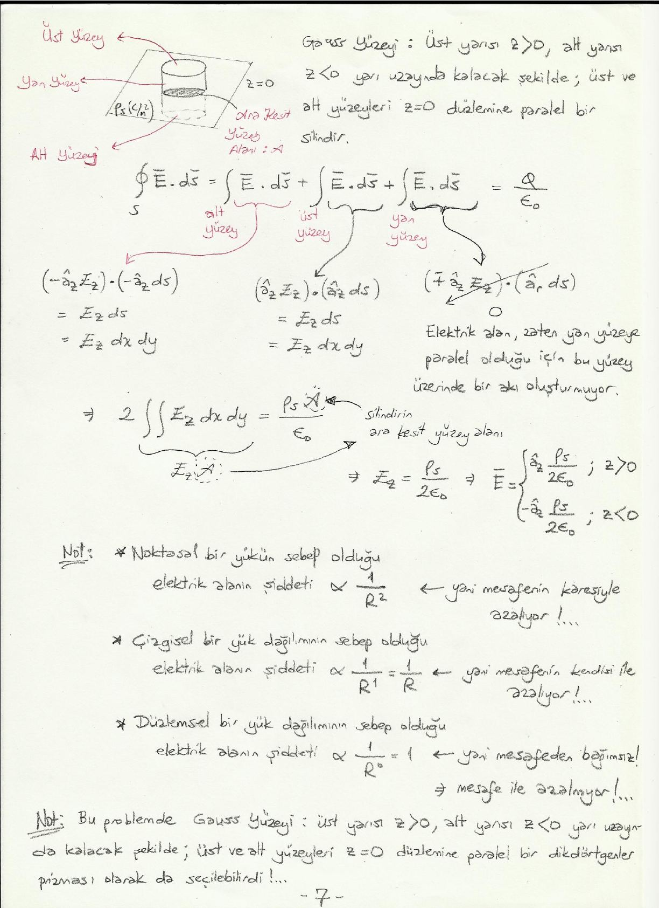

This post is the **"Coulomb's Law, Gauss's Law and Applications"** section (7 pages) of the handwritten lecture notes for **EEM224 Electromagnetics I** at Başkent University. The note does not state the author's name or the date. The text and formulas have been transcribed; page images have been added for the geometry drawings. The original scanned PDF of the note can be downloaded at the end of the post.

## Coulomb's law (continued)

### Electric field due to a charge located at the origin

At any observation point (for example P), the electric field points along the ray drawn from the charge to the observation point; therefore it is in the radial direction, i.e., the â_R direction in spherical coordinates. The magnitude of the electric field at this point can also be found using Coulomb's law:

Ē(P) = â_R E_R = â_R q / (4πε₀ R²)   (V/m)

Here, R is the distance between the charge and the observation point.

### Electric field due to a charge not located at the origin

At any observation point, the electric field again points along the ray drawn from the charge to the observation point; however, this time it is not in the â_R direction. So how do we find the direction of the electric field in this case?

If we call the position vector of the point where charge q is located R̄′, and the position vector of our observation point P R̄, then the vector directed from charge q to point P can be expressed as R̄ − R̄′. The electric field at point P lies along this direction, and its magnitude can be found using Coulomb's law:

Ē(P) = â_qP q / (4πε₀ |R̄ − R̄′|²) = (R̄ − R̄′)/|R̄ − R̄′| · q / (4πε₀ |R̄ − R̄′|²) = (R̄ − R̄′) q / (4πε₀ |R̄ − R̄′|³)   (V/m)

Here |R̄ − R̄′| is the distance between charge q and point P; â_qP is the unit vector directed from charge q to point P, and it can be found by dividing the vector (R̄ − R̄′) by its own norm: â_qP = (R̄ − R̄′) / |R̄ − R̄′|.

## Electric field due to discrete charges

Let the charges q₁, q₂, …, q_N be located at points with position vectors R̄′₁, R̄′₂, …, R̄′_N, respectively. The electric field these charges produce at a point P with position vector R̄ is the sum of the electric fields produced at P by each charge:

Ē(P) = (R̄ − R̄′₁) q₁ / (4πε₀|R̄ − R̄′₁|³) + (R̄ − R̄′₂) q₂ / (4πε₀|R̄ − R̄′₂|³) + … + (R̄ − R̄′_N) q_N / (4πε₀|R̄′ − R̄′_N|³)

Ē(P) = (1 / 4πε₀) Σ_(k=1)^(N) (R̄ − R̄′_k) q_k / |R̄ − R̄′_k|³   (V/m)

*Note: In the note, the denominator of the last term is written as |R̄′ − R̄′_N|³; the correct form is |R̄ − R̄′_N|³, as in the other terms.*

## Electric field due to continuous charge distributions

Sometimes the charges may also form a continuous distribution (a charge density function) within a certain region. In this case, we can again use "infinitesimal calculus" to compute the resulting electric field.

For example, consider a charge distribution with charge density ρ_v (C/m³) occupying a volume v′. How can we find the total electric field this distribution produces at an arbitrary observation point P? By taking small volumes within the volume v′, finding the electric field due to the total charge in each small volume, and then summing all these electric field values.

Let us choose a small rectangular-prism volume, which we will call dv′. The amount of charge in this small volume is ρ_v dv′. If we call the electric field that the charges in this small volume produce at point P dĒ:

dĒ = â_vP ρ_v dv′ / (4πε₀ R²)

Here â_vP is the unit vector directed from dv′ to P; R is the distance from the midpoint of dv′ to P. If we find dĒ for all the dv′ volumes within the volume v′ and sum them, Ē(P) ≅ Σ_i dĒ_i; if we choose the dv′ volumes very small:

Ē(P) = lim_(dv′_i→0) Σ_i dĒ_i = (1 / 4πε₀) ∫_v′ â_vP ρ_v / R² dv′   (V/m)

Note: Since ρ_v is a function of the spatial coordinates, it cannot be taken outside the integral like a constant coefficient!

The charges may not always be located within a volume. For example, if there is a continuous charge distribution ρ_s (C/m²) on a surface, by similar reasoning:

Ē(P) = (1 / 4πε₀) ∫_S′ â_sP ρ_s / R² ds′   (V/m)

Or, if the charges are distributed over a curve (for example, a piece of wire) with density ρ_l (C/m), again by the same reasoning:

Ē(P) = (1 / 4πε₀) ∫_C′ â_cP ρ_l / R² dl′   (V/m)

## Example: Infinitely long line charge (using Coulomb's law)

Suppose a constant charge density ρ_l (C/m) is present on an infinitely long, straight wire. Calculate the electric field produced by this structure.

Let us assume the wire extends along the z axis. Let us try to find the electric field at an arbitrary point P at a distance r from the wire. Let us choose a small segment of length dz on the wire. Let the distance from the midpoint of this segment to point P be R = √(z² + r²). The electric field that the charges in this small segment produce at point P is:

dĒ = â_cP ρ_l dz / (4πε₀ R²) = â_cP ρ_l dz / (4πε₀ (r² + z²))

If we call the midpoint of the segment C, the vector directed from C to P can be written as CP̄ = â_r r − â_z z. In this case, â_cP = CP̄ / |CP̄| = (â_r r − â_z z) / (r² + z²)^(1/2), and

dĒ = ρ_l dz / (4πε₀) · (â_r r − â_z z) / (r² + z²)^(3/2)

dĒ can be expressed as the sum of two components in the r and z directions: dĒ = dĒ_r + dĒ_z, where

dĒ_r = ρ_l dz r â_r / (4πε₀ (r² + z²)^(3/2)) and dĒ_z = −ρ_l dz z â_z / (4πε₀ (r² + z²)^(3/2))

If we call the point on the wire closest to P point O, the small segment with midpoint C lies a distance +z above point O. Let us call the point symmetric to C with respect to O point D, and consider another small segment with midpoint D. The z component of the electric field produced by the first segment (dĒ_1z) and the z component of the electric field produced by the second segment (dĒ_2z) will cancel each other. Therefore, the electric field at point P will be in the â_r direction (Ē = â_r E_r). In other words, the electric field produced by an infinitely long straight wire is in the radial direction, and there is no longer any need to consider the dĒ_z component in our calculations.

Since ρ_l is given as a constant in the problem, it can be taken outside the integral:

Ē(P) = â_r E_r = ∫ dĒ_r = â_r (ρ_l r / 4πε₀) ∫_(−∞)^(∞) dz / (r² + z²)^(3/2)   (V/m)

Ē(P) = â_r ρ_l / (2πε₀ r)   (V/m)

Coulomb's law leads to integrals that are very hard to evaluate analytically, even in the simplest problems!

## Gauss's law and applications

Because Coulomb's law leads to integrals that are difficult to evaluate analytically in many cases, Gauss's law finds more use in practice. Gauss's law is particularly useful in

- symmetric problems,
- problems in which the direction of the electric field can be predicted,

and in cases where

- Gaussian surfaces can be found on which the normal component of the electric field is constant.

### Example: Infinite line charge (using Gauss's law)

Let us solve the previous problem using Gauss's law. Based on the discussion and explanation on the previous page, we know that the electric field will be only in the radial direction: Ē = â_r E_r.

If we choose the Gaussian surface as a cylinder with central axis z, radius r, and length L:

∮_S Ē · ds̄ = Q / ε₀

Here Q is the charge enclosed within the cylinder (ρ_l L). The surface integral splits into three parts:

- Bottom surface: ds̄ = −â_z ds; (â_r E_r) · (−â_z ds) = 0
- Top surface: ds̄ = â_z ds; (â_r E_r) · (â_z ds) = 0
- Lateral surface: ds̄ = â_r ds = â_r r dz dφ

∫_lateral Ē · ds̄ = ρ_l L / ε₀ = ∫_lateral (â_r E_r) · (â_r r dr dφ) = ∫_(r=0)^(L) ∫_(φ=0)^(2π) E_r r dz dφ

E_r 2πrL = ρ_l L / ε₀ ⇒ E_r = ρ_l / (2πε₀ r)

Ē(P) = â_r ρ_l / (2πε₀ r)   (V/m)

Here P is a point at a distance r from the wire.

*Note: On this page of the note, the lateral surface element is written as (â_r r dr dφ) and the integration limit as r = 0 to L; as given in the figure on the previous page, on the lateral surface ds̄ = â_r r dz dφ, and the integral is taken from z = 0 to L. The result (E_r 2πrL) is correct accordingly.*

### Example: Infinite plane charge

Suppose a constant charge distribution ρ_s (C/m²) is present on a plane of infinite extent. Find the electric field produced by this charge distribution.

Let us choose the plane in question as the z = 0 plane. Consider the electric field at a point P in the z > 0 half-space. Let us call the electric field produced at this point by the charges on surface ds₁ dĒ₁. Let point P′ be the projection of point P onto the z = 0 plane. Let ds₂ be the surface located symmetrically to surface ds₁ with respect to point P′; let us also call the electric field produced at point P by the charges on surface ds₂ dĒ₂:

dĒ₁ + dĒ₂ = (dĒ_1x + dĒ_2x) + (dĒ_1y + dĒ_2y) + dĒ_1z + dĒ_2z

The x and y components cancel because of symmetry; therefore the electric field at point P will be only in the z direction. By similar reasoning, for a point P chosen in the z < 0 half-space, the electric field will be only in the −z direction:

Ē = â_z E_z (z > 0); Ē = −â_z E_z (z < 0)

Now we must choose a Gaussian surface on which the electric flux can be calculated easily. **Gaussian surface:** a cylinder whose upper half lies in the z > 0 half-space and whose lower half lies in the z < 0 half-space, with its top and bottom surfaces parallel to the z = 0 plane. Let the cross-sectional area be A:

∮_S Ē · ds̄ = ∫_bottom Ē · ds̄ + ∫_top Ē · ds̄ + ∫_lateral Ē · ds̄ = Q / ε₀

- Bottom surface: (−â_z E_z) · (−â_z ds) = E_z ds = E_z dx dy
- Top surface: (â_z E_z) · (â_z ds) = E_z ds = E_z dx dy
- Lateral surface: (∓â_z E_z) · (â_r ds) = 0. Since the electric field is already parallel to the lateral surface, it produces no flux through this surface.

2 ∫∫ E_z dx dy = 2 E_z A = ρ_s A / ε₀ ⇒ E_z = ρ_s / (2ε₀)

Ē = â_z ρ_s / (2ε₀) (z > 0); Ē = −â_z ρ_s / (2ε₀) (z < 0)

**Note:**

- The magnitude of the electric field produced by a point charge ∝ 1/R²; that is, it decreases with the square of the distance.
- The magnitude of the electric field produced by a line charge distribution ∝ 1/R¹ = 1/R; that is, it decreases with the distance itself.
- The magnitude of the electric field produced by a planar charge distribution ∝ 1/R⁰ = 1; that is, it is independent of distance and does not decrease with distance.

**Note:** In this problem, the Gaussian surface could also have been chosen as a rectangular prism whose upper half lies in the z > 0 half-space and whose lower half lies in the z < 0 half-space, with its top and bottom surfaces parallel to the z = 0 plane.
