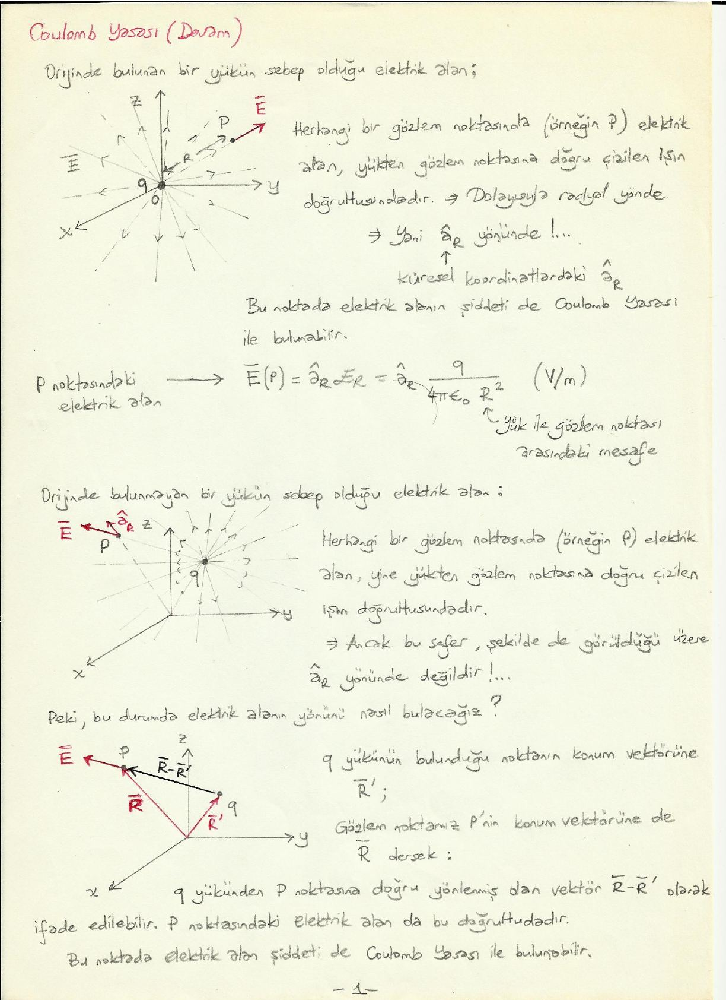
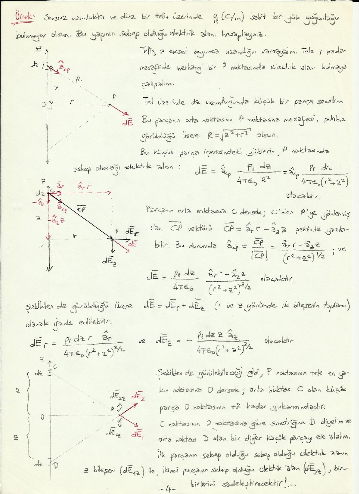
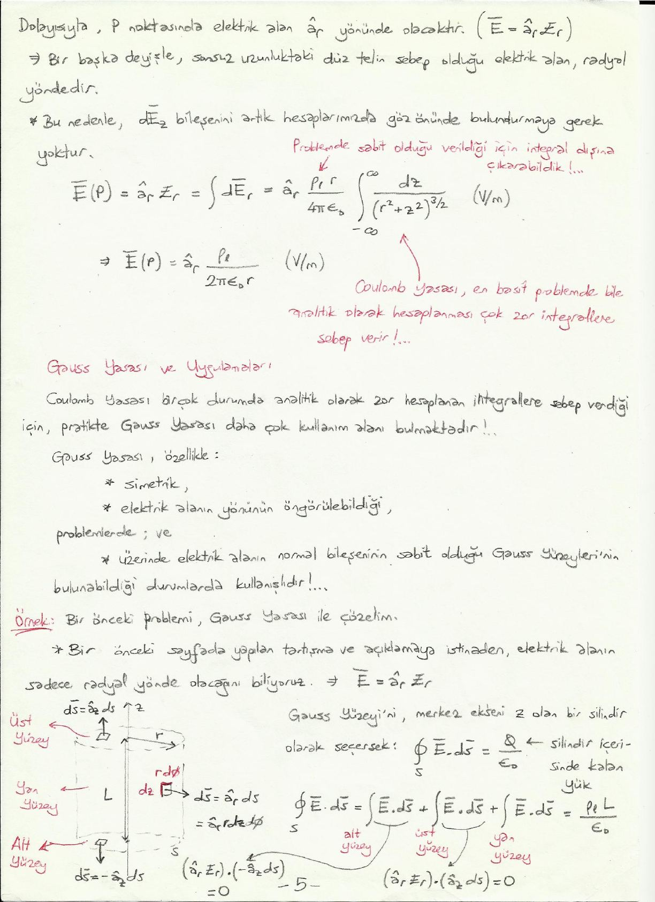
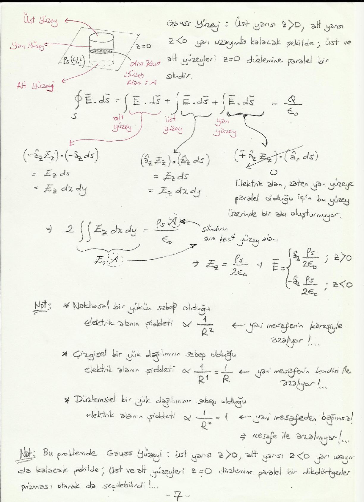

Bu yazı, Başkent Üniversitesi **EEM224 Elektromanyetik I** dersine ait el yazısı ders notlarının **"Coulomb Yasası, Gauss Yasası ve Uygulamaları"** bölümüdür (7 sayfa). Notta hazırlayanın adı ve tarih yazmıyor. Metin ve formüller yazıya döküldü; geometri çizimleri için sayfa görselleri eklendi. Taranmış notun orijinal PDF'i yazının sonunda indirilebilir.

## Coulomb yasası (devam)

### Orijinde bulunan bir yükün sebep olduğu elektrik alan

Herhangi bir gözlem noktasında (örneğin P) elektrik alan, yükten gözlem noktasına doğru çizilen ışın doğrultusundadır; dolayısıyla radyal yönde, yani küresel koordinatlardaki â_R yönündedir. Bu noktada elektrik alanın şiddeti de Coulomb yasası ile bulunabilir:

Ē(P) = â_R E_R = â_R q / (4πε₀ R²)   (V/m)

Burada R, yük ile gözlem noktası arasındaki mesafedir.

### Orijinde bulunmayan bir yükün sebep olduğu elektrik alan

Herhangi bir gözlem noktasında elektrik alan yine yükten gözlem noktasına doğru çizilen ışın doğrultusundadır; ancak bu sefer â_R yönünde değildir. Peki bu durumda elektrik alanın yönünü nasıl bulacağız?

q yükünün bulunduğu noktanın konum vektörüne R̄′, gözlem noktamız P'nin konum vektörüne de R̄ dersek, q yükünden P noktasına doğru yönlenmiş olan vektör R̄ − R̄′ olarak ifade edilebilir. P noktasındaki elektrik alan da bu doğrultudadır ve şiddeti Coulomb yasası ile bulunabilir:

Ē(P) = â_qP q / (4πε₀ |R̄ − R̄′|²) = (R̄ − R̄′)/|R̄ − R̄′| · q / (4πε₀ |R̄ − R̄′|²) = (R̄ − R̄′) q / (4πε₀ |R̄ − R̄′|³)   (V/m)

Burada |R̄ − R̄′|, q yükü ile P noktası arasındaki mesafedir; â_qP ise q yükünden P noktasına yönlenmiş olan birim vektördür ve (R̄ − R̄′) vektörünün kendi normuna bölünmesi ile bulunabilir: â_qP = (R̄ − R̄′) / |R̄ − R̄′|.

## Ayrık yüklerin sebep olduğu elektrik alan

q₁, q₂, …, q_N yükleri, konum vektörleri sırasıyla R̄′₁, R̄′₂, …, R̄′_N olan noktalarda bulunuyor olsun. Bu yüklerin konum vektörü R̄ olan bir P noktasında sebep olduğu elektrik alan, her bir yükün P noktasında sebep olduğu elektrik alanların toplamıdır:

Ē(P) = (R̄ − R̄′₁) q₁ / (4πε₀|R̄ − R̄′₁|³) + (R̄ − R̄′₂) q₂ / (4πε₀|R̄ − R̄′₂|³) + … + (R̄ − R̄′_N) q_N / (4πε₀|R̄′ − R̄′_N|³)

Ē(P) = (1 / 4πε₀) Σ_(k=1)^(N) (R̄ − R̄′_k) q_k / |R̄ − R̄′_k|³   (V/m)

*Not: Notta son terimin paydası |R̄′ − R̄′_N|³ olarak yazılmış; doğrusu, diğer terimlerde olduğu gibi |R̄ − R̄′_N|³'tür.*

## Sürekli yük dağılımlarının sebep olduğu elektrik alan

Yükler bazen de belirli bir bölge içerisinde sürekli bir dağılım (bir yük yoğunluğu fonksiyonu) oluşturuyor olabilir. Bu durumda oluşan elektrik alanı hesaplamak için yine "sonsuz küçükler hesabı"ndan yararlanabiliriz.

Örneğin bir v′ hacmini kaplayan, yük yoğunluğu ρ_v (C/m³) olan bir yük dağılımı olsun. Bu dağılımın herhangi bir P gözlem noktasında sebep olduğu toplam elektrik alanı nasıl bulabiliriz? v′ hacmi içerisinde küçük hacimler alıp her bir küçük hacim içerisinde kalan toplam yükün sebep olduğu elektrik alanı bularak ve ardından bütün bu elektrik alan değerlerini toplayarak.

dv′ adını vereceğimiz dikdörtgenler prizması şeklinde küçük bir hacim seçelim. Bu küçük hacim içerisindeki yük miktarı ρ_v dv′ kadar olacaktır. Bu küçük hacim içerisindeki yüklerin P noktasında sebep olacağı elektrik alana dĒ dersek:

dĒ = â_vP ρ_v dv′ / (4πε₀ R²)

Burada â_vP, dv′'den P'ye doğru yönlenmiş olan birim vektör; R, dv′'nün orta noktasının P'ye olan mesafesidir. v′ hacmi içerisindeki bütün dv′ hacimleri için dĒ'leri bulup toplarsak Ē(P) ≅ Σ_i dĒ_i; dv′ hacimlerini çok küçük seçersek:

Ē(P) = lim_(dv′_i→0) Σ_i dĒ_i = (1 / 4πε₀) ∫_v′ â_vP ρ_v / R² dv′   (V/m)

Not: ρ_v uzay koordinatlarına bağlı bir fonksiyon olduğu için bir katsayı gibi integralin dışına çıkartılamaz!

Yükler her zaman bir hacim içerisinde bulunmuyor olabilir. Örneğin bir yüzeyde sürekli bir yük dağılımı ρ_s (C/m²) varsa, benzer mantıkla:

Ē(P) = (1 / 4πε₀) ∫_S′ â_sP ρ_s / R² ds′   (V/m)

Ya da yükler bir eğri (örneğin bir tel parçası) üzerine ρ_l (C/m) yoğunluğuyla dağılmış ise yine aynı mantıkla:

Ē(P) = (1 / 4πε₀) ∫_C′ â_cP ρ_l / R² dl′   (V/m)

## Örnek: Sonsuz uzunlukta yüklü tel (Coulomb yasası ile)

Sonsuz uzunlukta ve düz bir telin üzerinde ρ_l (C/m) sabit bir yük yoğunluğu bulunuyor olsun. Bu yapının sebep olduğu elektrik alanı hesaplayınız.

Telin z ekseni boyunca uzandığını varsayalım. Tele r kadar mesafede herhangi bir P noktasında elektrik alanı bulmaya çalışalım. Tel üzerinde dz uzunluğunda küçük bir parça seçelim. Bu parçanın orta noktasının P noktasına mesafesi R = √(z² + r²) olsun. Bu küçük parça içerisindeki yüklerin P noktasında sebep olacağı elektrik alan:

dĒ = â_cP ρ_l dz / (4πε₀ R²) = â_cP ρ_l dz / (4πε₀ (r² + z²))

Parçanın orta noktasına C dersek, C'den P'ye yönlenmiş olan vektör CP̄ = â_r r − â_z z şeklinde yazılabilir. Bu durumda â_cP = CP̄ / |CP̄| = (â_r r − â_z z) / (r² + z²)^(1/2) ve

dĒ = ρ_l dz / (4πε₀) · (â_r r − â_z z) / (r² + z²)^(3/2)

olacaktır. dĒ, r ve z yönündeki iki bileşenin toplamı olarak ifade edilebilir: dĒ = dĒ_r + dĒ_z, burada

dĒ_r = ρ_l dz r â_r / (4πε₀ (r² + z²)^(3/2)) ve dĒ_z = −ρ_l dz z â_z / (4πε₀ (r² + z²)^(3/2))

P noktasının tele en yakın noktasına O dersek, orta noktası C olan küçük parça O noktasının +z kadar yukarısındadır. C noktasının O noktasına göre simetriğine D diyelim ve orta noktası D olan bir diğer küçük parçayı ele alalım. İlk parçanın sebep olduğu elektrik alanın z bileşeni (dĒ_1z) ile ikinci parçanın sebep olduğu elektrik alanın z bileşeni (dĒ_2z) birbirini sadeleştirecektir. Dolayısıyla P noktasında elektrik alan â_r yönünde olacaktır (Ē = â_r E_r). Bir başka deyişle, sonsuz uzunluktaki düz telin sebep olduğu elektrik alan radyal yöndedir ve dĒ_z bileşenini artık hesaplarımızda göz önünde bulundurmaya gerek yoktur.

ρ_l problemde sabit olarak verildiği için integral dışına çıkarılabilir:

Ē(P) = â_r E_r = ∫ dĒ_r = â_r (ρ_l r / 4πε₀) ∫_(−∞)^(∞) dz / (r² + z²)^(3/2)   (V/m)

Ē(P) = â_r ρ_l / (2πε₀ r)   (V/m)

Coulomb yasası, en basit problemde bile analitik olarak hesaplanması çok zor integrallere sebep verir!

## Gauss yasası ve uygulamaları

Coulomb yasası birçok durumda analitik olarak zor hesaplanan integrallere sebep verdiği için pratikte Gauss yasası daha çok kullanım alanı bulmaktadır. Gauss yasası özellikle

- simetrik,
- elektrik alanın yönünün öngörülebildiği

problemlerde ve

- üzerinde elektrik alanın normal bileşeninin sabit olduğu Gauss yüzeylerinin bulunabildiği

durumlarda kullanışlıdır.

### Örnek: Sonsuz yüklü tel (Gauss yasası ile)

Bir önceki problemi Gauss yasası ile çözelim. Bir önceki sayfada yapılan tartışma ve açıklamaya istinaden elektrik alanın sadece radyal yönde olacağını biliyoruz: Ē = â_r E_r.

Gauss yüzeyini merkez ekseni z olan, yarıçapı r ve uzunluğu L olan bir silindir olarak seçersek:

∮_S Ē · ds̄ = Q / ε₀

Burada Q silindir içerisinde kalan yüktür (ρ_l L). Yüzey integrali üç parçaya ayrılır:

- Alt yüzey: ds̄ = −â_z ds; (â_r E_r) · (−â_z ds) = 0
- Üst yüzey: ds̄ = â_z ds; (â_r E_r) · (â_z ds) = 0
- Yan yüzey: ds̄ = â_r ds = â_r r dz dφ

∫_yan Ē · ds̄ = ρ_l L / ε₀ = ∫_yan (â_r E_r) · (â_r r dr dφ) = ∫_(r=0)^(L) ∫_(φ=0)^(2π) E_r r dz dφ

E_r 2πrL = ρ_l L / ε₀ ⇒ E_r = ρ_l / (2πε₀ r)

Ē(P) = â_r ρ_l / (2πε₀ r)   (V/m)

Burada P, tele r kadar mesafedeki bir noktadır.

*Not: Notun bu sayfasında yan yüzey elemanı (â_r r dr dφ) ve integral sınırı (r = 0'dan L'ye) olarak yazılmış; bir önceki sayfadaki şekilde de verildiği gibi yan yüzeyde ds̄ = â_r r dz dφ'dir ve integral z = 0'dan L'ye alınır. Sonuç (E_r 2πrL) buna göre doğrudur.*

### Örnek: Sonsuz yüklü düzlem

Sonsuz genişlikteki bir düzlem üzerinde sabit ρ_s (C/m²)'lik bir yük dağılımı bulunuyor olsun. Bu yük dağılımının sebep olduğu elektrik alanı bulunuz.

Söz konusu düzlemi z = 0 düzlemi olarak seçelim. z > 0 yarı uzayında bulunan bir P noktasındaki elektrik alanı düşünelim. Bu noktada ds₁ yüzeyi üzerindeki yüklerin sebep olduğu elektrik alana dĒ₁ diyelim. P′ noktası, P noktasının z = 0 düzlemi üzerine izdüşümü olsun. ds₂ de ds₁ yüzeyinin P′ noktasına göre simetriğinde bulunan yüzey olsun; ds₂ yüzeyindeki yüklerin P noktasında sebep olduğu elektrik alana da dĒ₂ diyelim:

dĒ₁ + dĒ₂ = (dĒ_1x + dĒ_2x) + (dĒ_1y + dĒ_2y) + dĒ_1z + dĒ_2z

x ve y bileşenleri simetriden ötürü sıfırlanır; dolayısıyla P noktasında elektrik alan sadece z yönünde olacaktır. Benzer mantıkla z < 0 yarı uzayında seçilen bir P noktası için de elektrik alan sadece −z yönünde olacaktır:

Ē = â_z E_z (z > 0); Ē = −â_z E_z (z < 0)

Şimdi üzerinde elektrik akıyı kolaylıkla hesaplayacağımız bir Gauss yüzeyi seçmeliyiz. **Gauss yüzeyi:** üst yarısı z > 0, alt yarısı z < 0 yarı uzayında kalacak şekilde; üst ve alt yüzeyleri z = 0 düzlemine paralel bir silindir. Ara kesit yüzey alanı A olsun:

∮_S Ē · ds̄ = ∫_alt Ē · ds̄ + ∫_üst Ē · ds̄ + ∫_yan Ē · ds̄ = Q / ε₀

- Alt yüzey: (−â_z E_z) · (−â_z ds) = E_z ds = E_z dx dy
- Üst yüzey: (â_z E_z) · (â_z ds) = E_z ds = E_z dx dy
- Yan yüzey: (∓â_z E_z) · (â_r ds) = 0. Elektrik alan zaten yan yüzeye paralel olduğu için bu yüzey üzerinde bir akı oluşturmuyor.

2 ∫∫ E_z dx dy = 2 E_z A = ρ_s A / ε₀ ⇒ E_z = ρ_s / (2ε₀)

Ē = â_z ρ_s / (2ε₀) (z > 0); Ē = −â_z ρ_s / (2ε₀) (z < 0)

**Not:**

- Noktasal bir yükün sebep olduğu elektrik alanın şiddeti ∝ 1/R²; yani mesafenin karesiyle azalıyor.
- Çizgisel bir yük dağılımının sebep olduğu elektrik alanın şiddeti ∝ 1/R¹ = 1/R; yani mesafenin kendisi ile azalıyor.
- Düzlemsel bir yük dağılımının sebep olduğu elektrik alanın şiddeti ∝ 1/R⁰ = 1; yani mesafeden bağımsız, mesafe ile azalmıyor.

**Not:** Bu problemde Gauss yüzeyi, üst yarısı z > 0, alt yarısı z < 0 yarı uzayında kalacak şekilde, üst ve alt yüzeyleri z = 0 düzlemine paralel bir dikdörtgenler prizması olarak da seçilebilirdi.
