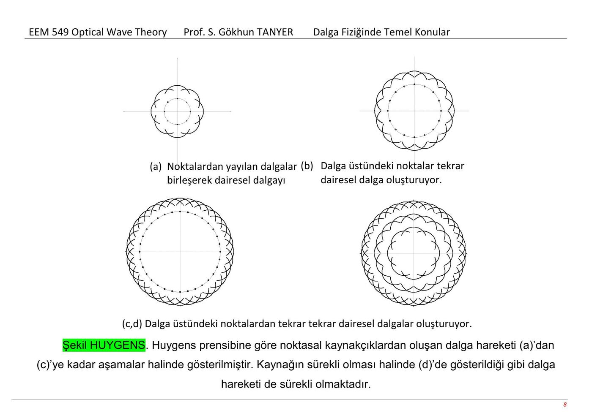
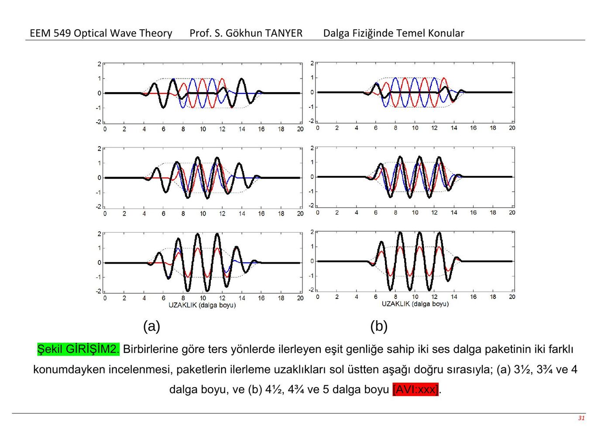
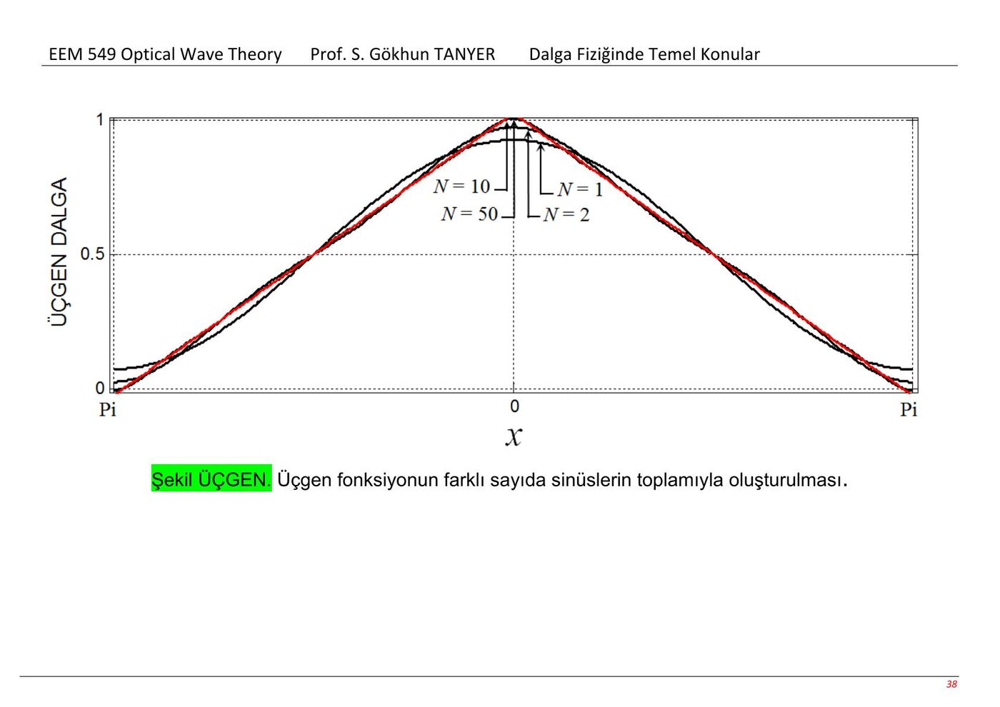
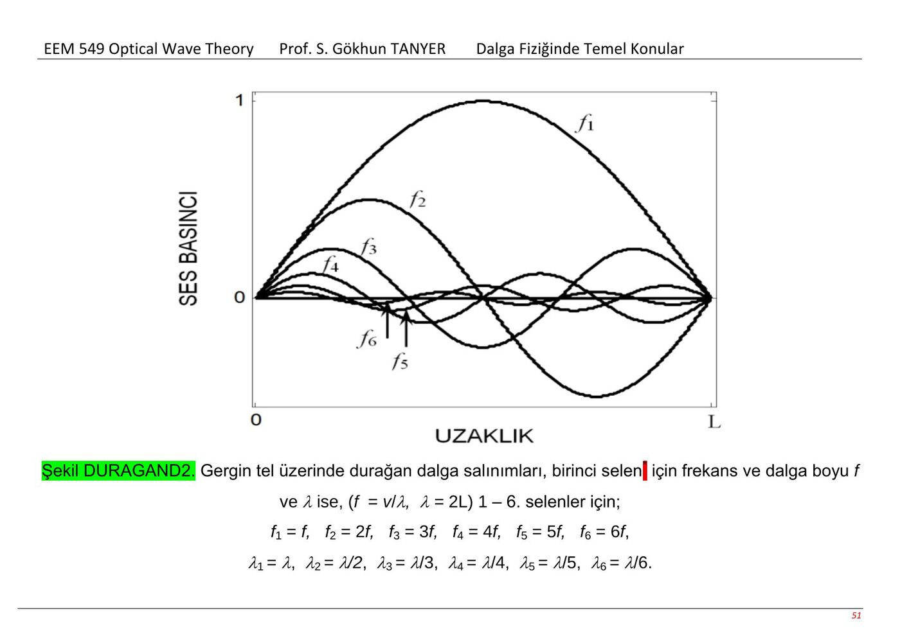

This post is based on the lecture note "Fundamental Topics in Wave Physics" prepared by Prof. S. Gökhun Tanyer for Başkent University. The cover reads EEM549 Optical Wave Theory and the 2013–2014 fall semester; because the file is in the EEM224 archive, it is placed under this course here. The PDF was created on 24 February 2014. The original 60-page document can be downloaded at the end of the post.

*Note: The document states that it draws on the author's draft book "The Nature of Music – The Sound of Mathematics," that the files are prepared only for Başkent University students, and that copying and publishing on the internet depend on the permission of the document's owner. This usage notice is present in the source.*

*This content belongs to a third-party source; it is shared for archival and nostalgic purposes with attribution. It will be removed at the request of the rights holder.*

## Water, sound and electromagnetic waves

Wave propagation is described as the successive transfer of interactions within a medium. A sound wave needs a material medium such as air, water or a solid; it does not propagate in a vacuum. An electromagnetic wave can also propagate in a vacuum. The note explains this distinction by also mentioning the historically proposed concept of the ether.

Sound pressure rises and falls around the equilibrium pressure of the medium. The particles oscillate locally while the wave advances. Sound is an example of a longitudinal wave in liquids and gases. Particle motion on a water surface can be elliptical, so it is not simply the same as a sound wave.

## The Huygens approach and polarization

Points on a wavefront can be thought of as sources of new small wavelets. The common envelope of these wavelets gives the next wavefront. The source visualizes this through water rings.

Polarization is the directional property of an oscillation. The note gives the polarization of reflected light and polarized sunglasses as examples; rotating the glasses changes the transmitted light, which allows this property to be observed.

## Speed, wavelength and frequency

v=λf, λ=v/f and f=v/λ. The period is T=1/f.

In the source example, v=344 m/s and f=344 Hz give λ=1 m and T≈2.907 ms. The quarter-period interval is T/4≈0.7267 ms. Waveforms are compared at the instants t=0, T/4 and T/2.

The amplitude of sound propagating in open space decreases with distance. The note emphasizes that the speed of the wave is determined by the medium, not by the source power.

*Note: This speed statement applies to the linear-medium approximation. For large-amplitude nonlinear waves, amplitude-dependent effects may occur.*

## Logarithm, bel and decibel

A logarithmic scale is used to display very large and very small intensities together. A factor of 10 log₁₀ is given for power/intensity ratios and 20 log₁₀ for pressure/amplitude ratios. In the example table, the values 100, 10, 1, 0.1 and 0.01 are shown as 20, 10, 0, −10 and −20 dB, respectively.

*Note: The dB formulas in the source are written as the logarithm of a single quantity. In physical use, a ratio to a reference is required: 10 log₁₀(I/I₀) and 20 log₁₀(p/p₀). The factor 20 for amplitude relies on the condition that intensity is proportional to the square of the amplitude.*

## Derivatives and wave equations

The note links the way local differences trigger changes in neighboring regions to the idea of the derivative. The relationship between the time-varying changes of electric and magnetic fields is tied to Maxwell's equations. The work of Ørsted, Ampère, Faraday, Maxwell and d'Alembert is described.

The sinusoidal family stays within the same family when differentiated:

sin x → cos x → −sin x → −cos x → sin x.

*Note: In the source, the year 1925 is written for Faraday's work on generating an electric field with a changing magnetic field. Since Faraday died in 1867, this date is erroneous; his work on electromagnetic induction dates from 1831.*

## Reflection, refraction, scattering and interference

At a medium boundary, part of a wave may be reflected and part may pass into the other medium. An echo is an example of reflection. The change of direction upon a change of medium is described in the source as refraction, and propagation around obstacles under the heading of scattering.

In a linear medium, pressure variations arriving at the same point add up. Contributions of the same sign reinforce each other, and those of opposite sign reduce each other. Two wave packets of equal amplitude traveling in opposite directions are compared; in fully constructive interference, the amplitude doubles.

## Overtones and the Fourier approach

Through the question of which sinusoidal shapes the medium of an instrument allows, the fundamental frequency and the overtones are introduced. Plucking a stretched string into a triangular shape and releasing it is explained as a sum of different sinusoidal components.

The series given in the source for the triangular shape:

f(x) = (4/π)cos x + (4/9π)cos 3x + (4/25π)cos 5x + …

f(x) = (4/π)Σ_(k=0)^∞ cos[(2k+1)x]/(2k+1)².

Approximations with N=1, 2, 10 and 50 terms are plotted to show how the added terms improve the shape.

*Note: Although the text describes this shape as a triangle of unit amplitude, the coefficients as written give f(0)=π/2. For a unit peak amplitude the coefficient would be 8/π²; the source formula is reproduced above without modification.*

## Standing waves and boundary conditions

Waves traveling back and forth between two ends superpose. When the nodes of the reflected waves coincide, nodes and antinodes with fixed positions form. Although the shape does not travel in space, the amplitude at each point varies with time; this is called a standing wave.

If the length between two fixed ends is L, then in the fundamental mode λ₁=2L and f₁=v/(2L). For the higher modes:

f_n=nf₁, λ_n=λ₁/n.

## Resonance, loss and waves in a pipe

Energy arriving repeatedly at a suitable frequency reinforces the existing vibration. When the losses equal the incoming power, a steady state is reached. If the loss is small, more energy accumulates; the time needed to reach the steady state can also be longer.

In the note, the pressure modes inside a pipe closed at both ends are compared with the modes on a string. A fundamental frequency and its integer multiples are shown. The end conditions of the pipe must be considered separately for pressure and for particle displacement.

In the laser example, the accumulation of the electromagnetic field between two mirrors is related to the concepts of stimulated emission and resonance.

## Guitar strings

For standard tuning, the source gives the following open-string frequencies:

| String | Note | Frequency |
|---|---|---|
| 1, thinnest | E4 | 329.63 Hz |
| 2 | B3 | 246.94 Hz |
| 3 | G3 | 196.00 Hz |
| 4 | D3 | 146.83 Hz |
| 5 | A2 | 110.00 Hz |
| 6, thickest | E2 | 82.41 Hz |

The thickness, tension and vibrating length of the string affect the frequency. Pressing the string against a fret changes the vibrating length.
