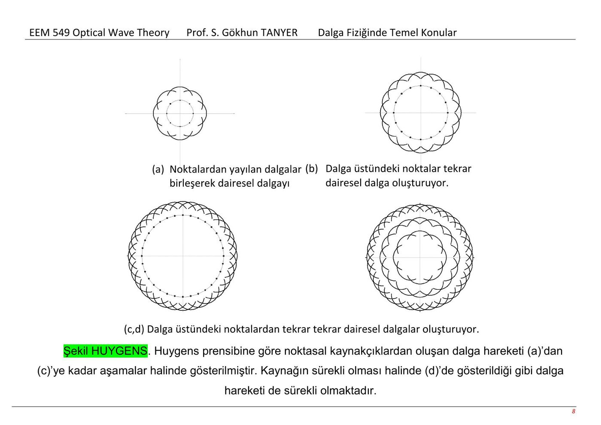
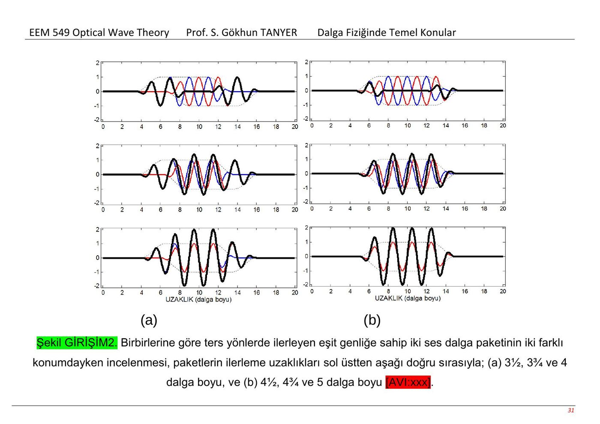
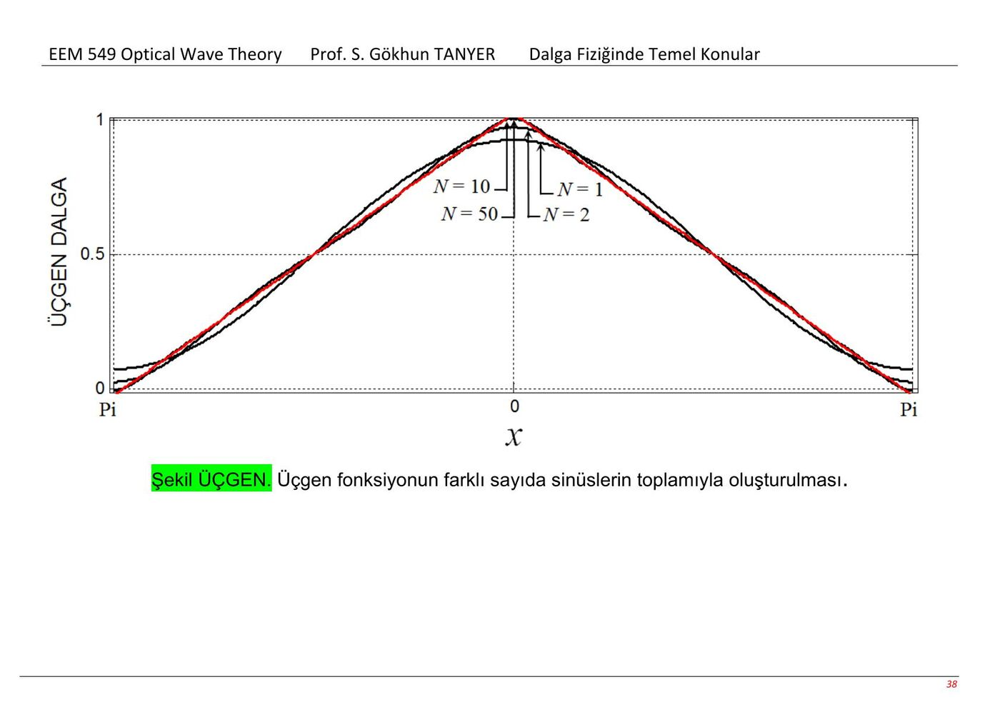
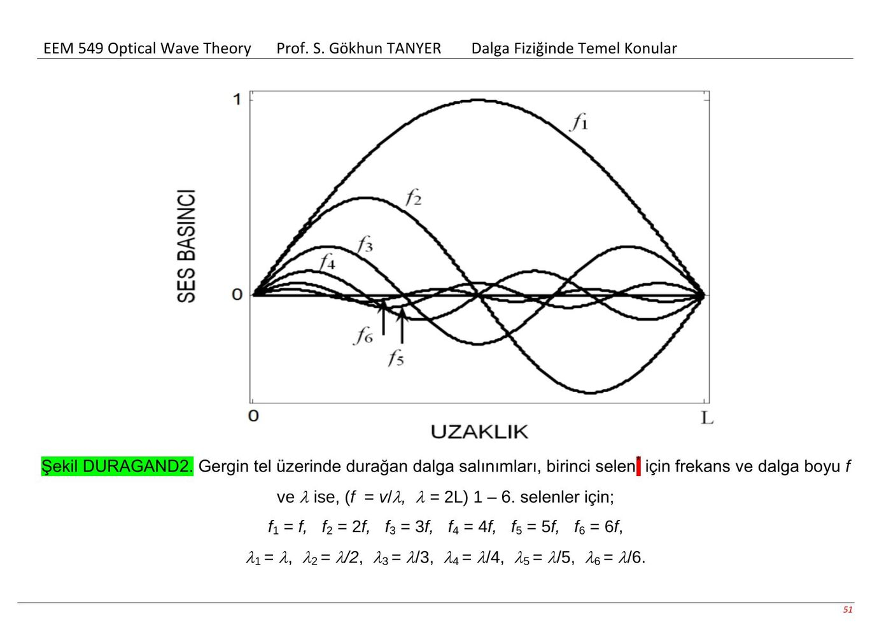

Bu yazı Prof. S. Gökhun Tanyer'in Başkent Üniversitesi için hazırladığı “Dalga Fiziğinde Temel Konular” ders notuna dayanır. Kapakta EEM549 Optical Wave Theory ve 2013–2014 güz dönemi yazmaktadır; dosya EEM224 arşivinde bulunduğu için burada bu ders altında yer alır. PDF 24 Şubat 2014'te oluşturulmuştur. Orijinal 60 sayfalık belge yazının sonunda indirilebilir.

*Not: Belge, yazarın “Müziğin Doğası – Matematiğin Sesi” adlı kitap taslağından yararlanıldığını ve dosyaların yalnız Başkent Üniversitesi öğrencileri için hazırlandığını; kopyalama ve internette yayımlamanın belge sahibinin iznine bağlı olduğunu belirtir. Bu kullanım uyarısı kaynakta bulunmaktadır.*

*Bu içerik üçüncü taraf bir kaynağa aittir; arşiv ve nostalji amacıyla kaynak belirtilerek paylaşılmıştır. Hak sahibinin talebi hâlinde kaldırılır.*

## Su, ses ve elektromanyetik dalgalar

Dalga yayılımı, ortam içindeki etkileşimlerin peş peşe aktarılmasıyla anlatılır. Ses dalgası hava, su veya katı gibi maddesel ortama ihtiyaç duyar; boşlukta yayılmaz. Elektromanyetik dalga boşlukta da yayılabilir. Not, geçmişte önerilen esir kavramını da anarak bu ayrımı açıklar.

Ses basıncı, ortamın denge basıncı etrafında artıp azalır. Tanecikler yerel olarak salınırken dalga ilerler. Ses, sıvı ve gazlarda boyuna dalga örneğidir. Su yüzeyindeki tanecik hareketi eliptik olabildiği için basitçe ses dalgasıyla aynı değildir.

## Huygens yaklaşımı ve polarizasyon

Dalga cephesindeki noktalar, yeni küçük dalgacıkların kaynağı gibi düşünülebilir. Bu dalgacıkların ortak zarfı sonraki dalga cephesini verir. Kaynakta su halkaları üzerinden görselleştirilir.

Polarizasyon salınımın yön özelliğidir. Not, yansıyan ışığın polarizasyonu ile polarize güneş gözlüğünü örnek verir; gözlük döndürüldüğünde geçen ışığın değişmesi bu özelliğin gözlenmesini sağlar.

## Hız, dalga boyu ve frekans

v=λf, λ=v/f ve f=v/λ. Periyot T=1/f'dir.

Kaynak örneğinde v=344 m/s ve f=344 Hz için λ=1 m, T≈2,907 ms bulunur. Çeyrek periyot aralığı T/4≈0,7267 ms'dir. Dalga şekilleri t=0, T/4, T/2 anlarında karşılaştırılır.

Açık alanda ilerleyen sesin genliği uzaklıkla azalır. Not, dalganın hızının kaynak gücünden değil ortamdan belirlendiğini vurgular.

*Not: Bu hız açıklaması doğrusal ortam yaklaşımı içindir. Büyük genlikli doğrusal olmayan dalgalarda genliğe bağlı etkiler bulunabilir.*

## Logaritma, bel ve desibel

Çok büyük ve çok küçük şiddetleri birlikte göstermek için logaritmik ölçek kullanılır. Güç/şiddet oranı için 10 log₁₀, basınç/genlik oranı için 20 log₁₀ katsayısı verilir. Örnek tabloda 100, 10, 1, 0,1 ve 0,01 değerleri sırasıyla 20, 10, 0, −10 ve −20 dB ile gösterilir.

*Not: Kaynaktaki dB formülleri tek büyüklüğün logaritması biçiminde yazılmıştır. Fiziksel kullanımda referansa oran gerekir: 10 log₁₀(I/I₀) ve 20 log₁₀(p/p₀). Genlik için 20 katsayısı, şiddetin genliğin karesiyle orantılı olduğu koşula dayanır.*

## Türev ve dalga denklemleri

Not, yerel farkların komşu bölgelerde değişimi tetiklemesini türev fikriyle bağdaştırır. Elektrik ve manyetik alanların zamana bağlı değişimleri arasındaki ilişki Maxwell denklemlerine bağlanır. Ørsted, Ampère, Faraday, Maxwell ve d'Alembert'in çalışmaları anlatılır.

Sinüzoidal aile, türev alındığında aynı aile içinde kalır:

sin x → cos x → −sin x → −cos x → sin x.

*Not: Kaynakta Faraday'ın değişen manyetik alanla elektrik alan oluşturma çalışması için 1925 yazılmıştır. Faraday 1867'de öldüğünden bu tarih hatalıdır; elektromanyetik indüksiyon çalışması 1831 tarihlidir.*

## Yansıma, kırılma, saçılma ve girişim

Ortam sınırında dalganın bir bölümü yansıyabilir, bir bölümü diğer ortama geçebilir. Yankı yansıma örneğidir. Ortam değişiminde yön değişmesi kırılma, engellerin çevresine yayılım ise kaynakta saçılma başlığı altında anlatılır.

Doğrusal ortamda aynı noktaya gelen basınç değişimleri toplanır. Aynı işaretli katkılar birbirini güçlendirir, ters işaretliler azaltır. İki eşit genlikli ve zıt yönde ilerleyen dalga paketi karşılaştırılır; tam yapıcı girişimde genlik iki katına çıkar.

## Selenler ve Fourier yaklaşımı

Çalgı ortamının hangi sinüs biçimlerine izin verdiği sorusu üzerinden temel frekans ve üst selenler tanıtılır. Gerilmiş bir telin üçgen biçiminde çekilip bırakılması, farklı sinüzoidal bileşenlerin toplamıyla açıklanır.

Kaynakta üçgen şekil için verilen seri:

f(x) = (4/π)cos x + (4/9π)cos 3x + (4/25π)cos 5x + …

f(x) = (4/π)Σ_(k=0)^∞ cos[(2k+1)x]/(2k+1)².

N=1,2,10 ve 50 terimli yaklaşımlar çizilerek eklenen terimlerin şekli nasıl iyileştirdiği gösterilir.

*Not: Metin bu şekli birim genlikli üçgen olarak tarif etse de yazılan katsayılarla f(0)=π/2 çıkar. Birim tepe genliği için katsayı 8/π² olur; kaynak formülü yukarıda değiştirilmeden aktarıldı.*

## Duran dalga ve sınır koşulları

İki uç arasında gidip gelen dalgalar üst üste biner. Yansıyan dalgaların düğümleri uyumlu olduğunda sabit konumlu düğüm ve karınlar oluşur. Şekil uzayda ilerlemese de her noktadaki genlik zamanla değişir; buna duran dalga denir.

İki sabit uç arasındaki uzunluk L ise temel modda λ₁=2L ve f₁=v/(2L). Üst modlarda:

f_n=nf₁, λ_n=λ₁/n.

## Rezonans, kayıp ve boru içindeki dalgalar

Uygun frekansta tekrar tekrar gelen enerji mevcut titreşimi destekler. Kayıplar gelen güce eşitlendiğinde kararlı durum oluşur. Kayıp küçükse daha çok enerji birikir; kararlı duruma ulaşma süresi de uzayabilir.

Notta iki ucu kapalı boru içindeki basınç modları, tel üzerindeki modlarla karşılaştırılır. Bir temel frekans ve onun tamsayı katları gösterilir. Borunun uç koşulları basınç ve tanecik yer değiştirmesi için ayrı düşünülmelidir.

Lazer örneğinde iki ayna arasındaki elektromanyetik alanın birikmesi, uyarılmış yayılım ve rezonans kavramlarıyla ilişkilendirilir.

## Gitar telleri

Standart akort için kaynakta şu serbest tel frekansları verilir:

| Tel | Perde | Frekans |
|---|---|---|
| 1, en ince | Mi E4 | 329,63 Hz |
| 2 | Si B3 | 246,94 Hz |
| 3 | Sol G3 | 196,00 Hz |
| 4 | Re D3 | 146,83 Hz |
| 5 | La A2 | 110,00 Hz |
| 6, en kalın | Mi E2 | 82,41 Hz |

Telin kalınlığı, gerginliği ve titreşen uzunluğu frekansı etkiler. Perdeye basılması titreşen uzunluğu değiştirir.
