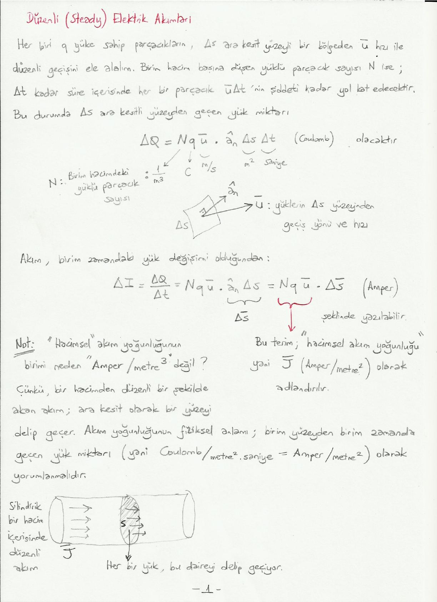

This post is the **"Steady Electric Currents"** section (4 pages) of the handwritten lecture notes for the **EEM224 Electromagnetics I** course at Başkent University. The note does not state the name of its author or a date. The text and formulas have been transcribed; one page image has been added for the current density drawings. The original scanned PDF of the note can be downloaded at the end of the post.

## Current density

Consider particles, each carrying charge q, passing steadily with velocity ū through a region with cross-sectional area Δs. If the number of charged particles per unit volume is N, then in a time Δt each particle will travel a distance equal to the magnitude of ūΔt. In this case, the amount of charge passing through the cross-section Δs is

ΔQ = N q ū · â_n Δs Δt   (coulomb)

where N is the number of charged particles per unit volume (1/m³), q is the charge (C), ū is the direction and velocity of the charges crossing the surface Δs (m/s), Δs is the area (m²), and Δt is the time (seconds).

Since current is the change of charge per unit time:

ΔI = ΔQ / Δt = N q ū · â_n Δs = N q ū · Δs̄   (ampere)

can be written. The term N q ū here is called the **"volume current density"**, that is, **J̄** (ampere/meter²).

**Note: Why is the unit of "volume" current density not "ampere/meter³"?** Because a current flowing steadily out of a volume pierces a surface as its cross-section. The physical meaning of current density should be interpreted as the amount of charge passing per unit surface per unit time (that is, coulomb/meter²·second = ampere/meter²). In a steady current within a cylindrical volume, each charge pierces the circle at the cross-section.

**Note 2:** In this case, if there is a current flowing on a surface (that is, a surface current), its unit will be J̄_s (ampere/meter), because the cross-section of a surface is a line (or a line segment). The physical meaning of surface current density should be interpreted as the amount of charge passing per unit length per unit time (that is, coulomb/meter·second = ampere/meter). In a steady current on a surface, each charge pierces this line segment.

Returning to our topic: the flux produced by the volume current density J̄ over a surface S actually gives us the current:

I = ∫_S J̄ · ds̄   (A)

Here J̄ is in units of A/m² and ds̄ in m².

## Electron mobility and conductivity

Inside metallic conductors, the velocity of electrons is directly proportional to a scalar quantity that we call the **"electron mobility (μ_e)"**:

ū = −μ_e Ē   (m/s)

Here the unit of μ_e is m²/(V·s) and the unit of Ē is V/m. J̄ = N q ū was defined earlier. From this,

J̄ = −N e μ_e Ē

Here e is the charge of an electron (1.6×10⁻¹⁹ coulomb), and the term N e μ_e is σ, that is, the **"conductivity"**. Since electron mobility (μ_e) is a property specific to each body/medium, conductivity (σ) is also a property specific to each body/medium. For bodies/media that we regard as perfect conductors, we assume μ_e → ∞ and σ → ∞.

*Note: If the electron charge is taken as q = −e, then J̄ = N q ū = N(−e)(−μ_e Ē) = N e μ_e Ē. The note has J̄ = −N e μ_e Ē written; for it to be consistent with the definition σ = N e μ_e and the immediately following J̄ = σĒ, the expression should be without the minus sign.*

## General form of Ohm's law

J̄ = σ Ē

Here J̄ is in units of A/m², Ē in V/m, and σ in A/(V·m) = ℧/m or siemens/m. Analogy: I = G V or I = V / R (Ohm's law).

**Why the general form?** In the circuit analysis course, for the expression V = IR, "two" points are needed to measure the potential difference and the equivalent resistance between them. However, the expression J̄(x₀, y₀, z₀) = σ(x₀, y₀, z₀) Ē(x₀, y₀, z₀) can be written for a single point (x₀, y₀, z₀) in space (that is, without needing a second point). For this reason, this expression is called the **"point form of Ohm's law"** or the **"general form of Ohm's law"**.

## Continuity equation

The principle of "conservation of charge" is one of our fundamental physical facts. Consider a volume v enclosed by a surface S. Let the charge in this volume be Q. If there is a current I flowing out of this volume, the decrease in the total charge in the volume per unit time must equal this current I. (Or, if there is a current I flowing into the volume, the increase in charge per unit time must equal I.)

The current flowing out of the volume will equal the flux produced by the current density vector over the surface S enclosing the volume:

I = ∮_S J̄ · ds̄

On the other hand:

I = −dQ/dt = −(d/dt) ∫_v ρ dv

can be written. By the divergence theorem, ∮_S J̄ · ds̄ = ∫_v (∇ · J̄) dv. From this,

∫_v (∇ · J̄) dv = −∫_v (∂ρ/∂t) dv

can be written, where −(d/dt) ∫_v ρ dv = −∫_v (∂ρ/∂t) dv. Why a partial derivative? Because ρ may also depend on the spatial coordinates!

Since this expression is independent of v (that is, since it holds for a v of any shape and size), the integrands must in fact be equal to each other:

∇ · J̄ = −∂ρ/∂t

This equation is called the **"continuity equation"**. Units: ∇ (1/m) · J̄ (A/m²) → A/m³; ∂ρ/∂t → C/(s·m³) = A/m³.

In steady currents, the charge density does not change with time; that is, ∂ρ/∂t = 0:

∇ · J̄ = 0

The current density vectors of steady currents are solenoidal; they form closed loops. In integral form, this expression can be written as

∮_S J̄ · ds̄ = 0

In the circuit analysis course, the sum of the currents entering/leaving a node was Σ_j I_j = 0 (Kirchhoff's current law); the expression ∮_S J̄ · ds̄ = 0 is the **general form of Kirchhoff's current law**.
