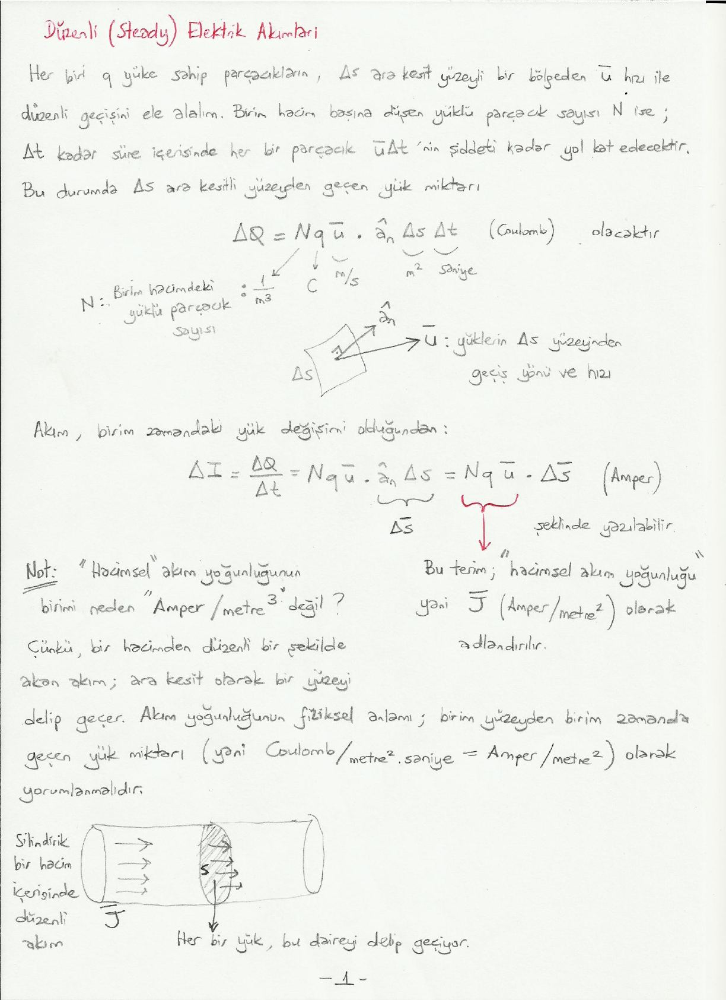

Bu yazı, Başkent Üniversitesi **EEM224 Elektromanyetik I** dersine ait el yazısı ders notlarının **"Düzenli (Steady) Elektrik Akımları"** bölümüdür (4 sayfa). Notta hazırlayanın adı ve tarih yazmıyor. Metin ve formüller yazıya döküldü; akım yoğunluğu çizimleri için bir sayfa görseli eklendi. Taranmış notun orijinal PDF'i yazının sonunda indirilebilir.

## Akım yoğunluğu

Her biri q yüküne sahip parçacıkların, Δs ara kesit yüzeyli bir bölgeden ū hızı ile düzenli geçişini ele alalım. Birim hacim başına düşen yüklü parçacık sayısı N ise Δt kadar süre içerisinde her bir parçacık ūΔt'nin şiddeti kadar yol kat edecektir. Bu durumda Δs ara kesitli yüzeyden geçen yük miktarı

ΔQ = N q ū · â_n Δs Δt   (coulomb)

olacaktır. Burada N birim hacimdeki yüklü parçacık sayısı (1/m³), q yük (C), ū yüklerin Δs yüzeyinden geçiş yönü ve hızı (m/s), Δs alan (m²), Δt süredir (saniye).

Akım, birim zamandaki yük değişimi olduğundan:

ΔI = ΔQ / Δt = N q ū · â_n Δs = N q ū · Δs̄   (amper)

şeklinde yazılabilir. Buradaki N q ū terimi **"hacimsel akım yoğunluğu"**, yani **J̄** (amper/metre²) olarak adlandırılır.

**Not: "Hacimsel" akım yoğunluğunun birimi neden "amper/metre³" değil?** Çünkü bir hacimden düzenli bir şekilde akan akım, ara kesit olarak bir yüzeyi delip geçer. Akım yoğunluğunun fiziksel anlamı, birim yüzeyden birim zamanda geçen yük miktarı (yani coulomb/metre²·saniye = amper/metre²) olarak yorumlanmalıdır. Silindirik bir hacim içerisinde düzenli akımda her bir yük, ara kesitteki daireyi delip geçiyor.

**Not 2:** Bu durumda yüzeyden akan bir akım (yani bir yüzey akımı) varsa onun birimi de J̄_s (amper/metre) olacaktır, çünkü bir yüzeyin ara kesiti bir doğru (veya doğru parçası) olacaktır. Yüzey akım yoğunluğunun fiziksel anlamı, birim uzunluktan birim zamanda geçen yük miktarı (yani coulomb/metre·saniye = amper/metre) olarak yorumlanmalıdır. Bir yüzey üzerindeki düzenli akımda her bir yük, bu doğru parçasını delip geçiyor.

Konumuza dönecek olursak: bir S yüzeyinde hacimsel akım yoğunluğu J̄'nin oluşturduğu akı aslında bize akımı verir:

I = ∫_S J̄ · ds̄   (A)

Burada J̄ (A/m²), ds̄ (m²) birimindedir.

## Elektron mobilitesi ve iletkenlik

Metalik iletkenlerin içerisinde elektronların hızı, **"elektron mobilitesi (μ_e)"** olarak adlandırdığımız skaler bir büyüklük ile doğru orantılıdır:

ū = −μ_e Ē   (m/s)

Burada μ_e'nin birimi m²/(V·s), Ē'nin birimi V/m'dir. J̄ = N q ū şeklinde tanımlanmıştı. Buradan

J̄ = −N e μ_e Ē

Burada e bir elektronun yükü (1,6×10⁻¹⁹ coulomb), N e μ_e terimi de σ, yani **"iletkenlik"** (*conductivity*). Elektron mobilitesi (μ_e) her bir cisme/ortama has bir özellik olduğu için iletkenlik (σ) de her bir cisme/ortama has bir özelliktir. Mükemmel iletken olarak kabul ettiğimiz cisim/ortamlarda μ_e → ∞ ve σ → ∞ varsayarız.

*Not: Elektronun yükü q = −e alınırsa J̄ = N q ū = N(−e)(−μ_e Ē) = N e μ_e Ē olur. Notta J̄ = −N e μ_e Ē yazılmış; σ = N e μ_e tanımı ve hemen ardından gelen J̄ = σĒ ile tutarlı olması için ifadenin eksi işaretsiz olması gerekir.*

## Ohm yasasının genel hâli

J̄ = σ Ē

Burada J̄ (A/m²), Ē (V/m) ve σ (A/(V·m) = ℧/m ya da siemens/m) birimindedir. Benzerlik: I = G V veya I = V / R (Ohm yasası).

**Neden genel hâli?** Devre analizi dersinde V = IR ifadesi için aralarındaki potansiyel farkı ve eşdeğer direnci ölçmek için "iki" nokta gerekmektedir. Ancak J̄(x₀, y₀, z₀) = σ(x₀, y₀, z₀) Ē(x₀, y₀, z₀) ifadesi uzaydaki tek bir (x₀, y₀, z₀) noktası için (yani ikinci bir noktaya gerek olmaksızın) yazılabilir. Bu yüzden bu ifadeye **"Ohm yasasının nokta formu"** veya **"Ohm yasasının genel hâli"** adı verilmektedir.

## Süreklilik denklemi

"Yüklerin korunumu" prensibi fiziksel olarak temel gerçeklerimizden biridir. S yüzeyi tarafından çevrelenen bir v hacmi düşünelim. Bu hacimde Q kadar yükümüz olsun. Eğer bu hacimden dışarı doğru bir I akımı varsa, birim zamanda hacimdeki toplam yükün düşüş miktarı bu I akımına eşit olmalıdır. (Veya hacimden içeri doğru bir I akımı varsa, birim zamandaki yük artış miktarı I'ya eşit olmalıdır.)

Hacimden dışarı çıkan akım, hacmi çevreleyen S yüzeyi üzerinde akım yoğunluğu vektörü tarafından oluşturulan akıya eşit olacaktır:

I = ∮_S J̄ · ds̄

Öte yandan:

I = −dQ/dt = −(d/dt) ∫_v ρ dv

olarak yazılabilir. Diverjans teoremi ile de ∮_S J̄ · ds̄ = ∫_v (∇ · J̄) dv'dir. Buradan

∫_v (∇ · J̄) dv = −∫_v (∂ρ/∂t) dv

yazılabilir; burada −(d/dt) ∫_v ρ dv = −∫_v (∂ρ/∂t) dv. Neden kısmi türev? Çünkü ρ uzay koordinatlarına da bağlı olabilir!

Bu ifade v'den bağımsız olduğuna göre (yani her şekil ve boyuttaki v için geçerli olduğuna göre) aslında integrali alınan değerler birbirine eşit olmalıdır:

∇ · J̄ = −∂ρ/∂t

Bu denkleme **"süreklilik denklemi"** adı verilir. Birimler: ∇ (1/m) · J̄ (A/m²) → A/m³; ∂ρ/∂t → C/(s·m³) = A/m³.

Düzenli akımlarda yük yoğunluğu zamanla değişmez; yani ∂ρ/∂t = 0:

∇ · J̄ = 0

Düzenli akımların akım yoğunluğu vektörleri solenoidaldir; kapalı döngüler oluşturur. Bu ifade integral formunda

∮_S J̄ · ds̄ = 0

şeklinde yazılabilir. Devre analizi dersinde bir düğüm noktasına giren/çıkan akımların toplamı Σ_j I_j = 0 (Kirchhoff'un akım yasası) idi; ∮_S J̄ · ds̄ = 0 ifadesi **Kirchhoff akım yasasının genel hâli**dir.
