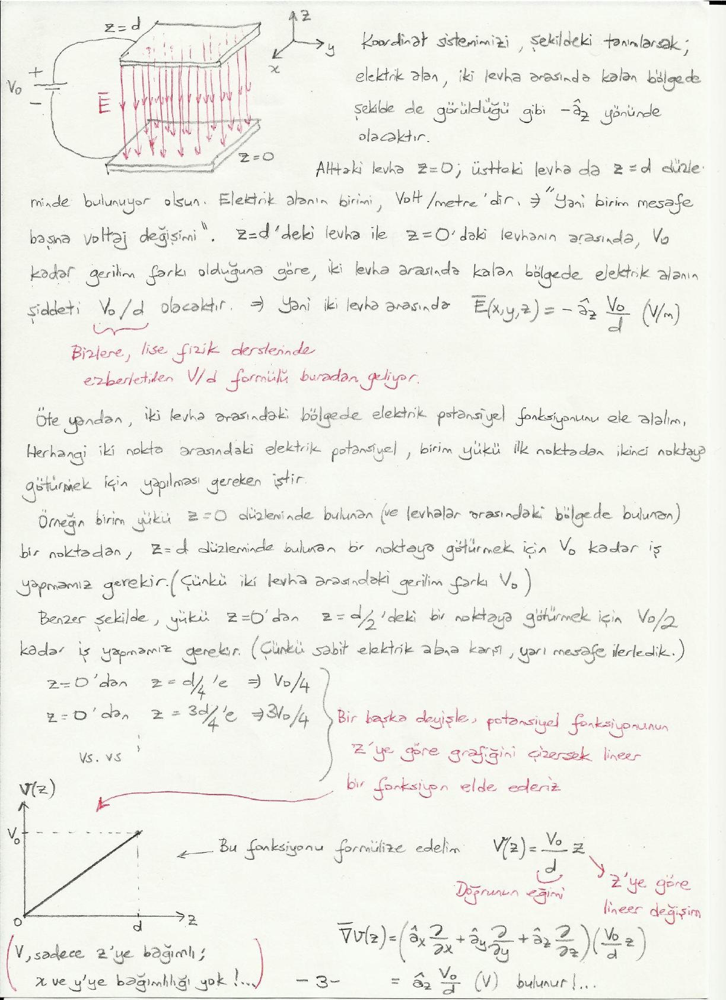
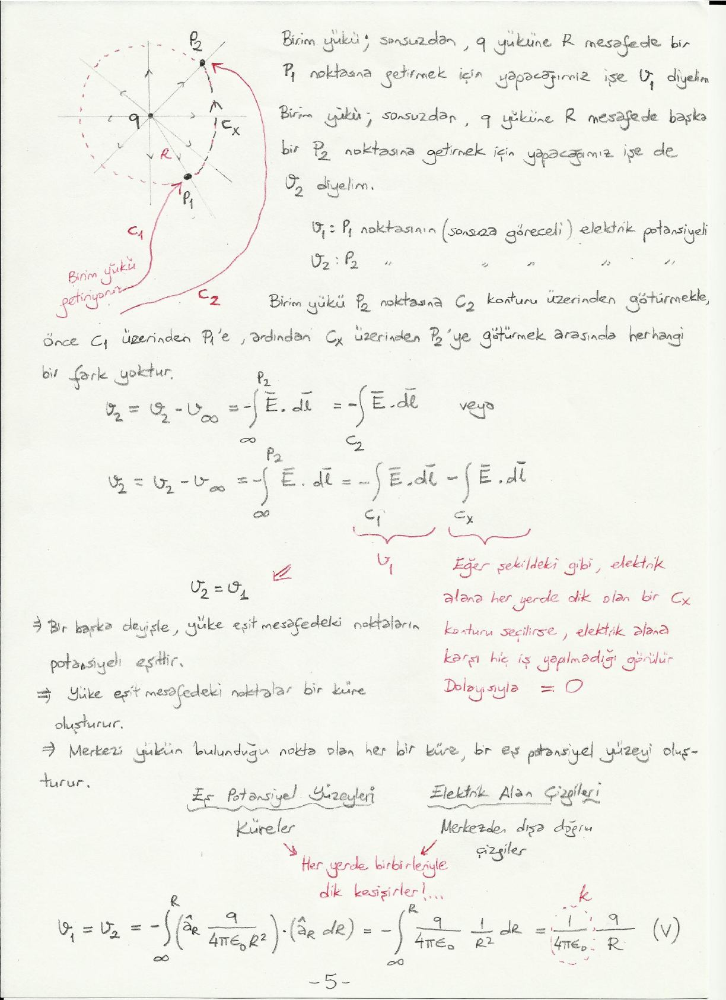
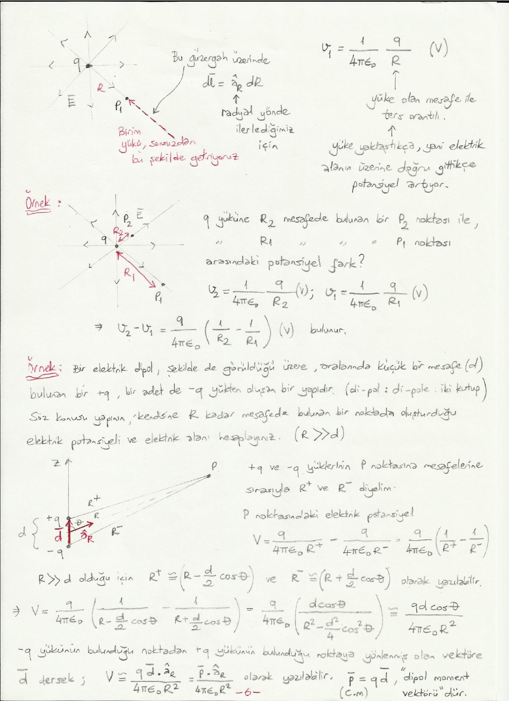

This post is the **"Electric Potential"** section of the handwritten lecture notes for the **EEM224 Electromagnetics I** course at Başkent University (7 pages). The note does not state the author's name or the date. The text and formulas have been transcribed; images of the relevant pages are included for the drawings. The original scanned PDF of the note can be downloaded at the end of the post.

## Electric potential

We previously saw that a vector field whose curl is 0 can in fact be expressed as the gradient of a scalar field (see the first of the two "0" identities). Since the electrostatic field is conservative (that is, its curl is 0), we can express the electrostatic field in terms of the gradient of a scalar function.

- If f(x, y, z) is a scalar field, then ∇ × [∇f(x, y, z)] = 0.
- Since ∇ × Ē(x, y, z) = 0, Ē can be written as Ē = ∇f(x, y, z).
- Let us define a function (scalar field), which we will denote by φ(x, y, z) or V(x, y, z): φ(x, y, z) = V(x, y, z) = −f(x, y, z).

Ē(x, y, z) = −∇φ(x, y, z) = −∇V(x, y, z)

Here, V is the **electric potential function**, the function we call "voltage" in circuit analysis. The unit of Ē is V/m, the unit of ∇ is m⁻¹, and the unit of V is the volt.

**Meaning of the "−" sign:** The gradient of a scalar function points in the direction of increase of the function. Therefore, the direction of the electric field is the direction in which the electric potential decreases. In other words, the electric potential increases as we move toward the charge that is the source of the electric field.

If we take the contour integral of both sides of the equation between the points P₁ and P₂:

∫_P₁^P₂ Ē · dl̄ = −∫_P₁^P₂ [∇V] · dl̄ = −(V|_P₂ − V|_P₁)

V_P₂ − V_P₁ = −∫_P₁^P₂ Ē · dl̄   (V)

Here, V|_P₂ and V|_P₁ are the values that the function V(x, y, z) takes at P₂ and P₁. Therefore, the electric potential function can also be defined as follows:

W / q = −∫_P₁^P₂ Ē · dl̄   (J/C) or (V)

**The potential difference between points P₂ and P₁ is the work that must be done against the electric field to move a unit charge from point P₁ to point P₂.**

**Important note:** The concept of electric potential is in fact a "relative" concept; that is, one can only speak of the potential difference between two points. (In circuit analysis courses and in laboratories, we always measure/calculate "the potential difference between a point in the circuit and ground.") Strictly speaking, one cannot talk about the electric potential of a single point. If we do speak of the potential of a single point out of habit, what we actually mean is "the potential difference between that point and infinity"; that is, the work done to bring a unit charge from infinity to the point in question. If we call our point P₁:

V_P₁ = V_P₁ − V_∞ = −∫_∞^P₁ Ē · dl̄

(Note: In circuit analysis, too, when we speak of the voltage of a point in a circuit, what we actually mean is the voltage difference between that point and ground.)

*Note: In the original note, the unit of this expression is written as (V/m); the unit of potential should be volts (V).*

## Example: Parallel-plate capacitor

The parallel-plate capacitor, familiar from high school physics, is formed by applying a voltage and an electric potential difference between two parallel plates. When a voltage difference is applied to the plates, positive charges are pulled from the plate with the lower voltage and sent to the other plate. By the principle of conservation of charge, an equal amount of negative charge appears on the other plate. Since the upper plate carries positive charge and the lower plate carries negative charge, an electric field forms in the region between the two plates. This electric field leaves the surface of the positively charged plate perpendicularly and enters the negatively charged plate perpendicularly along the shortest path.

Let the lower plate lie in the z = 0 plane and the upper plate in the z = d plane. The electric field in the region between the two plates will be in the −â_z direction. The unit of the electric field is volts/meter, that is, "voltage change per unit distance." Since the voltage difference between the plate at z = d and the plate at z = 0 is V₀, the magnitude of the electric field in the region between the two plates will be V₀/d:

Ē(x, y, z) = −â_z V₀/d   (V/m)

This is where the V/d formula that we were made to memorize in high school physics comes from.

Now let us consider the electric potential function in the region between the two plates. The electric potential between any two points is the work that must be done to move a unit charge from the first point to the second. For example, to move a unit charge from a point in the z = 0 plane (and in the region between the plates) to a point in the z = d plane, we must do V₀ of work (because the voltage difference between the two plates is V₀). Similarly, to move the charge from z = 0 to a point at z = d/2, we must do V₀/2 of work (because we advanced half the distance against a constant electric field). From z = 0 to z = d/4 it is V₀/4, to z = 3d/4 it is 3V₀/4, and so on.

In other words, if we plot the potential function against z, we obtain a linear function:

V(z) = (V₀/d) z

V₀/d is the slope of the line. V depends only on z; it has no dependence on x and y.

∇V(z) = (â_x ∂/∂x + â_y ∂/∂y + â_z ∂/∂z)(V₀ z/d) = â_z V₀/d

is obtained. We had previously found Ē(x, y, z) = −â_z V₀/d (V/m); hence Ē = −∇V. ✓

*Note: In the original note, the unit of ∇V is written as (V); since the gradient divides by length, the correct unit is V/m.*

- Moving toward the upper plate (that is, against the electric field), the electric potential increases (that is, in the +z direction).
- The gradient of the electric potential indeed points in the direction of increase (that is, the +z direction).

### Equipotential surfaces

- The potential is the same at every point on the plate at z = 0 (V = 0); the plate at z = 0 forms an equipotential surface.
- The potential is also the same at every point on the plate at z = d (V = V₀); the plate at z = d forms another equipotential surface.
- The plane at z = d/2, lying in the region between the two plates and parallel to both, also forms an equipotential surface (V = V₀/2).

Therefore, infinitely many equipotential surfaces parallel to the plates (that is, parallel to the xy plane) can be drawn between the two plates. The electric field, on the other hand, is in the −z direction: **Electric field lines and equipotential surfaces are always perpendicular to each other.**

Note: This is also something we would expect mathematically. Since the gradient of the electric potential function points in the direction of maximum increase of the function, it must be perpendicular to the surface on which the function is constant.

In other words, in a given problem, we can find the direction of the electric field by considering the variation of the electric potential, or find the variation of the electric potential by considering the direction of the electric field.

## Example: Electric field and electric potential due to a single charge

We know that electric field lines run from the charge out to infinity. Let V₁ be the work we do to bring a unit charge from infinity to a point P₁ at a distance R from the charge q, and let V₂ be the work we do to bring it to another point P₂, also at distance R (V₁ and V₂ are the electric potentials of the points P₁ and P₂ relative to infinity).

There is no difference between taking the unit charge to P₂ along contour C₂ and taking it first to P₁ along C₁ and then to P₂ along C_x:

V₂ = V₂ − V_∞ = −∫_∞^P₂ Ē · dl̄ = −∫_C₂ Ē · dl̄ or V₂ = −∫_C₁ Ē · dl̄ − ∫_Cx Ē · dl̄

The first term is V₁. If, as in the figure, a contour C_x that is everywhere perpendicular to the electric field is chosen, we see that no work is done against the electric field; therefore the second term is 0 and V₂ = V₁.

- In other words, points at equal distance from the charge have equal potential.
- Points at equal distance from the charge form a sphere.
- Each sphere centered at the point where the charge is located forms an equipotential surface.

The equipotential surfaces are spheres, and the electric field lines are lines going outward from the center; they intersect each other perpendicularly everywhere.

If we bring the unit charge in from infinity in the radial direction, then along this path dl̄ = â_R dR:

V₁ = V₂ = −∫_∞^R (â_R q / 4πε₀R²) · (â_R dR) = −∫_∞^R q / (4πε₀) · 1/R² dR = (1 / 4πε₀) · q / R   (V)

Here 1/4πε₀ = k. The potential is inversely proportional to the distance from the charge; as we approach the charge, that is, as we move against the electric field, the potential increases.

### Example: Potential difference between two points

What is the potential difference between a point P₂ at a distance R₂ from the charge q and a point P₁ at a distance R₁?

V₂ = (1/4πε₀) · q/R₂ (V); V₁ = (1/4πε₀) · q/R₁ (V)

V₂ − V₁ = q / (4πε₀) · (1/R₂ − 1/R₁)   (V)

## Example: Electric dipole

An electric dipole is a structure consisting of one +q charge and one −q charge separated by a small distance (d) (di-pole: two poles). Calculate the electric potential and electric field that this structure produces at a point at a distance R from it (R ≫ d).

Let the distances of the +q and −q charges to point P be R⁺ and R⁻, respectively. The electric potential at point P is:

V = q / (4πε₀R⁺) − q / (4πε₀R⁻) = q / (4πε₀) · (1/R⁺ − 1/R⁻)

Since R ≫ d, we can write R⁺ ≅ R − (d/2) cos θ and R⁻ ≅ R + (d/2) cos θ:

V = q / (4πε₀) · [1 / (R − (d/2) cos θ) − 1 / (R + (d/2) cos θ)] = q / (4πε₀) · d cos θ / (R² − (d²/4) cos² θ) ≅ q d cos θ / (4πε₀R²)

If we call the vector directed from the location of the −q charge to the location of the +q charge d̄:

V ≅ q d̄ · â_R / (4πε₀R²) = p̄ · â_R / (4πε₀R²)

Here p̄ = q d̄ (C·m) is the **"dipole moment vector."**

The electric field caused by the dipole can be calculated with Ē = −∇V. In spherical coordinates:

Ē = −∇V = â_R ∂V/∂R − â_θ ∂V/(R∂θ) = â_R p cos θ / (2πε₀R³) + â_θ p sin θ / (4πε₀R³) = p / (4πε₀R³) · (â_R 2 cos θ + â_θ sin θ)

*Note: In the original note, the intermediate step is written as −∇V = â_R ∂V/∂R − â_θ ∂V/(R∂θ), without the minus sign in front of the â_R term; the correct form is −â_R ∂V/∂R. The next step and the result (â_R 2 cos θ + â_θ sin θ) are correct.*

**Note:** As seen in this example, in cases where Gauss's law cannot be applied and Coulomb's law is also difficult to apply, it is possible to calculate first the electric potential and then the electric field.

## Electric potential due to continuous charge distributions

With an approach similar to the logic used earlier for calculating the electric field due to continuous charge distributions:

- The electric potential due to a charge density ρ_v (C/m³) within a volume v′: V = (1/4πε₀) ∫_v′ (ρ_v / R) dv′   (V)
- The electric potential due to a charge density ρ_s (C/m²) on a surface S′: V = (1/4πε₀) ∫_S′ (ρ_v / R) ds′   (V)
- The electric potential due to a charge density ρ_l (C/m) on a contour C′: V = (1/4πε₀) ∫_C′ (ρ_l / C) dl′   (V)

*Note: In the original note, ρ_v is written inside the surface integral and C is written in place of R in the denominator of the line integral; the correct expressions are ρ_s / R and ρ_l / R.*
