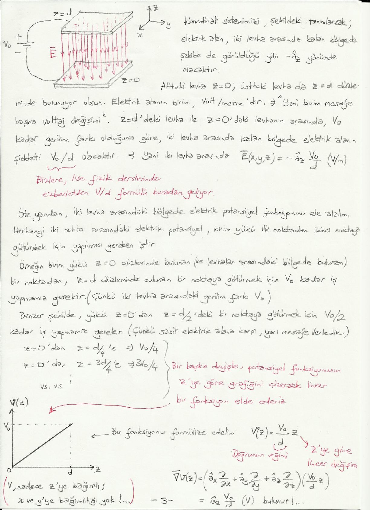
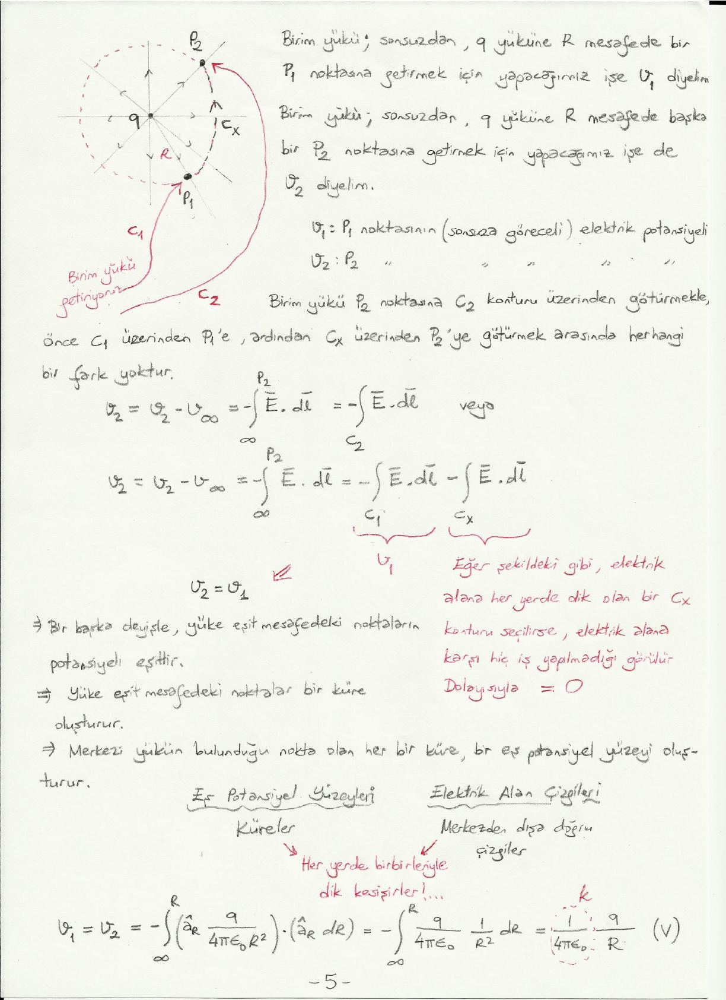
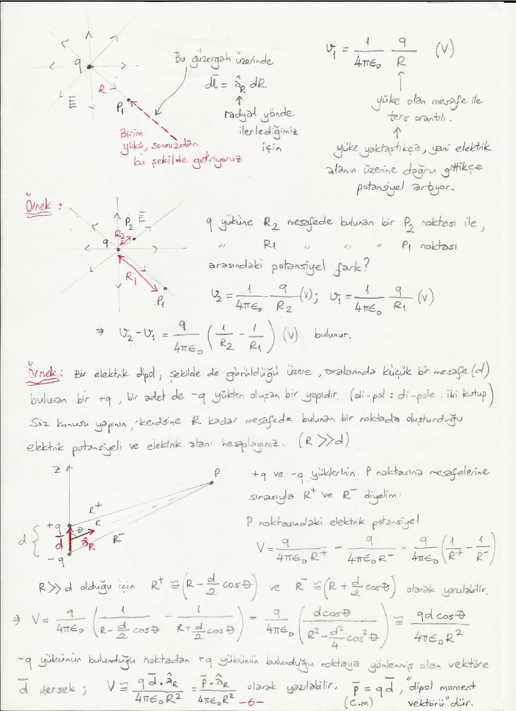

Bu yazı, Başkent Üniversitesi **EEM224 Elektromanyetik I** dersine ait el yazısı ders notlarının **"Elektrik Potansiyel"** bölümüdür (7 sayfa). Notta hazırlayanın adı ve tarih yazmıyor. Metin ve formüller yazıya döküldü; çizimler için ilgili sayfaların görselleri eklendi. Taranmış notun orijinal PDF'i yazının sonunda indirilebilir.

## Elektrik potansiyel

Daha önce buklesi 0 olan bir vektörel alanın aslında bir skaler alanın gradyantı şeklinde ifade edilebileceğini görmüştük (bkz. iki "0" eşitliğinden birincisi). Elektrostatik alan konservatif olduğu için (yani buklesi 0 olduğu için) elektrostatik alanı bir skaler fonksiyonun gradyantı cinsinden ifade edebiliriz.

- f(x, y, z) skaler alan ise ∇ × [∇f(x, y, z)] = 0.
- ∇ × Ē(x, y, z) = 0 olduğuna göre Ē = ∇f(x, y, z) şeklinde yazılabilir.
- φ(x, y, z) veya V(x, y, z) olarak göstereceğimiz bir fonksiyon (skaler alan) tanımlayalım: φ(x, y, z) = V(x, y, z) = −f(x, y, z).

Ē(x, y, z) = −∇φ(x, y, z) = −∇V(x, y, z)

Burada V, **elektrik potansiyel fonksiyonu**dur; devre analizinde "voltaj" olarak isimlendirdiğimiz fonksiyon. Ē'nin birimi V/m, ∇'nın birimi m⁻¹, V'nin birimi volttur.

**"−" işaretinin anlamı:** Skaler bir fonksiyonun gradyantı fonksiyonun artışı yönündedir. Dolayısıyla elektrik alanın yönü, elektrik potansiyelin azaldığı yöndedir. Bir başka deyişle, elektrik alanın kaynağı olan yüke doğru ilerledikçe elektrik potansiyel artar.

Eşitlikte her iki tarafın da P₁–P₂ noktaları arasında kontur integralini alırsak:

∫_P₁^P₂ Ē · dl̄ = −∫_P₁^P₂ [∇V] · dl̄ = −(V|_P₂ − V|_P₁)

V_P₂ − V_P₁ = −∫_P₁^P₂ Ē · dl̄   (V)

Burada V|_P₂ ve V|_P₁, V(x, y, z) fonksiyonunun P₂ ve P₁'de aldığı değerlerdir. Dolayısıyla elektrik potansiyel fonksiyonu şu şekilde de tanımlanabilir:

W / q = −∫_P₁^P₂ Ē · dl̄   (J/C) veya (V)

**P₂ ve P₁ noktaları arasındaki potansiyel fark: birim yükü P₁ noktasından P₂ noktasına götürmek için elektrik alana karşı yapılması gereken iş.**

**Önemli not:** Elektrik potansiyel kavramı aslında "göreceli" bir kavramdır; yani iki nokta arasındaki potansiyel farktan söz edilebilir. (Devre analizi derslerinde ve laboratuvarlarda hep "devredeki bir nokta ile toprak arasındaki potansiyel farkı" ölçeriz/hesaplarız.) Kitabi olarak, aslında tek bir noktanın elektrik potansiyelinden söz edilemez. Eğer ağız alışkanlığı ile tek bir noktanın potansiyelinden söz ediyorsak, aslında burada kastettiğimiz şey "o nokta ile sonsuz arasındaki potansiyel fark"tır; yani birim yükü sonsuzdan söz konusu noktaya getirmek için yapılan iş. Noktamıza P₁ dersek:

V_P₁ = V_P₁ − V_∞ = −∫_∞^P₁ Ē · dl̄

(Not: Devre analizi dersinde de devredeki bir noktanın geriliminden söz ediyorsak, aslında kastettiğimiz şey o nokta ile toprak arasındaki gerilim farkıdır.)

*Not: Notta bu ifadenin birimi (V/m) olarak yazılmış; potansiyelin birimi volt (V) olmalıdır.*

## Örnek: Paralel levha kapasitör (kondansatör)

Lise fizik derslerinden aşina olduğumuz paralel levha kapasitör, iki tane paralel levha arasına gerilim (voltaj) ve elektrik potansiyel farkı uygulanması ile kurulur. Levhalara gerilim farkı uygulanınca, gerilimi alçak olan levhadan pozitif yükler koparılarak diğer levhaya gönderilir. Yüklerin korunumu prensibi uyarınca diğer levhada da eşit miktarda negatif yük açığa çıkar. Üstteki levhada pozitif, alttaki levhada da negatif yükler olacağından iki levha arasında kalan bölgede bir elektrik alan oluşur. Bu elektrik alan, pozitif yüklü levhanın yüzeyinden dik çıkarak en kısa yoldan negatif yüklü levhaya dik girecek şekilde oluşacaktır.

Alttaki levha z = 0, üstteki levha da z = d düzleminde bulunuyor olsun. Elektrik alan iki levha arasında kalan bölgede −â_z yönünde olacaktır. Elektrik alanın birimi volt/metre'dir, yani "birim mesafe başına voltaj değişimi". z = d'deki levha ile z = 0'daki levhanın arasında V₀ kadar gerilim farkı olduğuna göre iki levha arasında kalan bölgede elektrik alanın şiddeti V₀/d olacaktır:

Ē(x, y, z) = −â_z V₀/d   (V/m)

Bizlere lise fizik derslerinde ezberletilen V/d formülü buradan geliyor.

Öte yandan iki levha arasındaki bölgede elektrik potansiyel fonksiyonunu ele alalım. Herhangi iki nokta arasındaki elektrik potansiyel, birim yükü ilk noktadan ikinci noktaya götürmek için yapılması gereken iştir. Örneğin birim yükü z = 0 düzleminde bulunan (ve levhalar arasındaki bölgede bulunan) bir noktadan z = d düzleminde bulunan bir noktaya götürmek için V₀ kadar iş yapmamız gerekir (çünkü iki levha arasındaki gerilim farkı V₀). Benzer şekilde yükü z = 0'dan z = d/2'deki bir noktaya götürmek için V₀/2 kadar iş yapmamız gerekir (çünkü sabit elektrik alana karşı yarı mesafe ilerledik). z = 0'dan z = d/4'e V₀/4, z = 3d/4'e 3V₀/4 vs.

Bir başka deyişle potansiyel fonksiyonunun z'ye göre grafiğini çizersek lineer bir fonksiyon elde ederiz:

V(z) = (V₀/d) z

V₀/d doğrunun eğimidir. V sadece z'ye bağımlı; x ve y'ye bağımlılığı yok.

∇V(z) = (â_x ∂/∂x + â_y ∂/∂y + â_z ∂/∂z)(V₀ z/d) = â_z V₀/d

bulunur. Daha önce de Ē(x, y, z) = −â_z V₀/d (V/m) bulmuştuk; demek ki Ē = −∇V. ✓

*Not: Notta ∇V'nin birimi (V) olarak yazılmış; gradyant metreye böldüğü için doğrusu V/m'dir.*

- Yukarıdaki levhaya doğru (yani elektrik alanın üzerine doğru) gittikçe elektrik potansiyel artmakta (yani +z yönünde).
- Elektrik potansiyelin gradyantı gerçekten de artış yönünde (yani +z yönünde) çıktı.

### Eş potansiyel yüzeyleri

- z = 0'daki levhanın üzerindeki her noktada potansiyel aynı (V = 0); z = 0'daki levha bir eş potansiyel yüzeyi oluşturur.
- z = d'deki levhanın üzerindeki her noktada da potansiyel aynı (V = V₀); z = d'deki levha da başka bir eş potansiyel yüzeyi oluşturur.
- z = d/2'de, her iki levha arasındaki bölgede kalan ve her iki levhaya paralel olan düzlem de bir eş potansiyel yüzeyi oluşturur (V = V₀/2).

Dolayısıyla iki levha arasında levhalara paralel (yani xy düzlemine paralel) sonsuz tane eş potansiyel yüzeyi çizilebilir. Elektrik alan ise −z yönündedir: **Elektrik alan çizgileri ile eş potansiyel yüzeyleri her zaman birbirlerine diktir.**

Not: Bu, matematiksel olarak da aslında beklediğimiz bir şeydi. Çünkü elektrik potansiyel fonksiyonunun gradyantı, fonksiyonun maksimum artış yönünü gösterdiği için fonksiyonun sabit olduğu yüzeye dik olmak zorunda.

Bir başka deyişle, verilen bir problemde elektrik potansiyel değişimini göz önünde bulundurarak elektrik alanın yönünü ya da elektrik alanın yönünü göz önünde bulundurarak elektrik potansiyelin değişimini bulabiliriz.

## Örnek: Tek bir yükün sebep olduğu elektrik alan ve elektrik potansiyel

Elektrik alan çizgilerinin yükten sonsuza doğru olduğunu biliyoruz. Birim yükü sonsuzdan q yüküne R mesafede bir P₁ noktasına getirmek için yapacağımız işe V₁, yine R mesafede başka bir P₂ noktasına getirmek için yapacağımız işe de V₂ diyelim (V₁ ve V₂, P₁ ve P₂ noktalarının sonsuza göreceli elektrik potansiyelleri).

Birim yükü P₂ noktasına C₂ konturu üzerinden götürmekle, önce C₁ üzerinden P₁'e, ardından C_x üzerinden P₂'ye götürmek arasında herhangi bir fark yoktur:

V₂ = V₂ − V_∞ = −∫_∞^P₂ Ē · dl̄ = −∫_C₂ Ē · dl̄ veya V₂ = −∫_C₁ Ē · dl̄ − ∫_Cx Ē · dl̄

İlk terim V₁'dir. Eğer şekildeki gibi elektrik alana her yerde dik olan bir C_x konturu seçilirse, elektrik alana karşı hiç iş yapılmadığı görülür; dolayısıyla ikinci terim 0'dır ve V₂ = V₁.

- Bir başka deyişle, yüke eşit mesafedeki noktaların potansiyeli eşittir.
- Yüke eşit mesafedeki noktalar bir küre oluşturur.
- Merkezi yükün bulunduğu nokta olan her bir küre, bir eş potansiyel yüzeyi oluşturur.

Eş potansiyel yüzeyleri küreler, elektrik alan çizgileri merkezden dışa doğru çizgilerdir; her yerde birbirleriyle dik kesişirler.

Birim yükü sonsuzdan radyal yönde getirirsek bu güzergâh üzerinde dl̄ = â_R dR olur:

V₁ = V₂ = −∫_∞^R (â_R q / 4πε₀R²) · (â_R dR) = −∫_∞^R q / (4πε₀) · 1/R² dR = (1 / 4πε₀) · q / R   (V)

Burada 1/4πε₀ = k'dir. Potansiyel yüke olan mesafe ile ters orantılı; yüke yaklaştıkça, yani elektrik alanın üzerine doğru gittikçe potansiyel artıyor.

### Örnek: İki nokta arasındaki potansiyel farkı

q yüküne R₂ mesafede bulunan bir P₂ noktası ile R₁ mesafede bulunan bir P₁ noktası arasındaki potansiyel fark nedir?

V₂ = (1/4πε₀) · q/R₂ (V); V₁ = (1/4πε₀) · q/R₁ (V)

V₂ − V₁ = q / (4πε₀) · (1/R₂ − 1/R₁)   (V)

## Örnek: Elektrik dipol

Bir elektrik dipol, aralarında küçük bir mesafe (d) bulunan bir +q ve bir adet de −q yükten oluşan bir yapıdır (di-pol: di-pole, iki kutup). Söz konusu yapının kendisine R kadar mesafede bulunan bir noktada oluşturduğu elektrik potansiyeli ve elektrik alanı hesaplayınız (R ≫ d).

+q ve −q yüklerinin P noktasına mesafelerine sırasıyla R⁺ ve R⁻ diyelim. P noktasındaki elektrik potansiyel:

V = q / (4πε₀R⁺) − q / (4πε₀R⁻) = q / (4πε₀) · (1/R⁺ − 1/R⁻)

R ≫ d olduğu için R⁺ ≅ R − (d/2) cos θ ve R⁻ ≅ R + (d/2) cos θ olarak yazılabilir:

V = q / (4πε₀) · [1 / (R − (d/2) cos θ) − 1 / (R + (d/2) cos θ)] = q / (4πε₀) · d cos θ / (R² − (d²/4) cos² θ) ≅ q d cos θ / (4πε₀R²)

−q yükünün bulunduğu noktadan +q yükünün bulunduğu noktaya yönlenmiş olan vektöre d̄ dersek:

V ≅ q d̄ · â_R / (4πε₀R²) = p̄ · â_R / (4πε₀R²)

Burada p̄ = q d̄ (C·m), **"dipol moment vektörü"**dür.

Dipolün sebep olduğu elektrik alan Ē = −∇V ile hesaplanabilir. Küresel koordinatlarda:

Ē = −∇V = â_R ∂V/∂R − â_θ ∂V/(R∂θ) = â_R p cos θ / (2πε₀R³) + â_θ p sin θ / (4πε₀R³) = p / (4πε₀R³) · (â_R 2 cos θ + â_θ sin θ)

*Not: Notta ara adım −∇V = â_R ∂V/∂R − â_θ ∂V/(R∂θ) olarak, â_R teriminin önünde eksi işareti olmadan yazılmış; doğrusu −â_R ∂V/∂R'dir. Sonraki adım ve sonuç (â_R 2 cos θ + â_θ sin θ) doğrudur.*

**Not:** Bu örnekte de görüldüğü üzere, Gauss yasasının uygulanamayacağı, Coulomb yasasının da uygulanmasının zor olduğu durumlarda öncelikle elektrik potansiyelin, ardından elektrik alanın hesaplanması mümkündür.

## Sürekli yük dağılımlarının sebep olduğu elektrik potansiyel

Daha önce sürekli yük dağılımlarının sebep olduğu elektrik alanı hesaplamaktaki mantığa benzer bir yaklaşımla:

- Bir v′ hacmi içerisindeki ρ_v (C/m³)'lük yük yoğunluğunun sebep olduğu elektrik potansiyel: V = (1/4πε₀) ∫_v′ (ρ_v / R) dv′   (V)
- Bir S′ yüzeyi üzerindeki ρ_s (C/m²)'lik yük yoğunluğunun sebep olduğu elektrik potansiyel: V = (1/4πε₀) ∫_S′ (ρ_v / R) ds′   (V)
- Bir C′ konturu üzerindeki ρ_l (C/m)'lik yük yoğunluğunun sebep olduğu elektrik potansiyel: V = (1/4πε₀) ∫_C′ (ρ_l / C) dl′   (V)

*Not: Notta yüzey integralinin içinde ρ_v, çizgi integralinin paydasında da R yerine C yazılmış; doğru ifadeler ρ_s / R ve ρ_l / R'dir.*
