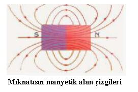
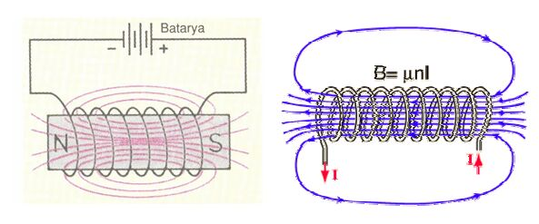
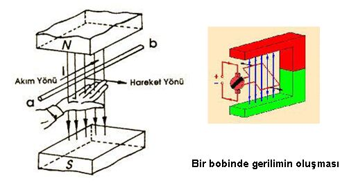

A compilation titled "Electromagnetism and Electromagnetic Induction" whose author, institution, and source site are not stated; the Word file's creation date is 11 November 2010. The source is the DOCX document of the same name in the course folder. A PDF rearranged from the text and embedded drawings can be downloaded at the end of the post.

*This content belongs to a third-party source; it is shared for archival and nostalgic purposes with attribution to the source. It will be removed at the request of the rights holder.*

## Magnetic Field

Magnetic fields are generally obtained in two ways. One is with the help of the natural magnets we know; the other is the magnetic field obtained by passing current through a conductor. Thus, the interaction that occurs around a magnet, or the effect that forms around a core when current is passed through a conductor wound on an iron core, is called a magnetic field.

## Properties of Magnetic Lines of Force

The imaginary lines along which iron filings line up around a magnet are called the magnetic field lines of force that the magnet creates in that region. The density of the magnetic lines of force increases as one approaches the poles of the magnet and decreases as one moves away from the poles. In brief, the properties of magnetic lines of force are as follows:

The direction of the magnetic lines of force is from N to S between the poles of the magnet, and from S to N inside it.
The magnetic lines of force pass between the poles of the magnet and through its interior, forming a closed circuit.
Magnetic lines of force do not cross one another; they are parallel to one another.
Magnetic lines of force pass through all materials and repel one another.
Air offers the greatest resistance.
The paths of the lines of force can be changed by another magnetic line of force.

## Electric Field

The electrostatic force (F) acting on a positive unit charge (Q) is called the electric field. The electric field is a vector quantity and is represented by lines of force. The electric field strength is denoted by the letter E. Its unit is volt/metre. The formula given below is used.

## Electric Line of Force and Field Strength

The imaginary lines that are used to represent the electric field, that are tangent to the field vector and in the same direction as the field, are called electric lines of force. When showing a strong field around an electric charge, the lines of force are drawn closely spaced. When showing a weak electric field, the lines of force are drawn sparsely.

## Electric Field Strength of a Point Charge q at a Distance r

There is a region in which an electric charge can exert its effect. Beyond a certain distance from the charge, its effect becomes too small to be felt. This region in which the electric charge exerts its effect is called the electric field of that charge. Listing the properties of the electric field:

1. Electric field lines point outward from a positive charge.
2. The electric field created by a negative charge points toward it.
3. Electric field lines never cross one another.

Like electric charges repel one another, and unlike electric charges attract one another. Electric field lines run from the + charge to the – charge. A field line can pass through every point within an electric field.

## Electromagnets

If a conductor is wound to form a coil and a current is passed through it, the current will flow through all the turns in the same direction. This creates a magnetic field with N and S poles in the coil. This magnet, which behaves like a permanent magnet, is called an ELECTROMAGNET. The magnetic field produced in each turn combines with the field of the adjacent turn to form a continuous magnetic field along the length of the coil. The poles of the magnetic field created around the coil depend on the direction of current flow and the winding direction of the coil. The strength of the magnetic field depends on the number of turns N, the magnitude of the current flowing through the coil I, the length of the coil L, and the medium "μ". The strength of the magnetic field is expressed in ampere-turns.

NOTE: The presence of a magnetic field in any region of space is revealed by the presence of a force acting on iron dust placed in that region. In such a region, iron filings line up along lines called magnetic field lines of force.

## Electromagnet Applications

Some of the industrial uses of the magnetic effect of electricity are as follows:
In running electric motors,
In transformers,
In magnetic grinding machines,
In transporting heavy loads and scrap metal with the help of electric cranes,
In operating contactors and relays,
In high-speed trains,
In sorting magnetic materials,
In automatic door systems,
In bell-type buzzers,
In the braking systems of electric trains and elevators.

Insulating material is used in response to the thermal and magnetic effects of electric current. When selecting the insulating material on conductors that will carry electric current, the following must be taken into account:

The type and thickness of the insulating material
The magnitude and effect of the voltage to be used
The shape of the electric field that forms
The weather conditions under which it operates

The most commonly used insulators are air, paper, rubber, mica, glass, porcelain, and plastic.

## Electromagnetism

Electric current arises from the movement of electric charges. The magnetic field obtained with electric current is generally called electromagnetism. A magnetic field forms around a conductor through which current is passed. These magnetic lines of force lie in a plane perpendicular to the conductor. The resulting lines of force differ from those of a magnet. In a current-carrying conductor there are no poles where the magnetic lines enter and exit. As the current passed through the conductor increases, the resulting electromagnetic field becomes stronger, the area it affects grows, and this magnetic field spreads equally and uniformly along the conductor. The direction of the magnetic lines of force formed around a straight conductor is found with the "RIGHT-HAND RULE."
In the Right-Hand Rule, the conductor is grasped so that the thumb of the right hand points in the direction of the current flowing through the conductor; the direction in which the other fingers wrap around the conductor (the four curled fingers) shows the direction of the magnetic lines of force. As one moves away from the wire, the magnetic field decreases in proportion to r2 (r = distance); but for any given distance r from the wire, its magnitude is constant along the wire. This magnitude is directly proportional to the current flowing through the wire.

## A Current-Carrying Conductor in a Constant Magnetic Field [LEFT-HAND RULE]

When current is passed through a conductor located in a constant magnetic field, the interaction of the magnetic field created by the current in the conductor with the surrounding magnetic field causes the conductor to be pushed out of the magnetic field. If the conductor is fixed so that it can move about its own axis in the direction of this pushing force, it rotates about itself. If it is not fixed, the conductor is pushed out of the magnetic field and this movement stops.

The direction of this movement or rotation is found with the left-hand rule. Left-Hand Rule: Spread the four fingers of the left hand together. If the left hand is inserted into the field so that the lines of force enter the palm (from the N pole toward the S pole), and the four fingers point in the direction of the current flowing through the conductor, the direction of the thumb, extended sideways, shows the direction of motion of the conductor. The direction in which the conductor is pushed depends on the current flowing through the conductor and the direction of the magnetic field.

Electromagnetic Induction

Moving a Conductor Within a Constant Magnetic Field (Principle of Electromagnetic Induction)

If a conductor in a constant magnetic field is moved so that it is cut by the magnetic field lines of force, a voltage is induced in that conductor. This phenomenon is called electromagnetic induction. The operating principle of dynamos can be given as an example of this phenomenon.

The magnitude of the voltage induced in the conductor is directly proportional to the speed of the conductor and the magnitude of the magnetic field. The direction of the induced current also depends on the direction of motion of the conductor and the direction of the magnetic field, and the direction of the current is found with the right-hand rule. Right-Hand Rule: When the right hand is held with the palm facing the N pole, and the thumb extended sideways indicates the direction of motion of the conductor in the field, the four adjacent fingers indicate the direction of the voltage induced in the conductor.

NOTE: By the method of electromagnetism, a voltage can be induced in a conductor by moving the conductor in a constant magnetic field. When current is passed through a conductor in a constant field, on the other hand, the conductor is pushed out of the field or rotates about itself; this is the operating principle of electric motors. The direction of the induced voltage is found with the right-hand rule, and the direction of conductor motion with the left-hand rule.

NOTE: If two conductors are placed side by side and current is passed through both in the same direction, the direction of the resulting magnetic fields is also the same. Thus the two magnetic fields combine to form a larger magnetic field surrounding both conductors. Such a situation causes the two conductors to be attracted toward each other. If the currents flowing through the conductors are in opposite directions, the magnetic fields formed around the conductors are also in opposite directions, and the conductors are pushed away from each other.

NOTE: If a conductor moves in a magnetic medium, it cuts the lines of force running from N to S. In this case, the electrons on the atoms of the conductor are pushed toward the outside of the magnetic medium. The end where the electrons collect shows negative (-) character. The atoms that lose their electrons on the conductor show positive (+) character. If a load is connected to these resulting "+" and "-" ends, the electrons complete their circuit through the load.

## Relations in the Figures

Electric field: E = F/Q. Point charge: E = kq/r². For a long solenoid, B = μnI; here n is the number of turns per unit length.

## Notes on the Source's Presentation

*Note: The statement in the text that "lines of force are parallel to one another" is not a general property; it is the special case of a uniform field. Field lines do not repel one another like physical threads; they are curves that visualize the field.*

*Note: The generalization that "air offers the greatest resistance" does not hold for every material and geometry; magnetic reluctance depends on permeability and geometry. The ampere-turn NI is the magnetomotive force; it is not the same quantity as H or B.*

*Note: For a straight, very long wire, the decrease with the square of the distance stated in the text is incorrect; B = μI/(2πr), that is, it decreases as 1/r. The geometry of a finite wire must additionally be taken into account.*

*Note: The force on a current-carrying conductor is in the direction of Iℓ × B; the conductor does not necessarily have to move "out of" the field. Parallel wires attract when the currents are in the same direction and repel when the currents are in opposite directions; however, the text's explanation that the fields are "in the same direction" everywhere is not correct.*

*Note: The Word document could not be converted directly to PDF in this environment. The download is a PDF rearranged from the text in the document; the original page layout was not preserved. For documents with embedded drawings, the drawings were transferred separately.*
