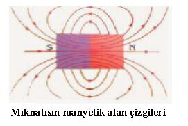
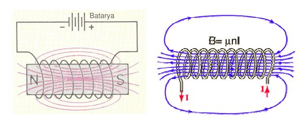
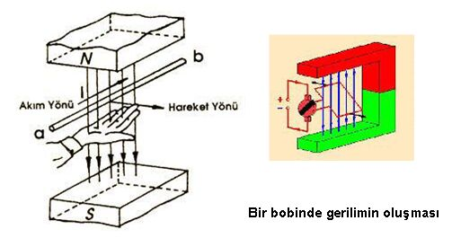

Yazarı, kurumu ve alındığı site belirtilmeyen “Elektromagnetizma ve Elektromanyetik İndiksiyon” başlıklı derleme; Word dosyasının oluşturma tarihi 11 Kasım 2010. Kaynak, ders klasöründeki aynı adlı DOCX belgesi. Metin ve gömülü çizimlerden yeniden düzenlenen PDF yazının sonunda indirilebilir.

*Bu içerik üçüncü taraf bir kaynağa aittir; arşiv ve nostalji amacıyla kaynak belirtilerek paylaşılmıştır. Hak sahibinin talebi hâlinde kaldırılır.*

## Manyetik Alan

Manyetik alanlar genel olarak iki türlü elde edilir. Bunlardan biri bildiğimiz doğal mıknatıslar yardımı ile diğeri ise bir iletkenden akım geçirerek elde edilen manyetik alandır. O halde bir mıknatıs etrafında meydana gelen etkileşim yada demir nüve üzerine sarılmış bir iletkenden akım geçirildiğinde nüve etrafında oluşan etkiye manyetik alan denir.

## Manyetik Kuvvet Çizgilerinin Özellikleri

Mıknatısın çevresinde demir tozlarının üzerinde sıralandığı hayali çizgilere, mıknatısın o bölgede oluşturduğu manyetik alan kuvvet çizgileri denir. Manyetik kuvvet çizgilerinin sıklığı mıknatısın kutuplarına yaklaştıkça artar, kutuplardan uzaklaştıkça azalır. Kısaca manyetik kuvvet çizgilerinin özellikleri şu şekilde sıralanır:

Manyetik kuvvet çizgilerinin yönü, mıknatısın kutupları arasında N’ den S’ ye doğru içerisinde ise S’ den N’ ye doğrudur.
Manyetik kuvvet çizgileri mıknatısın kutupları arasından ve içerisinden geçerek kapalı bir devre oluşturur.
Manyetik kuvvet çizgileri birbirlerini kesmezler, birbirlerine paraleldir.
Manyetik kuvvet çizgileri bütün malzemelerden geçerler ve birbirlerini iter.
En fazla direnci hava gösterir.
Kuvvet hatlarının yollarını başka bir manyetik kuvvet hattı değiştirebilir.

## Elektrik Alanı

Pozitif birim yüke (Q) etkiyen elektrostatik kuvvete (F) elektrik alanı denir.  Elektrik alanı vektörel bir büyüklüktür ve kuvvet çizgileri ile gösterilir. Elektrik alan şiddeti (E) harfi ile gösterilir. Birimi volt / metre’dir. Aşağıda belirtilen formül kullanılır.

## Elektrik Kuvvet Çizgisi ve Alan şiddeti

Elektrik alanını göstermeye yarayan, alan vektörüne teğet ve alanla aynı yönlü olan hayali çizgilere elektrik kuvvet çizgileri denir. Bir elektrik yükünün etrafındaki kuvvetli alanı gösterirken kuvvet çizgileri sık olarak çizilir. Zayıf elektrik alanını gösterirken de kuvvet çizgileri seyrek olarak çizilir

## Noktasal Bir q Yükünün r Kadar Uzaklıktaki Elektrik Alan Şiddeti

Elektrik yükünün etkisini gösterebildiği bir bölge vardır. Yükün belli uzaklığından itibaren etkisi hissedilmeyecek kadar az olur. Elektrik yükünün etkisini gösterdiği bu bölgeye, o yükün elektrik alanı denir. Elektrik alanının özelliklerini sıralarsak:

1. Elektrik alan çizgileri pozitif yükten dışa doğrudur.
2. Negatif yükün oluşturduğu elektrik alanı kendisine doğrudur.
3. Elektrik alan çizgileri birbirlerini hiçbir zaman kesmez.

Aynı cins elektrik yükleri birbirlerini iter, farklı cins elektrik yükleri birbirlerini çeker. Elektrik alan çizgileri + yükten – yüke doğrudur. Elektrik alanı içindeki her noktadan bir alan çizgisi geçebilir.

## Elektromıknatıslar

İletken, bir bobin meydana getirecek şekilde sarılmış ve içinden bir akım geçişi sağlanmışsa, akım bütün sarımlardan aynı yönde geçecektir. Bu da bobinde N ve S kutuplu bir manyetik alan oluşturur. Daimi mıknatıs özelliği gösteren bu mıknatısa ELEKTROMIKNATIS denir. Her sarımda meydana gelen manyetik alan, bitişiğindeki sarımın alanı ile birleşerek bobin içinde uzunluğuna devamlı bir manyetik alan oluşturur. Bobin etrafında oluşturulan manyetik alanın kutupları, akımın akış yönüne ve bobinin sarılma yönüne bağlıdır. Manyetik alanın kuvveti sarımların sayısına N ve bobinden geçen akımın şiddetine I, bobinin boyuna L ortama “μ” bağlıdır. Manyetik alanın kuvveti amper-sarım ile ifade edilir.

NOT: Herhangi bir uzay bölgesinde manyetik alanın varlığı, bu bölgeye yerleştirilmiş demir tozuna etkiyen kuvvetin varlığı ile belli olur. Böyle bir bölgede demir tozları, manyetik alan kuvvet çizgileri denen çizgiler boyunca sıralanır.

## Elektromıknatıs uygulamaları

Elektriğin manyetik etkisinin endüstrideki kullanım alanlarının bazıları şunlardır:
Elektrik motorlarının çalıştırılmasında,
Transformatörlerde,
Mıknatıslı taşlama tezgahlarında,
Elektrikli vinçler yardımıyla ağır ve hurdalıktaki metallerin nakliyatında,
Kontaktör ve rölelerin çalıştırılmasında,
Hızlı trenlerde,
Manyetik maddelerin ayıklanmasında,
Kapı otomatiklerinde,
Çanlı zillerde,
Elektrikli trenlerin ve asansörlerin fren sistemlerinde kullanılır.

Elektrik akımının ısı ve manyetik etkisine tepki olarak yalıtkan malzeme kullanılır. Elektrik akımını taşıyacak iletkenlerin üzerindeki yalıtkan malzemenin seçiminde şunlara dikkat edilmelidir:

Yalıtkan malzemenin cinsine ve kalınlığına
Kullanılacak gerilimin büyüklüğüne ve etkisine
Oluşan elektrik alanının şekline
Çalışılan hava koşullarına

En çok kullanılan yalıtkanlar hava, kağıt, kauçuk, mika, cam, porselen ve plastiktir.

## Elektromagnetizma

Elektrik akımı, elektrik yüklerinin hareketinden meydana gelmektedir. Elektrik akımı ile elde edilen manyetik alana genel olarak elektromanyetizma denir. Üzerinden akım geçirilen bir iletkenin etrafında bir manyetik alan oluşur. Bu manyetik kuvvet hatları iletkene dik bir düzlem içindedir. Meydana gelen kuvvet hatları mıknatıstan farklıdır. Üzerinden akım geçirilen iletkendeki manyetik hatların girip çıkacağı kutuplar yoktur. İletkenden geçirilen akım çoğaldıkça meydana gelen elektromanyetik alan kuvvetlenir, etkileyeceği alan büyür ve bu manyetik alan iletken boyunca eşit ve düzgün olarak yayılır. Düz iletkende meydana gelen manyetik kuvvet hatlarının yönü “SAĞ EL KURALI” ile bulunur. 
Sağ El Kuralı’nda; Sağ elin baş parmağı iletkenden geçen akımın yönünü gösterecek şekilde iletken tutulur, diğer parmakların iletkene sarılma yönü (kıvrılmış dört park ) manyetik kuvvet hatlarının yönünü gösterir. Manyetik alan telden uzaklaşınca r2 (r= uzaklık) ile orantılı azalır; ama telden herhangi bir r uzaklığı için tel boyunca büyüklüğü sabittir. Bu büyüklük telin içinden geçen akımla doğru orantılıdır.

## Sabit Bir Manyetik Alan İçerisinde Üzerinden Akım Geçen İletkenin Durumu [SOL EL KURALI]

Sabit bir manyetik alan içerisinde kalan iletkenden akım geçirildiğinde, iletken içinden geçen akımın oluşturduğu manyetik alanın, etrafındaki manyetik alan ile etkileşimi sonucunda iletken manyetik alan dışına doğru itilir. Bu itme kuvveti doğrultusunda iletken kendi etrafında hareket edecek şekilde sabitlenmiş ise, kendi etrafında dönme işlemi gerçekleşir. Sabitlenmemiş ise iletken manyetik alanın dışına doğru itilir ve bu hareket durur.

Bu Hareketin veya dönüşün yönü yönü sol el kuralı ile bulunur. Sol El Kuralı: Sol el dört parmağı birleştirilerek açılır. Kuvvet çizgileri avuç içine girecek şekilde( N kutbundan S ktbuna) alan içine sokulan sol elin dört parmağı iletkenden geçen akım yönünü gösterecek şekilde tutulursa yana açılan başparmağın yönü ise iletkenin hareket yönünü gösterir. İletkenin itilme yönü iletkenden geçen akım ve manyetik alanın yönüne bağlıdır.

Elektromanyetik İndüksiyon

Sabit Bir Manyetik Alan İçerisinde Bulunan İletkenin Hareketi Ettirilmesi Durumu ( Elektromanyetik İndüksiyon prensibi )

Sabit manyetik alan içerisinde bulunan iletken manyetik alan kuvvet çizgileri tarafından kesilecek şekilde hareket ettirilirse o iletkende gerilim indüklenir. Bu olaya elektromanyetik indüksiyon denir. Bu olaya örnek dinamoların çalışma prensibi verilebilir.

İletkende indüklenen gerilimin miktarı iletkenin hareket hızı ve manyetik alanın büyüklüğü ile doğru orantılıdır. İndüklenen akımın yönü de iletkenin hareket yönüne ve manyetik alanın yönüne bağlıdır ve akımın yönü sağ el kuralı ile bulunur. Sağ El Kuralı: Sağ elin avuç içi N kutbuna bakacak şekilde tutulduğunda, alan içindeki iletkenin hareket yönünü yana açılan başparmak gösteriyor olsun, iletkende indüklenen gerilimin yönünü bitişik dört parmak gösterir.

NOT:  Elektromanyetizma yöntemi ile sabit bir manyetik alan içerisinde iletken hareket ettirilerek iletken üzerinde gerilim indüklenebilir.  Sabit bir alan içinde iletkenden akım geçirildiğinde ise iletken alan dışına itilir veya kendi etrafında döner bu durum elektrik motorlarının çalışma pirensibidir. Sağ el kuralı ile indüklenen gerilim yönü, Sol el kuralı ile iletken hareket yönü bulunur.

NOT: İki iletken yan yana konur ve ikisinden de aynı yönde akım geçirilirse meydana gelecek manyetik alanın yönü de aynı olur. Böylece iki manyetik alan birleşerek her iki iletkeni çevreleyen daha büyük bir manyetik alanı oluşturur. Böyle bir durum her iki iletkenin birbirine doğru çekilmesine yol açar. İletkenlerden geçen akımın yönü zıt olursa iletkenlerde oluşan manyetik alanlar da zıt yönlü olur ve iletkenler birbirinden öteye itilir.

NOT: Manyetik ortamda bir iletken hareket ederse, N’den S’ye doğru giden kuvvet çizgilerini keser. Bu durumda iletkenin atomları üzerindeki elektronlar manyetik ortamın dışına doğru itilir. Elektronların toplandığı uç negatif (-) özellik gösterir. İletken üzerinde elektronlarını kaybeden atomlar pozitif (+) özellik gösterir. Bu oluşan “+” ve “-“ uçlara bir alıcı bağlanırsa elektronlar alıcı üzerinde devresini tamamlar.

## Şekillerdeki bağıntılar

Elektrik alan: E = F/Q. Noktasal yük: E = kq/r². Uzun solenoid için B = μnI; burada n birim uzunluktaki sarım sayısıdır.

## Kaynaktaki anlatım üzerine notlar

*Not: Metindeki “kuvvet çizgileri birbirlerine paraleldir” ifadesi genel bir özellik değildir; düzgün alanın özel durumudur. Alan çizgileri fiziksel iplikler gibi birbirlerini itmez; alanı görselleştiren eğrilerdir.*

*Not: “En fazla direnci hava gösterir” genellemesi her malzeme ve geometri için geçerli değildir; manyetik relüktans, geçirgenlik ve geometriye bağlıdır. Amper-sarım NI manyetomotor kuvvettir; H ve B ile aynı büyüklük değildir.*

*Not: Düz, çok uzun tel için metinde yazılan uzaklığın karesiyle azalma yanlıştır; B = μI/(2πr), yani 1/r ile azalır. Sonlu telin geometrisi ayrıca hesaba katılır.*

*Not: Akım taşıyan iletkenin kuvveti Iℓ × B yönündedir; iletkenin mutlaka alanın “dışına” çıkması gerekmez. Paralel teller aynı yönde akımda çekilir, ters yönde akımda itilir; fakat metindeki alanların her yerde “aynı yönde” olduğu açıklaması doğru değildir.*

*Not: Word belgesi bu ortamda doğrudan PDF’ye dönüştürülemedi. İndirme, belgedeki metinden yeniden dizilmiş bir PDF’dir; özgün sayfa düzeni korunmadı. Gömülü çizimler bulunan belgelerde çizimler ayrıca aktarıldı.*
