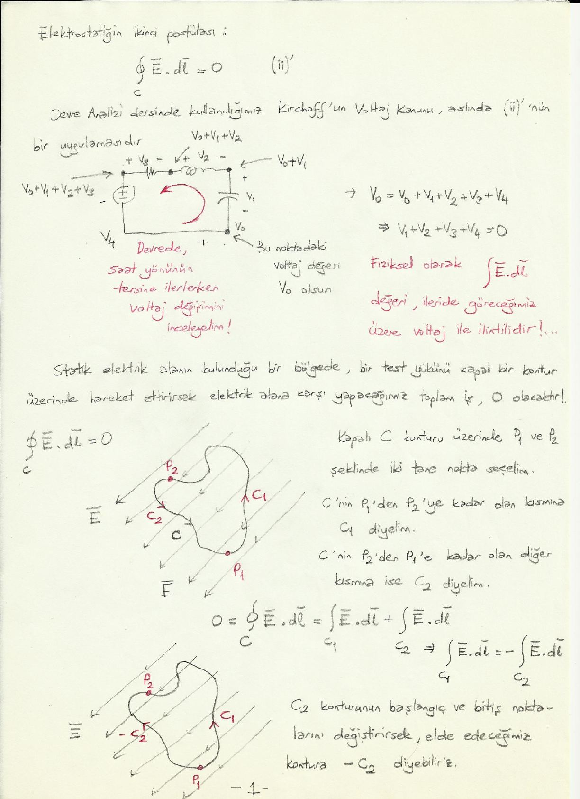
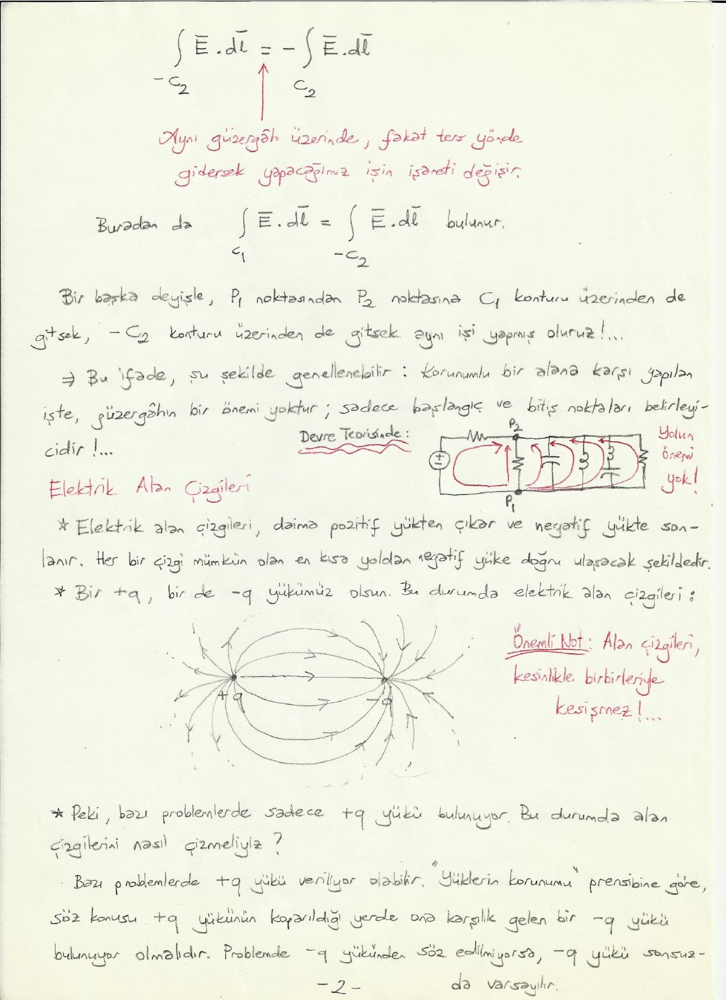
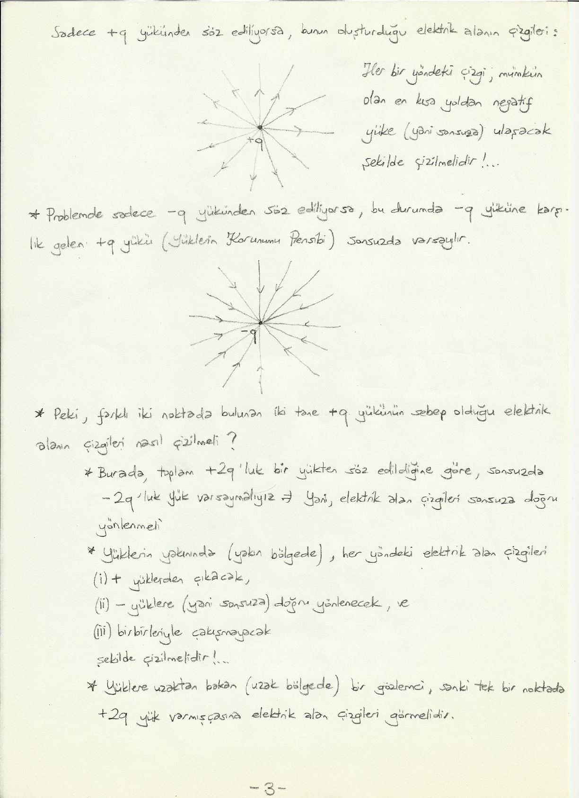
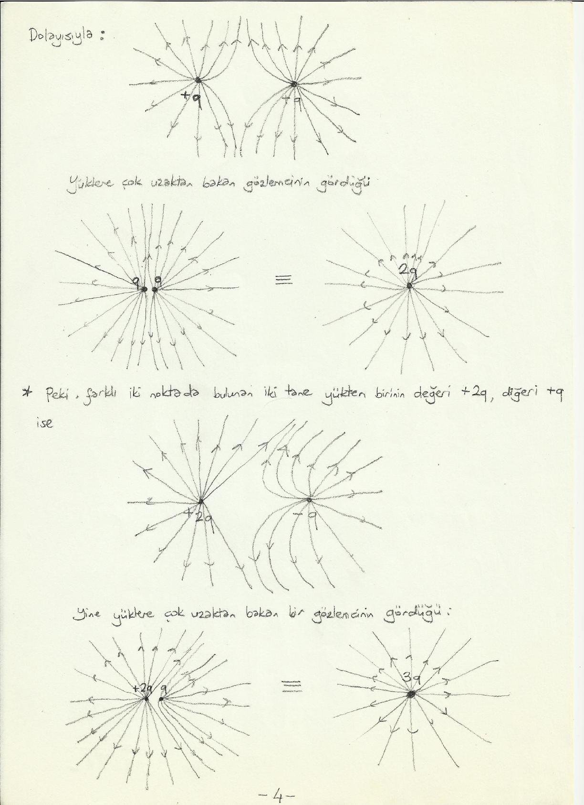
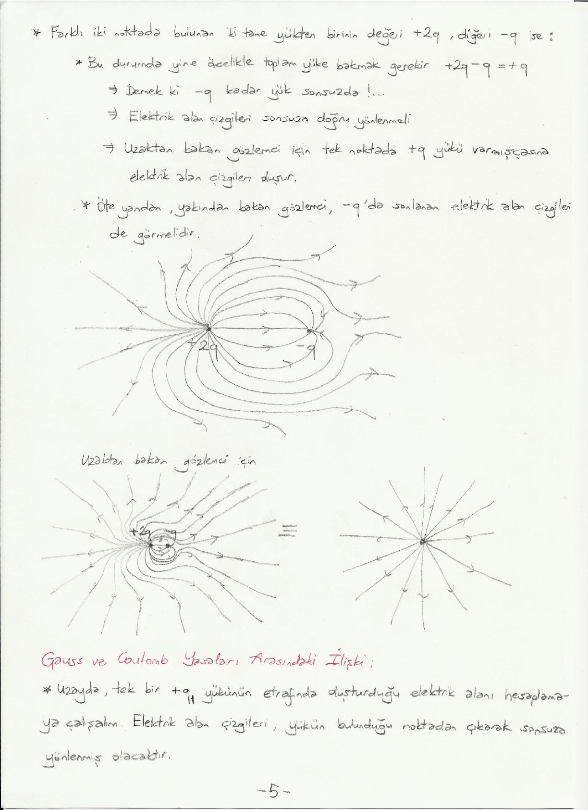
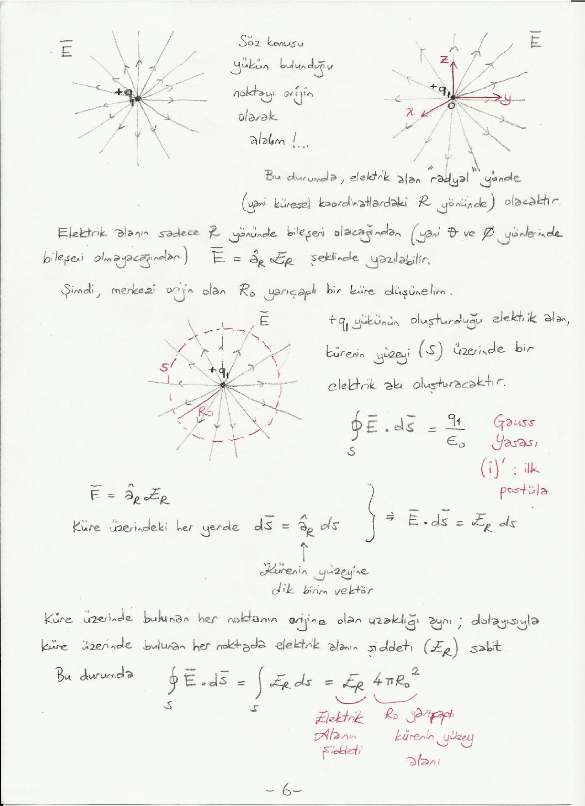

This post combines two sections of handwritten lecture notes for the Başkent University course **EEM224 Electromagnetics I**: **"The Two Fundamental Postulates of Electrostatics"** (4 pages; the scan is dated 23 March 2012) and **"Electric Field Lines"** (7 pages). The notes do not name their author. The text and formulas have been transcribed; page images have been added for the field-line drawings. The original PDFs of the scanned notes can be downloaded as a ZIP at the end of the post.

## Static electric fields (electrostatic fields)

Stationary/static charge(s) in a medium give rise to an "electrostatic field." The branch of science concerned with examining the electric field created by stationary charges in a medium, the forces between charges, and related topics is called **"Electrostatics."**

The birth of electrostatics is considered to be Coulomb's formulation, in 1785, of the force that charges exert on one another.

Let there be two charges (q₁ and q₂), and let the distance between them be R₁₂. The force exerted by the first charge (q₁) on the second charge (q₂) is expressed as:

F̄₁₂ = â_R12 k q₁q₂ / R₁₂²

Here k is a constant, and â_R12 is the unit vector directed from q₁ toward q₂. By Newton's law of action and reaction, the force exerted by the second charge (q₂) on the first charge (q₁) is:

F̄₂₁ = â_R21 k q₂q₁ / R₁₂² = −F̄₁₂

Here â_R21 is the unit vector directed from q₂ toward q₁.

Although Coulomb's law arose from experimental observations, it should really be regarded as a **"postulate"**:

- In the law above, does the size of the bodies carrying the charges matter?
- Could the exponent "2" in the term R₁₂² not be "1.9999993" instead of "2.0000000"?
- Could this experimental setup and these measurements have been carried out with such precision using 18th-century technology?

Therefore, when presenting electrostatics (or trying to understand it), it is more appropriate to follow a logical order rather than the historical order.

## The two fundamental postulates of electrostatics

Suppose a group of charges is present in a medium. The reason we think of these charges as creating an electrostatic field around them is that they exert a force on other charges in the medium.

Let us bring a charge q into the medium. Using the force F̄ acting on this charge, we can define the electrostatic field:

Ē = lim_(q→0) F̄ / q   (Newton/Coulomb)

That is, the electric field can be expressed as the **force per unit charge**.

The definition above is mathematical, not physical, because "q → 0" is not physically possible. The smallest charged particle in the universe is the electron, whose charge is 1.6×10⁻¹⁹ coulomb. What is meant here is that the charge q is very, very small and exerts so little force that it cannot disturb the group of charges creating the electric field.

According to the Helmholtz theorem, to define a vector field it is sufficient to know the divergence and curl of that vector field everywhere in space. Our two fundamental "postulates" both aim to define the divergence and curl of the electric (static) field:

- **(i)** ∇ · Ē = ρ / ε₀ — if there is a charge density in the medium, the electrostatic field is not solenoidal.
- **(ii)** ∇ × Ē = 0 — the electrostatic field is "conservative" (conservation of energy).

These expressions:

- are independent of coordinate systems,
- hold at every "point" in space,
- since they contain ∇, i.e. derivative terms, are also known as the "postulates in differential form."

### Integral form of the first postulate: Gauss's law

If we take the volume integral of (i) over a volume on both sides:

∫_v ∇ · Ē dv = ∫_v (ρ / ε₀) dv = (1/ε₀) ∫_v ρ dv = Q / ε₀

Here ρ is the charge density (C/m³) and Q is the total charge inside the volume v. By the divergence theorem, the left side becomes ∮_S Ē · ds̄; S is the closed surface enclosing the volume v, and this integral is the total flux that the electrostatic field produces through the surface S:

∮_S Ē · ds̄ = Q / ε₀   (i)′ — the integral form of (i), or the first postulate in integral form

**Gauss's law:** The total electric flux out of any closed surface is proportional to the total charge contained in the volume enclosed by that surface.

### Integral form of the second postulate

If we take the surface integral of (ii) over a surface on both sides:

∫_S (∇ × Ē) · ds̄ = ∫_S (0) · ds̄ = 0

By Stokes' theorem, the left side becomes ∮_C Ē · dl̄; C is the closed contour bounding the surface S, and this integral is the total work done against the electrostatic field along a closed contour:

∮_C Ē · dl̄ = 0   (ii)′ — the integral form of (ii), or the second postulate in integral form

The total work done against the electrostatic field along a closed contour is 0. That is, if in a region with an electric field we move a charge from a point P along any path we like (even one of infinite length) and bring it back to the point P, the total work we will have done against the electric field is 0 (conservation of energy).

## The second postulate and Kirchhoff's voltage law

Kirchhoff's voltage law, which we use in circuit analysis courses, is in fact an application of (ii)′. Let us examine the voltage change while moving counterclockwise around a circuit: let the voltage at the starting point be V₀; passing through the capacitor, inductor, resistor, and source, V₁, V₂, V₃, V₄ are added in turn, and we return to the same point:

V₀ = V₀ + V₁ + V₂ + V₃ + V₄ ⇒ V₁ + V₂ + V₃ + V₄ = 0

Physically, the value of ∫ Ē · dl̄ is related to voltage, as we will see later.

**Path independence.** If we move a test charge along a closed contour in a region containing a static electric field, the total work we do against the electric field will be 0. Let us choose two points P₁ and P₂ on the closed contour C. Let us call the part of C from P₁ to P₂ C₁, and the other part from P₂ to P₁ C₂:

0 = ∮_C Ē · dl̄ = ∫_C₁ Ē · dl̄ + ∫_C₂ Ē · dl̄ ⇒ ∫_C₁ Ē · dl̄ = −∫_C₂ Ē · dl̄

If we swap the starting and ending points of the contour C₂, we can call the resulting contour −C₂. If we travel along the same route but in the opposite direction, the sign of the work we do changes: ∫_(−C₂) Ē · dl̄ = −∫_C₂ Ē · dl̄. From this we also find

∫_C₁ Ē · dl̄ = ∫_(−C₂) Ē · dl̄

In other words, whether we go from point P₁ to point P₂ along the contour C₁ or along the contour −C₂, we do the same work. This statement can be generalized as follows: **in the work done against a conservative field, the route does not matter; only the starting and ending points are what count.** In circuit theory as well, the voltage between P₁ and P₂ is the same no matter which element between the two points we go through: the path does not matter.

## Electric field lines

- Electric field lines always emerge from a positive charge and terminate on a negative charge. Each line reaches the negative charge by the shortest possible path.
- **Important note:** Field lines never intersect one another!

When we have one +q and one −q charge, the field lines emerge from +q and terminate on −q.

**But in some problems only the +q charge is present. In this case, how should we draw the field lines?** According to the principle of "conservation of charge," there must be a corresponding −q charge at the place where the +q charge was separated from. If the problem does not mention a −q charge, the −q charge is assumed to be at infinity. In this case, the lines in each direction should be drawn so as to reach the negative charge (i.e., infinity) by the shortest possible path.

If the problem mentions only a −q charge, the +q charge corresponding to the −q charge (principle of conservation of charge) is assumed to be at infinity; the lines come in from infinity and terminate on −q.

**How should the field lines of the electric field caused by two +q charges at two different points be drawn?**

- Since a total charge of +2q is involved here, we must assume a −2q charge at infinity; that is, the electric field lines must be directed toward infinity.
- In the region close to the charges (near region), the electric field lines in every direction must be drawn so that they (i) emerge from the + charges, (ii) are directed toward the − charges (i.e., infinity), and (iii) do not coincide with one another.
- An observer looking at the charges from far away (far region) should see electric field lines as if there were a single +2q charge at a single point.

The same logic applies to two charges, one +2q and the other +q: an observer looking from very far away sees lines as if there were a 3q charge at a single point.

**If one is +2q and the other is −q:**

- In this case, again, we must first look at the total charge: +2q − q = +q. This means a charge of −q is at infinity; the electric field lines must be directed toward infinity. For an observer looking from far away, the electric field lines form as if there were a +q charge at a single point.
- On the other hand, an observer looking from close up must also see electric field lines terminating on −q.

## The relationship between Gauss's law and Coulomb's law

Let us try to calculate the electric field created around a single charge +q₁ in space. The electric field lines will emerge from the point where the charge is located and be directed toward infinity. Let us take the point where this charge is located as the origin. In this case the electric field will be in the "radial" direction (i.e., the R direction in spherical coordinates). Since the electric field has only an R-directed component (no components in the θ and φ directions), it can be written as Ē = â_R E_R.

Now consider a sphere of radius R₀ centered at the origin. The electric field created by the charge +q₁ will produce an electric flux over the surface (S) of the sphere. Gauss's law (the first postulate, (i)′):

∮_S Ē · ds̄ = q₁ / ε₀

Since Ē = â_R E_R and ds̄ = â_R ds everywhere on the sphere (â_R being the unit vector normal to the surface of the sphere), Ē · ds̄ = E_R ds. Every point on the sphere is at the same distance from the origin; therefore the magnitude of the electric field (E_R) is constant at every point on the sphere. In this case:

∮_S Ē · ds̄ = ∫_S E_R ds = E_R 4πR₀²

Here 4πR₀² is the surface area of the sphere of radius R₀.

E_R 4πR₀² = q₁ / ε₀ ⇒ E_R = (1 / 4πε₀) · q₁ / R₀²

Ē = â_R E_R = â_R (1 / 4πε₀) · q₁ / R₀²

This is the value of the electric field at a point at distance R₀ from the charge. If we had a second charge (q₂) at this point, the charge q₁ would exert a force (F̄₁₂) on this second charge:

F̄₁₂ = q₂ Ē = â_R (1 / 4πε₀) · q₁q₂ / R₀²

- â_R = â_R12: the unit vector directed from the first charge toward the second charge (in this example, since we chose the first charge at the origin, â_R12 = â_R).
- 1 / 4πε₀ = k
- R₀²: the square of the distance between them

Indeed, the exponent on R in Coulomb's law turns out to be exactly "2," not 1.999999 or 2.00000001! We have thus proved it.
