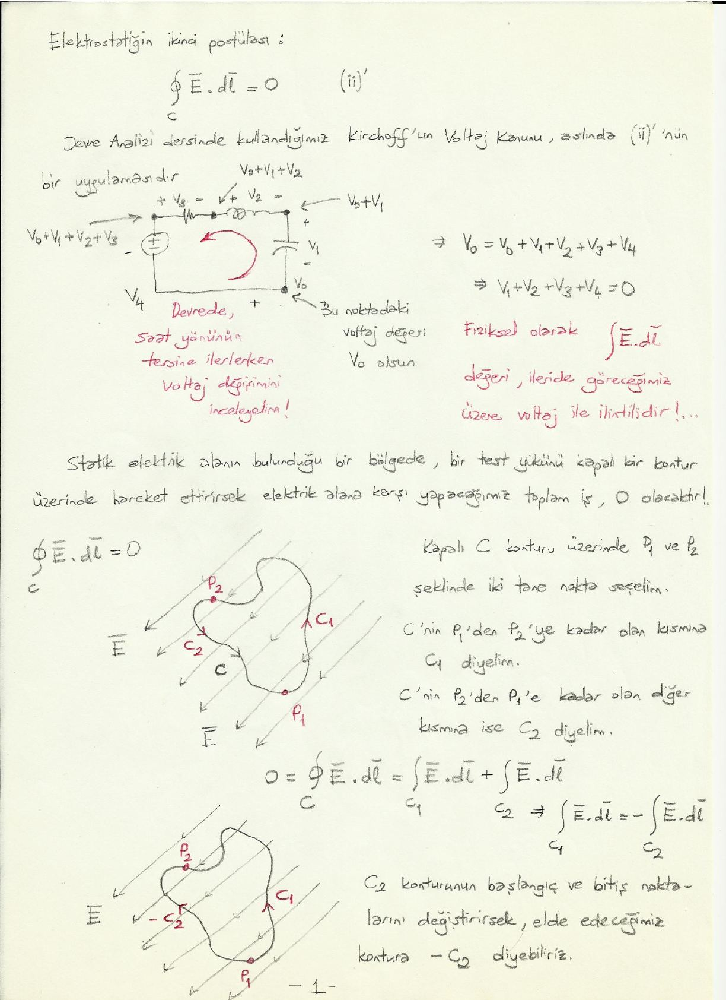
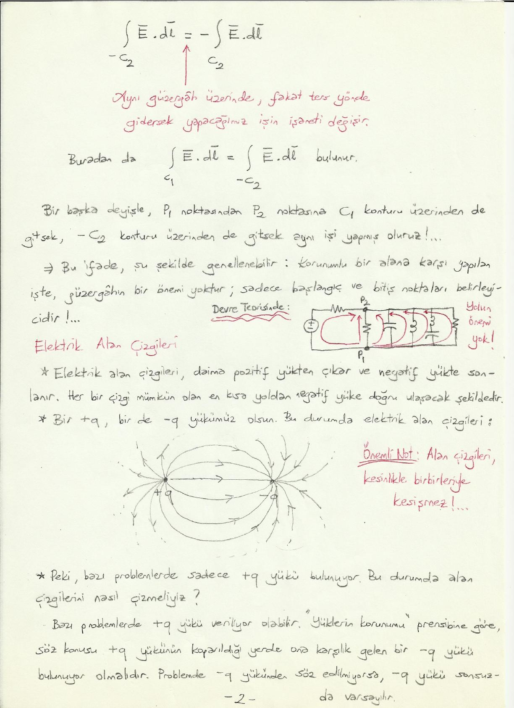
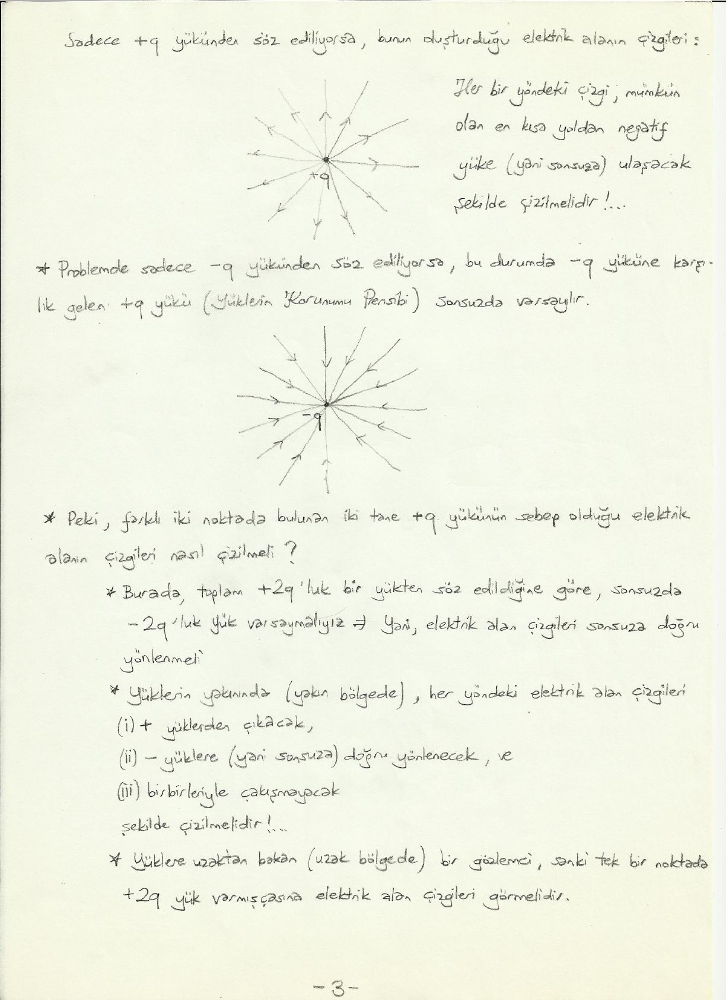
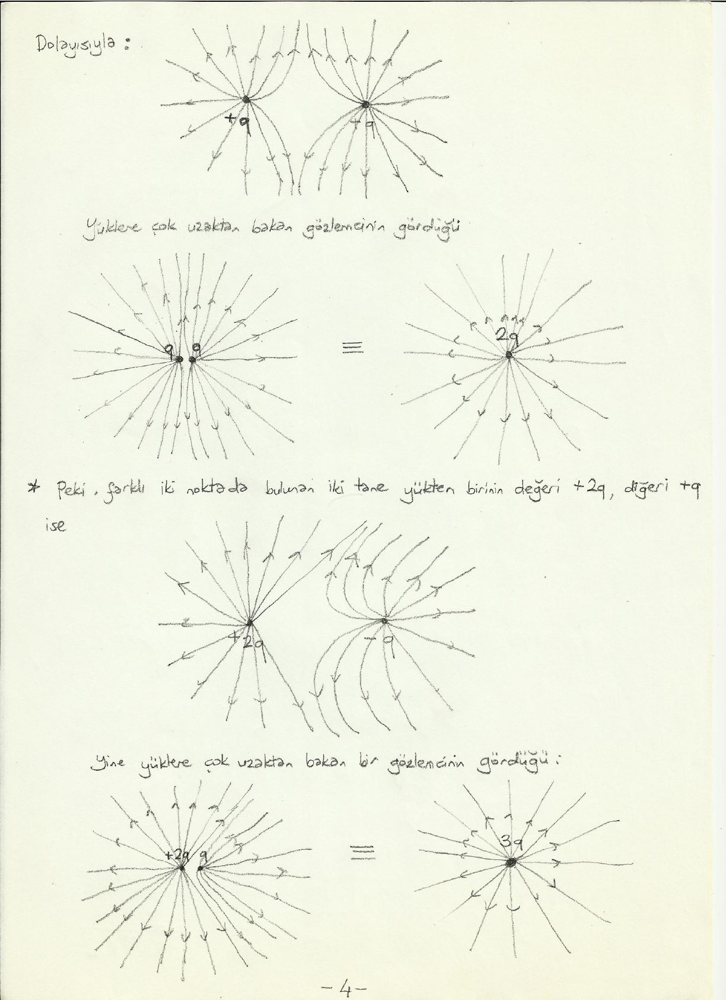
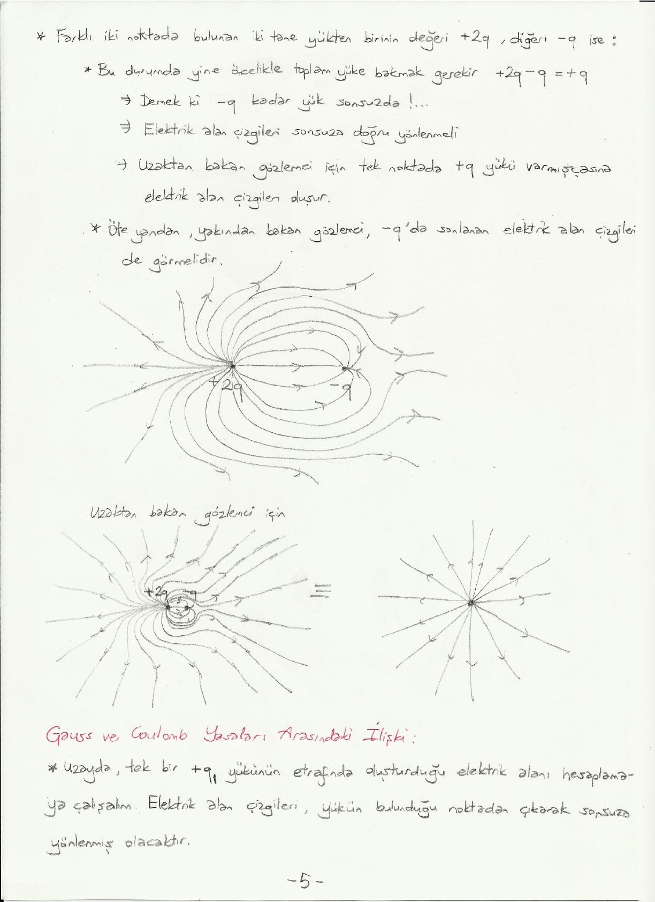
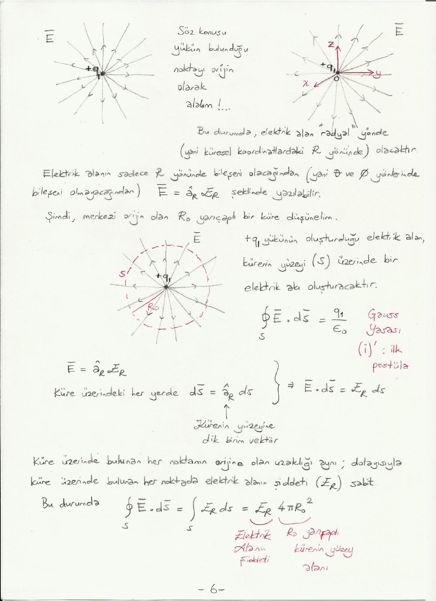

Bu yazı, Başkent Üniversitesi **EEM224 Elektromanyetik I** dersine ait el yazısı ders notlarının iki bölümünü bir araya getiriyor: **"Elektrostatiğin İki Temel Postülası"** (4 sayfa; taramanın tarihi 23 Mart 2012) ve **"Elektrik Alan Çizgileri"** (7 sayfa). Notlarda hazırlayanın adı yazmıyor. Metin ve formüller yazıya döküldü; alan çizgisi çizimleri için sayfa görselleri eklendi. Taranmış notların orijinal PDF'leri yazının sonunda ZIP olarak indirilebilir.

## Statik elektrik alanlar (elektrostatik alanlar)

Bir ortamda bulunan durgun/durağan yük(ler) "elektrostatik alana" sebep olur. Durgun yüklerin bulunduğu ortamda bu yüklerin oluşturduğu elektrik alanın incelenmesi, yüklerin birbirleriyle arasındaki kuvvetlerin incelenmesi vb. konularla ilgilenen bilim dalı da **"Elektrostatik"** olarak adlandırılır.

Elektrostatik biliminin doğuşu, 1785 tarihinde Coulomb'un yüklerin birbirlerine uyguladığı kuvveti formüle etmesi olarak kabul edilir.

İki yükümüz (q₁ ve q₂) olsun; aralarındaki mesafe R₁₂ olsun. Birinci yükün (q₁) ikinci yük (q₂) üzerine uyguladığı kuvvet:

F̄₁₂ = â_R12 k q₁q₂ / R₁₂²

olarak ifade edilir. Burada k bir sabittir, â_R12 ise q₁'den q₂'ye doğru yönlenmiş birim vektördür. Newton'un etki-tepki yasası uyarınca ikinci yükün (q₂) birinci yük (q₁) üzerine uyguladığı kuvvet ise:

F̄₂₁ = â_R21 k q₂q₁ / R₁₂² = −F̄₁₂

Burada â_R21, q₂'den q₁'e doğru yönlenmiş birim vektördür.

Her ne kadar Coulomb yasası deneysel gözlemler sonucu çıkmış olsa da aslında bir **"postüla"** olarak düşünülmelidir:

- Yukarıdaki yasada, söz konusu yükleri üzerinde bulunduran cisimlerin boyutunun önemi var mıdır?
- R₁₂² teriminin üslü ifadesi "2"; "2,0000000" yerine "1,9999993" olamaz mı?
- 18. yüzyıl teknolojisi ile bu deney kurgusu ve ölçümler bu hassasiyette yapılabilmiş olabilir mi?

Dolayısıyla elektrostatiği anlatırken (anlamaya çalışırken) tarihsel sıra yerine mantıksal sırayla gitmek daha uygun olacaktır.

## Elektrostatiğin iki temel postülası

Bir ortamda bir grup yük bulunuyor olsun. Bu yüklerin etraflarında elektrostatik alan oluşturuyor olmalarını düşünmemizin sebebi, söz konusu yüklerin ortamdaki başka yüklere bir kuvvet uyguluyor olmasıdır.

Ortama bir q yükü getirelim. Bu yüke uygulanacak kuvvet F̄ sayesinde elektrostatik alanın tanımını yapabiliriz:

Ē = lim_(q→0) F̄ / q   (Newton/Coulomb)

Yani elektrik alan, **birim yük başına düşen kuvvet** olarak ifade edilebilir.

Yukarıdaki tanım matematiksel olup fiziksel değildir, çünkü "q → 0" ifadesi fiziksel olarak mümkün değildir. Evrende en küçük yüklü parçacık bir elektron olup onun yükü de 1,6×10⁻¹⁹ coulomb'dur. Burada kastedilen, q yükünün çok çok küçük olması ve elektrik alanı oluşturan yük grubunu dağıtamayacak kadar az kuvvet uygulamasıdır.

Helmholtz teoremi uyarınca, bir vektörel alanı tanımlamak için söz konusu vektörel alanın diverjans ve buklesini uzayın her yerinde biliyor olmak yeterlidir. İki temel "postüla"mız da elektrik (statik) alanın diverjans ve buklesini tanımlamaya yöneliktir:

- **(i)** ∇ · Ē = ρ / ε₀ — ortamda bir yük yoğunluğu varsa elektrostatik alan solenoidal değildir.
- **(ii)** ∇ × Ē = 0 — elektrostatik alan "konservatif", yani "korunumlu"dur (enerjinin korunumu).

Bu ifadeler:

- koordinat sistemlerinden bağımsızdır,
- uzayda her "nokta" bazında geçerlidir,
- ∇, yani türev terimleri içerdiği için "türev formda postülalar" olarak da bilinir.

### Birinci postülanın integral formu: Gauss yasası

(i)'nin sağlı sollu bir hacim üzerinde hacim integralini alırsak:

∫_v ∇ · Ē dv = ∫_v (ρ / ε₀) dv = (1/ε₀) ∫_v ρ dv = Q / ε₀

Burada ρ yük yoğunluğu (C/m³), Q de v hacmi içerisindeki toplam yüktür. Sol taraf diverjans teoremiyle ∮_S Ē · ds̄ olur; S, v hacmini çevreleyen kapalı yüzeydir ve bu integral elektrostatik alanın S yüzeyi üzerinde oluşturduğu toplam akıdır:

∮_S Ē · ds̄ = Q / ε₀   (i)′ — (i)'nin integral formu veya integral formda birinci postüla

**Gauss yasası:** Herhangi bir kapalı yüzeyin dışına doğru toplam elektrik akı, söz konusu yüzeyin çevrelediği hacim içerisinde kalan toplam yük ile doğru orantılıdır.

### İkinci postülanın integral formu

(ii)'nin sağlı sollu bir yüzey üzerinde yüzey integralini alırsak:

∫_S (∇ × Ē) · ds̄ = ∫_S (0) · ds̄ = 0

Sol taraf Stokes teoremiyle ∮_C Ē · dl̄ olur; C, S yüzeyini çevreleyen kapalı konturdur ve bu integral kapalı bir kontur üzerinde elektrostatik alana karşı yapılan toplam iştir:

∮_C Ē · dl̄ = 0   (ii)′ — (ii)'nin integral formu veya integral formda ikinci postüla

Kapalı bir kontur üzerinde elektrostatik alana karşı yapılan toplam iş 0'dır. Yani elektrik alanın olduğu bir bölgede bir yükü bir P noktasından başlayarak istediğimiz güzergâh üzerinde (sonsuz uzunlukta olsa bile) dolaştırıp tekrar P noktasına getirirsek, elektrik alana karşı yapmış olacağımız toplam iş 0 olacaktır (enerjinin korunumu).

## İkinci postüla ve Kirchhoff gerilim yasası

Devre analizi dersinde kullandığımız Kirchhoff'un gerilim (voltaj) kanunu aslında (ii)′'nün bir uygulamasıdır. Bir devrede saat yönünün tersine ilerlerken voltaj değişimini inceleyelim: başlangıç noktasındaki voltaj V₀ olsun; kapasitör, bobin, direnç ve kaynak üzerinden geçerken sırasıyla V₁, V₂, V₃, V₄ eklenir ve aynı noktaya dönülür:

V₀ = V₀ + V₁ + V₂ + V₃ + V₄ ⇒ V₁ + V₂ + V₃ + V₄ = 0

Fiziksel olarak ∫ Ē · dl̄ değeri, ileride göreceğimiz üzere voltaj ile ilintilidir.

**Yoldan bağımsızlık.** Statik elektrik alanın bulunduğu bir bölgede bir test yükünü kapalı bir kontur üzerinde hareket ettirirsek elektrik alana karşı yapacağımız toplam iş 0 olacaktır. Kapalı C konturu üzerinde P₁ ve P₂ şeklinde iki nokta seçelim. C'nin P₁'den P₂'ye kadar olan kısmına C₁, P₂'den P₁'e kadar olan diğer kısmına C₂ diyelim:

0 = ∮_C Ē · dl̄ = ∫_C₁ Ē · dl̄ + ∫_C₂ Ē · dl̄ ⇒ ∫_C₁ Ē · dl̄ = −∫_C₂ Ē · dl̄

C₂ konturunun başlangıç ve bitiş noktalarını değiştirirsek elde edeceğimiz kontura −C₂ diyebiliriz. Aynı güzergâh üzerinde fakat ters yönde gidersek yapacağımız işin işareti değişir: ∫_(−C₂) Ē · dl̄ = −∫_C₂ Ē · dl̄. Buradan da

∫_C₁ Ē · dl̄ = ∫_(−C₂) Ē · dl̄

bulunur. Bir başka deyişle, P₁ noktasından P₂ noktasına C₁ konturu üzerinden de gitsek, −C₂ konturu üzerinden de gitsek aynı işi yapmış oluruz. Bu ifade şu şekilde genellenebilir: **korunumlu bir alana karşı yapılan işte güzergâhın bir önemi yoktur; sadece başlangıç ve bitiş noktaları belirleyicidir.** Devre teorisinde de P₁ ve P₂ arasındaki gerilim, iki nokta arasındaki hangi elemanın üzerinden gidilirse gidilsin aynıdır: yolun önemi yok.

## Elektrik alan çizgileri

- Elektrik alan çizgileri daima pozitif yükten çıkar ve negatif yükte sonlanır. Her bir çizgi mümkün olan en kısa yoldan negatif yüke doğru ulaşacak şekildedir.
- **Önemli not:** Alan çizgileri kesinlikle birbirleriyle kesişmez!

Bir +q, bir de −q yükümüz olduğunda alan çizgileri +q'dan çıkıp −q'da sonlanır.

**Peki bazı problemlerde sadece +q yükü bulunuyor. Bu durumda alan çizgilerini nasıl çizmeliyiz?** "Yüklerin korunumu" prensibine göre, söz konusu +q yükünün koparıldığı yerde ona karşılık gelen bir −q yükü bulunuyor olmalıdır. Problemde −q yükünden söz edilmiyorsa −q yükü sonsuzda varsayılır. Bu durumda her bir yöndeki çizgi, mümkün olan en kısa yoldan negatif yüke (yani sonsuza) ulaşacak şekilde çizilmelidir.

Problemde sadece −q yükünden söz ediliyorsa, −q yüküne karşılık gelen +q yükü (yüklerin korunumu prensibi) sonsuzda varsayılır; çizgiler sonsuzdan gelip −q'da sonlanır.

**Farklı iki noktada bulunan iki tane +q yükünün sebep olduğu elektrik alanın çizgileri nasıl çizilmeli?**

- Burada toplam +2q'luk bir yükten söz edildiğine göre sonsuzda −2q'luk yük varsaymalıyız; yani elektrik alan çizgileri sonsuza doğru yönlenmeli.
- Yüklerin yakınında (yakın bölgede) her yöndeki elektrik alan çizgileri (i) + yüklerden çıkacak, (ii) − yüklere (yani sonsuza) doğru yönlenecek ve (iii) birbirleriyle çakışmayacak şekilde çizilmelidir.
- Yüklere uzaktan bakan (uzak bölgede) bir gözlemci, sanki tek bir noktada +2q yük varmışçasına elektrik alan çizgileri görmelidir.

Biri +2q, diğeri +q olan iki yük için de aynı mantık geçerlidir: çok uzaktan bakan gözlemci tek noktada 3q yük varmış gibi çizgiler görür.

**Biri +2q, diğeri −q ise:**

- Bu durumda yine öncelikle toplam yüke bakmak gerekir: +2q − q = +q. Demek ki −q kadar yük sonsuzda; elektrik alan çizgileri sonsuza doğru yönlenmeli. Uzaktan bakan gözlemci için tek noktada +q yükü varmışçasına elektrik alan çizgileri oluşur.
- Öte yandan yakından bakan gözlemci, −q'da sonlanan elektrik alan çizgilerini de görmelidir.

## Gauss ve Coulomb yasaları arasındaki ilişki

Uzayda tek bir +q₁ yükünün etrafında oluşturduğu elektrik alanı hesaplamaya çalışalım. Elektrik alan çizgileri yükün bulunduğu noktadan çıkarak sonsuza yönlenmiş olacaktır. Söz konusu yükün bulunduğu noktayı orijin olarak alalım. Bu durumda elektrik alan "radyal" yönde (yani küresel koordinatlardaki R yönünde) olacaktır. Elektrik alanın sadece R yönünde bileşeni olacağından (θ ve φ yönlerinde bileşeni olmayacağından) Ē = â_R E_R şeklinde yazılabilir.

Şimdi merkezi orijin olan R₀ yarıçaplı bir küre düşünelim. +q₁ yükünün oluşturduğu elektrik alan kürenin yüzeyi (S) üzerinde bir elektrik akı oluşturacaktır. Gauss yasası (ilk postüla, (i)′):

∮_S Ē · ds̄ = q₁ / ε₀

Ē = â_R E_R ve küre üzerindeki her yerde ds̄ = â_R ds (â_R, kürenin yüzeyine dik birim vektör) olduğundan Ē · ds̄ = E_R ds. Küre üzerinde bulunan her noktanın orijine olan uzaklığı aynı; dolayısıyla küre üzerinde bulunan her noktada elektrik alanın şiddeti (E_R) sabit. Bu durumda:

∮_S Ē · ds̄ = ∫_S E_R ds = E_R 4πR₀²

Burada 4πR₀², R₀ yarıçaplı kürenin yüzey alanıdır.

E_R 4πR₀² = q₁ / ε₀ ⇒ E_R = (1 / 4πε₀) · q₁ / R₀²

Ē = â_R E_R = â_R (1 / 4πε₀) · q₁ / R₀²

Bu, yüke R₀ mesafede olan bir noktada elektrik alanın değeridir. Bu noktada ikinci bir yükümüz (q₂) olsa, q₁ yükü bu ikinci yüke bir kuvvet (F̄₁₂) uygulayacaktır:

F̄₁₂ = q₂ Ē = â_R (1 / 4πε₀) · q₁q₂ / R₀²

- â_R = â_R12: birinci yükten ikinci yüke yönlenmiş olan birim vektör (bu örnekte birinci yükü orijinde seçtiğimiz için â_R12 = â_R çıktı).
- 1 / 4πε₀ = k
- R₀²: aradaki mesafenin karesi

Gerçekten de Coulomb yasasındaki R'nin üzerindeki üslü terim tam tamına "2" imiş, 1,999999 veya 2,00000001 değil! Bunu ispatlamış olduk.
