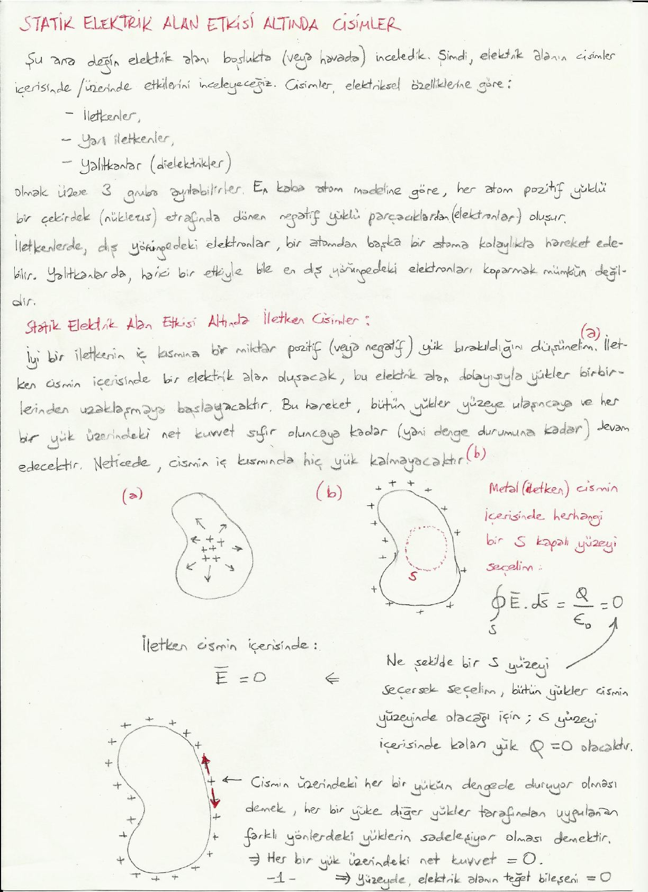
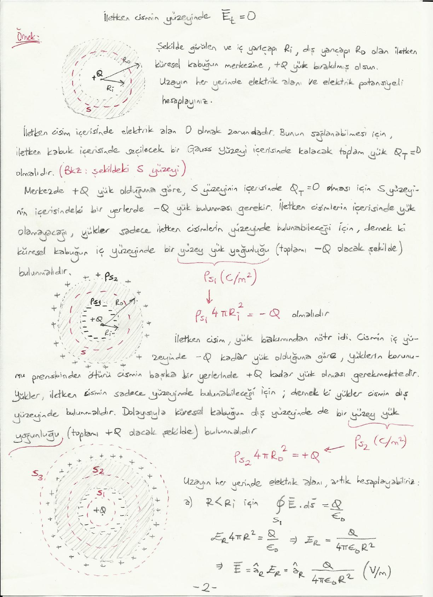
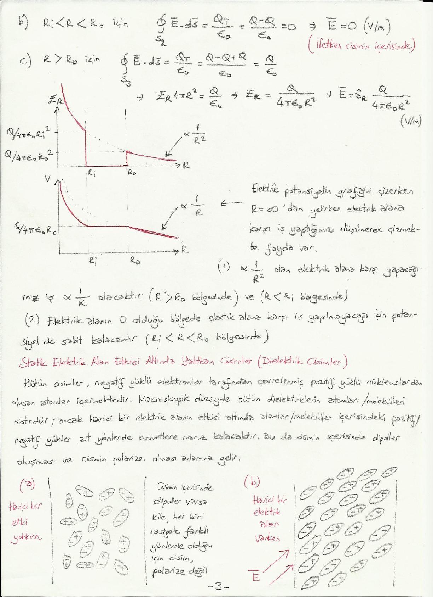
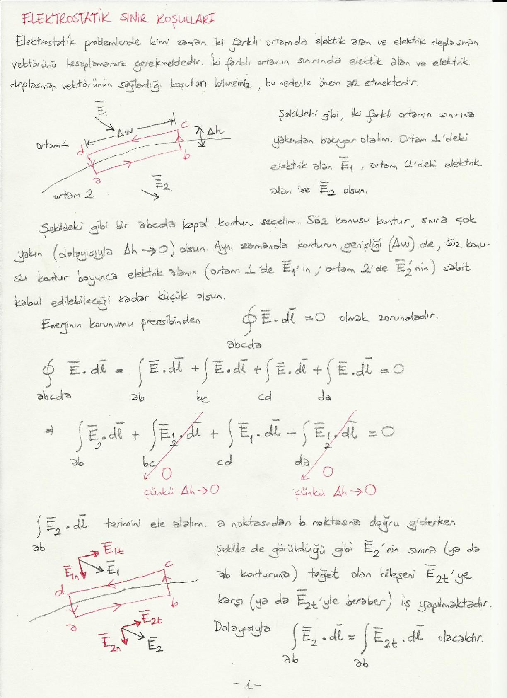
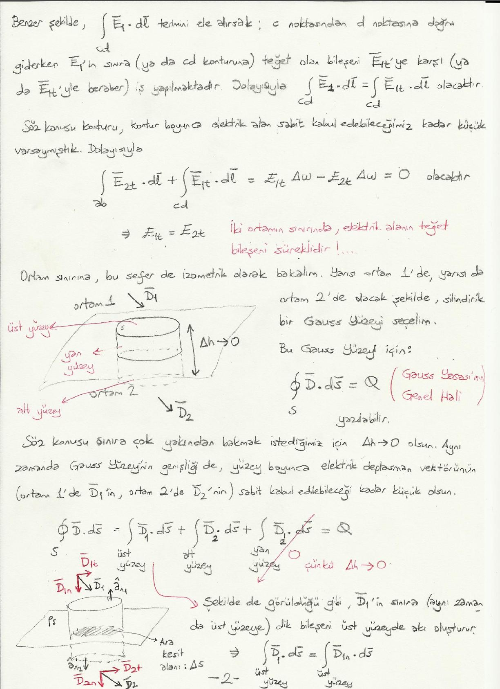

This post brings together two sections of handwritten course notes for Başkent University's **EEM224 Electromagnetics I**: **"Bodies Under the Influence of a Static Electric Field"** (4 pages) and **"Electrostatic Boundary Conditions"** (3 pages). The notes do not state the author's name or a date. The text and formulas have been transcribed; page images have been included for the drawings and graphs. The original PDFs of the scanned notes can be downloaded as a ZIP at the end of the post.

## Bodies under the influence of a static electric field

Up to now we have studied the electric field in free space (or air). Now we will examine the effects of the electric field in/on materials. According to their electrical properties, materials can be divided into 3 groups:

- conductors,
- semiconductors,
- insulators (dielectrics).

According to the crudest atomic model, every atom consists of negatively charged particles (electrons) orbiting a positively charged nucleus. In conductors, the electrons in the outer orbits can easily move from one atom to another. In insulators, it is not possible to detach the outermost-orbit electrons even with an external influence.

## Conducting bodies under the influence of a static electric field

Let us imagine that some positive (or negative) charge is placed inside a good conductor. An electric field will form inside the conducting body; because of this electric field, the charges will start moving away from each other. This motion will continue until all the charges reach the surface and the net force on each charge becomes zero (that is, until the equilibrium state). As a result, no charge will remain in the interior of the body.

Let us choose an arbitrary closed surface S inside the metal (conducting) body:

∮_S Ē · ds̄ = Q / ε₀ = 0

Whatever surface S we choose, since all the charges are on the surface of the body, the charge enclosed within S will be Q = 0. Therefore, **inside a conducting body Ē = 0**.

Each charge on the body being at rest means that the forces in different directions exerted on each charge by the other charges cancel out; that is, the net force on each charge = 0. Therefore the tangential component of the electric field at the surface = 0: **on the surface of a conducting body E_t = 0**.

### Example: Conducting spherical shell with a +Q charge at its center

Let a +Q charge be placed at the center of a conducting spherical shell with inner radius R_i and outer radius R_o. Calculate the electric field and electric potential everywhere in space.

The electric field inside a conducting body must be 0. For this to hold, the total charge enclosed by a Gauss surface (S) chosen inside the conducting shell must be Q_T = 0. Since there is a +Q charge at the center, for Q_T = 0 inside S there must be a −Q charge somewhere inside S. Since there can be no charge inside conducting bodies and charges can exist only on the surface of conducting bodies, there must therefore be a surface charge density ρ_s1 (C/m²) (with a total of −Q) on the inner surface of the spherical shell:

ρ_s1 4πR_i² = −Q

The conducting body was neutral in terms of charge. Since there is −Q of charge on the inner surface of the body, by the principle of conservation of charge there must be +Q of charge somewhere else on the body. Since charges can exist only on the surface of the conducting body, there must therefore also be a surface charge density ρ_s2 (C/m²) (with a total of +Q) on the outer surface of the spherical shell:

ρ_s2 4πR_o² = +Q

We can now calculate the electric field everywhere in space:

**a) For R < R_i** (surface S₁): ∮ Ē · ds̄ = Q/ε₀ ⇒ E_R 4πR² = Q/ε₀ ⇒ Ē = â_R Q / (4πε₀R²)   (V/m)

**b) For R_i < R < R_o** (surface S₂): ∮ Ē · ds̄ = Q_T/ε₀ = (Q − Q)/ε₀ = 0 ⇒ Ē = 0 (V/m) (inside the conducting body)

**c) For R > R_o** (surface S₃): ∮ Ē · ds̄ = Q_T/ε₀ = (Q − Q + Q)/ε₀ = Q/ε₀ ⇒ E_R 4πR² = Q/ε₀ ⇒ Ē = â_R Q / (4πε₀R²)   (V/m)

The magnitude of the electric field decreases as 1/R² in the region R < R_i, falling to the value Q/(4πε₀R_i²) at R_i, is zero inside the shell, and starting from the value Q/(4πε₀R_o²) at R_o decreases again as 1/R².

When plotting the electric potential, it is useful to draw it by imagining that we are coming in from R = ∞ and doing work against the electric field:

1. The work we do against an electric field that is ∝ 1/R² will be ∝ 1/R (in the region R > R_o and in the region R < R_i).
1. In the region where the electric field is 0, no work is done against the electric field, so the potential also remains constant (in the region R_i < R < R_o); this constant value is Q/(4πε₀R_o).

## Insulating bodies (dielectric bodies) under the influence of a static electric field

All materials contain atoms made up of positively charged nuclei surrounded by negatively charged electrons. At the macroscopic level, the atoms/molecules of all dielectrics are neutral; however, under the influence of an external electric field, the positive/negative charges within the atoms/molecules will be subjected to forces in opposite directions. This means that dipoles form inside the body and the body becomes **polarized**.

- (a) With no external influence: even if there are dipoles inside the body, each is oriented randomly in a different direction, so the body is not polarized.
- (b) With an external electric field present: the dipoles align in the direction of the field.

We previously defined the "dipole moment vector" of a dipole: p̄ = q d̄ (C·m); q is the charge (C), d̄ is the distance between the charges (m).

Each of the dipoles induced in the body will have a dipole moment vector. To measure the amount of polarization in the body, we can define the **polarization vector**:

P̄ = lim_(Δv→0) (Σ_(k=1)^(n) p̄_k) / Δv   (C/m²)

Here n is the number of atoms (molecules) per unit volume, and Σ p̄_k is the sum of the moments of all the dipoles per unit volume. If all the dipoles are randomly oriented, Σ p̄_k = 0 ⇒ P̄ = 0.

The more inclined the dipoles inside a body are to orient in the same direction (parallel to the external electric field) under an external electric field, the more polarized that body will be; in other words, P̄ will be larger for such bodies.

D̄ = ε₀Ē + P̄   (C/m²)

- D̄: the **"electric flux density"** or **"electric displacement vector"** (displacement: this name was given in reference to the change in position of the +/− charges)
- ε₀: a constant; Ē: the external electric field. ε₀Ē is a constant value for a constant electric field value.
- P̄: a vector whose magnitude varies with the properties of the body; it takes different values for different bodies.

Therefore the ratio between |D̄| and |Ē| will differ from body to body; that is, the ratio between |D̄| and |Ē| is a property of the material:

D̄ = εĒ = ε_r ε₀ Ē   (C/m²)

Here ε is the electric permittivity (dielectric constant) of the material, and ε_r is the relative dielectric constant.

## Electrostatic boundary conditions

In electrostatic problems, we sometimes need to calculate the electric field and the electric displacement vector in two different media. It is therefore important to know the conditions satisfied by the electric field and the electric displacement vector at the boundary of two different media.

### Tangential component

Let us take a close look at the boundary of two different media. Let the electric field in medium 1 be Ē₁ and the electric field in medium 2 be Ē₂. Let us choose a closed contour abcda on the two sides of the boundary. Let this contour be very close to the boundary (hence Δh → 0). At the same time, let the width of the contour (Δw) be small enough that the electric field along this contour (Ē₁ in medium 1, Ē₂ in medium 2) can be assumed constant. By the principle of conservation of energy, ∮_abcda Ē · dl̄ = 0 must hold:

∮_abcda Ē · dl̄ = ∫_ab Ē₂ · dl̄ + ∫_bc Ē · dl̄ + ∫_cd Ē₁ · dl̄ + ∫_da Ē · dl̄ = 0

The integrals along the sides bc and da are zero because Δh → 0.

When going from point a to point b, work is done against (or along with) the component Ē₂t of Ē₂ that is tangential to the boundary (or to the segment ab); therefore ∫_ab Ē₂ · dl̄ = ∫_ab Ē₂t · dl̄. Similarly, when going from point c to point d, ∫_cd Ē₁ · dl̄ = ∫_cd Ē₁t · dl̄. We had assumed the contour to be small enough that the electric field along it can be taken as constant:

∫_ab Ē₂t · dl̄ + ∫_cd Ē₁t · dl̄ = E₁t Δw − E₂t Δw = 0 ⇒ **E₁t = E₂t**

At the boundary of two media, the tangential component of the electric field is continuous.

### Normal component

This time, let us look at the boundary between the media isometrically. Let us choose a cylindrical Gauss surface with half in medium 1 and half in medium 2. For this Gauss surface we can write

∮_S D̄ · ds̄ = Q   (general form of Gauss's law)

Since we want to look at the boundary very closely, let Δh → 0. At the same time, let the width of the Gauss surface be small enough that the electric displacement vector over the surface (D̄₁ in medium 1, D̄₂ in medium 2) can be assumed constant:

∮_S D̄ · ds̄ = ∫_top D̄₁ · ds̄ + ∫_bottom D̄₂ · ds̄ + ∫_side D̄ · ds̄ = Q

The side-surface integral is 0 because Δh → 0. The component of D̄₁ perpendicular to the boundary (and therefore to the top surface) produces flux through the top surface: ∫_top D̄₁ · ds̄ = ∫_top D̄₁n · ds̄. Similarly, the component of D̄₂ perpendicular to the boundary (and therefore to the bottom surface) produces flux through the bottom surface: ∫_bottom D̄₂ · ds̄ = ∫_bottom D̄₂n · ds̄. On the top surface ds̄ = â_n1 ds, on the bottom surface ds̄ = â_n2 ds = −â_n1 ds:

∫_top D̄₁n · ds̄ + ∫_bottom D̄₂n · ds̄ = Q = ρ_s Δs

Here ρ_s is the charge density on the boundary surface between the two media (C/m²), and Δs is the cross-sectional area of the Gauss surface (m²):

D₁n Δs − D₂n Δs = (D₁n − D₂n) Δs = ρ_s Δs ⇒ **D₁n − D₂n = ρ_s**   (C/m²)

At the boundary of two media, the normal component of the electric displacement vector is discontinuous by an amount equal to the surface charge density at the boundary.

### Special cases

**If both media are dielectrics:** E₁t = E₂t ⇒ D₁t/ε₁ = D₂t/ε₂. In such a case, since there will be no charge at the boundary (that is, ρ_s = 0), D₁n = D₂n ⇒ ε₁E₁n = ε₂E₂n.

**If medium 2 is a conductor:** Ē₂ = 0 ⇒ E₂t = 0 ⇒ E₁t = E₂t = 0; D̄₂ = 0 ⇒ D₂n = 0 ⇒ D₁n − D₂n = ρ_s ⇒ D₁n = ρ_s.

**Important note:** The expressions derived above are valid only "at the boundary". That is, E₁t = E₂t holds only at a point on the boundary; at a point away from the boundary, the value of E₁t need not equal the value of E₂t at another point.
