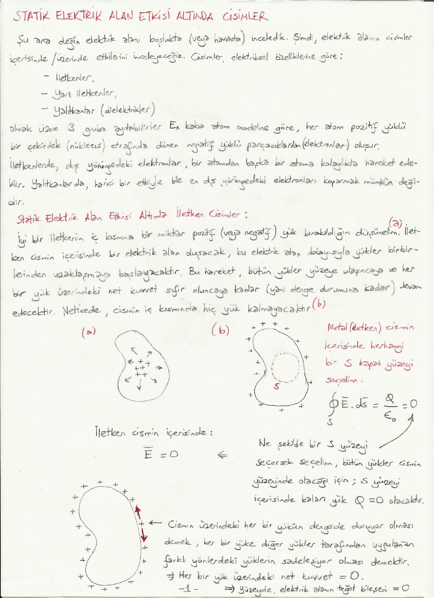
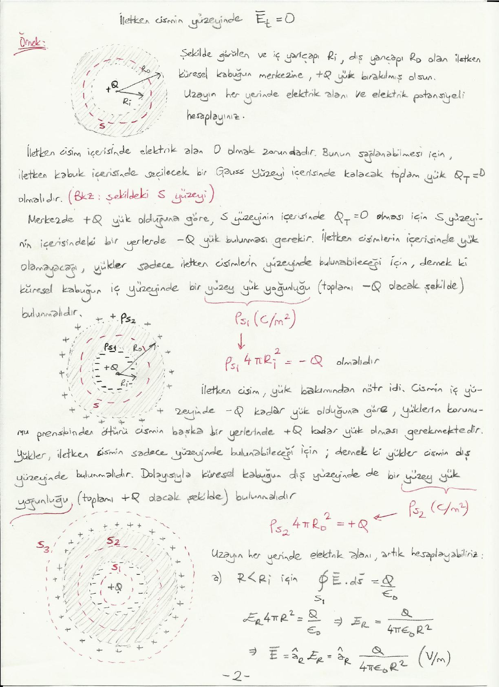
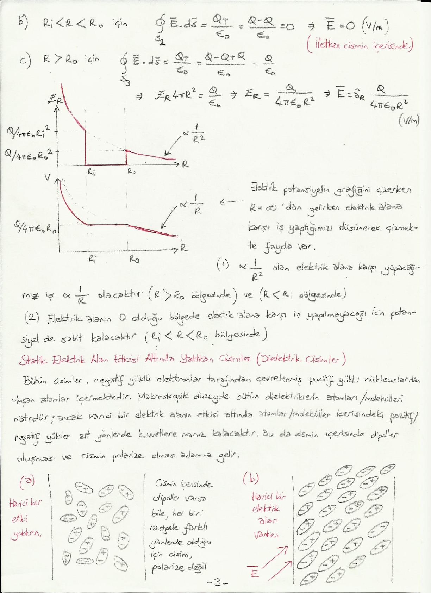
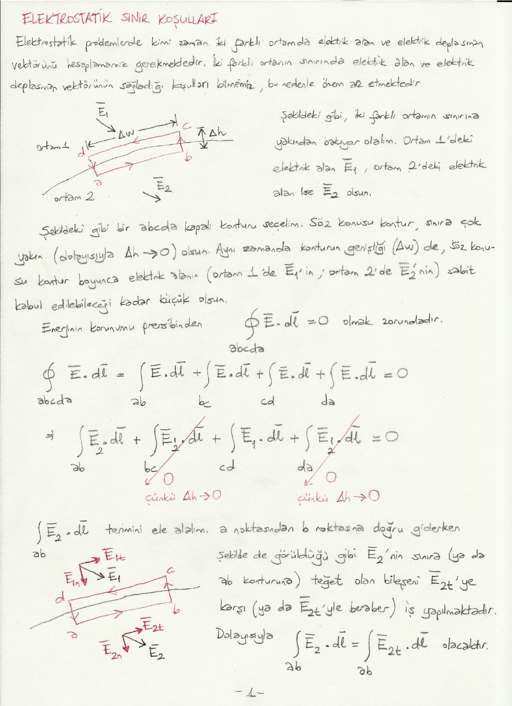
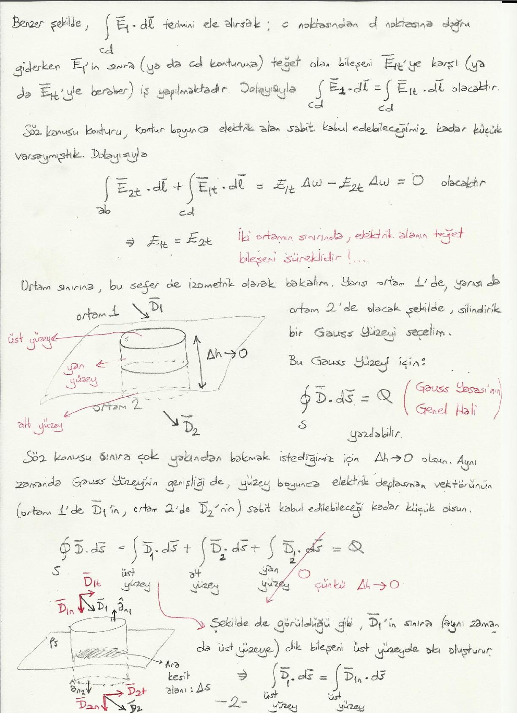

Bu yazı, Başkent Üniversitesi **EEM224 Elektromanyetik I** dersine ait el yazısı ders notlarının iki bölümünü bir araya getiriyor: **"Statik Elektrik Alan Etkisi Altında Cisimler"** (4 sayfa) ve **"Elektrostatik Sınır Koşulları"** (3 sayfa). Notlarda hazırlayanın adı ve tarih yazmıyor. Metin ve formüller yazıya döküldü; çizimler ve grafikler için sayfa görselleri eklendi. Taranmış notların orijinal PDF'leri yazının sonunda ZIP olarak indirilebilir.

## Statik elektrik alan etkisi altında cisimler

Şu ana değin elektrik alanı boşlukta (veya havada) inceledik. Şimdi elektrik alanın cisimler içerisinde/üzerinde etkilerini inceleyeceğiz. Cisimler elektriksel özelliklerine göre

- iletkenler,
- yarı iletkenler,
- yalıtkanlar (dielektrikler)

olmak üzere 3 gruba ayrılabilirler. En kaba atom modeline göre her atom, pozitif yüklü bir çekirdek (nükleus) etrafında dönen negatif yüklü parçacıklardan (elektronlar) oluşur. İletkenlerde dış yörüngedeki elektronlar bir atomdan başka bir atoma kolaylıkla hareket edebilir. Yalıtkanlarda harici bir etkiyle bile en dış yörüngedeki elektronları koparmak mümkün değildir.

## Statik elektrik alan etkisi altında iletken cisimler

İyi bir iletkenin iç kısmına bir miktar pozitif (veya negatif) yük bırakıldığını düşünelim. İletken cismin içerisinde bir elektrik alan oluşacak; bu elektrik alan dolayısıyla yükler birbirlerinden uzaklaşmaya başlayacaktır. Bu hareket, bütün yükler yüzeye ulaşıncaya ve her bir yük üzerindeki net kuvvet sıfır oluncaya kadar (yani denge durumuna kadar) devam edecektir. Neticede cismin iç kısmında hiç yük kalmayacaktır.

Metal (iletken) cismin içerisinde herhangi bir S kapalı yüzeyi seçelim:

∮_S Ē · ds̄ = Q / ε₀ = 0

Ne şekilde bir S yüzeyi seçersek seçelim, bütün yükler cismin yüzeyinde olacağı için S yüzeyi içerisinde kalan yük Q = 0 olacaktır. Dolayısıyla **iletken cismin içerisinde Ē = 0**.

Cismin üzerindeki her bir yükün dengede duruyor olması demek, her bir yüke diğer yükler tarafından uygulanan farklı yönlerdeki kuvvetlerin sadeleşiyor olması demektir; yani her bir yük üzerindeki net kuvvet = 0. Dolayısıyla yüzeyde elektrik alanın teğet bileşeni = 0: **iletken cismin yüzeyinde E_t = 0**.

### Örnek: Merkezinde +Q yük bulunan iletken küresel kabuk

İç yarıçapı R_i, dış yarıçapı R_o olan iletken küresel kabuğun merkezine +Q yük bırakılmış olsun. Uzayın her yerinde elektrik alanı ve elektrik potansiyeli hesaplayınız.

İletken cisim içerisinde elektrik alan 0 olmak zorundadır. Bunun sağlanabilmesi için iletken kabuk içerisinde seçilecek bir Gauss yüzeyi (S) içerisinde kalacak toplam yük Q_T = 0 olmalıdır. Merkezde +Q yük olduğuna göre, S yüzeyinin içerisinde Q_T = 0 olması için S yüzeyinin içerisindeki bir yerlerde −Q yük bulunması gerekir. İletken cisimlerin içerisinde yük olamayacağı, yükler sadece iletken cisimlerin yüzeyinde bulunabileceği için, demek ki küresel kabuğun iç yüzeyinde bir yüzey yük yoğunluğu ρ_s1 (C/m²) (toplamı −Q olacak şekilde) bulunmalıdır:

ρ_s1 4πR_i² = −Q

İletken cisim yük bakımından nötr idi. Cismin iç yüzeyinde −Q kadar yük olduğuna göre, yüklerin korunumu prensibinden ötürü cismin başka bir yerlerinde +Q kadar yük olması gerekmektedir. Yükler iletken cismin sadece yüzeyinde bulunabileceği için demek ki küresel kabuğun dış yüzeyinde de bir yüzey yük yoğunluğu ρ_s2 (C/m²) (toplamı +Q olacak şekilde) bulunmalıdır:

ρ_s2 4πR_o² = +Q

Uzayın her yerinde elektrik alanı artık hesaplayabiliriz:

**a) R < R_i için** (S₁ yüzeyi): ∮ Ē · ds̄ = Q/ε₀ ⇒ E_R 4πR² = Q/ε₀ ⇒ Ē = â_R Q / (4πε₀R²)   (V/m)

**b) R_i < R < R_o için** (S₂ yüzeyi): ∮ Ē · ds̄ = Q_T/ε₀ = (Q − Q)/ε₀ = 0 ⇒ Ē = 0 (V/m) (iletken cismin içerisinde)

**c) R > R_o için** (S₃ yüzeyi): ∮ Ē · ds̄ = Q_T/ε₀ = (Q − Q + Q)/ε₀ = Q/ε₀ ⇒ E_R 4πR² = Q/ε₀ ⇒ Ē = â_R Q / (4πε₀R²)   (V/m)

Elektrik alanın şiddeti R < R_i bölgesinde 1/R² ile azalarak R_i'de Q/(4πε₀R_i²) değerine iner, kabuğun içinde sıfırdır, R_o'da Q/(4πε₀R_o²) değerinden başlayarak yine 1/R² ile azalır.

Elektrik potansiyelin grafiğini çizerken R = ∞'dan gelirken elektrik alana karşı iş yaptığımızı düşünerek çizmekte fayda var:

1. ∝ 1/R² olan elektrik alana karşı yapacağımız iş ∝ 1/R olacaktır (R > R_o bölgesinde ve R < R_i bölgesinde).
1. Elektrik alanın 0 olduğu bölgede elektrik alana karşı iş yapılmayacağı için potansiyel de sabit kalacaktır (R_i < R < R_o bölgesinde); bu sabit değer Q/(4πε₀R_o)'dır.

## Statik elektrik alan etkisi altında yalıtkan cisimler (dielektrik cisimler)

Bütün cisimler, negatif yüklü elektronlar tarafından çevrelenmiş pozitif yüklü nükleuslardan oluşan atomlar içermektedir. Makroskopik düzeyde bütün dielektriklerin atomları/molekülleri nötrdür; ancak harici bir elektrik alanın etkisi altında atomlar/moleküller içerisindeki pozitif/negatif yükler zıt yönlerde kuvvetlere maruz kalacaktır. Bu da cismin içerisinde dipoller oluşması ve cismin **polarize** olması anlamına gelir.

- (a) Harici bir etki yokken: cismin içerisinde dipoller varsa bile her biri rastgele farklı yönlerde olduğu için cisim polarize değil.
- (b) Harici bir elektrik alan varken: dipoller alan yönünde hizalanır.

Daha önce bir dipolün "dipol moment vektörü"nü tanımlamıştık: p̄ = q d̄ (C·m); q yük (C), d̄ yükler arasındaki mesafe (m).

Cisim üzerinde endüklenmiş olan dipollerin her biri için bir dipol moment vektörü olacaktır. Cisim üzerindeki polarizasyon miktarını ölçmeye yönelik olarak **polarizasyon vektörü**nü tanımlayabiliriz:

P̄ = lim_(Δv→0) (Σ_(k=1)^(n) p̄_k) / Δv   (C/m²)

Burada n birim hacimdeki atom (molekül) sayısı, Σ p̄_k birim hacimdeki bütün dipollerin momentlerinin toplamıdır. Eğer bütün dipoller rastgele yönlenmiş ise Σ p̄_k = 0 ⇒ P̄ = 0 çıkacaktır.

Eğer bir cismin içerisindeki dipoller harici elektrik alan altında aynı yönde (harici elektrik alana paralel olacak şekilde) yönlenmeye ne kadar meyilli (eğilimli) ise o cisim o kadar polarize olacaktır; bir başka deyişle böyle cisimler için P̄ daha büyük olacaktır.

D̄ = ε₀Ē + P̄   (C/m²)

- D̄: **"elektrik akı yoğunluğu"** veya **"elektrik deplasman vektörü"** (displacement: +/− yüklerin konum değişiminden esinlenilerek bu isim verilmiştir)
- ε₀: sabit sayı; Ē: harici elektrik alan. ε₀Ē, sabit bir elektrik alan değeri için sabit değerdir.
- P̄: cismin özelliğine göre büyüklüğü değişen bir vektör; farklı cisimler için farklı değerler alır.

Dolayısıyla |D̄| ile |Ē| arasındaki oran cisimden cisme fark edecektir; yani |D̄| ile |Ē| arasındaki oran bir cisim özelliğidir:

D̄ = εĒ = ε_r ε₀ Ē   (C/m²)

Burada ε cismin elektrik geçirgenliği (dielektrik sabiti), ε_r de göreceli (relative) dielektrik sabitidir.

## Elektrostatik sınır koşulları

Elektrostatik problemlerde kimi zaman iki farklı ortamda elektrik alan ve elektrik deplasman vektörünü hesaplamamız gerekmektedir. İki farklı ortamın sınırında elektrik alan ve elektrik deplasman vektörünün sağladığı koşulları bilmemiz bu nedenle önem arz etmektedir.

### Teğet bileşen

İki farklı ortamın sınırına yakından bakıyor olalım. Ortam 1'deki elektrik alan Ē₁, ortam 2'deki elektrik alan ise Ē₂ olsun. Sınırın iki yanında bir abcda kapalı konturu seçelim. Söz konusu kontur sınıra çok yakın (dolayısıyla Δh → 0) olsun. Aynı zamanda konturun genişliği (Δw) de, söz konusu kontur boyunca elektrik alanın (ortam 1'de Ē₁'in, ortam 2'de Ē₂'nin) sabit kabul edilebileceği kadar küçük olsun. Enerjinin korunumu prensibinden ∮_abcda Ē · dl̄ = 0 olmak zorundadır:

∮_abcda Ē · dl̄ = ∫_ab Ē₂ · dl̄ + ∫_bc Ē · dl̄ + ∫_cd Ē₁ · dl̄ + ∫_da Ē · dl̄ = 0

bc ve da kenarlarındaki integraller Δh → 0 olduğu için sıfırdır.

a noktasından b noktasına doğru giderken Ē₂'nin sınıra (ya da ab konturuna) teğet olan bileşeni Ē₂t'ye karşı (ya da Ē₂t'yle beraber) iş yapılmaktadır; dolayısıyla ∫_ab Ē₂ · dl̄ = ∫_ab Ē₂t · dl̄. Benzer şekilde c noktasından d noktasına doğru giderken ∫_cd Ē₁ · dl̄ = ∫_cd Ē₁t · dl̄ olacaktır. Konturu, kontur boyunca elektrik alanı sabit kabul edebileceğimiz kadar küçük varsaymıştık:

∫_ab Ē₂t · dl̄ + ∫_cd Ē₁t · dl̄ = E₁t Δw − E₂t Δw = 0 ⇒ **E₁t = E₂t**

İki ortamın sınırında elektrik alanın teğet bileşeni süreklidir.

### Normal bileşen

Ortam sınırına bu sefer de izometrik olarak bakalım. Yarısı ortam 1'de, yarısı da ortam 2'de olacak şekilde silindirik bir Gauss yüzeyi seçelim. Bu Gauss yüzeyi için

∮_S D̄ · ds̄ = Q   (Gauss yasasının genel hâli)

yazılabilir. Söz konusu sınıra çok yakından bakmak istediğimiz için Δh → 0 olsun. Aynı zamanda Gauss yüzeyinin genişliği de, yüzey boyunca elektrik deplasman vektörünün (ortam 1'de D̄₁'in, ortam 2'de D̄₂'nin) sabit kabul edilebileceği kadar küçük olsun:

∮_S D̄ · ds̄ = ∫_üst D̄₁ · ds̄ + ∫_alt D̄₂ · ds̄ + ∫_yan D̄ · ds̄ = Q

Yan yüzey integrali Δh → 0 olduğu için 0'dır. D̄₁'in sınıra (aynı zamanda üst yüzeye) dik bileşeni üst yüzeyde akı oluşturur: ∫_üst D̄₁ · ds̄ = ∫_üst D̄₁n · ds̄. Benzer şekilde D̄₂'nin sınıra (aynı zamanda alt yüzeye) dik bileşeni alt yüzeyde akı oluşturmaktadır: ∫_alt D̄₂ · ds̄ = ∫_alt D̄₂n · ds̄. Üst yüzeyde ds̄ = â_n1 ds, alt yüzeyde ds̄ = â_n2 ds = −â_n1 ds:

∫_üst D̄₁n · ds̄ + ∫_alt D̄₂n · ds̄ = Q = ρ_s Δs

Burada ρ_s iki ortam arasındaki sınır yüzeydeki yük yoğunluğu (C/m²), Δs Gauss yüzeyinin ara kesit alanıdır (m²):

D₁n Δs − D₂n Δs = (D₁n − D₂n) Δs = ρ_s Δs ⇒ **D₁n − D₂n = ρ_s**   (C/m²)

İki ortamın sınırında elektrik deplasman vektörünün normal bileşeni, ortam sınırındaki yüzey yük yoğunluğu kadar süreksizlik gösterir.

### Özel durumlar

**Eğer her iki ortam da dielektrik ise:** E₁t = E₂t ⇒ D₁t/ε₁ = D₂t/ε₂. Böyle bir durumda ortam sınırında hiç yük olmayacağından (yani ρ_s = 0 olacağından) D₁n = D₂n ⇒ ε₁E₁n = ε₂E₂n.

**Eğer ortam 2 iletken ise:** Ē₂ = 0 ⇒ E₂t = 0 ⇒ E₁t = E₂t = 0; D̄₂ = 0 ⇒ D₂n = 0 ⇒ D₁n − D₂n = ρ_s ⇒ D₁n = ρ_s.

**Önemli not:** Yukarıda türetilen ifadeler sadece "sınırda" geçerlidir. Yani E₁t = E₂t yalnızca sınır üzerindeki noktada sağlanır; sınırdan uzaktaki bir noktada E₁t'nin değeri, başka bir noktadaki E₂t'nin değerine eşit olmak zorunda değildir.
