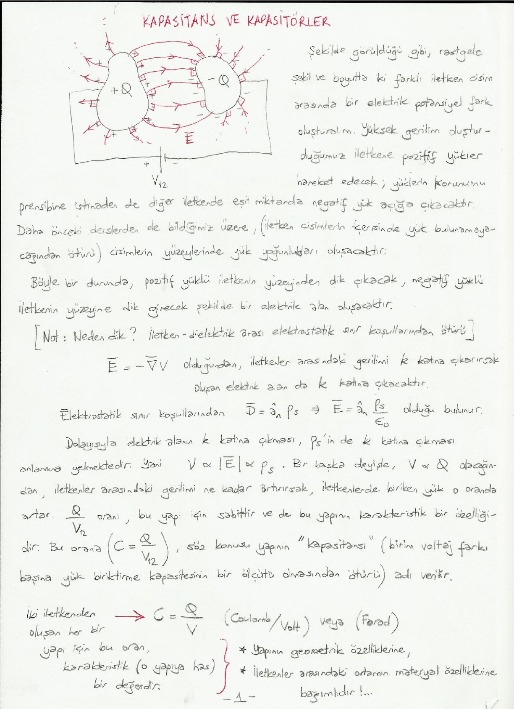
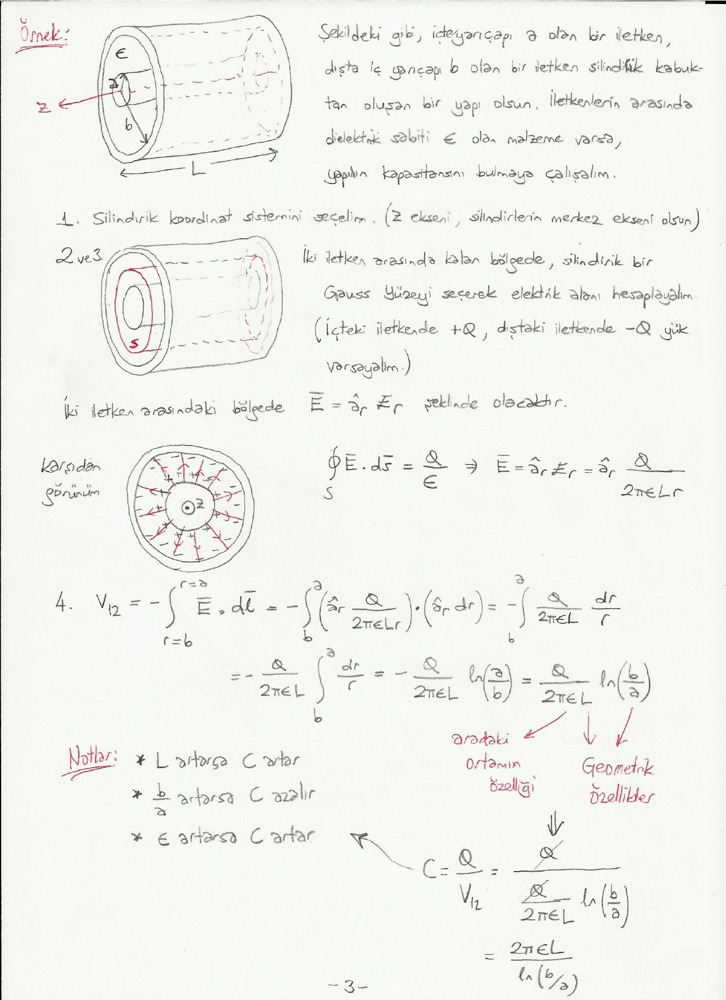
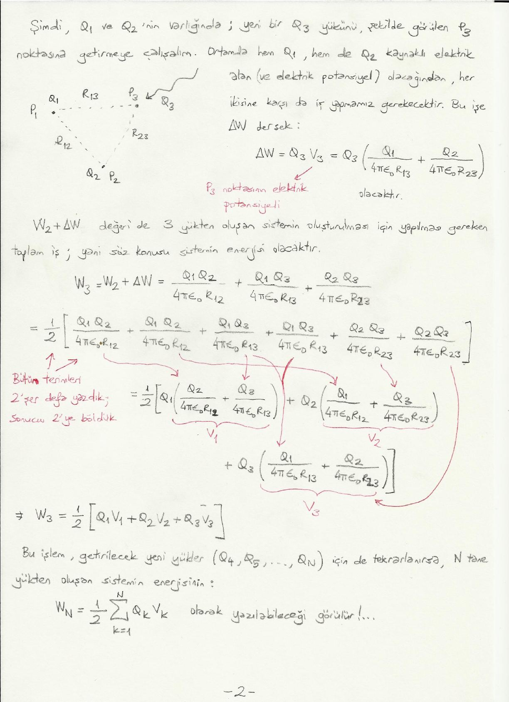

This post brings together two sections of handwritten course notes for **EEM224 Electromagnetics I** at Başkent University: **"Capacitance and Capacitors"** (3 pages) and **"Electrostatic Energy"** (3 pages). The notes do not state the author's name or a date. The text and formulas have been transcribed; page images have been added for the drawings. The original PDFs of the scanned notes can be downloaded as a ZIP at the end of the post.

## Capacitance and capacitors

Let us create an electric potential difference (V₁₂) between two different conducting bodies of arbitrary shape and size. Positive charges will move onto the conductor held at the higher voltage; by the principle of conservation of charge, an equal amount of negative charge will appear on the other conductor. As we know from earlier lectures (since there can be no charge inside conducting bodies), surface charge densities will form on the surfaces of the bodies.

In such a case, an electric field will form that leaves the surface of the positively charged conductor perpendicularly and enters the surface of the negatively charged conductor perpendicularly. [Note: Why perpendicular? Because of the electrostatic boundary conditions at a conductor–dielectric interface.]

Since Ē = −∇V, if we increase the voltage between the conductors by a factor of k, the resulting electric field also increases by a factor of k. From the electrostatic boundary conditions, D̄ = â_n ρ_s ⇒ Ē = â_n ρ_s / ε₀. Therefore, the electric field increasing by a factor of k means that ρ_s also increases by a factor of k. That is, V ∝ |Ē| ∝ ρ_s.

In other words, since V ∝ Q, the more we increase the voltage between the conductors, the more the charge accumulated on the conductors increases, in the same proportion. The ratio Q/V₁₂ is constant for this structure and is a characteristic property of the structure. This ratio (C = Q/V₁₂) is called the **"capacitance"** of the structure in question (since it is a measure of the capacity to store charge per unit voltage difference).

C = Q / V   (Coulomb/Volt) or (Farad)

For every structure consisting of two conductors, this ratio is a characteristic value (specific to that structure) and

- depends on the geometric properties of the structure,
- depends on the material properties of the medium between the conductors.

### Method for calculating capacitance

The capacitance of a given structure can be calculated with the following method:

1. Choose a coordinate system appropriate to the geometry.
1. Assume charges +Q and −Q on the conductors.
1. Calculate the electric field (Ē) in the medium between the conductors using Gauss's law or another method.
1. Calculate the potential difference between the +Q conductor and the −Q conductor using V₁₂ = −∫_2^1 Ē · dl̄ (1: positively charged conductor, 2: negatively charged conductor).
1. Find the capacitance from C = Q / V₁₂.

[Note: The result may contain terms such as the geometric properties of the body (structure) (i.e., dimensions, the distance between the conductors, etc.) and the dielectric permittivity (ε_r) of the medium between the conductors. However, it must not contain terms such as Q or V.]

### Example: Parallel-plate capacitor

Let us calculate the capacitance of this structure, which we have examined before. Let the surface area of each plate be A, the distance between them be d, and the medium between them be air (ε₀).

1. Choose the Cartesian coordinate system (lower plate at z = 0, upper plate at z = d).
1. Assume +Q on the upper plate and −Q on the lower one.
1. Electric field between the two plates: Ē = −â_z ρ_s/ε₀ = −â_z ρ_s A/(ε₀A) = −â_z Q/(ε₀A).
1. V₁₂ = −∫_2^1 Ē · dl̄ = −∫_0^d (−â_z Q/ε₀) · (â_z dz) = +∫_0^d Q/(ε₀A) dz = Qd/(ε₀A)
1. C = Q/V₁₂ = Q / (Qd/(ε₀A)) = ε₀A/d (F) is found.

*Note: In the first integral of the fourth step, the denominator is written as ε₀ instead of ε₀A; the next expression and the result use the correct form (ε₀A).*

### Example: Coaxial cylindrical capacitor

Consider a structure of length L consisting of a conductor of radius a on the inside and a cylindrical conducting shell of inner radius b on the outside. If the material between the conductors has dielectric constant ε, let us try to find the capacitance of the structure.

**Step 1.** Choose the cylindrical coordinate system (let the z axis be the central axis of the cylinders).

**Steps 2 and 3.** Let us calculate the electric field by choosing a cylindrical Gaussian surface in the region between the two conductors (assume +Q on the inner conductor and −Q on the outer conductor). In the region between the two conductors, the field has the form Ē = â_r E_r:

∮_S Ē · ds̄ = Q/ε ⇒ Ē = â_r E_r = â_r Q / (2πεLr)

**Step 4.** Potential difference:

V₁₂ = −∫_(r=b)^(r=a) Ē · dl̄ = −∫_b^a (â_r Q/(2πεLr)) · (â_r dr) = −Q/(2πεL) ∫_b^a dr/r = −Q/(2πεL) ln(a/b) = Q/(2πεL) ln(b/a)

**Step 5.** Capacitance:

C = Q/V₁₂ = Q / [Q/(2πεL) · ln(b/a)] = 2πεL / ln(b/a)

Here ε is a property of the medium in between, while L and ln(b/a) are geometric properties.

**Notes:**

- If L increases, C increases.
- If b/a increases, C decreases.
- If ε increases, C increases.

## Electrostatic energy

We said earlier that the electric potential of a point (relative to infinity) is the work that must be done to bring a unit charge from infinity to that point.

Let there be a charge Q₁ at point P₁; the work done to bring a unit charge to a point P₂ at a distance R₁₂ from P₁ is

V₂ = Q₁ / (4πε₀R₁₂)

If we bring a charge Q₂ to this point instead of a unit charge, Q₂ times more work is required. Calling this W₂:

W₂ = Q₂V₂ = Q₂Q₁ / (4πε₀R₁₂)

is obtained. We can also write W₂ as W₂ = Q₁ · Q₂/(4πε₀R₁₂); here Q₂/(4πε₀R₁₂) is the electric potential at point P₁ due to the electric field caused by Q₂ (V₁). Therefore, it can also be written as W₂ = Q₁V₁.

This can also be interpreted as follows: with Q₂ at point P₂, the work done to bring the charge Q₁ from infinity to point P₁ is also equal to W₂. Therefore, in a two-charge system it does not matter which charge is brought first; the work done turns out equal to W₂ = Q₁Q₂/(4πε₀R₁₂). The work done to build/assemble this two-charge system can also be defined as the energy of this system.

Generalizing: **The energy of a system is the total work that must be done to build/assemble that system.** The energy of the system consisting of two charges is:

W₂ = Q₁V₁ = Q₂V₂ = ½ (Q₁V₁ + Q₂V₂)

Now let us try to bring a new charge Q₃ to point P₃ in the presence of Q₁ and Q₂. Since there will be an electric field (and electric potential) due to both Q₁ and Q₂ in the medium, we will need to do work against both of them. Calling this work ΔW:

ΔW = Q₃V₃ = Q₃ [Q₁/(4πε₀R₁₃) + Q₂/(4πε₀R₂₃)]

Here V₃ is the electric potential at point P₃. The value W₂ + ΔW will be the total work that must be done to build the system of 3 charges, that is, the energy of the system in question:

W₃ = W₂ + ΔW = Q₁Q₂/(4πε₀R₁₂) + Q₁Q₃/(4πε₀R₁₃) + Q₂Q₃/(4πε₀R₂₃)

If we write every term twice, divide the result by 2, and regroup the terms:

W₃ = ½ [Q₁ (Q₂/(4πε₀R₁₂) + Q₃/(4πε₀R₁₃)) + Q₂ (Q₁/(4πε₀R₁₂) + Q₃/(4πε₀R₂₃)) + Q₃ (Q₁/(4πε₀R₁₃) + Q₂/(4πε₀R₂₃))]

The expressions in parentheses are V₁, V₂, and V₃, respectively:

W₃ = ½ [Q₁V₁ + Q₂V₂ + Q₃V₃]

If this procedure is repeated for the new charges to be brought in (Q₄, Q₅, …, Q_N), it is seen that the energy of the system consisting of N charges can be written as

W_N = ½ Σ_(k=1)^(N) Q_k V_k

### Continuous charge distributions

We can generalize the expression we obtained for systems of discrete charges to systems formed by continuous charge distributions as follows:

W_e = ½ ∫_v′ ρ_v V dv′   (J)

- W_e: subscript "e" because it denotes "electrostatic" energy
- v′: the volume over which the charge distribution extends
- ρ_v: charge density (C/m³)
- V: electric potential of each point within the volume (V) or (J/C)

### Electrostatic energy in terms of field vectors

The expression W_e = ½ ∫_v′ ρ_v V dv′ can also be written, using ∇ · D̄ = ρ_v and Ē = −∇V, as

W_e = ½ ∫_v′ D̄ · Ē dv   (J)

The result of the scalar product D̄ · Ē is a scalar; a volume integral can be taken. Writing D̄ = εĒ:

W_e = ½ ∫_v′ ε |Ē|² dv′

can also be written in this form.

### Example: Energy of a parallel-plate capacitor

The energy of a parallel-plate capacitor consisting of two plates of area A separated by a distance d: we saw earlier that when there is a potential difference V₀ between the plates, the magnitude of the electric field between the plates is |Ē| = V₀/d.

W_e = ½ ∫_v′ ε |Ē|² dv′ = ½ ∫_v′ ε (V₀/d)² dv′ = ½ ε (V₀²/d²) A d = ½ ε (A/d) V₀²

Here v′ is the region between the two plates, ε is the dielectric constant of the filling material between the two plates, and A·d is the volume of the region between the two plates. We found earlier that the capacitance of this structure is C = εA/d:

W_e = ½ ε (A/d) V₀² = ½ C V₀²

The ½CV² formula we used by rote in the circuit analysis course!
