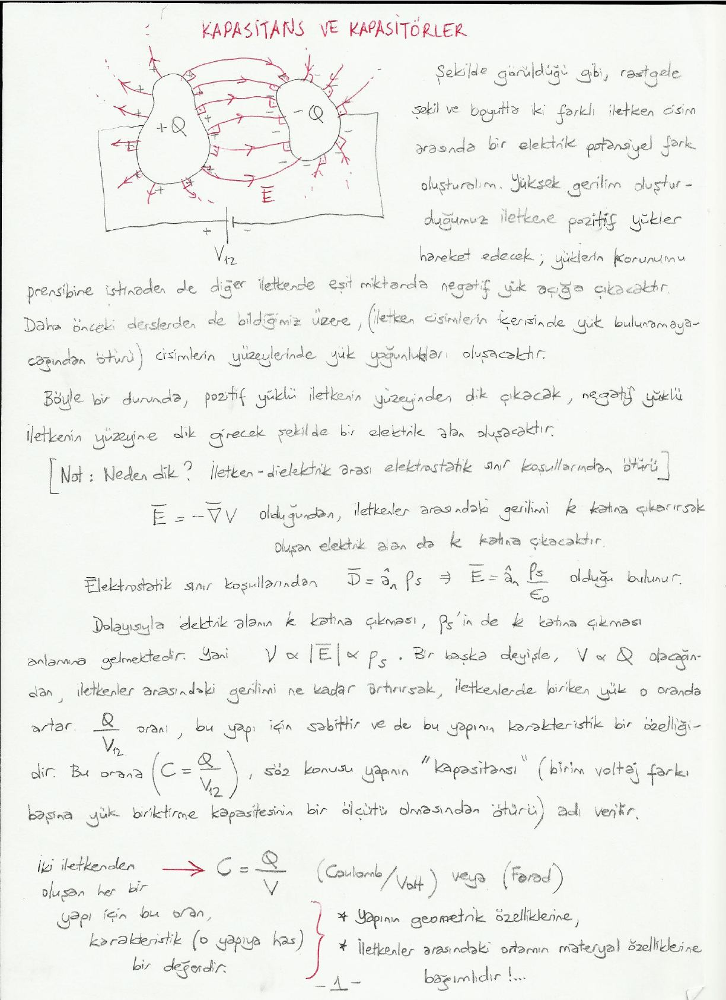
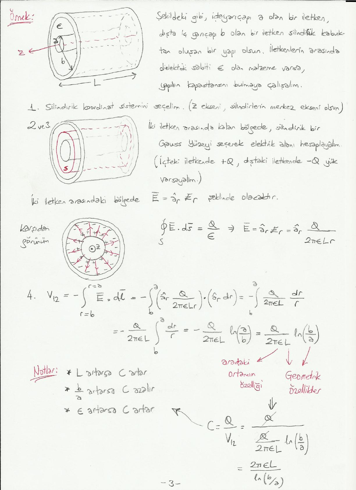
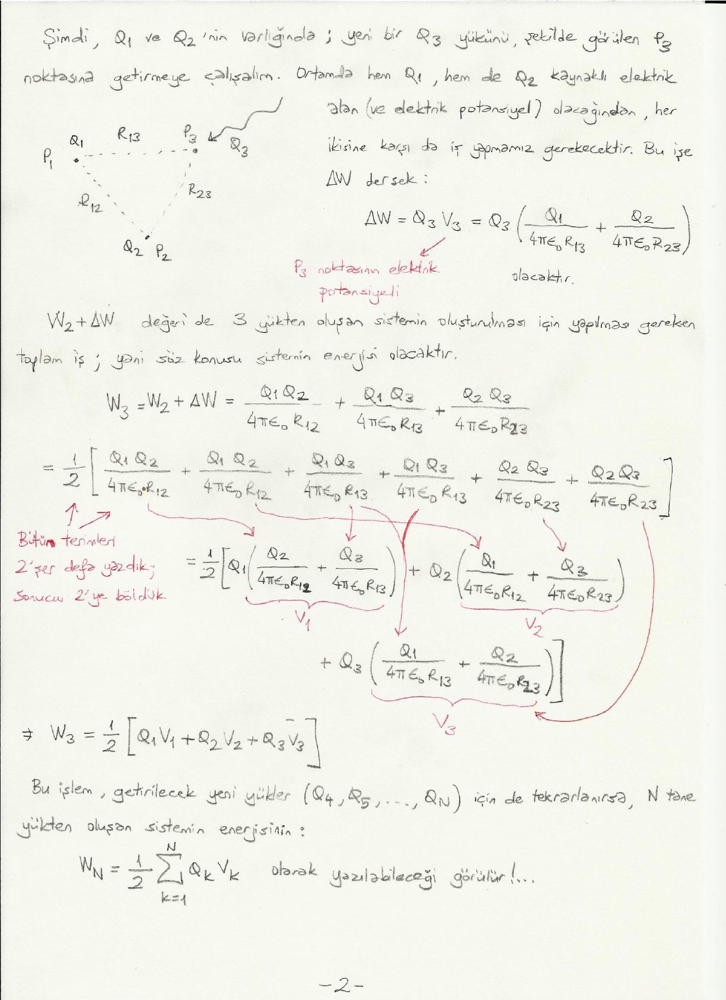

Bu yazı, Başkent Üniversitesi **EEM224 Elektromanyetik I** dersine ait el yazısı ders notlarının iki bölümünü bir araya getiriyor: **"Kapasitans ve Kapasitörler"** (3 sayfa) ve **"Elektrostatik Enerji"** (3 sayfa). Notlarda hazırlayanın adı ve tarih yazmıyor. Metin ve formüller yazıya döküldü; çizimler için sayfa görselleri eklendi. Taranmış notların orijinal PDF'leri yazının sonunda ZIP olarak indirilebilir.

## Kapasitans ve kapasitörler

Rastgele şekil ve boyutta iki farklı iletken cisim arasında bir elektrik potansiyel fark (V₁₂) oluşturalım. Yüksek gerilim oluşturduğumuz iletkene pozitif yükler hareket edecek; yüklerin korunumu prensibine istinaden de diğer iletkende eşit miktarda negatif yük açığa çıkacaktır. Daha önceki derslerden de bildiğimiz üzere (iletken cisimlerin içerisinde yük bulunamayacağından ötürü) cisimlerin yüzeylerinde yük yoğunlukları oluşacaktır.

Böyle bir durumda pozitif yüklü iletkenin yüzeyinden dik çıkacak, negatif yüklü iletkenin yüzeyine dik girecek şekilde bir elektrik alan oluşacaktır. [Not: Neden dik? İletken–dielektrik arası elektrostatik sınır koşullarından ötürü.]

Ē = −∇V olduğundan iletkenler arasındaki gerilimi k katına çıkarırsak oluşan elektrik alan da k katına çıkacaktır. Elektrostatik sınır koşullarından D̄ = â_n ρ_s ⇒ Ē = â_n ρ_s / ε₀ olduğu bulunur. Dolayısıyla elektrik alanın k katına çıkması, ρ_s'in de k katına çıkması anlamına gelmektedir. Yani V ∝ |Ē| ∝ ρ_s.

Bir başka deyişle V ∝ Q olacağından, iletkenler arasındaki gerilimi ne kadar artırırsak iletkenlerde biriken yük o oranda artar. Q/V₁₂ oranı bu yapı için sabittir ve bu yapının karakteristik bir özelliğidir. Bu orana (C = Q/V₁₂), söz konusu yapının **"kapasitansı"** adı verilir (birim voltaj farkı başına yük biriktirme kapasitesinin bir ölçütü olmasından ötürü).

C = Q / V   (Coulomb/Volt) veya (Farad)

İki iletkenden oluşan her bir yapı için bu oran karakteristik (o yapıya has) bir değerdir ve

- yapının geometrik özelliklerine,
- iletkenler arasındaki ortamın malzeme özelliklerine

bağımlıdır.

### Kapasitans hesaplama yöntemi

Verilen bir yapının kapasitansı şu yöntemle hesaplanabilir:

1. Geometriye uygun bir koordinat sistemi seçilir.
1. İletkenler üzerinde +Q ve −Q yükler olduğu varsayılır.
1. Gauss yasası veya başka bir yöntem ile iletkenler arasındaki ortamda elektrik alan (Ē) hesaplanır.
1. +Q yüklü iletken ile −Q yüklü iletken arasındaki potansiyel fark V₁₂ = −∫_2^1 Ē · dl̄ formülü ile hesaplanır (1: pozitif yüklü iletken, 2: negatif yüklü iletken).
1. Kapasitans C = Q / V₁₂ ile bulunur.

[Not: Bulunan sonuç, cismin (yapının) geometrik özellikleri (yani boyutlar, iletkenler arasındaki mesafe vb.) ve iletkenler arasındaki ortamın dielektrik geçirgenliği (ε_r) gibi terimler içerebilir. Ancak Q, V gibi terimler içermemelidir.]

### Örnek: Paralel levha kapasitör

Daha önce de incelediğimiz bu yapının kapasitansını hesaplayalım. Levhaların her birinin yüzey alanı A, aralarındaki mesafe d, aralarındaki ortam ise hava (ε₀) olsun.

1. Kartezyen koordinat sistemini seçelim (alttaki levha z = 0, üstteki levha z = d).
1. Üstteki levhada +Q, alttakinde −Q yük varsayalım.
1. İki levha arasındaki elektrik alan: Ē = −â_z ρ_s/ε₀ = −â_z ρ_s A/(ε₀A) = −â_z Q/(ε₀A).
1. V₁₂ = −∫_2^1 Ē · dl̄ = −∫_0^d (−â_z Q/ε₀) · (â_z dz) = +∫_0^d Q/(ε₀A) dz = Qd/(ε₀A)
1. C = Q/V₁₂ = Q / (Qd/(ε₀A)) = ε₀A/d (F) olarak bulunur.

*Not: Dördüncü adımın ilk integralinde payda ε₀A yerine ε₀ olarak yazılmış; bir sonraki ifadede ve sonuçta doğru (ε₀A) kullanılmış.*

### Örnek: Koaksiyel silindirik kapasitör

İç yarıçapı a olan bir iletken ile dışta iç yarıçapı b olan bir iletken silindirik kabuktan oluşan, uzunluğu L olan bir yapı olsun. İletkenlerin arasında dielektrik sabiti ε olan malzeme varsa yapının kapasitansını bulmaya çalışalım.

**Adım 1.** Silindirik koordinat sistemini seçelim (z ekseni silindirlerin merkez ekseni olsun).

**Adım 2 ve 3.** İki iletken arasında kalan bölgede silindirik bir Gauss yüzeyi seçerek elektrik alanı hesaplayalım (içteki iletkende +Q, dıştaki iletkende −Q yük varsayalım). İki iletken arasındaki bölgede Ē = â_r E_r şeklinde olacaktır:

∮_S Ē · ds̄ = Q/ε ⇒ Ē = â_r E_r = â_r Q / (2πεLr)

**Adım 4.** Potansiyel fark:

V₁₂ = −∫_(r=b)^(r=a) Ē · dl̄ = −∫_b^a (â_r Q/(2πεLr)) · (â_r dr) = −Q/(2πεL) ∫_b^a dr/r = −Q/(2πεL) ln(a/b) = Q/(2πεL) ln(b/a)

**Adım 5.** Kapasitans:

C = Q/V₁₂ = Q / [Q/(2πεL) · ln(b/a)] = 2πεL / ln(b/a)

Burada ε aradaki ortamın özelliği, L ve ln(b/a) geometrik özelliklerdir.

**Notlar:**

- L artarsa C artar.
- b/a artarsa C azalır.
- ε artarsa C artar.

## Elektrostatik enerji

Daha önce bir noktanın (sonsuza göreceli) elektrik potansiyelinin, birim yükü sonsuzdan ilgili noktaya getirmek için yapılması gereken iş olduğunu söylemiştik.

P₁ noktasında Q₁ yükü olsun; P₁ noktasına R₁₂ mesafedeki bir P₂ noktasına birim yükü getirmek için yapılan iş

V₂ = Q₁ / (4πε₀R₁₂)

olacaktır. Bu noktaya birim yük değil de Q₂ yükünü getirmek için Q₂ kat daha fazla iş yapmak gerekir. Buna W₂ dersek:

W₂ = Q₂V₂ = Q₂Q₁ / (4πε₀R₁₂)

elde edilir. W₂'yi W₂ = Q₁ · Q₂/(4πε₀R₁₂) şeklinde de yazabiliriz; buradaki Q₂/(4πε₀R₁₂), P₁ noktasında Q₂'nin sebep olduğu elektrik alandan kaynaklanan elektrik potansiyeldir (V₁). Dolayısıyla W₂ = Q₁V₁ şeklinde de yazılabilir.

Bu durum şu şekilde de yorumlanabilir: P₂ noktasında Q₂ varken sonsuzdan P₁ noktasına Q₁ yükünü getirmek için yapılan iş de W₂'ye eşittir. Dolayısıyla iki yüklü sistemde hangi yükün önce getirildiğinin bir önemi yoktur; yapılan iş W₂ = Q₁Q₂/(4πε₀R₁₂) değerine eşit çıkmaktadır. İki yüklü bu sistemi oluşturmak/kurmak için yapılan iş, bu sistemin enerjisi olarak da tanımlanabilir.

Bunu genelleyecek olursak: **Bir sistemin enerjisi, o sistemi kurmak/oluşturmak için yapılması gereken toplam iştir.** İki yükten oluşan sistemin enerjisi:

W₂ = Q₁V₁ = Q₂V₂ = ½ (Q₁V₁ + Q₂V₂)

Şimdi Q₁ ve Q₂'nin varlığında yeni bir Q₃ yükünü P₃ noktasına getirmeye çalışalım. Ortamda hem Q₁ hem de Q₂ kaynaklı elektrik alan (ve elektrik potansiyel) olacağından her ikisine karşı da iş yapmamız gerekecektir. Bu işe ΔW dersek:

ΔW = Q₃V₃ = Q₃ [Q₁/(4πε₀R₁₃) + Q₂/(4πε₀R₂₃)]

Burada V₃, P₃ noktasının elektrik potansiyelidir. W₂ + ΔW değeri de 3 yükten oluşan sistemin oluşturulması için yapılması gereken toplam iş, yani söz konusu sistemin enerjisi olacaktır:

W₃ = W₂ + ΔW = Q₁Q₂/(4πε₀R₁₂) + Q₁Q₃/(4πε₀R₁₃) + Q₂Q₃/(4πε₀R₂₃)

Bütün terimleri 2'şer defa yazıp sonucu 2'ye bölersek ve terimleri yeniden gruplarsak:

W₃ = ½ [Q₁ (Q₂/(4πε₀R₁₂) + Q₃/(4πε₀R₁₃)) + Q₂ (Q₁/(4πε₀R₁₂) + Q₃/(4πε₀R₂₃)) + Q₃ (Q₁/(4πε₀R₁₃) + Q₂/(4πε₀R₂₃))]

Parantez içleri sırasıyla V₁, V₂ ve V₃'tür:

W₃ = ½ [Q₁V₁ + Q₂V₂ + Q₃V₃]

Bu işlem getirilecek yeni yükler (Q₄, Q₅, …, Q_N) için de tekrarlanırsa N tane yükten oluşan sistemin enerjisinin

W_N = ½ Σ_(k=1)^(N) Q_k V_k

olarak yazılabileceği görülür.

### Sürekli yük dağılımları

Ayrık yüklerin oluşturduğu sistemler için elde ettiğimiz ifadeyi sürekli yük dağılımlarının oluşturduğu sistemler için şu şekilde genelleyebiliriz:

W_e = ½ ∫_v′ ρ_v V dv′   (J)

- W_e: "elektrostatik" enerjiyi belirttiği için "e" alt indisi
- v′: yük dağılımının yayıldığı hacim
- ρ_v: yük yoğunluğu (C/m³)
- V: hacim içerisindeki her bir noktanın elektrik potansiyeli (V) veya (J/C)

### Alan vektörleri cinsinden elektrostatik enerji

W_e = ½ ∫_v′ ρ_v V dv′ ifadesi, ∇ · D̄ = ρ_v ve Ē = −∇V kullanılarak

W_e = ½ ∫_v′ D̄ · Ē dv   (J)

şeklinde de yazılabilir. D̄ · Ē skaler çarpımının sonucu skalerdir; hacim integrali alınabilir. D̄ = εĒ yazarsak:

W_e = ½ ∫_v′ ε |Ē|² dv′

şeklinde de yazılabilir.

### Örnek: Paralel levha kapasitörün enerjisi

Aralarında d mesafe bulunan, A yüzeyli iki levhadan oluşan paralel levha kapasitörün enerjisi: Daha önce levhalar arasında V₀ potansiyel fark bulunması durumunda levhalar arasındaki elektrik alanın şiddetinin |Ē| = V₀/d olduğunu görmüştük.

W_e = ½ ∫_v′ ε |Ē|² dv′ = ½ ∫_v′ ε (V₀/d)² dv′ = ½ ε (V₀²/d²) A d = ½ ε (A/d) V₀²

Burada v′ iki levha arasında kalan bölge, ε iki levha arasındaki dolgu malzemesinin dielektrik sabiti, A·d iki levha arasında kalan bölgenin hacmidir. Daha önce bu yapının kapasitansının C = εA/d olduğunu bulmuştuk:

W_e = ½ ε (A/d) V₀² = ½ C V₀²

Devre analizi dersinde ezbere kullandığımız ½CV² formülü!
