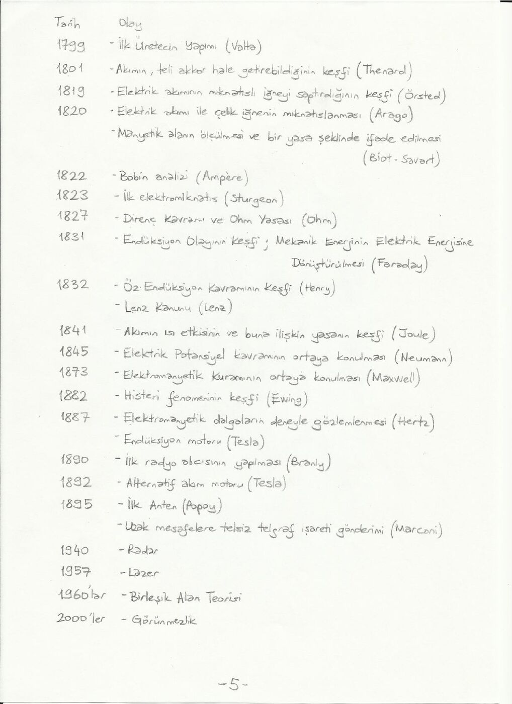
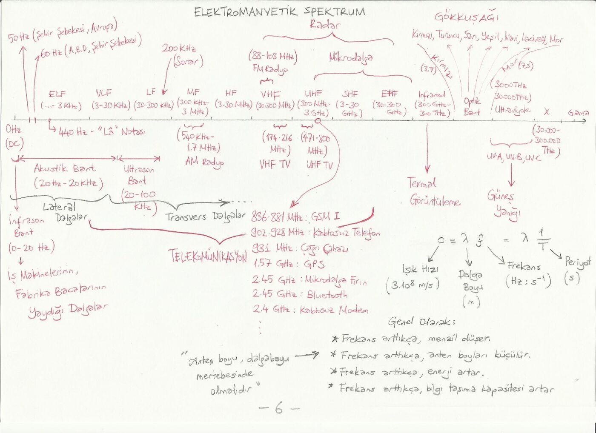

This post is the seven-page introductory note found in the 8thelixir_notlari compilation in the source archive. The author and date are not stated. The course scope, history, and spectrum drawings have been transcribed into text; the original PDF can be downloaded at the end of the post.

*Note: This content belongs to a third-party source; it is shared for archival and nostalgic purposes with the source credited. It will be removed at the request of the rights holder.*

## Sources and course scope

The main reference is David K. Cheng's Fundamentals of Engineering Electromagnetics. The note gives its Turkish translation as Adnan Köksal and Birsen Saka, Palme Yayınları. Supplementary sources include Cheng's Field and Wave Electromagnetics, calculus and physics textbooks, the Schaum vector analysis series, open lectures, and Wikipedia.

For undergraduate-level electromagnetics courses, the following topic sequence is given:

- Scalar and vector quantities, multivariable functions, the concept of a field.
- Addition, subtraction, scalar and vector products; gradient, divergence, and curl.
- Cartesian, cylindrical, and spherical coordinates; differential length, surface, and volume.
- The divergence and Stokes theorems, the two null identities, classification of fields, and the Helmholtz theorem.
- Line, surface, and volume integrals.
- Electrostatic postulates, Coulomb's and Gauss's laws; fields of discrete and continuous charges.
- Electric potential, conductors, dielectrics, electric flux density, and boundary conditions.
- Capacitance, electrostatic energy, and force.
- Steady currents, Ohm's law, the continuity equation, Kirchhoff's current law, Joule's law, and resistance.
- Magnetostatic fields, vector magnetic potential, Biot–Savart law, magnetic dipole.
- Magnetic materials, hysteresis, magnetic circuits, inductance, energy, force, and torque.
- Time-varying fields, Faraday's law, Maxwell's equations, wave equations, and phasors.
- Plane waves, polarization, phase and group velocities, the Poynting vector, reflection and refraction.

## History

The note gives a timeline starting from observations of lodestone and amber and extending through the work of Gilbert, Coulomb, Volta, Ørsted, Biot–Savart, Ampère, Ohm, Faraday, Lenz, Joule, Maxwell, and Hertz. The subsequent topics are radio communications, radar, lasers, and invisibility research.

*Note: The timeline assigns a single year to some inventions; these are the source's historical summary. For example, 1957 is written for the laser; the first working laser was realized in 1960.*

## The electromagnetic spectrum

The chart extends from radio frequencies through microwaves, infrared, visible light, ultraviolet, X-rays, and gamma rays. The acoustic band is shown separately; sound waves are not electromagnetic waves. Frequency and wavelength are inversely related.

## Transverse and longitudinal waves

In a transverse wave, the oscillation direction of the medium or field is perpendicular to the direction of wave propagation. In a longitudinal wave, the oscillation is parallel to the direction of propagation. The note explains these with the examples of a spring, the Mexican wave, and sound.

v = λf, f = 1/T.

Here v is the propagation speed (m/s), λ is the wavelength (m), f is the frequency (Hz), and T is the period (s).

*Note: The source uses the word "lateral" for the longitudinal wave; the common term is "longitudinal."*
