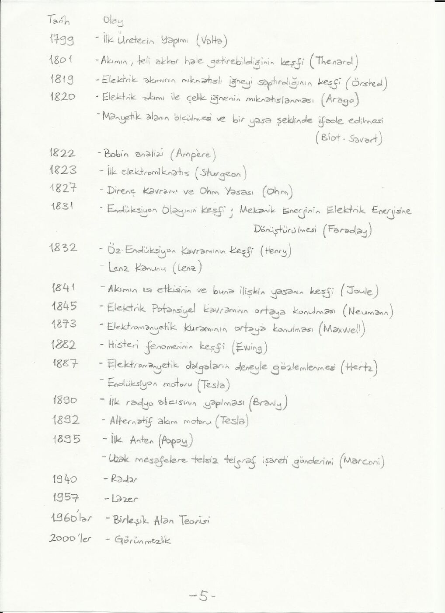
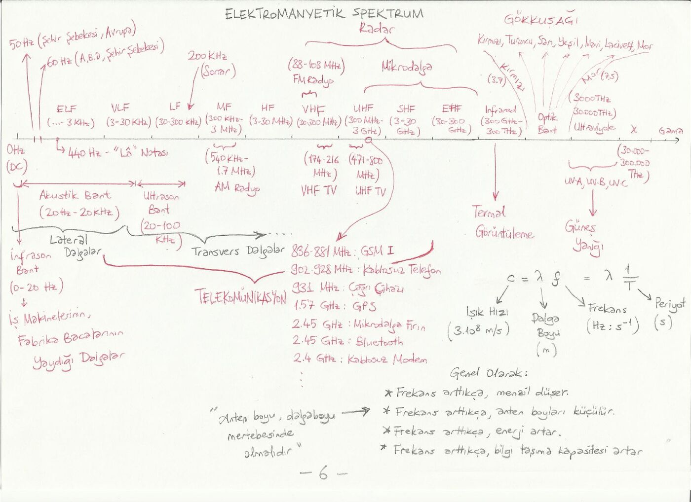

Bu yazı, kaynak arşivindeki 8thelixir_notlari derlemesinde bulunan yedi sayfalık giriş notudur. Hazırlayan ve tarih belirtilmemiştir. Ders kapsamı, tarihçe ve spektrum çizimleri metne aktarıldı; orijinal PDF yazının sonunda indirilebilir.

*Bu içerik üçüncü taraf bir kaynağa aittir; arşiv ve nostalji amacıyla kaynak belirtilerek paylaşılmıştır. Hak sahibinin talebi hâlinde kaldırılır.*

## Kaynaklar ve ders kapsamı

Ana kaynak David K. Cheng'in Fundamentals of Engineering Electromagnetics kitabıdır. Notta Türkçe çevirisi Adnan Köksal ve Birsen Saka, Palme Yayınları olarak belirtilir. Yardımcı kaynaklar arasında Cheng'in Field and Wave Electromagnetics kitabı, calculus ve fizik kitapları, Schaum vektör analizi serisi, açık dersler ve Wikipedia sayılır.

Lisans düzeyindeki elektromanyetik dersleri için şu konu sırası verilir:

- Skaler ve vektörel büyüklükler, çok değişkenli fonksiyonlar, alan kavramı.
- Toplama, çıkarma, skaler ve vektörel çarpım; gradyant, diverjans ve bukle.
- Kartezyen, silindirik ve küresel koordinatlar; diferansiyel uzunluk, yüzey ve hacim.
- Diverjans ve Stokes teoremleri, iki sıfır özdeşliği, alanların sınıflandırılması ve Helmholtz teoremi.
- Çizgi, yüzey ve hacim integralleri.
- Elektrostatik postülalar, Coulomb ve Gauss yasaları; ayrık ve sürekli yüklerin alanları.
- Elektrik potansiyel, iletkenler, dielektrikler, elektrik akı yoğunluğu ve sınır koşulları.
- Kapasitans, elektrostatik enerji ve kuvvet.
- Düzenli akımlar, Ohm yasası, süreklilik denklemi, Kirchhoff akım yasası, Joule yasası ve direnç.
- Manyetostatik alanlar, vektör manyetik potansiyel, Biot–Savart, manyetik dipol.
- Manyetik malzemeler, histerezis, manyetik devreler, endüktans, enerji, kuvvet ve tork.
- Zamana bağlı alanlar, Faraday yasası, Maxwell denklemleri, dalga denklemleri ve fazörler.
- Düzlem dalgalar, polarizasyon, faz ve grup hızları, Poynting vektörü, yansıma ve kırılma.

## Tarihçe

Not, mıknatıs taşı ve kehribar gözlemlerinden başlayıp Gilbert, Coulomb, Volta, Ørsted, Biot–Savart, Ampère, Ohm, Faraday, Lenz, Joule, Maxwell ve Hertz'in çalışmalarına uzanan bir zaman çizelgesi verir. Sonraki başlıklar radyo haberleşmesi, radar, lazer ve görünmezlik çalışmalarıdır.

*Not: Tarih çizelgesinde bazı buluşlara tek bir yıl atanmıştır; bunlar kaynağın tarihsel özetidir. Örneğin lazer için 1957 yazılmıştır; ilk çalışan lazer 1960'ta gerçekleştirilmiştir.*

## Elektromanyetik spektrum

Çizelge, radyo frekanslarından mikrodalgaya, kızılötesine, görünür ışığa, morötesine, X ve gama ışınlarına uzanır. Akustik bant ayrıca gösterilir; ses dalgası elektromanyetik dalga değildir. Frekans ve dalga boyu ters ilişkilidir.

## Enine ve boyuna dalgalar

Enine dalgada ortamın veya alanın salınım doğrultusu, dalganın ilerleme doğrultusuna diktir. Boyuna dalgada salınım, ilerleme doğrultusuna paraleldir. Notta yay, Meksika dalgası ve ses örnekleriyle anlatılır.

v = λf, f = 1/T.

Burada v yayılma hızı (m/s), λ dalga boyu (m), f frekans (Hz), T periyottur (s).

*Not: Kaynak, boyuna dalga için “lateral” sözcüğünü kullanmıştır; yaygın karşılığı “longitudinal”dır.*

