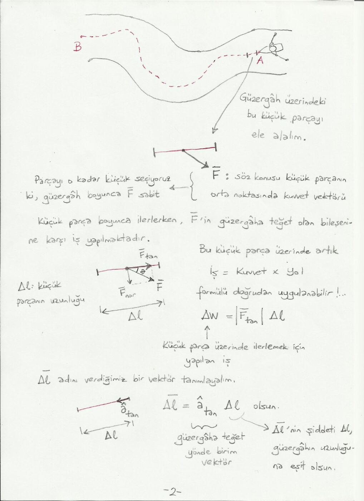
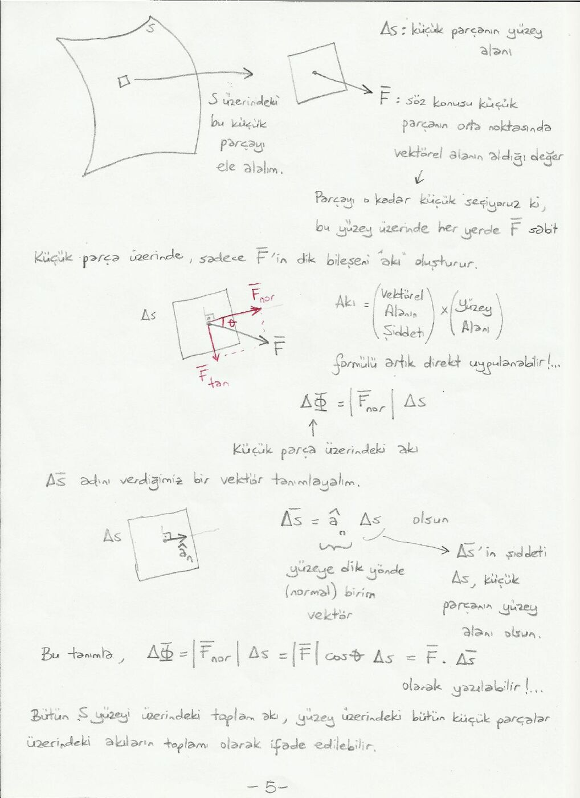
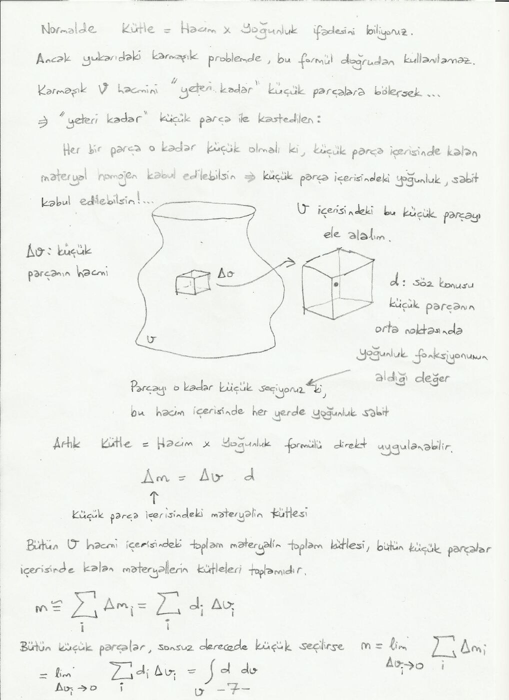

This post is a text transcription of the eight-page handwritten lecture note in the EEM224 folder. The author and date are not stated in the document. The original PDF can be downloaded at the end of the post.

## Line (contour) integral

The force F(x,y,z) exerted by the current in a stream bed changes both in direction and in magnitude with position. To find the work done by a rower moving along a curved path from point A to point B, a single force × distance product is not sufficient.

The path is divided into small segments over which the force can be assumed approximately constant and the path approximately straight. In each segment only the component of the force tangent to the path does work:

ΔW = F_tan Δl = |F| cosθ Δl = F · Δl.

Summing over all the segments and taking the limit as the segments become small:

W ≅ Σ Fᵢ · Δlᵢ → W = ∫_A^B F · dl.

Work is a scalar; the unit of force is N, the unit of length is m, and the unit of work is N·m. For a general vector field, the line integral takes the form C = ∫ A · dl. For a closed contour, where the starting and ending points coincide, the ∮ symbol is used.

## Surface (area) integral

Flux is a scalar quantity that indicates how much a vector field passes through a surface. When a constant field is perpendicular to the surface, the field magnitude is multiplied by the surface area. For a curved surface and a variable field, the surface is divided into small elements.

On each element ΔS, the surface is assumed approximately flat and the field approximately constant. With the unit normal â_n, the vector surface element is defined as ΔS = â_n ΔS. Only the normal component contributes to the flux:

ΔΦ = F_nor ΔS = |F| cosθ ΔS = F · ΔS.

Φ ≅ Σ Fᵢ · ΔSᵢ → Φ = ∫_S F · dS.

A closed surface encloses a volume; in this case the surface integral is denoted with the closed integral sign. The choice of the direction of the normal determines the sign of the flux.

## Volume integral

The total mass of a body with non-uniform density cannot be found with a single density × volume product. The volume V is divided into small elements Δv over which the density can be assumed approximately constant:

Δm = d Δv,

m ≅ Σ dᵢ Δvᵢ → m = ∫_V d dv.

Here d is the density (kg/m³), dv is the volume (m³), and m is the mass (kg). The product is a product of scalars. The general form is written as g = ∫_V f dv.

