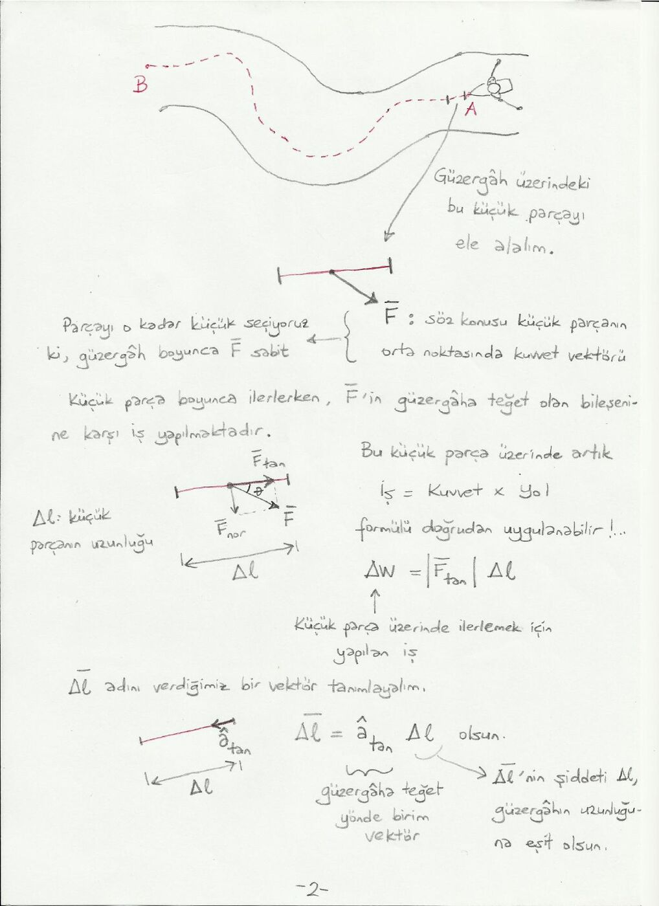
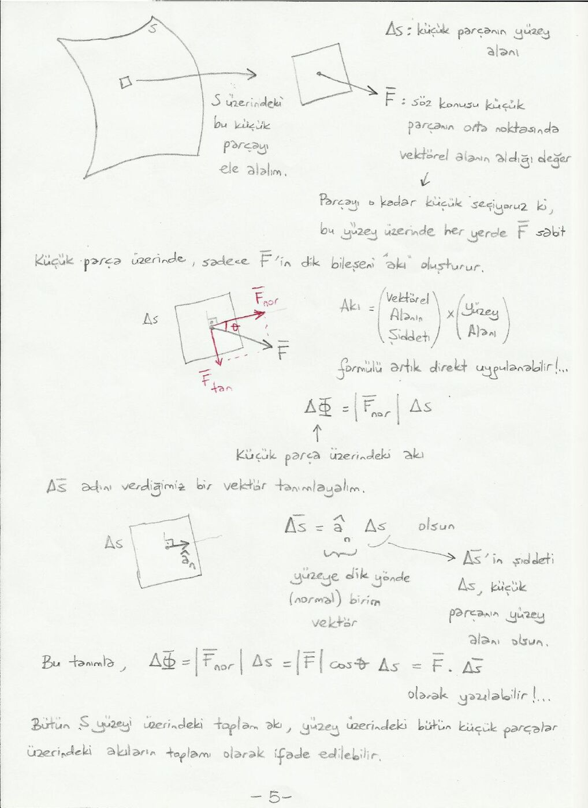
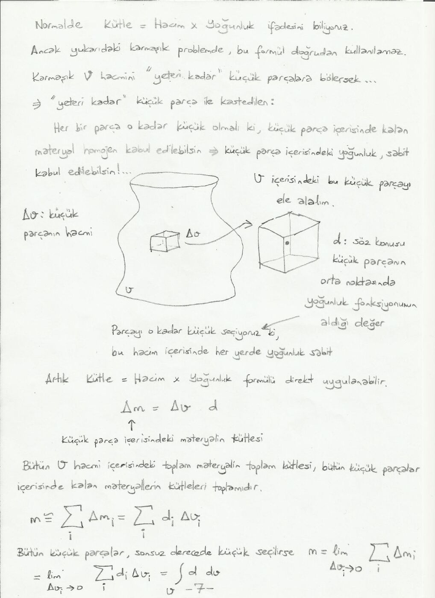

Bu yazı, EEM224 klasöründeki sekiz sayfalık el yazısı ders notunun metin dökümüdür. Hazırlayan ve tarih belgede belirtilmemiştir. Orijinal PDF yazının sonunda indirilebilir.

## Çizgi (kontur) integrali

Bir dere yatağındaki akıntının uyguladığı kuvvet F(x,y,z), konuma göre hem yön hem büyüklük değiştirir. A noktasından B noktasına eğri bir güzergâh boyunca ilerleyen kürekçinin yaptığı işi bulmak için tek bir kuvvet × yol çarpımı yeterli değildir.

Güzergâh, kuvvetin yaklaşık sabit ve yolun yaklaşık doğru kabul edilebildiği küçük parçalara bölünür. Her parçada yalnız kuvvetin yola teğet bileşeni iş yapar:

ΔW = F_tan Δl = |F| cosθ Δl = F · Δl.

Bütün parçaların toplamı ve küçük parça limitinde:

W ≅ Σ Fᵢ · Δlᵢ → W = ∫_A^B F · dl.

İş skalerdir; kuvvetin birimi N, uzunluğun birimi m, işin birimi N·m'dir. Genel bir vektör alanı için çizgi integrali C = ∫ A · dl biçimindedir. Başlangıç ve bitiş noktası aynı olan kapalı konturda ∮ işareti kullanılır.

## Yüzey (alan) integrali

Akı, bir vektör alanının yüzeyi ne kadar delip geçtiğini gösteren skaler büyüklüktür. Sabit bir alan yüzeye dik olduğunda alan büyüklüğü ile yüzey alanı çarpılır. Eğri yüzey ve değişken alan için yüzey küçük parçalara ayrılır.

Her ΔS parçasında yüzey yaklaşık düz, alan yaklaşık sabit kabul edilir. Birim normal â_n ile vektörel yüzey elemanı ΔS = â_n ΔS olarak tanımlanır. Yalnız normal bileşen akıya katkı verir:

ΔΦ = F_nor ΔS = |F| cosθ ΔS = F · ΔS.

Φ ≅ Σ Fᵢ · ΔSᵢ → Φ = ∫_S F · dS.

Kapalı yüzey bir hacmi çevreler; bu durumda yüzey integrali kapalı integral işaretiyle gösterilir. Normal yönünün seçimi, akının işaretini belirler.

## Hacim integrali

Yoğunluğu homojen olmayan bir cismin toplam kütlesi, tek bir yoğunluk × hacim çarpımıyla bulunamaz. V hacmi, yoğunluğun yaklaşık sabit kabul edilebildiği küçük Δv parçalarına ayrılır:

Δm = d Δv,

m ≅ Σ dᵢ Δvᵢ → m = ∫_V d dv.

Burada d yoğunluk (kg/m³), dv hacim (m³), m kütledir (kg). Çarpım, skalerlerin çarpımıdır. Genel biçim g = ∫_V f dv olarak yazılır.

