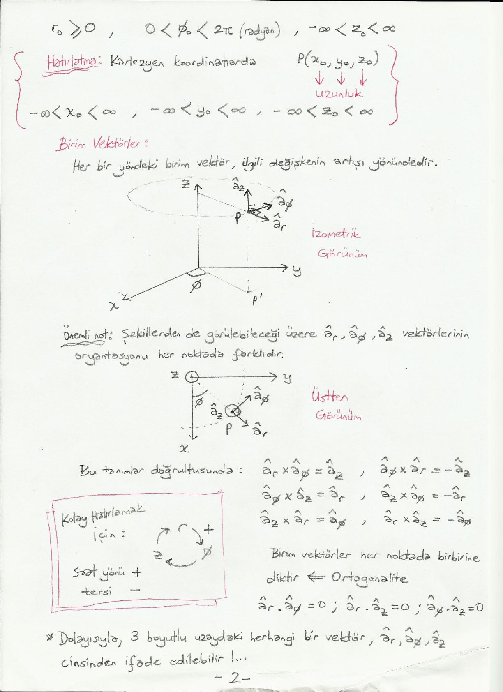
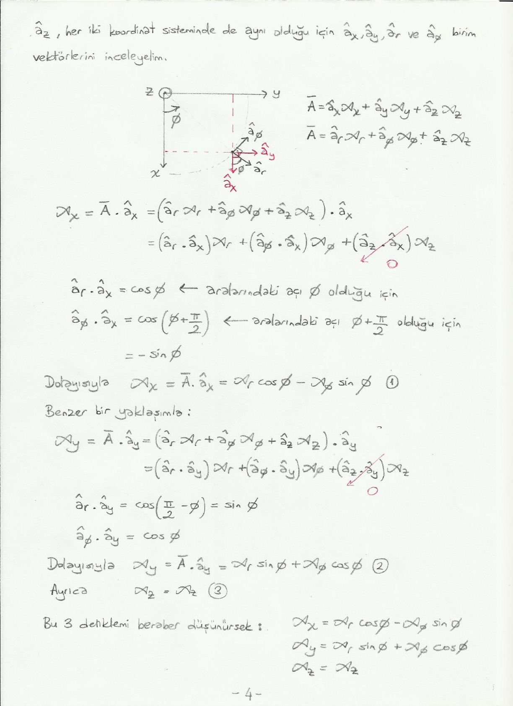
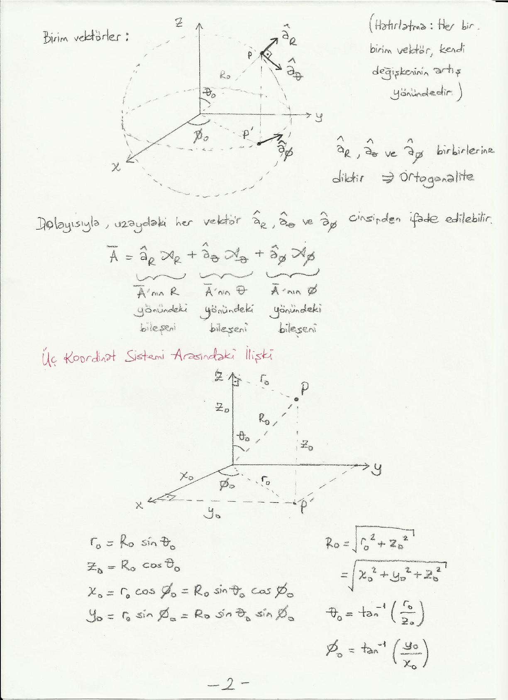

This post brings together two sections of the handwritten lecture notes for the Başkent University course **EEM224 Electromagnetics I**: **"Cylindrical Coordinate System"** (5 pages) and **"Spherical Coordinate System"** (2 pages). The notes do not state the author's name or a date. The definitions and formulas have been transcribed into text; page images are included for the three-dimensional drawings. The original PDFs of the scanned notes can be downloaded as a ZIP at the end of the post. The previous section, the "Vector Analysis" note, is also in the archive as a separate post.

## Cylindrical coordinate system

Any point P in space can be expressed as the intersection of 3 surfaces:

1. a cylinder whose central axis is the z axis and which passes through P,
1. a plane that both intersects the z axis and passes through P, and
1. a plane parallel to the xy plane that passes through P.

The 3 surfaces defined this way intersect each other pairwise at right angles at every point in space; thus an **orthogonal** coordinate system is defined.

If the cylinder of radius r = r₀, the plane φ = φ₀ and the plane z = z₀ are given, the point P can be defined in cylindrical coordinates as **P(r₀, φ₀, z₀)**. With these definitions:

- r₀ is the distance of point P from the z axis. (Some sources use the variable ρ instead of r.)
- φ₀ is the angle that the line segment OP' makes with the x axis (P' is the projection of point P onto the xy plane).
- z₀ is the length of the line segment PP'.

r₀ and z₀ are lengths, φ₀ is an angle. Ranges of values: r₀ ≥ 0, 0 < φ₀ < 2π (radians), −∞ < z₀ < ∞.

*Note: The note writes the angle range as 0 < φ₀ < 2π; since φ₀ = 0 (the direction of the x axis) is also a valid value, the correct range is 0 ≤ φ₀ < 2π. The spherical coordinates page gives the range in this form (0 ≤ φ₀ < 2π).*

Reminder: In Cartesian coordinates P(x₀, y₀, z₀) consists of three lengths, with −∞ < x₀ < ∞, −∞ < y₀ < ∞, −∞ < z₀ < ∞.

 in cylindrical coordinates")

### Unit vectors

The unit vector in each direction points in the direction of increase of the corresponding variable: â_r, â_φ, â_z.

**Important note:** As can be seen from the figures, the orientation of the vectors â_r, â_φ, â_z differs at every point.

According to these definitions:

- â_r × â_φ = â_z, â_φ × â_r = −â_z
- â_φ × â_z = â_r, â_z × â_φ = −â_r
- â_z × â_r = â_φ, â_r × â_z = −â_φ

To remember easily, use the cycle r → φ → z → r: following the cycle direction is +, the opposite direction is −.

The unit vectors are perpendicular to each other at every point (orthogonality): â_r · â_φ = 0, â_r · â_z = 0, â_φ · â_z = 0. Therefore any vector in three-dimensional space can be expressed in terms of â_r, â_φ, â_z.



## Relationship between the cylindrical and Cartesian coordinate systems

Every point P in space can be expressed in the Cartesian coordinate system as well as in the cylindrical coordinate system. Let the Cartesian representation of point P be P(x₀, y₀, z₀) and its cylindrical representation be P(r₀, φ₀, z₀):

- x₀ = r₀ cos φ₀
- y₀ = r₀ sin φ₀
- z₀ = z₀ (the same)
- r₀ = √(x₀² + y₀²)
- φ₀ = tan⁻¹(y₀ / x₀)

On the other hand, any vector Ā in space can also be expressed in both systems:

- In terms of Cartesian unit vectors: Ā = â_x A_x + â_y A_y + â_z A_z
- In terms of cylindrical unit vectors: Ā = â_r A_r + â_φ A_φ + â_z A_z

Here â_r A_r is the component of Ā in the r direction; â_φ A_φ is the component in the φ direction; â_z A_z is the component in the z direction. Since the z variable is defined in the same way in both coordinate systems (because the â_z's are the same), the A_z's are the same. Question: What is the relationship between A_x, A_y and A_r, A_φ?

### Transformation of components

Since â_z is the same in both systems, let us examine the unit vectors â_x, â_y, â_r and â_φ:

A_x = Ā · â_x = (â_r A_r + â_φ A_φ + â_z A_z) · â_x = (â_r · â_x) A_r + (â_φ · â_x) A_φ + (â_z · â_x) A_z

Here â_z · â_x = 0, and

- â_r · â_x = cos φ (since the angle between them is φ)
- â_φ · â_x = cos(φ + π/2) = −sin φ (since the angle between them is φ + π/2)

Therefore **A_x = A_r cos φ − A_φ sin φ** (1)

With a similar approach:

- â_r · â_y = cos(π/2 − φ) = sin φ
- â_φ · â_y = cos φ

Therefore **A_y = A_r sin φ + A_φ cos φ** (2). Also **A_z = A_z** (3).



If these three equations are written in matrix form:

```
| A_x |   | cos φ   −sin φ   0 | | A_r |
| A_y | = | sin φ    cos φ   0 | | A_φ |
| A_z |   |   0        0     1 | | A_z |
```

If the middle matrix is called **T**, this matrix equation lets us write A_x, A_y, A_z in terms of A_r, A_φ, A_z.

**Question:** How can we write A_r, A_φ, A_z in terms of A_x, A_y, A_z?

- **Solution 1:** Similarly to the previous approach: A_r = Ā · â_r = (â_x A_x + â_y A_y + â_z A_z) · â_r, A_φ = Ā · â_φ = (â_x A_x + â_y A_y + â_z A_z) · â_φ, A_z = A_z.
- **Solution 2:** If we compute the inverse (T⁻¹) of the matrix T obtained above, [A_r A_φ A_z]ᵀ = T⁻¹ [A_x A_y A_z]ᵀ.

## Spherical coordinate system

Any point P in space can be expressed as the intersection of

1. a sphere centered at the origin,
1. a cone whose apex is at the origin and whose central axis is the +z axis, and
1. a half-plane passing through the z axis.

The point P, the intersection of the sphere R = R₀, the cone θ = θ₀ and the half-plane φ = φ₀, is denoted in the spherical coordinate system as **P(R₀, θ₀, φ₀)**. R₀ is a length; θ₀ and φ₀ are angles.

- R₀: the length of the line segment OP
- θ₀: the angle between the line segment OP and the z axis
- φ₀: the angle between the line segment OP' and the x axis (the same as the definition in the cylindrical coordinate system)

Ranges of values: R₀ ≥ 0, 0 ≤ θ₀ < π, 0 ≤ φ₀ < 2π.

*Note: For θ₀ the note gives 0 ≤ θ₀ < π; since points on the −z axis are represented by θ₀ = π, the range is usually given as 0 ≤ θ₀ ≤ π.*

 in spherical coordinates")

### Unit vectors

Each unit vector points in the direction of increase of its own variable. â_R, â_θ and â_φ are perpendicular to each other (orthogonality). Therefore every vector in space can be expressed in terms of â_R, â_θ and â_φ:

Ā = â_R A_R + â_θ A_θ + â_φ A_φ

Here the terms are the components of Ā in the R, θ and φ directions, respectively.

## Relationship between the three coordinate systems

- r₀ = R₀ sin θ₀
- z₀ = R₀ cos θ₀
- x₀ = r₀ cos φ₀ = R₀ sin θ₀ cos φ₀
- y₀ = r₀ sin φ₀ = R₀ sin θ₀ sin φ₀
- R₀ = √(r₀² + z₀²) = √(x₀² + y₀² + z₀²)
- θ₀ = tan⁻¹(r₀ / z₀)
- φ₀ = tan⁻¹(y₀ / x₀)


