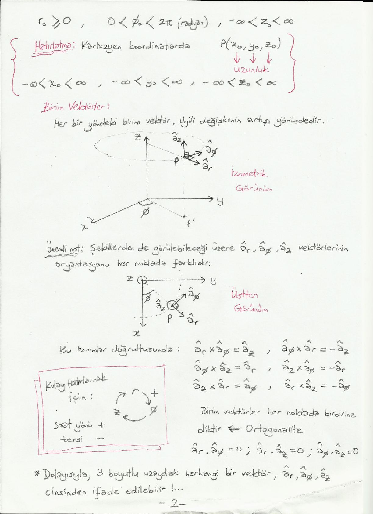
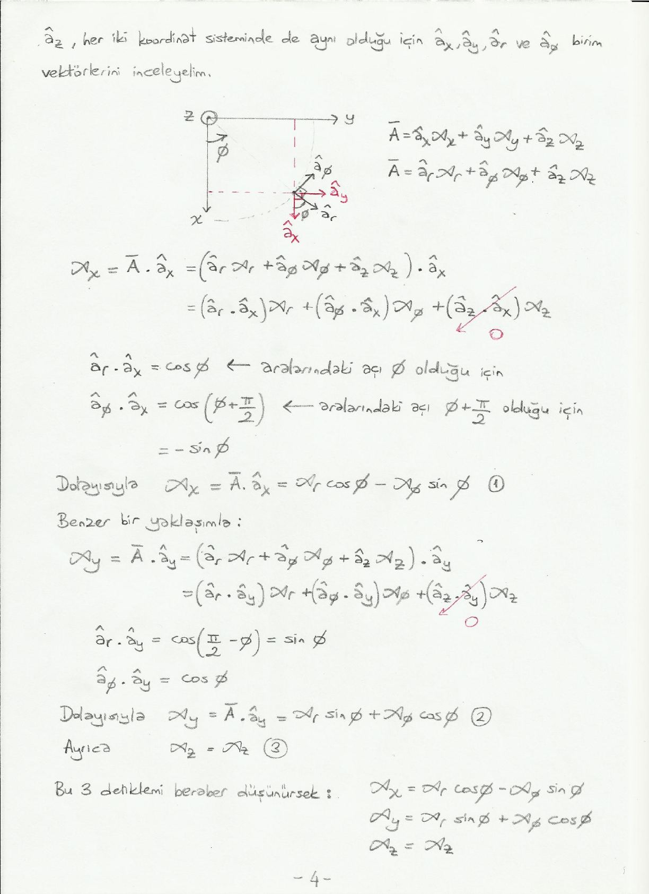
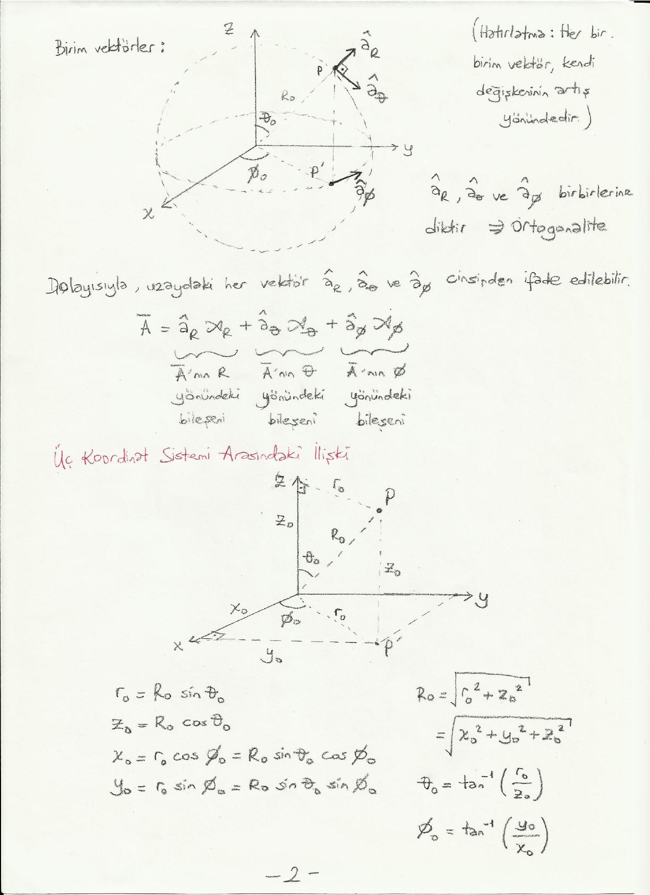

Bu yazı, Başkent Üniversitesi **EEM224 Elektromanyetik I** dersine ait el yazısı ders notlarının iki bölümünü bir araya getiriyor: **"Silindirik Koordinat Sistemi"** (5 sayfa) ve **"Küresel Koordinat Sistemi"** (2 sayfa). Notlarda hazırlayanın adı ve tarih yazmıyor. Tanımlar ve formüller metne döküldü; üç boyutlu çizimler için sayfa görselleri eklendi. Taranmış notların orijinal PDF'leri yazının sonunda ZIP olarak indirilebilir. Önceki bölüm "Vektör Analizi" notu da arşivde ayrı bir yazı olarak yer alıyor.

## Silindirik koordinat sistemi

Uzaydaki herhangi bir P noktası,

1. merkez ekseni z ekseni olan ve P noktasından geçen bir silindir,
1. hem z eksenini kesen hem de P noktasından geçen bir düzlem ve
1. xy düzlemine paralel olan ve P noktasından geçen bir düzlem

olmak üzere 3 adet yüzeyin kesişim kümesi olarak ifade edilebilir. Bu şekilde tanımlanmış 3 yüzey, uzaydaki her noktada birbirleriyle ikişerli olarak dik kesişir; böylece **ortogonal** bir koordinat sistemi tanımlanmış olur.

r = r₀ yarıçaplı silindir, φ = φ₀ düzlemi ve z = z₀ düzlemi ise P noktası silindirik koordinatlarda **P(r₀, φ₀, z₀)** olarak tanımlanabilir. Bu tanımlar ile:

- r₀ değeri, P noktasının z eksenine mesafesidir. (Bazı kaynaklarda r yerine ρ değişkeni de kullanılmaktadır.)
- φ₀ değeri, OP' doğru parçasının x ekseni ile yaptığı açıdır (P', P noktasının xy düzlemi üzerine izdüşümü).
- z₀ değeri, PP' doğru parçasının uzunluğudur.

r₀ ve z₀ uzunluk, φ₀ açıdır. Değer aralıkları: r₀ ≥ 0, 0 < φ₀ < 2π (radyan), −∞ < z₀ < ∞.

*Not: Notta açı aralığı 0 < φ₀ < 2π olarak yazılmış; φ₀ = 0 (x ekseni yönü) de geçerli bir değer olduğundan doğrusu 0 ≤ φ₀ < 2π'dir. Küresel koordinatlar sayfasında aralık bu şekilde (0 ≤ φ₀ < 2π) verilmiş.*

Hatırlatma: Kartezyen koordinatlarda P(x₀, y₀, z₀) üç uzunluktan oluşur ve −∞ < x₀ < ∞, −∞ < y₀ < ∞, −∞ < z₀ < ∞.

 noktası")

### Birim vektörler

Her bir yöndeki birim vektör, ilgili değişkenin artışı yönündedir: â_r, â_φ, â_z.

**Önemli not:** Şekillerden de görülebileceği üzere â_r, â_φ, â_z vektörlerinin oryantasyonu her noktada farklıdır.

Bu tanımlar doğrultusunda:

- â_r × â_φ = â_z, â_φ × â_r = −â_z
- â_φ × â_z = â_r, â_z × â_φ = −â_r
- â_z × â_r = â_φ, â_r × â_z = −â_φ

Kolay hatırlamak için r → φ → z → r döngüsü: saat yönü +, tersi −.

Birim vektörler her noktada birbirine diktir (ortogonalite): â_r · â_φ = 0, â_r · â_z = 0, â_φ · â_z = 0. Dolayısıyla üç boyutlu uzaydaki herhangi bir vektör â_r, â_φ, â_z cinsinden ifade edilebilir.



## Silindirik ve Kartezyen koordinat sistemleri arasındaki ilişki

Uzaydaki her bir P noktası Kartezyen koordinat sisteminde ifade edilebileceği gibi silindirik koordinat sisteminde de ifade edilebilir. P noktasının Kartezyen gösterimi P(x₀, y₀, z₀), silindirik gösterimi P(r₀, φ₀, z₀) olsun:

- x₀ = r₀ cos φ₀
- y₀ = r₀ sin φ₀
- z₀ = z₀ (aynı)
- r₀ = √(x₀² + y₀²)
- φ₀ = tan⁻¹(y₀ / x₀)

Öte yandan uzaydaki herhangi bir Ā vektörü de her iki sistemde ifade edilebilir:

- Kartezyen birim vektörleri cinsinden: Ā = â_x A_x + â_y A_y + â_z A_z
- Silindirik birim vektörleri cinsinden: Ā = â_r A_r + â_φ A_φ + â_z A_z

Burada â_r A_r, Ā'nın r yönündeki; â_φ A_φ, φ yönündeki; â_z A_z, z yönündeki bileşenidir. z değişkeni her iki koordinat sisteminde aynı şekilde tanımlandığı için (â_z'ler aynı olduğu için) A_z'ler aynıdır. Soru: A_x, A_y ile A_r, A_φ arasındaki ilişki nedir?

### Bileşenlerin dönüşümü

â_z her iki sistemde aynı olduğu için â_x, â_y, â_r ve â_φ birim vektörlerini inceleyelim:

A_x = Ā · â_x = (â_r A_r + â_φ A_φ + â_z A_z) · â_x = (â_r · â_x) A_r + (â_φ · â_x) A_φ + (â_z · â_x) A_z

Burada â_z · â_x = 0'dır ve

- â_r · â_x = cos φ (aralarındaki açı φ olduğu için)
- â_φ · â_x = cos(φ + π/2) = −sin φ (aralarındaki açı φ + π/2 olduğu için)

Dolayısıyla **A_x = A_r cos φ − A_φ sin φ** (1)

Benzer bir yaklaşımla:

- â_r · â_y = cos(π/2 − φ) = sin φ
- â_φ · â_y = cos φ

Dolayısıyla **A_y = A_r sin φ + A_φ cos φ** (2). Ayrıca **A_z = A_z** (3).



Bu üç denklem matris biçiminde yazılırsa:

```
| A_x |   | cos φ   −sin φ   0 | | A_r |
| A_y | = | sin φ    cos φ   0 | | A_φ |
| A_z |   |   0        0     1 | | A_z |
```

Ortadaki matrise **T** denirse bu matris denklemi A_x, A_y, A_z'yi A_r, A_φ, A_z cinsinden yazmamızı sağlar.

**Soru:** A_r, A_φ, A_z'yi A_x, A_y, A_z cinsinden nasıl yazabiliriz?

- **Çözüm 1:** Bir önceki yaklaşıma benzer şekilde: A_r = Ā · â_r = (â_x A_x + â_y A_y + â_z A_z) · â_r, A_φ = Ā · â_φ = (â_x A_x + â_y A_y + â_z A_z) · â_φ, A_z = A_z.
- **Çözüm 2:** Yukarıda elde ettiğimiz T matrisinin tersini (T⁻¹) hesaplarsak [A_r A_φ A_z]ᵀ = T⁻¹ [A_x A_y A_z]ᵀ.

## Küresel koordinat sistemi

Uzaydaki herhangi bir P noktası,

1. merkezi orijinde bulunan bir küre,
1. tepe noktası orijin olan ve merkez ekseni +z ekseni olan bir koni ve
1. z ekseninden geçen bir yarım düzlemin

kesişim kümesi olarak ifade edilebilir. R = R₀ küresi, θ = θ₀ konisi ve φ = φ₀ yarım düzleminin kesişim kümesi olan P noktası küresel koordinat sisteminde **P(R₀, θ₀, φ₀)** olarak gösterilir. R₀ uzunluk, θ₀ ve φ₀ açıdır.

- R₀: OP doğru parçasının uzunluğu
- θ₀: OP doğru parçası ile z ekseni arasındaki açı
- φ₀: OP' doğru parçası ile x ekseni arasındaki açı (silindirik koordinat sistemindeki tanımın aynısı)

Değer aralıkları: R₀ ≥ 0, 0 ≤ θ₀ < π, 0 ≤ φ₀ < 2π.

*Not: θ₀ için notta 0 ≤ θ₀ < π yazıyor; −z ekseni üzerindeki noktalar θ₀ = π ile gösterildiği için aralık genellikle 0 ≤ θ₀ ≤ π olarak verilir.*

 noktası")

### Birim vektörler

Her bir birim vektör kendi değişkeninin artış yönündedir. â_R, â_θ ve â_φ birbirlerine diktir (ortogonalite). Dolayısıyla uzaydaki her vektör â_R, â_θ ve â_φ cinsinden ifade edilebilir:

Ā = â_R A_R + â_θ A_θ + â_φ A_φ

Burada terimler sırasıyla Ā'nın R, θ ve φ yönündeki bileşenleridir.

## Üç koordinat sistemi arasındaki ilişki

- r₀ = R₀ sin θ₀
- z₀ = R₀ cos θ₀
- x₀ = r₀ cos φ₀ = R₀ sin θ₀ cos φ₀
- y₀ = r₀ sin φ₀ = R₀ sin θ₀ sin φ₀
- R₀ = √(r₀² + z₀²) = √(x₀² + y₀² + z₀²)
- θ₀ = tan⁻¹(r₀ / z₀)
- φ₀ = tan⁻¹(y₀ / x₀)


