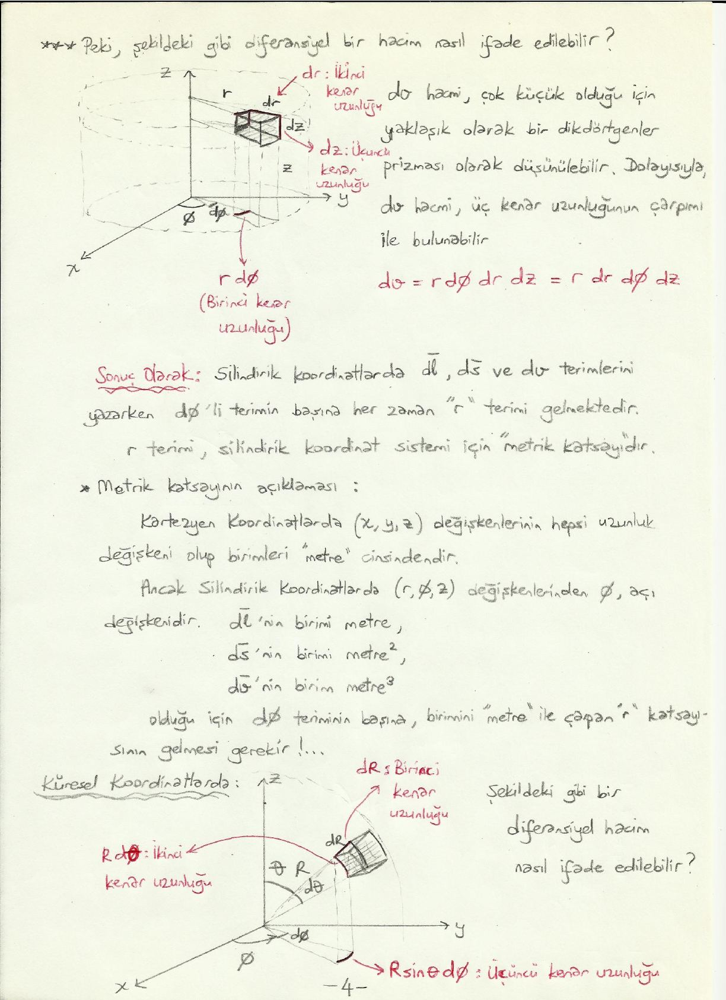
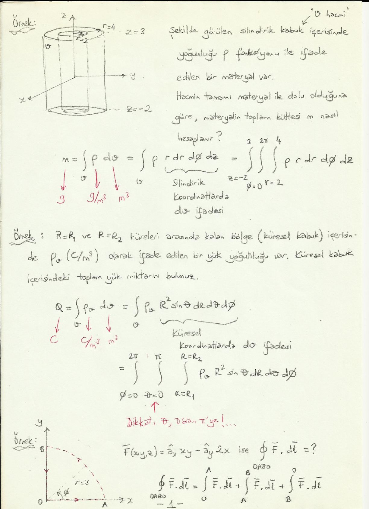

This post brings together two sections of handwritten lecture notes for the **EEM224 Electromagnetics I** course at Başkent University: **"Metric Coefficients"** (6 pages) and **"Problems on Vector Analysis"** (3 pages). The notes do not state the author's name or the date. The formulas and solutions have been transcribed into text; images of the relevant pages are included for the figures. The original PDFs of the scanned notes can be downloaded as a ZIP at the end of the post.

## Metric coefficients

So far we have treated the dl̄, ds̄ and dv terms in integrals independently of the coordinate system. How can we write these terms in Cartesian, cylindrical and spherical coordinates?

## In Cartesian coordinates

**Differential length.** The component of a dl̄ (differential length) vector lying in the xy plane along the x direction is â_x dx, and along the y direction is â_y dy (dx and dy are differential lengths in the x and y directions):

dl̄ = â_x dx + â_y dy

An arbitrarily oriented dl̄ vector is the sum of its components in the x, y and z directions:

dl̄ = â_x dx + â_y dy + â_z dz

**Differential surface.** The vector associated with a differential surface (ds) in the xy plane is ds̄ = â_n ds. Here â_n is the unit vector in the direction normal (perpendicular) to the surface in question (â_z in this example), and the surface area is dx dy:

- On the xy plane: ds̄ = â_z dx dy
- On the yz plane: ds̄ = â_x dy dz
- On the xz plane: ds̄ = â_y dx dz

**Differential volume.** dv is a rectangular prism with edges dx, dy and dz. Therefore dv = dx dy dz.

## In cylindrical coordinates

A dl̄ vector in the xy plane can be split into two components: dl̄ = v̄₁ + v̄₂.

- v̄₁: the component of dl̄ in the r direction (â_r direction, looking at the figure): v̄₁ = â_r dr. dr is the distance between the starting and ending points of v̄₁.
- v̄₂: the component of dl̄ in the φ direction (−â_φ direction, looking at the figure): v̄₂ = −â_φ r dφ. r dφ is the distance between the starting and ending points of v̄₂.

**Why r dφ?** The length of an arc of radius r swept by an angle α (in radians) is rα. (If the angle α is 2π radians, i.e. 360°, the arc becomes a full circle; the arc length is r·2π = 2πr, the circumference of a circle of radius r.) Therefore the length of the arc of radius r swept by an angle dφ is r dφ, and

dl̄ = â_r dr − â_φ r dφ

*Note: The minus sign comes from the dl̄ vector in the figure being drawn toward the direction in which φ decreases. When dφ is taken as signed (positive in the direction of increase), the general expression is written as dl̄ = â_r dr + â_φ r dφ + â_z dz.*

; dl in cylindrical coordinates")

**Differential surface.** Since a differential surface (ds) in the xy plane is extremely small, it can be treated as a rectangle; its area equals the product of the two side lengths: ds = r dφ dr. Hence

ds̄ = â_n r dr dφ = â_z r dr dφ

**Differential volume.** Since the volume dv is extremely small, it can be approximated as a rectangular prism with edges r dφ (first edge), dr (second edge) and dz (third edge):

dv = r dφ dr dz = r dr dφ dz

**In conclusion:** When writing the dl̄, ds̄ and dv terms in cylindrical coordinates, the term containing dφ is always preceded by the factor "r". **The factor r is the "metric coefficient" of the cylindrical coordinate system.**

**Explanation of the metric coefficient:** In Cartesian coordinates, the variables (x, y, z) are all length variables with units of "meters." In cylindrical coordinates, however, among the variables (r, φ, z), φ is an angle variable. Since dl̄ has units of meters, ds̄ meters², and dv meters³, the dφ term must be preceded by the coefficient "r," which multiplies its units by "meters."

## In spherical coordinates

Since the differential volume is extremely small, it can be approximated as a rectangular prism. Its edges are dR (first edge), R dθ (second edge) and R sin θ dφ (third edge). The volume is the product of the three edge lengths:

dv = dR · R dθ · R sin θ dφ = R² sin θ dR dθ dφ



**In conclusion:** When writing the dl̄, ds̄ and dv terms in spherical coordinates, the term containing dθ is always preceded by the factor "R," and the term containing dφ is always preceded by "R sin θ." These are also the "metric coefficients" of the spherical coordinate system. Since θ and φ are angle variables, it makes sense that the dφ and dθ terms are preceded by coefficients that make their units "meters."

## Summary table

| | Cartesian (x, y, z) | Cylindrical (r, φ, z) | Spherical (R, θ, φ) |
|---|---|---|---|
| Base vectors â_u1, â_u2, â_u3 | â_x, â_y, â_z | â_r, â_φ, â_z | â_R, â_θ, â_φ |
| Metric coefficient h₁ | 1 | 1 | 1 |
| Metric coefficient h₂ | 1 | r | R |
| Metric coefficient h₃ | 1 | 1 | R sin θ |
| Differential volume dv | dx dy dz | r dr dφ dz | R² sin θ dR dθ dφ |

## Expressing the ∇ operator in other coordinate systems

Recall that the ∇ operator is expressed in the Cartesian coordinate system as ∇ = â_x ∂/∂x + â_y ∂/∂y + â_z ∂/∂z. The unit of ∇ is meter⁻¹; since x, y, z are length variables in Cartesian coordinates, the terms ∂/∂x, ∂/∂y and ∂/∂z have units of meter⁻¹. In cylindrical coordinates, however, the ∂/∂φ term, and in spherical coordinates the ∂/∂θ and ∂/∂φ terms, would not have units of meter⁻¹, so these terms must also be preceded by the appropriate metric coefficients. In general:

**Gradient:**

∇ = â_u1 ∂/(h₁∂u₁) + â_u2 ∂/(h₂∂u₂) + â_u3 ∂/(h₃∂u₃)

**Divergence:**

∇ · Ā = (1 / h₁h₂h₃) [∂(h₂h₃A_u1)/∂u₁ + ∂(h₁h₃A_u2)/∂u₂ + ∂(h₁h₂A_u3)/∂u₃]

- In cylindrical coordinates: ∇ · Ā = (1/r) [∂(rA_r)/∂r + ∂A_φ/∂φ + ∂(rA_z)/∂z]
- In spherical coordinates: ∇ · Ā = (1 / R² sin θ) [∂(R² sin θ A_R)/∂R + ∂(R sin θ A_θ)/∂θ + ∂(R A_φ)/∂φ]

**Curl:**

```
                   | â_u1 h₁    â_u2 h₂    â_u3 h₃ |
∇ × Ā = 1/(h₁h₂h₃) | ∂/∂u₁      ∂/∂u₂      ∂/∂u₃   |
                   | h₁A_u1     h₂A_u2     h₃A_u3  |
```

In cylindrical and spherical coordinates:

```
              | â_r    â_φ r    â_z  |
∇ × Ā = (1/r) | ∂/∂r   ∂/∂φ     ∂/∂z |
              | A_r    r A_φ    A_z  |

                     | â_R    â_θ R    â_φ R sin θ   |
∇ × Ā = 1/(R² sin θ) | ∂/∂R   ∂/∂θ     ∂/∂φ          |
                     | A_R    R A_θ    R sin θ A_φ   |
```

## Problems on vector analysis

### Example 1: Mass of the material in a cylindrical shell

Inside the cylindrical shell shown in the figure (inner radius r = 2, outer radius r = 4, from z = −2 to z = 3) there is a material whose density is given by the function ρ. Given that the entire volume is filled with the material, how is the total mass m of the material calculated?

m = ∫_v ρ dv = ∫_v ρ r dr dφ dz = ∫_{z=−2}^{3} ∫_{φ=0}^{2π} ∫_{r=2}^{4} ρ r dr dφ dz

Units: m [g], ρ [g/m³], dv [m³]. Here r dr dφ dz is the expression for dv in cylindrical coordinates.

### Example 2: Total charge in a spherical shell

In the region between the spheres R = R₁ and R = R₂ (a spherical shell) there is a charge density ρ_v (C/m³). Find the total charge inside the spherical shell.

Q = ∫_v ρ_v dv = ∫_v ρ_v R² sin θ dR dθ dφ = ∫_{φ=0}^{2π} ∫_{θ=0}^{π} ∫_{R=R₁}^{R₂} ρ_v R² sin θ dR dθ dφ

Units: Q [C], ρ_v [C/m³], dv [m³]. Note: θ goes from 0 to π!



### Example 3: Line integral over a closed path

If F̄(x, y, z) = â_x xy − â_y 2x, then ∮_OABO F̄ · dl̄ = ? (O is the origin, A = (3, 0), B = (0, 3); from A to B is a quarter circle of radius r = 3.)

∮_OABO F̄ · dl̄ = ∫_O^A F̄ · dl̄ + ∫_A^B F̄ · dl̄ + ∫_B^O F̄ · dl̄

**Along path OA,** y = 0. Therefore F̄ = −â_y 2x and dl̄ = â_x dx; F̄ · dl̄ = 0 ⇒ ∫_O^A F̄ · dl̄ = 0.

**Along path AB,** x² + y² = 9 and dl̄ = â_x dx + â_y dy:

F̄ · dl̄ = (â_x xy − â_y 2x) · (â_x dx + â_y dy) = xy dx − 2x dy

We must choose the limits by looking at how x and y vary when going from point A to point B: x goes from 3 to 0, and y goes from 0 to 3. In the first integral we must express y in terms of x (y = √(9 − x²)), and in the second, x in terms of y (x = √(9 − y²)):

∫_A^B F̄ · dl̄ = ∫_3^0 x√(9 − x²) dx − ∫_0^3 2√(9 − y²) dy

**Along path BO,** x = 0. Therefore F̄ = 0 ⇒ ∫_B^O F̄ · dl̄ = 0.

*Note: The integrals are left unevaluated in the note. The first integral is −9 and the second is 2·(9π/4) = 9π/2, so ∮ F̄ · dl̄ = −9 − 9π/2 ≈ −23.14. Stokes' theorem gives the same result: (∇ × F̄)_z = −2 − x, and its integral over the quarter disk is −2·(9π/4) − 9 = −9π/2 − 9.*

### Example 4: The field âR f(R)

In spherical coordinates, the vector field Ā can be expressed as Ā = â_R f(R); f(R) is a scalar function depending only on the variable R.

**a) Show that Ā is irrotational.** Irrotational ⇔ ∇ × Ā = 0 must hold.

```
                     | â_R    â_θ R    â_φ R sin θ |
∇ × Ā = 1/(R² sin θ) | ∂/∂R   ∂/∂θ     ∂/∂φ        |
                     | f(R)   0        0           |
```

When the determinant is expanded, the only terms that could be nonzero are â_φ R sin θ ∂f(R)/∂θ and â_θ R ∂f(R)/∂φ. Since f depends only on R, its partial derivatives with respect to θ and φ are 0. Therefore ∇ × Ā = 0 ⇒ Ā is irrotational.

**b) Is Ā solenoidal?** Solenoidal ⇔ ∇ · Ā = 0 must hold.

∇ · Ā = (1 / R² sin θ) [∂(R² sin θ A_R)/∂R + ∂(R sin θ A_θ)/∂θ + ∂(R A_φ)/∂φ]

Since Ā = â_R f(R), A_R = f(R), A_θ = 0, A_φ = 0:

∇ · Ā = (1 / R² sin θ) ∂(R² sin θ f(R))/∂R

If the partial derivative of R² f(R) with respect to R is nonzero, then ∇ · Ā ≠ 0 ⇒ Ā is not solenoidal.
