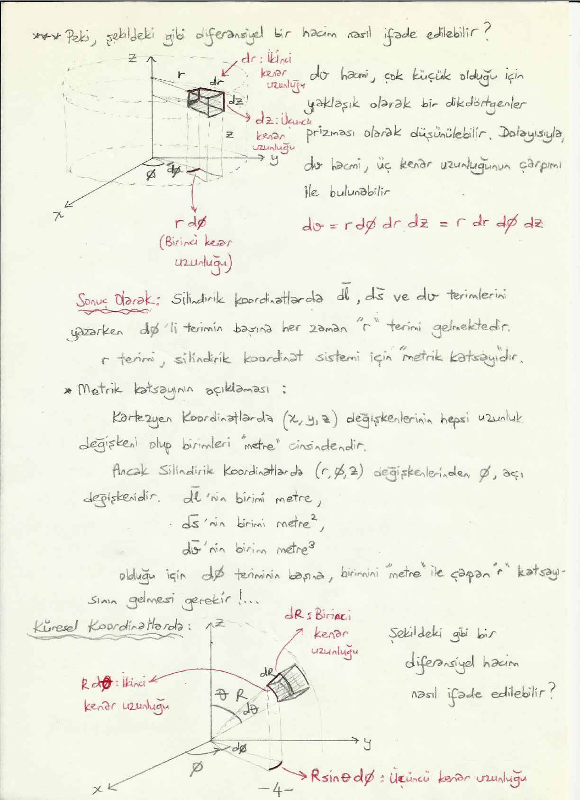
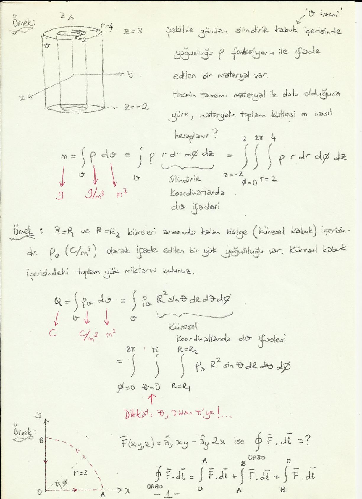

Bu yazı, Başkent Üniversitesi **EEM224 Elektromanyetik I** dersine ait el yazısı ders notlarının iki bölümünü bir araya getiriyor: **"Metrik Katsayılar"** (6 sayfa) ve **"Vektör Analizi ile İlgili Problemler"** (3 sayfa). Notlarda hazırlayanın adı ve tarih yazmıyor. Formüller ve çözümler metne döküldü; çizimler için ilgili sayfaların görselleri eklendi. Taranmış notların orijinal PDF'leri yazının sonunda ZIP olarak indirilebilir.

## Metrik katsayılar

Şu ana değin integrallerdeki dl̄, ds̄ ve dv terimlerini koordinat sistemlerinden bağımsız olarak düşündük. Bu terimleri Kartezyen, silindirik ve küresel koordinatlarda nasıl yazabiliriz?

## Kartezyen koordinatlarda

**Diferansiyel uzunluk.** xy düzlemi üzerindeki bir dl̄ (diferansiyel uzunluk) vektörünün x yönündeki bileşeni â_x dx, y yönündeki bileşeni â_y dy'dir (dx ve dy, x ve y yönlerinde diferansiyel uzunluklardır):

dl̄ = â_x dx + â_y dy

Rastgele yönlenmiş bir dl̄ vektörü ise x, y ve z yönündeki bileşenlerinin toplamıdır:

dl̄ = â_x dx + â_y dy + â_z dz

**Diferansiyel yüzey.** xy düzlemi üzerindeki bir diferansiyel yüzeye (ds) ilişkin vektör ds̄ = â_n ds şeklindedir. Burada â_n söz konusu yüzeye dik (normal) yöndeki birim vektördür (bu örnekte â_z), yüzey alanı ise dx dy'dir:

- xy düzlemi üzerinde: ds̄ = â_z dx dy
- yz düzlemi üzerinde: ds̄ = â_x dy dz
- xz düzlemi üzerinde: ds̄ = â_y dx dz

**Diferansiyel hacim.** dv, kenarları dx, dy ve dz olan bir dikdörtgenler prizmasıdır. Dolayısıyla dv = dx dy dz.

## Silindirik koordinatlarda

xy düzlemi üzerindeki bir dl̄ vektörü iki bileşene ayrılabilir: dl̄ = v̄₁ + v̄₂.

- v̄₁: dl̄'nin r yönündeki bileşeni (şekle bakınca â_r yönünde): v̄₁ = â_r dr. dr, v̄₁'in başlangıç ve bitiş noktaları arasındaki mesafedir.
- v̄₂: dl̄'nin φ yönündeki bileşeni (şekle bakınca −â_φ yönünde): v̄₂ = −â_φ r dφ. r dφ, v̄₂'nin başlangıç ve bitiş noktaları arasındaki mesafedir.

**Neden r dφ?** r yarıçapında α (radyan) açısı tarafından taranan yayın uzunluğu rα'dır. (α açısı 2π radyan, yani 360° ise yay bir çember olur; yayın uzunluğu r·2π = 2πr, yani r yarıçaplı çemberin çevresidir.) Dolayısıyla r yarıçaplı ve dφ açısı tarafından taranan yayın uzunluğu r dφ'dir ve

dl̄ = â_r dr − â_φ r dφ

*Not: Eksi işareti, şekildeki dl̄ vektörünün φ'nin azaldığı yöne doğru çizilmiş olmasından geliyor. dφ işaretli (artış yönünde pozitif) alındığında genel ifade dl̄ = â_r dr + â_φ r dφ + â_z dz olarak yazılır.*

; silindirik koordinatlarda dl")

**Diferansiyel yüzey.** xy düzlemi üzerindeki bir diferansiyel yüzey (ds) çok çok küçük olduğu için bir dikdörtgen gibi düşünülebilir; yüzey alanı iki kenar uzunluğunun çarpımına eşittir: ds = r dφ dr. Buradan

ds̄ = â_n r dr dφ = â_z r dr dφ

**Diferansiyel hacim.** dv hacmi çok küçük olduğu için yaklaşık olarak bir dikdörtgenler prizması olarak düşünülebilir; kenarları r dφ (birinci kenar), dr (ikinci kenar) ve dz'dir (üçüncü kenar):

dv = r dφ dr dz = r dr dφ dz

**Sonuç olarak:** Silindirik koordinatlarda dl̄, ds̄ ve dv terimlerini yazarken dφ'li terimin başına her zaman "r" terimi gelmektedir. **r terimi silindirik koordinat sistemi için "metrik katsayı"dır.**

**Metrik katsayının açıklaması:** Kartezyen koordinatlarda (x, y, z) değişkenlerinin hepsi uzunluk değişkeni olup birimleri "metre" cinsindendir. Ancak silindirik koordinatlarda (r, φ, z) değişkenlerinden φ açı değişkenidir. dl̄'nin birimi metre, ds̄'nin birimi metre², dv'nin birimi metre³ olduğu için dφ teriminin başına, birimini "metre" ile çarpan "r" katsayısının gelmesi gerekir.

## Küresel koordinatlarda

Diferansiyel hacim çok küçük olduğu için yaklaşık olarak bir dikdörtgenler prizması gibi düşünülebilir. Kenarları dR (birinci kenar), R dθ (ikinci kenar) ve R sin θ dφ'dir (üçüncü kenar). Hacim üç kenarın uzunluğunun çarpımıdır:

dv = dR · R dθ · R sin θ dφ = R² sin θ dR dθ dφ



**Sonuç olarak:** Küresel koordinatlarda dl̄, ds̄ ve dv terimlerini yazarken dθ'lı terimin başına her zaman "R", dφ'li terimin başına ise her zaman "R sin θ" terimleri gelmektedir. Bu terimler de küresel koordinat sistemi için "metrik katsayılar"dır. θ ve φ açı terimleri olduğundan dφ ve dθ terimlerinin birimlerini "metre" yapan katsayıların gelmesi mantıklıdır.

## Özet tablo

| | Kartezyen (x, y, z) | Silindirik (r, φ, z) | Küresel (R, θ, φ) |
|---|---|---|---|
| Baz vektörler â_u1, â_u2, â_u3 | â_x, â_y, â_z | â_r, â_φ, â_z | â_R, â_θ, â_φ |
| Metrik katsayı h₁ | 1 | 1 | 1 |
| Metrik katsayı h₂ | 1 | r | R |
| Metrik katsayı h₃ | 1 | 1 | R sin θ |
| Diferansiyel hacim dv | dx dy dz | r dr dφ dz | R² sin θ dR dθ dφ |

## ∇ operatörünün diğer koordinat sistemlerinde ifade edilmesi

Hatırlayacak olursak ∇ operatörü Kartezyen koordinat sisteminde ∇ = â_x ∂/∂x + â_y ∂/∂y + â_z ∂/∂z olarak ifade ediliyordu. ∇'nın birimi metre⁻¹'dir; Kartezyen koordinatlarda x, y, z uzunluk değişkenleri olduğundan ∂/∂x, ∂/∂y ve ∂/∂z terimlerinin birimleri metre⁻¹ olmaktadır. Ancak silindirik koordinatlarda ∂/∂φ teriminin, küresel koordinatlarda ∂/∂θ ve ∂/∂φ terimlerinin birimleri metre⁻¹ olmayacağından bu terimlerin de başlarına uygun şekilde metrik katsayıların gelmesi gerekir. Genel olarak:

**Gradyant:**

∇ = â_u1 ∂/(h₁∂u₁) + â_u2 ∂/(h₂∂u₂) + â_u3 ∂/(h₃∂u₃)

**Diverjans:**

∇ · Ā = (1 / h₁h₂h₃) [∂(h₂h₃A_u1)/∂u₁ + ∂(h₁h₃A_u2)/∂u₂ + ∂(h₁h₂A_u3)/∂u₃]

- Silindirik koordinatlarda: ∇ · Ā = (1/r) [∂(rA_r)/∂r + ∂A_φ/∂φ + ∂(rA_z)/∂z]
- Küresel koordinatlarda: ∇ · Ā = (1 / R² sin θ) [∂(R² sin θ A_R)/∂R + ∂(R sin θ A_θ)/∂θ + ∂(R A_φ)/∂φ]

**Bukle:**

```
                   | â_u1 h₁    â_u2 h₂    â_u3 h₃ |
∇ × Ā = 1/(h₁h₂h₃) | ∂/∂u₁      ∂/∂u₂      ∂/∂u₃   |
                   | h₁A_u1     h₂A_u2     h₃A_u3  |
```

Silindirik ve küresel koordinatlarda:

```
              | â_r    â_φ r    â_z  |
∇ × Ā = (1/r) | ∂/∂r   ∂/∂φ     ∂/∂z |
              | A_r    r A_φ    A_z  |

                     | â_R    â_θ R    â_φ R sin θ   |
∇ × Ā = 1/(R² sin θ) | ∂/∂R   ∂/∂θ     ∂/∂φ          |
                     | A_R    R A_θ    R sin θ A_φ   |
```

## Vektör analizi ile ilgili problemler

### Örnek 1: Silindirik kabuktaki malzemenin kütlesi

Şekilde görülen silindirik kabuk (iç yarıçap r = 2, dış yarıçap r = 4, z = −2 ile z = 3 arası) içerisinde yoğunluğu ρ fonksiyonu ile ifade edilen bir malzeme var. Hacmin tamamı malzeme ile dolu olduğuna göre malzemenin toplam kütlesi m nasıl hesaplanır?

m = ∫_v ρ dv = ∫_v ρ r dr dφ dz = ∫_{z=−2}^{3} ∫_{φ=0}^{2π} ∫_{r=2}^{4} ρ r dr dφ dz

Birimler: m [g], ρ [g/m³], dv [m³]. Burada r dr dφ dz, silindirik koordinatlarda dv ifadesidir.

### Örnek 2: Küresel kabuktaki toplam yük

R = R₁ ve R = R₂ küreleri arasında kalan bölge (küresel kabuk) içerisinde ρ_v (C/m³) olarak ifade edilen bir yük yoğunluğu var. Küresel kabuk içerisindeki toplam yük miktarını bulunuz.

Q = ∫_v ρ_v dv = ∫_v ρ_v R² sin θ dR dθ dφ = ∫_{φ=0}^{2π} ∫_{θ=0}^{π} ∫_{R=R₁}^{R₂} ρ_v R² sin θ dR dθ dφ

Birimler: Q [C], ρ_v [C/m³], dv [m³]. Dikkat: θ, 0'dan π'ye!



### Örnek 3: Kapalı yol üzerinde çizgi integrali

F̄(x, y, z) = â_x xy − â_y 2x ise ∮_OABO F̄ · dl̄ = ? (O orijin, A = (3, 0), B = (0, 3); A'dan B'ye r = 3 yarıçaplı çeyrek çember.)

∮_OABO F̄ · dl̄ = ∫_O^A F̄ · dl̄ + ∫_A^B F̄ · dl̄ + ∫_B^O F̄ · dl̄

**OA güzergâhı üzerinde** y = 0. Dolayısıyla F̄ = −â_y 2x ve dl̄ = â_x dx; F̄ · dl̄ = 0 ⇒ ∫_O^A F̄ · dl̄ = 0.

**AB güzergâhı üzerinde** x² + y² = 9 ve dl̄ = â_x dx + â_y dy:

F̄ · dl̄ = (â_x xy − â_y 2x) · (â_x dx + â_y dy) = xy dx − 2x dy

Sınırlara A noktasından B noktasına giderken x'in ve y'nin değişimine bakarak karar vermeliyiz: x, 3'ten 0'a; y, 0'dan 3'e gider. İlk integralde y'yi x cinsinden (y = √(9 − x²)), ikincide x'i y cinsinden (x = √(9 − y²)) ifade etmeliyiz:

∫_A^B F̄ · dl̄ = ∫_3^0 x√(9 − x²) dx − ∫_0^3 2√(9 − y²) dy

**BO güzergâhı üzerinde** x = 0. Dolayısıyla F̄ = 0 ⇒ ∫_B^O F̄ · dl̄ = 0.

*Not: Notta integraller hesaplanmadan bırakılmış. Birinci integral −9, ikincisi 2·(9π/4) = 9π/2 olduğundan ∮ F̄ · dl̄ = −9 − 9π/2 ≈ −23,14 bulunur. Stokes teoremiyle de aynı sonuç çıkar: (∇ × F̄)_z = −2 − x ve çeyrek daire üzerindeki integrali −2·(9π/4) − 9 = −9π/2 − 9.*

### Örnek 4: âR f(R) alanı

Küresel koordinatlarda Ā vektörel alanı Ā = â_R f(R) şeklinde ifade edilebiliyor; f(R) sadece R değişkenine bağımlı skaler bir fonksiyon.

**a) Ā'nın irrotasyonel olduğunu gösteriniz.** İrrotasyonel ⇔ ∇ × Ā = 0 olmalı.

```
                     | â_R    â_θ R    â_φ R sin θ |
∇ × Ā = 1/(R² sin θ) | ∂/∂R   ∂/∂θ     ∂/∂φ        |
                     | f(R)   0        0           |
```

Determinant açıldığında sıfırdan farklı olabilecek terimler yalnızca â_φ R sin θ ∂f(R)/∂θ ve â_θ R ∂f(R)/∂φ'dir. f sadece R'ye bağımlı olduğuna göre θ'ya ve φ'ye göre kısmi türevleri 0'dır. Dolayısıyla ∇ × Ā = 0 ⇒ Ā irrotasyoneldir.

**b) Ā solenoidal midir?** Solenoidal ⇔ ∇ · Ā = 0 olmalı.

∇ · Ā = (1 / R² sin θ) [∂(R² sin θ A_R)/∂R + ∂(R sin θ A_θ)/∂θ + ∂(R A_φ)/∂φ]

Ā = â_R f(R) olduğundan A_R = f(R), A_θ = 0, A_φ = 0:

∇ · Ā = (1 / R² sin θ) ∂(R² sin θ f(R))/∂R

Eğer R² f(R) teriminin R'ye göre kısmi türevi 0'dan farklıysa ∇ · Ā ≠ 0 ⇒ Ā solenoidal değildir.
