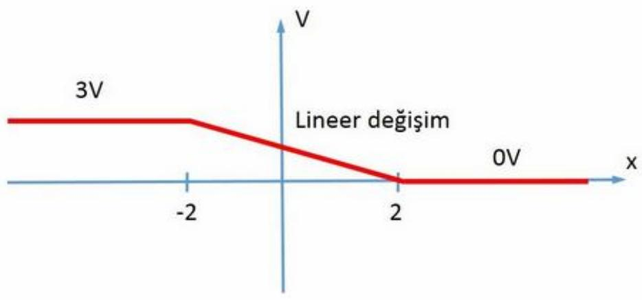

This post brings together the first four homework assignments given in the **EEM224 Electromagnetics I** course at Başkent University in the 2014 spring semester. The assignments were prepared by the course instructor **Dr. S. Gökhun Tanyer**; their dates range from 17 February to 12 March 2014. In the header of the documents, the course's English name appears as *EEM 224 Electromagnetic Wave Theory I*. The original PDFs of the four assignments can be downloaded as a ZIP at the end of the post.

## Homework rules

The same rules appear at the beginning of each homework sheet:

- **Submission date and time:** All assignments given during a week must be submitted at the first class meeting on the first Monday following the week in which the assignment was given. For late submissions, the assignment grade will be reduced by 20% for each day of delay.
- Assignments that do not have the name, surname, student number and homework number written in full at the top of the first page will lose 10% of their grade.
- Prepare all explanations in your own handwriting, drawing figures where necessary.
- Do not use a cover page or plastic sleeve folders for your assignments.

## Homework 1: Wave phenomena (17 February 2014)

A special condition for this assignment: the due date is the first Monday after the end of the add-drop week (3 March).

1. Listen to Tolgahan Çoğulu's adjustable-fret guitar on YouTube. Comment on what you hear in a few short sentences.
1. What is Rayleigh scattering?
1. What is interference?
1. What is polarization?

Using the information you find on the internet, write down clearly on a blank sheet of paper what you understand, in your own words. You may draw supporting graphs where necessary. Prepare all explanations in your own handwriting, drawing figures where necessary.

## Homework 2: Vectors (2 March 2014)

Textbook: D. K. Cheng, *Field and Wave Electrodynamics*.

1. Review questions in the book: R.2–1, R.2–3, R.2–4, R.2–10.
1. Problems in the book: P.2–1, P.2–3.

If announced in class, additional questions will also be added to the assignment.

*Note: The sheet gives the book title as "Field and Wave Electrodynamics"; the numbers R.2 and P.2 appear to correspond to Chapter 2 (vector analysis) of Cheng's "Field and Wave Electromagnetics".*

## Homework 3: Plotting with Matlab (12 March 2014)

In this assignment you will become familiar with a software environment such as Matlab. Examine the software commands below along with the questions in this assignment:

```matlab
clear
plot, axis, subplot, contour, mesh, surf, surfl, movie
title, xlabel, ylabel
figure, clf
hold off, hold on
set(gca, 'ytick', [0 1 2])
set(gca, 'xtick', [0 1 2])
grid on, grid off
legend
```

**Question 1.** Using software, have the following computed:

- a. the circumference and area of a circle,
- b. the surface area and volume of a sphere.

**Question 2.** Plot the following figures:

| Figure | Requirement |
|---|---|
| Figure 1 | Plot the vector running from x = 0 to 360. |
| Figure 2 | Add the vector running from y = 0 to 360·2 to the same graph. |
| Figure 3 | Take the sine of the vector running from z = 0 to 2π and plot it on a new graph. |
| Figure 4 | Add the cosine, −sine and −cosine to Figure 3. To avoid confusing the curves, draw them as solid, dashed, dash-dotted and dotted lines. You may also adjust the coloring and line thickness. |
| Figure 6 | Fix/create the frame of your graph using the AXIS command. TITLE: the name of the figure; XLABEL: state the unit, if any; YLABEL: state the name of the quantity being plotted. |
| Figure 7 | Add a LEGEND to this graph. |
| Figure 8 | Create a 50×50 matrix. Using subplot, plot four graphs on a single page with the contour, mesh, surf and surfl commands. |

Submit the software code itself together with your figures.

*Note: The figure numbers on the sheet skip from 4 to 6; there is no "Figure 5" item.*

## Homework 4: Mathematical operators (12 March 2014)

In this assignment we will review mathematical operators.



### 1. Finding the gradient vector

In the figure, the electric potential is 3 V for x ≤ −2 and 0 V for x ≥ 2; it varies linearly between −2 and 2.

- **1.A.** Express mathematically the electric potential field shown in the figure: V(x, y, z) = ? (Linear = linear)
- **1.B.** Find the electric potential field over all of space (defining it in separate regions where necessary).

### 2. Finding the divergence and the curl

The second figure shows the same curve, this time with E_x on the vertical axis.

- **2.A.** Express mathematically the electric field, for which the figure indicates only an x component exists. Compute the divergence.
- **2.B.** If the quantity given in the figure is the y component of the electric field, express the electric field mathematically. Compute the divergence again.
- **2.C.** If the quantity given in the figure is the y component of the electric field, this time find the curl of the electric field.

### 3. (To be included)

For the third question, the sheet only says "To be included."; if announced in class, additional questions will also be added to the assignment.
