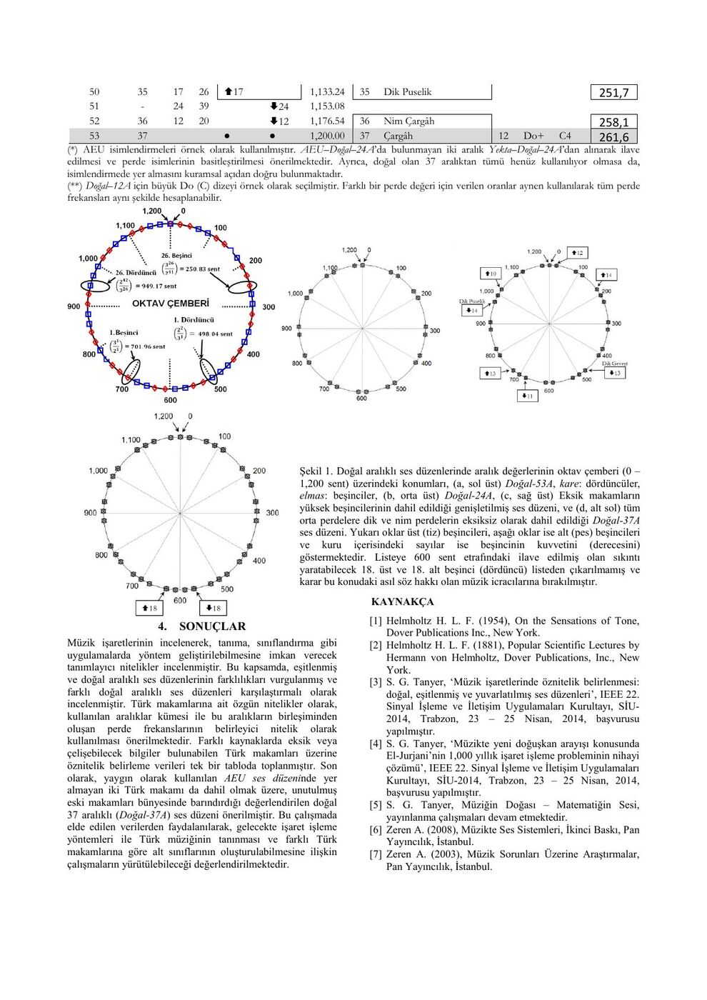

This four-page paper, prepared by Süleyman Gökhun Tanyer (Başkent University, Electrical and Electronics Engineering), was transcribed from the January 2014 PDF version. The references in the text cite SİU 2014 submissions; the acceptance/publication status cannot be verified separately from this file. The original PDF can be downloaded at the end of the article.

*Note: This content belongs to a third-party source; it is shared for archival and nostalgic purposes with the source credited. It will be removed at the request of the rights holder.*

## Scope of the Work

The paper titled "Natural 37-Interval Tuning System: A Complete Pool of Natural Intervals Needed in Turkish Makam Theory" compares natural and equal-tempered tunings. The author argues that the interval sets used for recognizing and classifying Turkish makams are decisive.

## Equal and Natural Intervals

In the Equal-12A system, the product of 12 semitone steps is 2: y¹²=2, y=2^(1/12). The natural fifth is 3/2, and the equal-tempered fifth is 2^(7/12). The two ratios are not the same.

*Note: The source uses the word "rational" for 2^(1/12); this number is irrational. In the source's comma calculation, the numerator is also written as 531144 and the approximate value as 22.5 cents; the calculation 3¹²/2¹⁹ gives 531441/524288 and approximately 23.46 cents.*

## From Natural-53A to Natural-37A

Natural-53A is presented as an interval pool for many tuning systems that use fifths. The paper discusses the limited set of fifths in the Arel–Ezgi–Uzdilek system. The upper and lower fifths are extended to include intervals left outside it, such as Dik Geveşt and Dik Puselik.

In the proposed Natural-37A, an effort is made to preserve the symmetry of the octave circle. Whether to keep the two fifths at ±18 degrees is left to the performers' judgment; the tuning system from which these are removed is called Natural-35A.

## Examples from the Pitch Table

The table uses C3=130.8 Hz as its base; with a different starting frequency, the entire table can be rescaled while preserving the ratios.

| Natural-37A degree | Pitch | Cents | Frequency (Hz) |
|---|---|---|---|
| 0 | Çargâh | 0.00 | 130.8 |
| 1 | Dik Çargâh | 23.46 | 132.5 |
| 2 | Nim Hicaz | 66.76 | 135.9 |
| 3 | Hicaz | 90.22 | 137.8 |
| 6 | Neva | 203.91 | 147.1 |
| 12 | Hüseyni | 407.82 | 165.5 |
| 15 | Acem | 498.04 | 174.4 |
| 18 | Eviç | 588.27 | 183.7 |
| 19 | Mahur | 611.73 | 186.2 |
| 22 | Gerdaniye | 701.96 | 196.2 |
| 28 | Muhayyer | 905.87 | 220.7 |
| 31 | Sünbüle | 996.09 | 232.5 |
| 34 | Puselik | 1109.78 | 248.3 |
| 35 | Dik Puselik | 1133.24 | 251.7 |
| 36 | Nim Çargâh | 1176.54 | 258.1 |
| 37 | Üst Çargâh | 1200.00 | 261.6 |

## Conclusion

The author recommends using interval and pitch frequencies in music classification, and combining information from different sources into a single table. The claim that Natural-37A also covers missing and forgotten makams is the paper's proposal; it is not presented here as an independently verified result.

