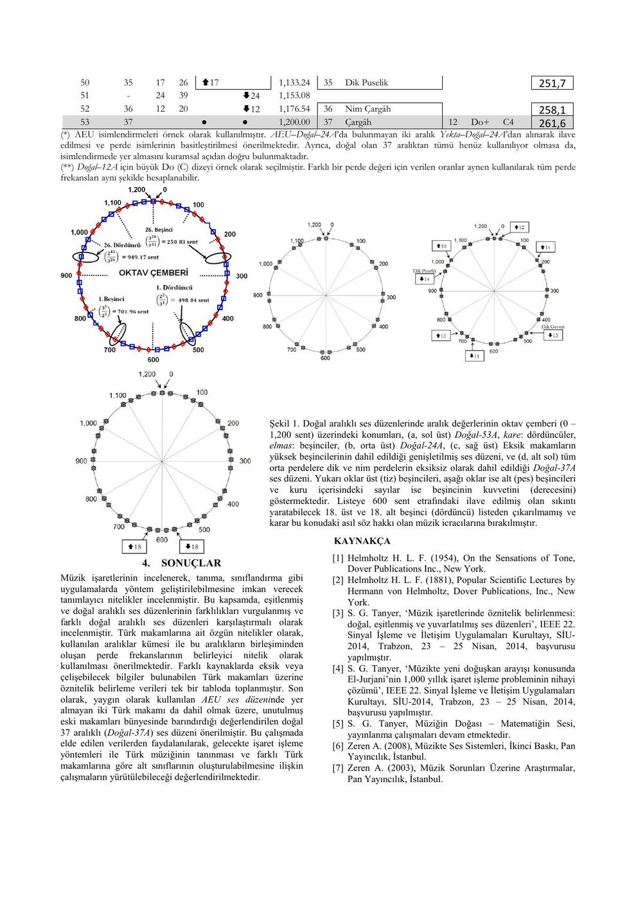

Süleyman Gökhun Tanyer (Başkent Üniversitesi Elektrik ve Elektronik Mühendisliği) tarafından hazırlanan bu dört sayfalık bildiri, Ocak 2014 tarihli PDF sürümünden aktarıldı. Metindeki kaynakça SİU 2014 başvurularını anıyor; bu dosyadan kabul/yayın durumu ayrıca doğrulanamıyor. Orijinal PDF yazının sonunda indirilebilir.

*Bu içerik üçüncü taraf bir kaynağa aittir; arşiv ve nostalji amacıyla kaynak belirtilerek paylaşılmıştır. Hak sahibinin talebi hâlinde kaldırılır.*

## Çalışmanın kapsamı

“Doğal 37 Aralıklı Ses Düzeni: Türk Makamları Kuramında İhtiyaç Duyulan Doğuşkanların Eksiksiz Havuzu” başlıklı bildiri, doğal ve eşitlenmiş düzenleri karşılaştırır. Yazar, Türk makamlarının tanınması ve sınıflandırılması için kullanılan aralık kümelerinin belirleyici olduğunu savunur.

## Eşit ve doğal aralıklar

Eşit-12A düzeninde 12 yarım adımın çarpımı 2'dir: y¹²=2, y=2^(1/12). Doğal beşinci 3/2, eşitlenmiş beşinci 2^(7/12)'dir. İki oran aynı değildir.

*Not: Kaynak 2^(1/12) için “rasyonel” sözcüğünü kullanmıştır; bu sayı irrasyoneldir. Kaynaktaki koma hesabında da pay 531144 ve yaklaşık 22,5 sent yazılmıştır; 3¹²/2¹⁹ hesabı 531441/524288 ve yaklaşık 23,46 sent verir.*

## Doğal-53A'dan Doğal-37A'ya

Doğal-53A, beşincilerin kullanıldığı birçok düzen için aralık havuzu olarak sunulur. Bildiri Arel–Ezgi–Uzdilek düzeninin sınırlı beşinci kümesini tartışır. Dik Geveşt ve Dik Puselik gibi dışarıda kalan aralıkları içermek üzere üst ve alt beşinciler genişletilir.

Önerilen Doğal-37A'da oktav çemberinin simetrisi korunmaya çalışılır. ±18 dereceli iki beşincinin korunup korunmaması icracıların değerlendirmesine bırakılır; bunların çıkarıldığı düzen Doğal-35A olarak adlandırılır.

## Perde tablosundan örnekler

Tablo C3=130,8 Hz temelini kullanır; farklı başlangıç frekansında oranlar korunarak bütün tablo yeniden ölçeklenebilir.

| Doğal-37A derecesi | Perde | Sent | Frekans (Hz) |
|---|---|---|---|
| 0 | Çargâh | 0,00 | 130,8 |
| 1 | Dik Çargâh | 23,46 | 132,5 |
| 2 | Nim Hicaz | 66,76 | 135,9 |
| 3 | Hicaz | 90,22 | 137,8 |
| 6 | Neva | 203,91 | 147,1 |
| 12 | Hüseyni | 407,82 | 165,5 |
| 15 | Acem | 498,04 | 174,4 |
| 18 | Eviç | 588,27 | 183,7 |
| 19 | Mahur | 611,73 | 186,2 |
| 22 | Gerdaniye | 701,96 | 196,2 |
| 28 | Muhayyer | 905,87 | 220,7 |
| 31 | Sünbüle | 996,09 | 232,5 |
| 34 | Puselik | 1109,78 | 248,3 |
| 35 | Dik Puselik | 1133,24 | 251,7 |
| 36 | Nim Çargâh | 1176,54 | 258,1 |
| 37 | Üst Çargâh | 1200,00 | 261,6 |

## Sonuç

Yazar, aralık ve perde frekanslarının müzik sınıflandırmada kullanılmasını, farklı kaynaklardaki bilgilerin tek tabloda birleştirilmesini önerir. Doğal-37A'nın eksik ve unutulmuş makamları da kapsadığı savı bildirinin önerisidir; burada bağımsız doğrulanmış sonuç olarak sunulmamıştır.

