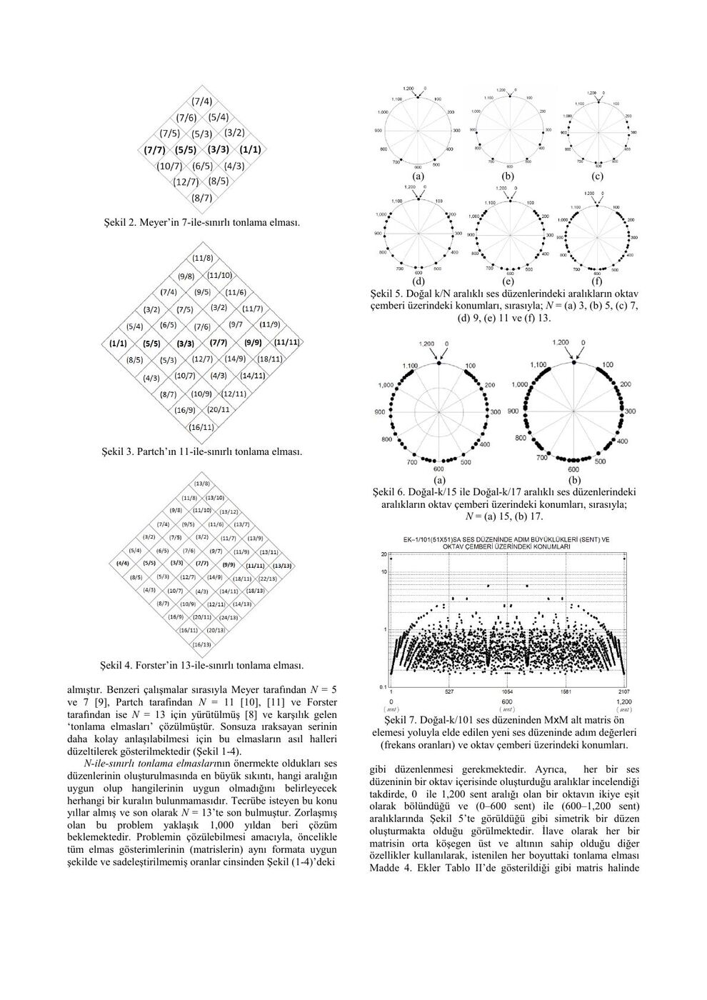
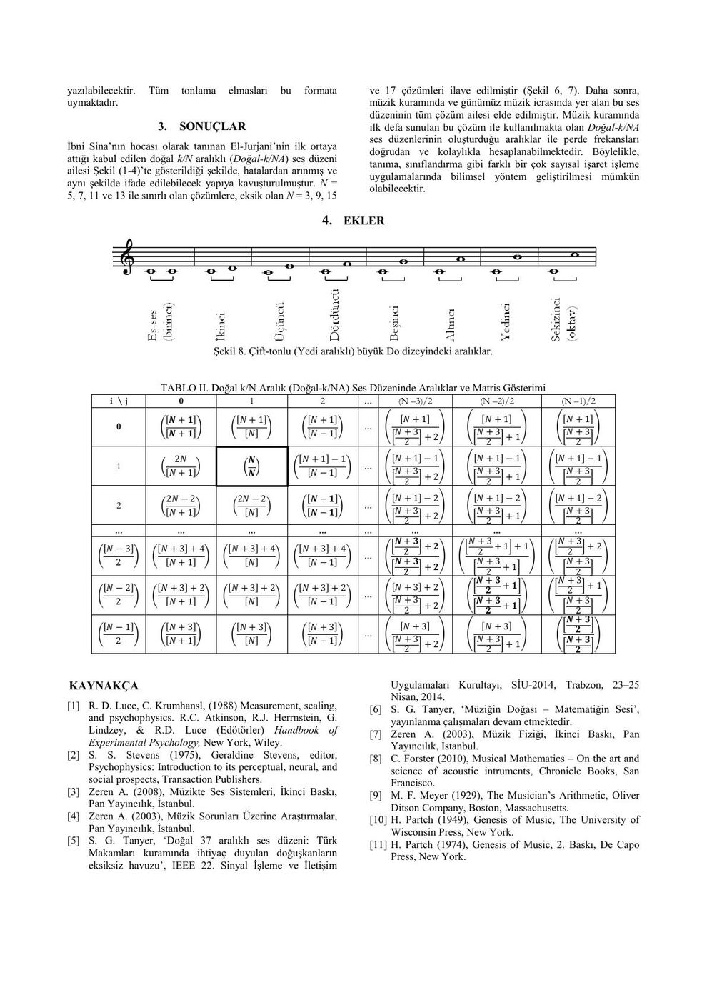

This four-page paper, prepared by Süleyman Gökhun Tanyer (Başkent University, Electrical and Electronics Engineering), was transcribed from the January 2014 PDF version. The references in the text cite SİU 2014 submissions; acceptance/publication status cannot be verified separately from this file. The original PDF can be downloaded at the end of the article.

*This content belongs to a third-party source; it is shared for archival and nostalgic purposes with attribution. It will be removed at the request of the rights holder.*

## Problem and Objective

The paper is titled "The Final Solution to Al-Jurjani's 1,000-Year-Old Signal Processing Problem in the Search for a New Generator in Music". The objective is to generate natural intervals, usable in music recognition, classification, and synthesis, as a mathematical family.

The author treats the tonality diamond, limited by N, as the problem of generating pitch arrangements that do not depend on fifth generators. As N grows, hand selection becomes difficult; the author proposes overcoming this by arranging the ratios in matrix form. The historical references include the work of Al-Jurjani, Meyer, Partch, and Forster.

## Octave and Fifth

The unison ratio is 1/1, the octave is 2/1, and the natural fifth is 3/2. The ratios are preserved even when the fundamental frequency changes. For example, if C4=261.6 Hz is chosen, the fifth is approximately 392 Hz; for D3=146.8 Hz, the fifth is A3=220 Hz.

Twelve natural fifths and seven octaves do not coincide exactly: (3/2)¹² ≠ 2⁷. The paper discusses this discrepancy as one of the reasons for the search for new tuning systems. In the equal twelve-interval temperament, a semitone is 2^(1/12), that is, 100 cents.

*Note: In the source, the numerator of the comma ratio is written as 531144 and the difference as approximately 22.5 cents. By calculation, 3¹²/2¹⁹ = 531441/524288 ≈ 1.013643 and 1200 log₂(531441/524288) ≈ 23.46 cents. This discrepancy is recorded without changing the numbers in the source.*

## Triangular Matrix

For Al-Jurjani's approach, the paper gives the following triangular ratio arrangement:

| N | Ratios |
|---|---|
| 1 | 1/1 |
| 2 | 2/2, 3/2 |
| 3 | 3/3, 4/3, 5/3 |
| 4 | 4/4, 5/4, 6/4, 7/4 |
| 5 | 5/5, 6/5, 7/5, 8/5, 9/5 |

In the natural-k/NA family, the ratios k=N,N+1,…,2N−1 form the initial set. Displaying the ratios in the same arrangement without simplification helps establish a common pattern among different diamonds.

## Octave Circle and Conclusion

An octave is shown on a circle over the 0–1200 cent range. Examples for N=3,5,7,9,11,13 and new plots for N=15,17 are compared. The N=101 example shows how new interval sets can be generated by selecting submatrices from a large matrix.

The author's conclusion is that diamonds treated in the past as separate examples can be expressed in a single matrix family. The use of these ratio sets as features in music classification and recognition is proposed. The claims are reported as the paper's own results.

