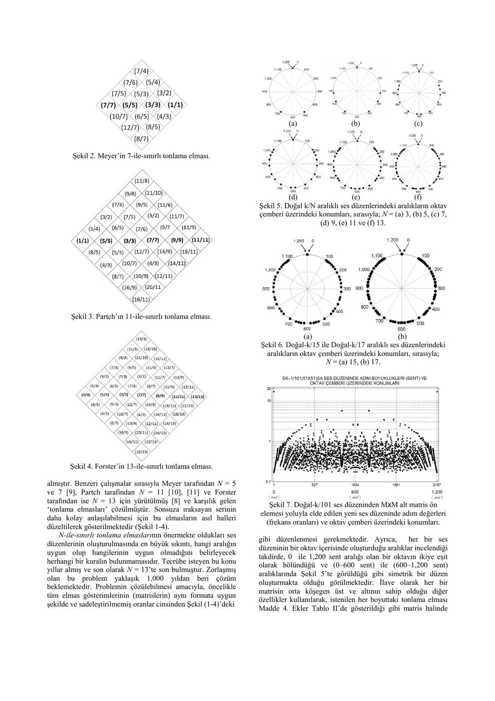
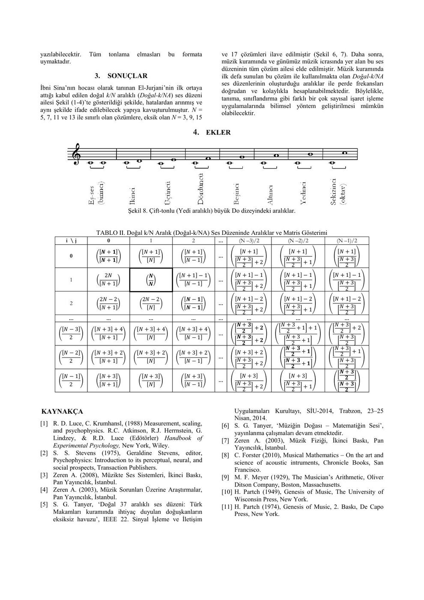

Süleyman Gökhun Tanyer (Başkent Üniversitesi Elektrik ve Elektronik Mühendisliği) tarafından hazırlanan bu dört sayfalık bildiri, Ocak 2014 tarihli PDF sürümünden aktarıldı. Metindeki kaynakça SİU 2014 başvurularını anıyor; bu dosyadan kabul/yayın durumu ayrıca doğrulanamıyor. Orijinal PDF yazının sonunda indirilebilir.

*Bu içerik üçüncü taraf bir kaynağa aittir; arşiv ve nostalji amacıyla kaynak belirtilerek paylaşılmıştır. Hak sahibinin talebi hâlinde kaldırılır.*

## Problem ve amaç

Bildirinin adı “Müzikte Yeni Doğuşkan Arayışı Konusunda El-Jurjani'nin 1,000 Yıllık İşaret İşleme Probleminin Nihayi Çözümü”dür. Amaç, müzik tanıma, sınıflandırma ve sentezlemede kullanılabilecek doğal aralıkların matematiksel bir aile olarak üretilmesidir.

Yazar, N ile sınırlı tonlama elmasını, beşinci doğuşkanlarına bağlı olmayan ses düzenleri üretme problemi olarak ele alır. N büyüdükçe elle seçimin zorlaşmasını, oranların matris biçiminde düzenlenmesiyle aşmayı önerir. Tarihsel atıflar El-Jurjani, Meyer, Partch ve Forster'ın çalışmalarını kapsar.

## Oktav ve beşinci

Eşses oranı 1/1, oktav 2/1 ve doğal beşinci 3/2'dir. Temel frekans değişse de oranlar korunur. Örneğin C4=261,6 Hz seçilirse beşinci yaklaşık 392 Hz'dir; D3=146,8 Hz için beşinci A3=220 Hz olur.

On iki doğal beşinci ile yedi oktav tam olarak çakışmaz: (3/2)¹² ≠ 2⁷. Bildiri bu farkı yeni akort düzenleri arayışının nedenlerinden biri olarak tartışır. Eşit on iki aralıklı düzende yarım adım 2^(1/12), yani 100 senttir.

*Not: Kaynakta koma oranının payında 531144 ve fark için yaklaşık 22,5 sent yazılmıştır. Hesapla 3¹²/2¹⁹ = 531441/524288 ≈ 1,013643 ve 1200 log₂(531441/524288) ≈ 23,46 sent bulunur. Kaynaktaki sayılar değiştirilmeden bu fark kaydedildi.*

## Üçgen matris

Bildiride El-Jurjani'nin yaklaşımı için şu üçgen oran düzeni verilir:

| N | Oranlar |
|---|---|
| 1 | 1/1 |
| 2 | 2/2, 3/2 |
| 3 | 3/3, 4/3, 5/3 |
| 4 | 4/4, 5/4, 6/4, 7/4 |
| 5 | 5/5, 6/5, 7/5, 8/5, 9/5 |

Doğal-k/NA ailesinde k=N,N+1,…,2N−1 oranları başlangıç kümesini oluşturur. Oranların sadeleştirilmeden aynı düzende gösterilmesi, farklı elmaslar arasında ortak örüntü kurulmasına yardımcı olur.

## Oktav çemberi ve sonuç

Bir oktav 0–1200 sent aralığında çember üzerinde gösterilir. N=3,5,7,9,11,13 örnekleri ve N=15,17 için yeni çizimler karşılaştırılır. N=101 örneği, büyük bir matristen alt matris seçerek yeni aralık kümeleri oluşturmayı gösterir.

Yazarın sonucu, geçmişte ayrı örnekler olarak ele alınan elmasların tek bir matris ailesinde ifade edilebileceğidir. Bu oran kümelerinin müzik sınıflandırma ve tanımada öznitelik olarak kullanılması önerilir. İddialar bildirinin kendi sonuçları olarak aktarılmıştır.

