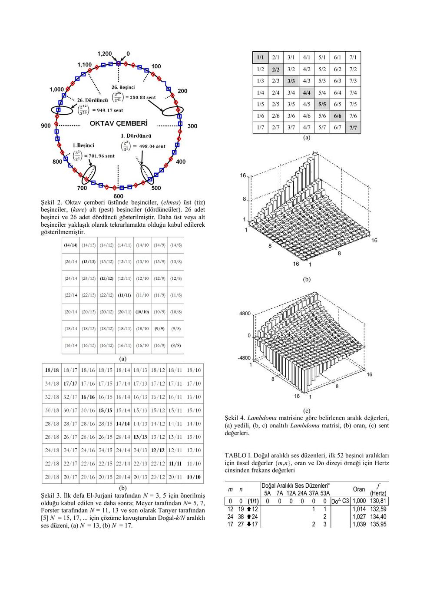

This four-page paper, prepared by Süleyman Gökhun Tanyer (Başkent University, Department of Electrical and Electronics Engineering), was transcribed from the January 2014 PDF version. The references in the text mention SİU 2014 submissions; the acceptance/publication status cannot be verified from this file. The original PDF can be downloaded at the end of the post.

*Note: This content belongs to a third-party source; it is shared for archival and nostalgic purposes with the source credited. It will be removed at the request of the rights holder.*

## Purpose

The paper titled "Determining Features in Music Signals: Natural, Equal-Tempered, and Rounded Tuning Systems" proposes using theoretical musical intervals for the recognition and classification of audio files. It searches for distinguishing information in the frequency ratios of Western and Eastern music and of different modes and makams.

## The Octave and Fifths

In music, the ratios of frequencies matter as much as individual absolute frequencies. The unison is expressed by the ratio 1/1, the octave by 2/1, and the fifth by 3/2. An octave being 1200 cents serves to represent the same ratio at different frequencies with the same distance.

Natural-interval systems consist of integer ratios. The paper examines systems based on fifth generators and other natural-interval systems separately. The Natural-5A, Natural-7A, Natural-12A, Natural-24A, Natural-37A, and Natural-53A sets are compared.

## The Lambdoma Matrix

In the Lambdoma table, the rows and columns form integer ratios. The diagonal contains unison values such as 1/1, 2/2, 3/3. The fact that the same ratio can be represented by different fractions creates the need for reduction and for removing repetitions.

The paper has three representations: a ratio table, a three-dimensional surface of the ratios, and a surface in cents. In this way, the relationship between the numerical arrangement of the intervals and logarithmic perception is visualized.

## Equal-Tempered and Rounded Tunings

When the octave is divided into N equal parts, the step ratio is y=2^(1/N). For N=12, each semitone is 100 cents. While the natural fifth is approximately 701.955 cents, the equal-tempered fifth is 700 cents.

In the paper, for the Bohlen–Pierce tuning, the tritave (3/1) interval is divided into N equal parts instead of the octave, given as y=3^(1/N). In rounded tunings, some natural intervals are preserved while other intervals are adjusted.

## Features and Conclusion

The cent values of intervals, frequency ratios, positions on the octave circle, and pitch sets are candidate features for classification. The paper compares rounded values such as DG and DG# with natural systems in tabular form; it emphasizes that the tuning system used may make a difference between recordings.

The conclusion of the work is that, for music recognition, not only the numerical properties of the audio recording but also the theoretical properties of the tuning system can be used. The complete tables and matrices are in the original PDF.
